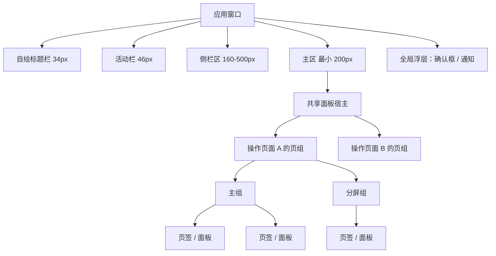
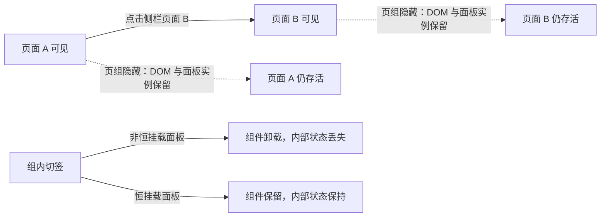
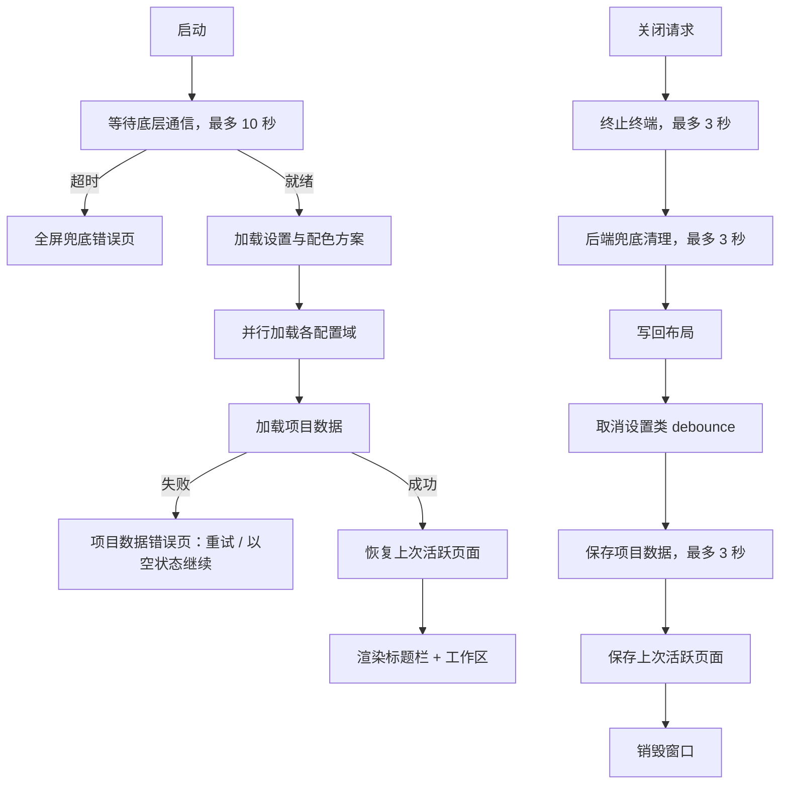

# 主区工作区壳：标题栏、操作页面、面板容器与全局框架

> 快照日期：2026-10-19
>
> 本文档描述 slTerminal 主区面板与工作区在当前版本中的实际行为，属于 as-is 现状功能规格。代码是行为的真值源；本文档为一次性快照，不承诺随代码演进同步更新。若文档与代码不一致，以代码为准。
>
> 读者：测试/QA、开发，以及需要了解主区用户可感知行为的成员。

## 1. 本篇定位与范围

### 1.1 覆盖

本文覆盖主区及其外壳的现状行为：

- 自绘标题栏、窗口拖拽与窗口控制钮。
- 应用横向分区：活动栏、侧栏区、主区。
- 项目、操作页面、页组与面板的层级模型。
- 面板注册、类型白名单、面板错误隔离与恒挂载差异。
- 页内分屏、空页占位、组头新建入口。
- 页签标题、状态图示、右键菜单、关闭路径与关闭守卫。
- 布局持久化、重启恢复、旧格式迁移与未注册类型过滤。
- 面板焦点意图与布局恢复的焦点豁免。
- 全局快捷键体系：命令目录、上下文、保留键、覆盖层与按键拦截边界。
- 主题与配色：仅暗色、唯一内置方案、启动防白闪与配置现状。
- 启动链、关闭清理链、通知浮层、确认框与系统通知。
- 侧栏与主区之间的跨区触发点。

### 1.2 不覆盖

- 各面板内部功能：终端、编辑器、Diff、GitShow、HTML 预览、Markdown 文档、设置中心的内容与操作细节，分别见 [02-terminal.md](02-terminal.md)、[03-editor.md](03-editor.md)、[04-diff.md](04-diff.md)、[05-gitshow.md](05-gitshow.md)、[06-document-preview.md](06-document-preview.md)、[07-settings-center.md](07-settings-center.md)。
- 侧栏内部：活动栏按钮拖拽、侧栏区上下分区、导航树、文件浏览器、Commit 视图、Agent 全局文件，见 [../sidebar/README.md](../sidebar/README.md) 与 [../sidebar/01-framework.md](../sidebar/01-framework.md)。
- 终端 PTY、ConPTY、shell 集成、输出合帧等后端/渲染实现细节。
- 配色 token 的具体色值与视觉设计规范。
- 多窗口、多实例并发、跨平台行为、触摸优先布局。

### 1.3 术语与口径

领域术语以仓库根 [CONTEXT.md](../../CONTEXT.md) 为准。本篇常用口径：

- **操作页面**：项目内一个独立工作页，拥有自己的面板布局。页面之间以显隐切换，终端跨页面存活。
- **页组**：一个操作页面在主区宿主内的面板分组容器。一个页面有一个主组，并可有零个或多个页内分屏组（分屏区）。
- **面板**：可托管到页组中的最小 UI 单元；面板类型由注册表白名单限定。
- **页签**：面板在页组页签栏中的呈现单元，也称面板页签。
- **文档预览面板**：HTML 预览与 Markdown 文档面板的合称。
- **恒挂载面板**：切走页签后仍保持挂载的面板类型；其余面板切走页签时卸载。
- **空页占位**：页组内没有面板时显示的空态界面，文案为 `打开终端或编辑器开始工作`。
- **应用运行期**：应用进程的一次运行。本文区分「运行期内保留」与「跨重启保留」。

## 2. 界面结构与入口

### 2.1 窗口与标题栏

- 应用只有一个主窗口，默认尺寸 1200×800，无系统标题栏与系统边框；窗口使用暗色主题，窗口底色为深色。
- 窗口最上方为 34px 高的自绘标题栏，底边有 1px 分隔线。
- 标题栏自左向右依次为应用标识、项目/页面标题与窗口控制钮：
  - 左段：终端提示符图形标识与文字 `slTerminal`。
  - 中段：活跃项目名 / 活跃操作页面名。无项目时中段为空。
  - 右段：最小化、最大化/还原、关闭窗口控制钮。
- 左段与中段共同构成拖拽区，拖拽区高度撑满标题栏；右段窗口控制钮不参与拖拽。
- 标题栏下方为活动栏、侧栏区、主区组成的横向分区；主区外还有全局浮层：确认框与通知浮层不参与该布局，以固定定位覆盖在界面上。

### 2.2 横向分区

自左向右：

| 区域 | 尺寸约束 | 可见性 |
|---|---|---|
| 活动栏 | 固定 46px | 常驻显示 |
| 侧栏区 | 默认 250px，可调范围 160–500px | 上下两区都无视图时整体隐藏 |
| 主区 | 占剩余宽度，最小 200px | 始终存在 |

- 活动栏、侧栏区、主区之间为可拖动分隔线；侧栏区宽度调整后约 2 秒内自动保存，重启后恢复。
- 侧栏区隐藏时，其分隔线不可见、不可拖动，主区接管其宽度。
- 活动栏宽度不可调整；侧栏区内部的上下面板、按钮归属与视图行为归侧栏规格，不在本篇重复。
- 主区内部承载所有操作页面的面板布局；同一时刻只显示活跃操作页面的页组。

### 2.3 主区与浮层挂载

- 主区是一个共享面板宿主：所有操作页面的页组同时存在于同一宿主内，只显隐不同，不随切页重建。
- 没有任何活跃操作页面时，整个宿主隐藏，主区显示为空白区域，不显示全局欢迎页或全局空态。
- 确认框使用全屏遮罩并阻塞界面交互；通知浮层位于右上角，不阻塞交互。
- 页签右键菜单与终端重命名弹窗也是固定定位浮层，覆盖在主区之上。

### 2.4 主要入口

| 入口 | 位置 | 可感知结果 |
|---|---|---|
| 活动栏视图按钮 | 最左侧活动栏 | 打开/关闭侧栏视图；与主区交互见侧栏规格 |
| 活动栏底部「配置」钮 | 活动栏底部 | 打开或聚焦设置中心；可能先切换操作页面 |
| 组头「+」 | 每个页组头部右侧 | 在该组内新建终端页签 |
| 空页占位「新建终端」 | 空页组中央 | 在该组内新建终端页签 |
| 页签右键菜单 | 任意页签 | 新建终端、重命名、复制相对路径、关闭类操作 |
| 窗口控制钮 | 标题栏右段 | 最小化 / 最大化或还原 / 关闭窗口 |
| 侧栏文件与 Commit 条目 | 侧栏区 | 在主区打开对应面板；见第 4 节与侧栏规格 |

## 3. 功能点分节

### 3.1 自绘标题栏与窗口控制

**行为**

- 标题栏高度 34px，左右内边距 12px，字号 12px；文字不参与文本选择。
- 中段标题显示「活跃项目名 / 活跃操作页面名」。活跃项目按全局活跃页面定位；全局无活跃页时回退到第一个项目当前页面；仍无法定位时中段为空。
- 标题过长时单行显示并以省略号截断，不换行。
- 窗口控制钮均为 38×26px，图标 12px，按钮间距 2px，圆角 4px：
  - 最小化：图标与提示文字均为「最小化」。
  - 最大化/还原：根据窗口当前是否最大化，在图标与文字「最大化」/「还原」之间切换。
  - 关闭：图标与提示文字均为「关闭」；悬停底色使用危险色，其余窗口控制钮悬停使用次级背景色。
- 最大化状态通过窗口尺寸变化事件回查，不依赖按钮点击本地翻转；按钮、双击拖拽区、拖动窗口边框、系统贴靠等最大化/还原路径都能触发状态更新。

**交互规则**

- 在左段或中段按住鼠标可拖动窗口。
- 在左段或中段双击切换最大化/还原。该行为由系统原生拖拽区处理，应用不额外注册双击事件，避免双重切换。
- 单击各钮分别执行最小化、切换最大化/还原、关闭窗口。
- 关闭钮不直接销毁进程或窗口，而是发起窗口关闭请求，进入统一关闭清理链（见 3.10）。

**边界条件**

- 右段窗口控制钮不属于拖拽区，点击不会触发窗口拖动。
- 中段无项目标题时仍保留全高拖拽区，不会出现无法拖动的空白死区。
- 标题栏只在应用就绪后显示；启动加载页显示全屏「slTerminal 启动中…」且无标题栏；项目数据加载失败页会显示标题栏，以保留窗口控制能力。
- 启动早期 IPC 就绪失败的兜底错误页不加载应用界面，因此没有自绘标题栏与窗口控制钮。

**验收判据**

- 启动后窗口顶部可见 34px 自绘标题栏；左侧有应用标识，中部显示活跃项目/页面，右侧有最小化、最大化/还原、关闭窗口控制钮。
- 在标题栏左段或中段拖动可移动窗口；双击可最大化，再次双击可还原。
- 最大化后，最大化钮的图标与提示文字变为「还原」；还原后恢复为「最大化」。
- 右段窗口控制钮不触发拖动；关闭钮悬停呈危险色。
- 点击关闭钮后窗口执行清理流程再关闭，而非立即消失。

### 3.2 操作页面模型

**行为**

- 数据层级为：项目 → 操作页面 → 页组 → 面板。
- 每个操作页面拥有独立的面板布局；页面之间互不影响。
- 所有操作页面的页组同时存在于主区宿主内。切换操作页面只改变各页组的可见性：
  - 活跃页面的全部页组可见。
  - 其他页面的全部页组隐藏。
  - 隐藏页组不卸载面板，终端实例与页面内容保持存活。
- 活跃操作页面为空布局时，其页组无面板，显示空页占位：15px 线性图标、13px 文案 `打开终端或编辑器开始工作`，以及「新建终端」按钮。
- 通过侧栏新建操作页面时，新页面使用空布局，默认名为 `页面-<数字后缀>`，且不会自动切换过去。
- 没有活跃操作页面时，主区宿主整体隐藏，主区空白；此状态不等同于空页占位。

**交互规则**

- 在侧栏导航树中点击某个操作页面，该页面成为活跃页面，主区只显示该页面的页组。
- 切换操作页面不会主动把键盘焦点移到任何面板；焦点保持在用户当前操作的位置。
- 在空页占位点击「新建终端」，在当前页组内创建一个终端页签；页面随即显示终端面板。
- 新建终端默认工作目录为所属项目的根目录；由「在终端中打开」或历史会话恢复等入口打开时，可使用入口指定的工作目录。

**边界条件**

- 切换页面只改变可见性，不重建页面；隐藏页面中的终端、编辑器等面板仍占用内存。
- 主区没有页面级页签栏；操作页面不以页签形式出现在主区，切换入口在侧栏导航树。
- 页面删除后不能恢复，也没有撤销入口。
- 删除操作页面由侧栏导航树右键菜单触发，当前代码路径不弹出页面级确认框。
- 删除页面时：
  - 该页面的全部页组被移除，页内所有面板卸载。
  - 页内所有终端会话被终止。
  - 该页面的终端编号计数与标题状态被清除。
  - 该页面从项目数据中移除。
  - 若删除的是活跃页面，活跃页面转移到该项目剩余的当前页面；没有剩余页面时，主区进入无活跃页状态。
  - 页面上的设置中心面板若有未保存修改，也不会有面板级确认；未保存内容随页面删除丢弃。
- 删除项目时，该项目下所有页面的页组与终端一并移除。若删除的是活跃项目，活跃页面标识不会自动转移到其他项目，主区可能保持空白，直到用户手动选择其他项目的页面。
- 新建页面不自动切换，用户需要再点击该页面才会看到其空页占位。

**验收判据**

- 打开两个操作页面，在页面 A 新建终端后切到页面 B，再切回页面 A：终端内容与运行状态仍在，没有重新创建终端实例。
- 页面 B 为空布局时显示 `打开终端或编辑器开始工作` 与「新建终端」按钮。
- 在空页占位点击「新建终端」后，该页面出现一个终端页签，空页占位消失。
- 删除当前活跃页面后，主区切换到该项目剩余页面；删除最后一个页面后，主区为空白。
- 删除含运行中终端的页面后，对应终端进程终止，页面不再出现在导航树中。

### 3.3 面板注册、白名单与错误隔离

**行为**

- 面板类型白名单如下表；只有表中的类型可被创建与恢复：

| 面板类型 | 用途 | 页签切走后是否保持挂载 |
|---|---|---|
| 终端 | 运行 shell 或编码 CLI | 是 |
| 编辑器 | 可编辑文件 | 否 |
| HTML 预览 | HTML 渲染与源码二态 | 是 |
| Markdown 文档 | Markdown 编辑/分栏/预览三态 | 是 |
| GitShow | 只读展示 HEAD 内容 | 否 |
| Diff | 双栏差异对照 | 否 |
| 设置中心 | 应用配置页容器 | 是 |

- 布局恢复时只接受白名单内的面板类型；未注册类型被静默丢弃，不弹提示。
- 每个面板都包裹独立错误边界。某个面板渲染抛错时：
  - 该面板区域显示「页面渲染出错」占位、说明文字、重试按钮与可折叠错误详情。
  - 同一页组内的其他面板不受影响。
  - 点击「重试」清除错误态并重新渲染该面板。
- 应用顶层还有全屏错误边界；标题栏、主区、通知监听等区域也各自有区域级错误边界，单个区域崩溃不会直接拖垮整个界面。

**交互规则**

- 恒挂载面板在页签切走后仍保留组件实例；切回时恢复原实例，不重新初始化。
- 非恒挂载面板在切走页签时卸载，切回时重新挂载并从文件或参数重新建立内容。
- 操作页面切换只隐藏页组，不卸载任何面板；因此页面切换与页签切换的状态保留结果不同。

**边界条件**

- 恒挂载白名单是有意取舍：终端必须保持实例；HTML/Markdown 需要保持 iframe 或编辑实例；设置中心需要保持未保存状态。编辑器、GitShow、Diff 为控制内存占用而不恒挂载。
- 非恒挂载面板切走页签会丢失组件内部状态，例如撤销历史、光标位置、滚动位置；未保存的编辑内容也会丢失（见已知限制）。
- 空页组或过滤后无面板的页组显示空页占位；不会自动创建默认终端。
- 面板类型过滤与布局恢复失败只写日志，不向用户弹窗。

**验收判据**

- 打开终端、编辑器、HTML 预览、Markdown 文档、GitShow、Diff 与设置中心各一个页签，均可正常渲染。
- 编辑器页签切走再切回，面板重新挂载；终端页签切走再切回，内容与运行状态保持。
- 切换操作页面再切回，所有页签的激活面板与内容保持，不发生卸载重建。
- 恢复包含未知面板类型的布局后，该面板不出现，页面其余内容正常；无其他面板时显示空页占位。
- 人为触发某个面板渲染错误后，只有该面板区域显示错误占位，其他面板仍可用；点击「重试」可恢复。

### 3.4 页内分屏、组头与空页占位

**行为**

- 页内分屏采用网格布局：同一操作页面可拆成多个并列或嵌套的组，每组有自己的页签栏。
- 将页签拖到组边缘可创建新的分屏组；拖回其他组可合并页签。
- 只支持网格分屏：
  - 不支持浮动组。
  - 不支持把面板弹出为独立窗口。
  - 布局保存时也不保存浮动组或弹出组。
- 每个组头右侧有 22×22px 的「+」钮，悬停显示次级背景色，提示文字为「新建终端」；点击后在该组内新建终端页签。
- 空页组中央显示空页占位与「新建终端」按钮；按钮在占位所在组内新建终端。
- 组内最后一个页签被关闭后，组保留并显示空页占位。
- 组内最后一个面板被拖到其他组后，该空组自动移除。
- 页签右键菜单中的「新建终端」把新终端放入右键页签所在组。

**交互规则**

- 分屏只发生在当前活跃操作页面内；其他操作页面的页组不可见，不能作为拖拽落点。
- 交互式打开的新面板优先落在当前聚焦组；当前聚焦组不属于目标页面时，回退到该页面主组或页内首个组。
- 若不同页面的面板被放入同一组，系统以组内首个面板所属页面作为该组归属，其余面板自动回到各自页面的组。
- 不属于任何被引用的空壳组会被自动清理。
- 页组之间没有跨页拖拽入口；用户不能通过拖拽把面板移动到另一个操作页面。

**边界条件**

- 分屏组数量与嵌套深度没有单独上限，最终受窗口可用尺寸限制。
- 主组可能因为被拖空而自动删除；此时该页面剩余的组继续作为新增面板的落点。
- 空页占位不是独立面板，不会出现在页签栏中。
- 布局恢复时不会恢复浮动组、弹出组或跨页面板。

**验收判据**

- 把页签拖到当前组右侧或下侧，出现新的分屏组，两个组同时可见。
- 把页签从分屏组拖回原组，分屏组消失或空组被清理。
- 点击组头「+」，新终端出现在该组内，而不是其他分屏组。
- 关闭组内最后一个页签后，该组仍显示空页占位与「新建终端」。
- 尝试把页签拖到窗口边缘或另一个不可见页面的方向，不会产生跨页面板。
- 页面内出现跨页面板混入时，面板自动回到所属页面，不长时间停留在错误页组。

### 3.5 页签：标题、图示、菜单与关闭

**行为**

**标题规则**

- 终端页签标题为 `terminal-N`，每个操作页面独立从 0 开始编号。
- 应用运行期内关闭终端页签不重新编号；之后新建终端继续使用递增编号。
- 重启恢复时，没有自定义标题的终端按页面内顺序重新编号，编号计数从 0 重新累计；自定义标题不占编号；此后新建终端继续递增。
- 编辑器及文件型页签标题默认为文件名。
- 同一操作页面内出现同名文件时，相关页签改用相对项目根目录的路径；文件不在项目根目录内时退回规范化绝对路径。
- 关闭冲突文件之一后，剩余页签重新计算标题，可能恢复为纯文件名。
- GitShow 与 Diff 页签在文件名或相对路径后追加状态后缀：
  - 已新增：`(git add)`
  - 未跟踪：`(git not add)`
  - 已删除：`(git delete)`
  - 已修改、已重命名、冲突：`(git diff)`
- 用户可对终端页签自定义标题。自定义标题随布局保存，重启后保留，且优先于 `terminal-N` 自动标题；自动编号计数不受自定义标题影响。
- 布局恢复时，不带自定义标题的终端会按当前编号规则重新计算标题；持久化时的临时标题（例如编码 CLI 运行中的显示名）不会被保留。
- 文件另存为成功后，页签标题按新路径重新计算。

**页签图示**

- 终端页签可显示状态圆点，状态与颜色对应如下：
  - 工作：绿色
  - 注意：黄色
  - 完成：灰色
  - 错误：红色
- 终端绑定编码 CLI 会话后显示该 CLI 的品牌图标（16×16），与状态圆点可同时出现。
- 文件型页签显示按文件扩展名着色的文件图标，不显示状态圆点或 CLI 图标。
- 聚焦组中的激活页签底部显示 2px 强调色指示条；非聚焦组不显示。
- 关闭按钮 `×` 默认不可见，鼠标悬停页签时显现；悬停关闭按钮时出现按钮底色。

**右键菜单**

- 在页签上右键打开自研菜单，菜单以固定定位出现在鼠标位置。
- 通用项：
  - `新建终端`
  - `关闭`（危险色）
  - `关闭其他`（危险色）
  - `关闭全部`（危险色）
- 文件型页签额外在首部显示 `复制相对路径`，复制内容相对所属项目根目录。
- 终端页签额外显示 `重命名`；当该终端正在运行编码 CLI 会话时，`重命名` 置灰且不可点击。
- `关闭其他` 与 `关闭全部` 的作用范围是当前页签所在组，而不是整个操作页面。
- 菜单在点击菜单项、点击菜单外区域或按 `Escape` 时关闭；切换操作页面时菜单也被清空。

**重命名终端**

- 重命名弹窗预填当前标题并自动聚焦、全选输入内容。
- 输入内容去除首尾空白后提交；为空或纯空白时行内显示 `名称不能为空`，弹窗保持打开。
- `Enter` 确认；`Escape`、点击遮罩或「取消」关闭且不修改标题。
- 确认后页签立即改名，并随布局持久化。

**关闭路径与守卫**

- 以下方式关闭页签，均进入同一关闭守卫：
  - 页签悬停后的 `×`。
  - `Ctrl+W`。
  - 鼠标中键点击页签。
  - 右键菜单中的 `关闭`。
- `Ctrl+W` 作用于当前激活页签；没有激活面板时事件透传，不由关闭命令消费。
- 鼠标中键关闭被点击的页签，不要求该页签已聚焦或激活；中键按在 `×` 上也会经冒泡关闭同一页签。
- 关闭守卫只覆盖设置中心面板：
  - 设置中心存在未保存修改时，弹出确认框：标题 `未保存的修改`，正文 `当前配置页有未保存的修改，关闭将丢弃这些修改。`
  - 确认后关闭并清除未保存标记；取消则不关闭。
- `关闭其他`/`关闭全部` 批量关闭时：
  - 收集待关闭中的未保存设置中心面板，弹出一次确认，正文列出这些面板标题。
  - 列表中没有未保存设置中心面板时，直接关闭，无额外交互。
  - 取消则整批不关闭。
- 编辑器、GitShow、Diff 等非设置中心面板关闭时不弹未保存确认。

**去重聚焦**

- 同一操作页面内打开同一文件、且页签后缀相同时，不新建页签，而是聚焦已有页签。
- 普通编辑器页签与同文件的 Git Diff/GitShow 页签视为不同页签，互不替代。
- 设置中心每个操作页面最多一个；重复打开时聚焦已有面板。
- 终端页签不去重，每次新建都创建独立终端。

**交互规则**

- 单击页签激活该页签及其所在组，键盘焦点进入该面板的输入区（见 3.7）。
- 激活页签底部指示条只出现在当前聚焦组的激活页签上。
- 页签悬停时文字变亮；关闭按钮显现，布局宽度不因悬停跳动。
- 中键关闭不切换激活页签；关闭的是中键命中的页签。
- 文件去重只在当前操作页面内生效；同一文件在不同操作页面可各开一个页签。

**边界条件**

- 终端编号每页独立，不同页面可以同时存在 `terminal-0`。
- 自定义终端标题不会占用或推进编号。
- 关闭守卫只识别设置中心面板；编辑器未保存修改不会拦截关闭。
- 文件标题冲突按文件基本名判断；不同目录下的同名文件都会显示相对路径。
- 批量关闭的确认列表只列未保存的设置中心面板，其他页签不列名。

**验收判据**

- 在同一页面依次新建两个终端，标题为 `terminal-0`、`terminal-1`；关闭 `terminal-0` 后再新建，标题为 `terminal-2`。
- 两个不同页面各新建终端，均可从 `terminal-0` 开始。
- 打开两个不同目录下的同名文件，两个页签均显示相对路径；关闭一个后，另一个恢复为文件名。
- 从 Commit 视图打开已修改文件，页签标题带 `(git diff)`；再从文件浏览器打开同一文件，产生普通编辑器页签而不是聚焦 Diff 页签。
- 终端运行编码 CLI 时右键菜单中的 `重命名` 置灰；未运行时点击可打开重命名弹窗。
- 重命名输入纯空白并确认，弹窗保持打开并显示 `名称不能为空`。
- 设置中心有未保存修改时，用 `×`、`Ctrl+W`、中键或右键「关闭」任一方式关闭，均出现 `未保存的修改` 确认框；取消后页签仍在。
- 中键点击非激活页签，被点击页签关闭，当前激活页签不被误关。
- 没有激活面板时按 `Ctrl+W`，页签不关闭，按键继续传给终端。

### 3.6 布局持久化与恢复

**行为**

- 每个操作页面保存自己的布局片段，包含：
  - 该页面的页组划分与分屏结构。
  - 每组内的页签及激活页签。
  - 页面内激活组。
  - 面板参数（例如文档查看形态）。
  - 终端自定义标题。
- 页签增删、组拆分、面板拖动、布局尺寸变化后，布局立即写入内存中的页面数据，并在约 2 秒内自动写入磁盘。
- 正常关闭应用时，会先把当前布局完整写回各页面，再保存项目数据；布局不会等待 2 秒 debounce。
- 重启时：
  - 读取所有项目的所有页面布局，组装成一个共享宿主。
  - 恢复每个页面的页组、页签顺序、激活页签与激活组。
  - 只显示上次活跃的操作页面。
  - 恢复过程不抢键盘焦点（见 3.7）。
- 布局恢复失败时不阻断启动：主区以空态占位接管，应用界面仍可显示。
- 某页面的布局数据无法解析时，该页面按空页处理，其他页面不受影响。
- 布局中的浮动组与弹出组不会保存或恢复；仅网格分屏有效。
- 页组的隐藏状态不写入页面布局；页面切换完全由活跃页面推导。

**旧格式迁移**

- 旧版本按「每页一个独立布局实例」保存的布局，在启动时迁移为当前共享宿主形态：
  - 每页的多个旧组合并为一个页组。
  - 面板标识改写为当前页前缀协议形态，面板参数中的旧标识同步改写。
  - 旧字段缺失时补齐默认朝向、组标识与激活组。
- 迁移过程中：
  - 无法归组的幽灵面板引用被丢弃。
  - 未注册或已失效的面板类型被丢弃。
  - 丢弃只写日志，不弹提示，不阻断启动。
  - 原多组分屏排列被压平，不保留旧分屏结构。
- 新格式页面布局中，若存在本页面板但没有任何叶节点引用它，该面板会被并入首叶，避免面板丢失。

**边界条件**

- 未注册面板类型在恢复时被过滤；若一页的所有面板都被过滤，该页显示空页占位。
- 恢复时保存的页签标题不作为真值；终端标题按编号规则或自定义标题重算，文件标题按文件路径重算。
- 布局恢复期间产生的程序化布局变化不会触发写回，避免恢复过程反向覆盖存储。
- 布局恢复失败、页面切片损坏、全部面板被过滤时，均不会弹出用户可读的错误说明，只记录日志或控制台信息。

**验收判据**

- 将某页拆成两个分屏组、每组放置页签，重启后分屏结构、页签顺序和激活页签保持。
- 在一个页面打开编辑器并调整分屏，切换到另一页面再切回，布局不变。
- 正常关闭后重启，最后一个活跃操作页面自动恢复显示。
- 在旧布局数据上启动，应用不崩溃；原面板尽量保留，无法识别的内容被丢弃，页面其余部分可用。
- 包含未知面板类型的布局恢复后，未知面板消失，页面不崩溃；无剩余面板时显示空页占位。
- 恢复后的应用启动完成时，没有面板自动获得键盘焦点。

### 3.7 焦点行为

**行为**

- 面板获得键盘焦点由以下方式驱动：
  - **新建/交互式打开**：新面板创建后，键盘焦点进入该面板的输入区。
  - **激活事件**：用户点击页签、程序化聚焦已有面板或切换页面并聚焦面板时，焦点进入被激活面板。
- 交互式打开入口包括：
  - 新建终端（组头「+」、空页占位按钮、页签右键菜单）。
  - 从文件浏览器或文档预览打开文件。
  - 从 Commit 视图打开文件。
  - 打开设置中心。
  - 从文件浏览器「在终端中打开」。
  - 恢复历史会话。
- 新建面板的焦点动作延迟到下一动画帧执行，等待面板容器的可见性翻开；执行前再次确认面板仍处于激活态。
- 布局恢复不产生键盘焦点意图，也不触发面板激活事件，因此重启恢复后不会抢焦点。
- 切换操作页面不主动聚焦任何面板。

**焦点落点**

| 面板类型 | 焦点落点 |
|---|---|
| 终端 | 终端输入区 |
| 编辑器 | 编辑区 |
| GitShow | 只读编辑区 |
| Diff | 右侧可编辑工作区栏 |
| 设置中心 | 面板内容容器，可接受程序化聚焦 |
| 文档预览面板（HTML/Markdown） | 一期不接入自动聚焦 |

**交互规则**

- 点击页签会激活该页签，并把焦点送入对应面板的输入区。
- 打开文件时若命中已有页签，不新建面板，直接聚焦已有页签；该路径不需要新建焦点意图。
- 大文件只读浏览形态不自动抢焦点；编辑器、GitShow、Diff 在只读大文件形态下不执行聚焦。
- 布局恢复后即使存在激活页签，也不会把焦点移入任何输入区。

**边界条件**

- 新建面板的焦点意图是一次性的；消费后即失效。
- 若面板容器尚未就绪，焦点动作会在就绪后补执行；执行时若面板已被切走或所在组失焦，则跳过。
- 预览类文档面板不参与“新建即聚焦”，焦点仍停留在原来的位置。
- 键盘焦点不会因为切换操作页面而自动转移；被隐藏页面中的原焦点不会主动迁移到新页面。

**验收判据**

- 点击组头「+」新建终端后，可直接在终端中输入字符，无需再点击终端区域。
- 从文件浏览器双击文件打开编辑器后，可直接在编辑器中输入。
- 重启应用并恢复布局后，没有终端或编辑器自动获得焦点，按键不会误输入到面板。
- 点击已打开的编辑器页签，焦点进入该编辑器。
- 打开大文件进入只读浏览时，不自动抢焦点。
- 新建 HTML 或 Markdown 文档面板后，焦点不会自动进入其内容区。

### 3.8 全局快捷键与命令体系

**行为**

- 可重绑命令的默认键位如下：

| 设置中心显示名 | 默认键 | 生效上下文 | 作用 |
|---|---|---|---|
| 关闭当前页签 | `Ctrl+W` | 全局 | 关闭当前激活页签 |
| 复制选区 | `Ctrl+Shift+C` | 终端 | 复制终端选区 |
| 粘贴 | `Ctrl+Shift+V` | 终端 | 粘贴到终端 |
| 插入换行（不提交） | `Ctrl+Enter` | 终端 | 终端输入换行 |
| 中断（本地状态提示） | `Ctrl+C` | 终端 | 将页签置为注意，并继续透传中断控制字符（SIGINT） |
| 保存文件 | `Ctrl+S` | 编辑器 | 保存当前编辑器 |
| 切换自动换行 | `Alt+Z` | 编辑器 | 切换编辑器自动换行 |
| 删除文件 | `Delete` | 文件树 | 删除文件树选中项 |
| 打开文件 | `Enter` | 文件树 | 打开或展开选中项 |
| 重命名文件 | `F2` | 文件树 | 重命名选中项 |

- 命令在应用启动时一次性注册；命令处理器派发到当前聚焦的面板实例，不绑定到某个固定面板。
- 每个面板在获得焦点时把自身上下文加入上下文栈；失焦时从栈中移除。上下文栈为后进先出，只有栈顶失焦时才移除对应上下文。
- 全局命令始终可匹配；面板命令只在对应上下文位于焦点栈中时匹配。
- 没有聚焦实例时，面板命令处理器返回未消费，按键继续传给面板自身处理。

**优先级与冲突**

- 命令优先级：全局命令 0–99，面板命令 100–199；数值越高越优先。
- 相同按键命中多个命令时，按以下顺序决定唯一执行者：
  1. 优先级更高者。
  2. 优先级相同时，最近获得焦点的上下文优先。
  3. 全局命令排在面板命令之后。
- 终端委托路径会强制指定终端上下文；此时终端命令优先于全局命令。
- 同一上下文内同一按键被重复绑定只写警告日志，不阻止配置；运行期只执行最终选出的一个命令，不级联执行。
- 命中命令且处理器返回已消费时，事件才被阻止默认行为并停止传播；处理器返回未消费时，事件继续下发。
- 终端层的 `Ctrl+C` 命令处理器始终返回未消费，确保控制字符继续发送给终端，SIGINT 语义保持不变；该命令只负责本地状态提示。

**保留键与用户覆盖**

- 以下按键不可被用户覆盖绑定：
  - 终端上下文：`Ctrl+C`、`Ctrl+V`、`Ctrl+X`、`Ctrl+Z`、`Ctrl+A`（保护控制字符透传与中断语义）。
  - 编辑器上下文：`Ctrl+F`、`Ctrl+Z`、`Ctrl+Y`、`Ctrl+Shift+Z`、`Tab`、`Shift+Tab`（保留给编辑器内部编辑键）。
  - 全局上下文：同时受终端与编辑器的保留键限制。
- 用户覆盖保存在应用数据目录中 `settings.json` 的 `keybindings` 段，格式为命令到按键字符串或解绑标记的映射。
- 覆盖规则：
  - 重新绑定为合法按键：立即生效，无需重启。
  - 设为空/解绑：该命令不再响应默认键。
  - 绑定到保留键或非法按键字符串：回退到默认键，仅记录警告，不弹提示。
- 覆盖变更后约 2 秒自动保存；保存失败弹出警告通知 `设置保存失败，重启后将丢失`。
- 快捷键配置页录制新键时会暂停全局派发，避免录制按键本身触发命令；录制结束或取消后恢复。

**IME 与事件拦截边界**

- 键盘事件处于输入法合成状态时，未声明“合成期间允许”的命令一律不匹配；当前命令目录中没有合成期间允许的命令。因此中文输入法合成过程中不会误触发快捷键。
- 应用只在命令实际消费按键时阻止默认行为；未命中命令的按键正常进入终端或编辑器。
- Windows 运行时层面固定限制以下组合：
  - `Ctrl+W` 不会触发浏览器内核关闭窗口，由应用命令处理。
  - `Ctrl+P`、`Ctrl+R`、`F12` 被运行时拦截，应用内不可用。
  - `Ctrl+F` 不被运行时拦截，可在编辑器内进入编辑器搜索。
- 终端在窗口级捕获之外还有一层按键委托兜底，仅在窗口捕获未生效时使用；两路径不会产生重复命令副作用（中断命令由状态守卫幂等）。

**边界条件**

- 可重绑命令目录固定，见上表；新增命令需随版本提供，用户不能在界面中创建新命令。
- 用户可以把多个命令绑定到同一按键；只有优先级最高或最近焦点上下文对应的命令执行。
- 保留键限制针对用户覆盖；代码内置默认键可绑定保留键，`Ctrl+C` 的中断命令属于显式豁免。
- 快捷键配置页录制期间，所有快捷键派发都不消费按键。

**验收判据**

- 有激活页签时按 `Ctrl+W`，当前页签关闭；没有激活页签时按 `Ctrl+W`，终端收到对应控制字符，页签不关闭。
- 在终端聚焦时按 `Ctrl+Shift+C` 复制选区；在编辑器聚焦时按 `Ctrl+S` 保存文件。
- 在文件树聚焦时按 `Delete`、`Enter`、`F2` 分别删除、打开/展开、重命名选中项。
- 把某命令重绑到 `Ctrl+Alt+K` 后立即按新键生效，无需重启；重启后仍生效。
- 用户把命令绑定到 `Ctrl+C`（终端或全局上下文）时，实际仍使用该命令的默认键。
- 中文输入法合成期间输入 `Ctrl+W` 等组合，不触发应用命令，输入法正常出字。
- 未命中的按键可在终端或编辑器中正常输入，不被全局监听吞掉。

### 3.9 主题与配色

**行为**

- 应用仅提供暗色模式，不提供浅色模式或跟随系统明暗切换。
- 唯一内置配色方案为 `linear`。方案同时定义以下内容：
  - 界面语义颜色 token。
  - 终端 ANSI 调色板。
  - 编辑器主题与语法高亮覆盖。
  - 第三方布局组件与分隔线的 CSS 变量。
- 界面颜色统一由当前配色方案的语义 token 或方案派生值提供；终端、编辑器、Diff、Markdown 预览、标题栏与浮层使用同一当前方案。
- 界面挂载前的窗口底色、页面底色与启动错误页使用与 `linear` 同步生成的固定深色值，避免启动白闪；这些启动色不参与运行期方案系统。
- 启动早期读取用户设置中的配色方案标识：
  - 标识缺失或不是字符串时使用 `linear`。
  - 标识未注册时回退 `linear`，仅记录警告，不向用户弹窗。
- 运行期没有配色方案切换界面；设置中心也没有主题配置页。当前实现会在启动时读取应用数据目录中 `settings.json` 的 `colorScheme` 字段；手动修改该字段后需重启应用，未知值回退 `linear`。
- `colorScheme` 缺失或未知时，用户看到的仍然是 `linear` 的暗色外观。

**交互规则**

- 用户不能通过应用内 UI 更改亮暗模式或选择其他配色方案。
- 手动修改 `colorScheme` 后必须重启窗口才会生效；应用启动时在界面挂载前解析方案。
- 终端 ANSI 调色板、编辑器语法色与界面 token 随当前配色方案一起变化，不存在单独切换终端配色或编辑器配色的入口。

**边界条件**

- 当前构建只注册 `linear`；即便手动写入其他方案标识，也没有可用的其他方案，最终回退 `linear`。
- 启动防白闪色在方案系统之外，与 `linear` 的关键色值手动同步；它不响应用户配置。
- 主题切换不提供预览、即时生效或局部主题。
- 仅暗色是产品定位约束，不是用户可选项。

**验收判据**

- 应用启动过程中与启动完成后均保持深色外观，不出现白色闪屏。
- 界面、终端、编辑器与各种浮层使用同一套暗色配色，无局部亮色主题。
- 应用内找不到配色方案切换入口或亮色模式开关。
- 手动把 `colorScheme` 改为未知值并重启，应用仍以 `linear` 暗色外观启动，不崩溃。
- 手动修改 `colorScheme` 后，不重启不会发生配色变化。

### 3.10 启动与关闭

**启动链**

**行为**

- 启动时先等待底层运行时通信就绪，最多等待约 10 秒。
- 通信就绪超时后，不再挂载应用界面，而是显示全屏兜底错误页：深色背景、居中错误红文字，内容包含「Tauri IPC 初始化超时（等待 10s 后仍未就绪）」。
- 运行时通信就绪后，在界面挂载前加载用户设置并解析配色方案；设置读取失败时使用默认设置与 `linear`，仅记录警告。
- 随后并行加载以下配置域，单个失败不阻塞其余：
  - 字体大小
  - 快捷键覆盖
  - 侧栏布局
  - CLI 别名
  - Agent 全局文件展示配置
  - ConPTY 输入模式能力矩阵
- 配置域读取失败时保持该域默认值并记录警告；配置文件损坏时弹出警告通知 `配置已损坏，已回退默认值`。
- 配置加载后加载项目数据：
  - 成功：继续启动。
  - 失败：显示项目数据加载错误页，阻断进入工作区。
  - 错误页包含错误信息、「重试」与「以空状态继续」按钮，并显示自绘标题栏以保留窗口控制。
  - 「重试」重新执行项目数据加载；「以空状态继续」带着空项目进入工作区，并允许后续保存。
- 项目数据加载成功后：
  - 读取上次活跃操作页面标识；若能定位其所属项目，先同步项目根路径，再切到该页面。
  - 项目根路径同步失败时弹出警告 `项目根路径设置失败，文件操作可能被拒绝`，但不阻断启动。
- 启动链末尾查询 ConPTY 后端状态：
  - 已尝试捆绑 ConPTY 但回退到系统控制台时，弹出一次警告 `终端已回退到系统控制台,鼠标滚轮转发不可用`。
  - 使用捆绑 ConPTY 或非相关平台时静默。
  - 查询失败不阻断启动，仅记录警告。
- 数据就绪后渲染标题栏、工作区与通知监听组件；确认框与通知浮层挂在应用根部。
- 启动期间的通知先进入队列；界面挂载后，未超过自动消失时长的通知照常显示。

**交互规则**

- 启动加载页显示全屏文案 `slTerminal 启动中…`，不显示工作区。
- 项目数据加载失败时不能进入工作区，必须先选择重试或以空状态继续。
- 「以空状态继续」是显式用户选择，之后对项目的保存不会再被空写守卫拦截。
- 上次活跃页面恢复后只显示该页面，其他页面虽已恢复布局但不可见。

**边界条件**

- 配置域读取失败不会阻断启动，应用以默认值运行。
- 项目数据读取失败会阻断启动，避免空数据覆盖磁盘内容；只有用户确认「以空状态继续」才放行保存。
- 启动兜底错误页没有自绘标题栏与窗口控制钮。
- 启动期写入的通知先进入队列；界面挂载后，未超过自动消失时长的通知照常显示。
- 上次活跃页面标识无法对应到任何项目时，不会恢复项目根路径；主区可能保持空白，直到用户从侧栏手动选择页面。

**关闭链**

**行为**

- 标题栏关闭钮、系统关闭命令、任务栏关闭等路径都会发起窗口关闭请求，进入统一清理链。
- 关闭请求先阻止窗口立即销毁，然后依次执行：
  1. 遍历所有已注册终端，并发终止对应 PTY，最多等待 3 秒；失败项汇总记录日志。
  2. 调用后端兜底清理，终止后端仍残留的 PTY，最多等待 3 秒。
  3. 把当前完整布局写回各操作页面。
  4. 取消所有设置类自动保存的待执行定时器。
  5. 保存全部项目数据，最多等待 3 秒。
  6. 保存上次活跃操作页面标识。
  7. 恢复编码 CLI 的状态行桥接配置，失败不阻断关闭。
  8. 销毁窗口。
- 清理链中的失败只记录日志，不阻止窗口关闭；终端进程另有后端作业对象兜底。
- 关闭流程的 PTY 清理与项目保存各有 3 秒上限，正常情况下关闭远快于上限；极端情况下串行等待可能接近 9 秒。

**交互规则**

- 关闭窗口时不会逐个询问未保存内容；关闭守卫只在关闭设置中心页签时生效。
- 关闭过程中界面可能短暂保留，直到清理链结束或各阶段超时。
- 项目布局会先写回内存再随项目数据落盘，因此正常关闭不会丢失最近布局变更。

**边界条件**

- 关闭时取消的是设置类自动保存定时器，不是冲刷：最近约 2 秒内尚未落盘的设置类变更可能丢失（见已知限制）。
- 项目数据保存失败只记录日志，窗口仍然关闭。
- 关闭时不会等待所有终端优雅退出，3 秒后继续关闭；后端作业对象负责最终终止。
- 设置中心的未保存修改随窗口关闭丢弃，不弹确认。

**验收判据**

- 启动时断开底层通信，等待约 10 秒后出现深色全屏错误页，应用不挂载。
- 项目数据文件不可读、结构异常导致加载抛错时，启动显示「项目数据加载失败」错误页，提供「重试」「以空状态继续」按钮；项目数据损坏但可回退时，弹出 `配置已损坏，已回退默认值` 警告并继续启动。
- 正常启动后显示上次活跃操作页面。
- ConPTY 回退场景下启动出现一次 `终端已回退到系统控制台,鼠标滚轮转发不可用` 通知，后续启动不再重复弹出。
- 在终端运行中关闭窗口，所有终端进程终止，窗口在清理链结束后关闭。
- 关闭前刚调整的布局，重启后仍保持。
- 关闭前 1 秒内修改字体大小等设置，重启后该变更可能丢失（符合已知限制）。
- 通过标题栏关闭钮与系统关闭命令关闭，行为一致，均执行清理链。

### 3.11 通知、通知浮层与确认框

**行为**

**通知浮层（Toast）**

- 通知浮层固定显示在窗口右上角，多条通知纵向堆叠，单条最大宽度 320px。
- 通知类型与自动消失时长：
  - 成功：3 秒
  - 警告：4 秒
  - 错误：5 秒
- 通知不阻塞界面交互，不打断当前操作，也没有手动关闭按钮。
- 通知内容为纯文本；类型通过背景色、边框色和文字颜色区分。
- 通知浮层使用 `role="status"` 与 `aria-live="polite"`，新通知可被辅助技术感知。

**确认框**

- 确认框为阻塞式模态：全屏遮罩覆盖界面，用户必须确认、取消、按 `Escape` 或点击遮罩才能继续。
- 单次只能存在一个确认框；若在已有确认框挂起时发起新的确认请求，旧请求按取消处理。
- 默认按钮文案为「确认」与「取消」；调用方可自定义文案、标题、正文与危险样式。
- 弹出后焦点落在确认按钮；`Tab`/`Shift+Tab` 在确认与取消按钮之间循环，不逃出弹窗；`Enter` 经聚焦按钮提交。
- 关闭语义：
  - 点击确认：返回确认。
  - 点击取消、按 `Escape`、点击遮罩空白处：返回取消。
- 危险操作的确认按钮使用错误红色底，普通操作使用强调色底。
- 本篇范围内由框架或面板发起的通知包括：项目根路径设置失败、设置保存失败、配置损坏、ConPTY 回退、无项目时打开设置中心、设置中心打开失败、页面无面板时打开文件。
- 本篇范围内由框架或面板发起的确认框包括：关闭有未保存修改的设置中心页签（单个或批量）、删除项目、删除历史会话、删除文件或文件夹、Commit 回滚或删除、打开大文件时的继续/中止确认。侧栏触发的确认细节见对应侧栏文档。

**系统通知**

- 当应用窗口处于失焦状态且收到编码 CLI 的状态事件时，可能发送系统桌面通知并触发任务栏闪烁。
- 通知类别为「权限请求」「任务完成」「错误」；类别判定由对应 CLI 的能力声明决定。
- 系统通知正文格式为 `<项目名> · <类别> · <时间>`；无法反查项目名时该项为空。
- 同一事件按键去重，重复投递不会重复通知；去重缓存超过 200 条时裁剪为最近 100 条。
- 系统通知没有点击跳转能力；任务栏闪烁是唯一的回窗引导通道，窗口重新获得焦点后停止闪烁。
- 通知权限在首次需要时请求一次。

**交互规则**

- 通知浮层上的通知只读，不可点击、不可拖动、不可手动关闭；到时自动消失。
- 确认框期间，背景界面的鼠标与键盘操作被遮罩阻止。
- 系统通知只在窗口失焦时出现；窗口聚焦时不打扰用户。
- 任务栏闪烁在所有通知类别下都会触发。

**边界条件**

- 通知浮层与确认框均为应用内浮层，不进入横向分区布局，也不随页面切换消失。
- 未注册的 CLI 或没有状态事件能力的 CLI 不产生系统通知。
- 确认框不排队；后发确认会让先发确认按取消结束。
- 通知浮层在应用早期写入的通知会先进入队列；浮层挂载后，未超过自动消失时长的通知显示。
- 系统通知不保证在系统通知中心保留，也不提供点击回跳。

**验收判据**

- 触发一条成功、一条警告、一条错误通知，三者右上角堆叠，并分别在 3/4/5 秒后消失。
- 通知出现时仍可操作终端和面板，不被阻塞。
- 触发确认框后，背景不可交互；点击取消、按 `Escape` 或点击遮罩均返回取消。
- 确认框中按 `Tab` 在确认与取消之间循环，焦点不离开弹窗；按 `Enter` 执行当前聚焦按钮。
- 连续触发确认请求，先发请求按取消结束，界面只显示后发请求。
- 窗口失焦时收到编码 CLI 状态事件，出现系统通知且任务栏闪烁；回到窗口后闪烁停止。
- 同一事件重复投递不会连续弹多条系统通知。

## 4. 跨区行为

侧栏内部行为不在本篇展开，下表只列跨区触发条件与主区可感知结果。

| 触发条件 | 可感知结果 | 细节归属 |
|---|---|---|
| 在导航树点击操作页面 | 该页面成为活跃页面，主区切换显示其页组；侧栏布局不变 | [../sidebar/02-nav-tree.md](../sidebar/02-nav-tree.md) |
| 在导航树新建操作页面 | 新页面加入项目，使用空布局，不自动切换；用户点击后才显示空页占位 | [../sidebar/02-nav-tree.md](../sidebar/02-nav-tree.md) |
| 在导航树删除操作页面 | 页面及其页组、终端立即移除；不弹页面级确认；活跃页转移或主区空白 | [../sidebar/02-nav-tree.md](../sidebar/02-nav-tree.md) |
| 在文件浏览器双击文件 | 在当前活跃页面打开对应面板；同文件且页签后缀已存在则聚焦已有页签 | [../sidebar/03-explorer.md](../sidebar/03-explorer.md) |
| 在文件浏览器「在终端中打开」 | 在活跃页面新建终端，工作目录为所选路径 | [../sidebar/03-explorer.md](../sidebar/03-explorer.md) |
| 在 Commit 视图双击文件 | 按 git 状态打开面板：added/untracked → 编辑器；modified/renamed/conflict → Diff；deleted → GitShow；同文件同后缀已打开则聚焦已有页签 | [../sidebar/04-commit.md](../sidebar/04-commit.md) |
| 在导航树点击活跃会话行 | 切换到该终端所属操作页面，并聚焦对应终端页签 | [../sidebar/02-nav-tree.md](../sidebar/02-nav-tree.md) |
| 在导航树恢复历史会话 | 在活跃页面创建终端并恢复会话 | [../sidebar/02-nav-tree.md](../sidebar/02-nav-tree.md) |
| 点击活动栏底部「配置」钮 | 切换到目标项目第一个操作页面（无页面则新建空页），打开或聚焦该页设置中心；无项目时提示 `请先创建项目` | [../sidebar/01-framework.md](../sidebar/01-framework.md)、[07-settings-center.md](07-settings-center.md) |
| 设置中心面板所属项目不再是活跃项目 | 设置中心自动关闭；若存在未保存修改则先确认，取消则暂不关闭 | [07-settings-center.md](07-settings-center.md) |
| 切换操作页面 | 侧栏区、活动栏的布局与开关状态保持不变；主区只改变可见页面 | 本篇 |
| 窗口失焦时编码 CLI 发出状态事件 | 系统通知出现并闪烁任务栏 | 本篇 3.11 |
| 应用重启 | 恢复上次活跃页面、页面布局、页签标题与侧栏状态 | 本篇 3.6、[../sidebar/01-framework.md](../sidebar/01-framework.md) |

## 5. 状态保留与持久化

### 5.1 运行期状态保留

| 状态对象 | 组内切签 | 切换操作页面 | 关闭后重开 | 应用重启 |
|---|---|---|---|---|
| 终端实例与终端内容 | 保留（恒挂载） | 保留（页组仅隐藏） | 不保留；关闭页签终止该终端，重新打开创建新终端 | 不保留；重新创建终端 |
| 终端页签编号 | 保留 | 保留 | 保留计数；新终端继续递增 | 无自定义标题的终端恢复时重新编号，之后新建继续递增 |
| 终端自定义标题 | 保留 | 保留 | 不保留（新页签无自定义标题） | 保留 |
| 编辑器/Diff 编辑缓冲、撤销历史、光标/滚动 | 不保留；面板卸载重建 | 保留（页面切换不卸载） | 不保留；以磁盘内容重新打开 | 不保留；以磁盘内容重新打开 |
| GitShow 内容、滚动与搜索状态 | 不保留；面板卸载重建 | 保留（页面切换不卸载） | 不保留；重新读取 HEAD | 不保留；重新读取 HEAD |
| 文档预览面板草稿内容 | 保留 | 保留 | 不保留（重新加载文档） | 不保留 |
| 设置中心未保存修改 | 保留 | 同项目内保留；跨项目自动关闭（有未保存修改先确认） | 关闭前确认；确认后丢弃，重新打开无未保存修改 | 不保留 |
| 页组分屏结构、页签顺序、激活页签/组 | 保留 | 保留 | 其他页签的布局保持；重新打开的面板按当前聚焦组落位，不恢复关闭前位置 | 保留 |
| 面板参数（如文档查看形态） | 保留 | 保留 | 不保留（新面板默认形态） | 保留 |
| 键盘焦点 | 不适用 | 不主动迁移 | 不适用 | 不恢复；布局恢复不抢焦 |
| 侧栏布局、宽度、开关 | 不适用 | 保留 | 不适用 | 保留（见侧栏规格） |

> 「关闭后重开」指关闭页签或面板后重新打开同一资源；「应用重启」指应用进程退出后重新启动。

### 5.2 保存与加载

- 布局变更立即写入内存中的操作页面数据，并由项目数据持久化在约 2 秒后落盘。
- 正常关闭会先冲刷布局与项目数据，不等 2 秒 debounce。
- 终端自定义标题、文档查看形态等不触发布局变更事件的参数，在写入时显式保存布局。
- 上次活跃操作页面标识单独保存在本地存储中，关闭时写入，启动时读取。
- 布局恢复顺序：读取全部页面布局 → 组装共享宿主 → 恢复页面页组与页签 → 显示上次活跃页面。
- 布局恢复不写入焦点意图，也不触发面板激活事件。

### 5.3 用户配置持久化

- 快捷键覆盖、侧栏布局、字体大小、CLI 别名、Agent 全局文件展示配置、ConPTY 输入模式使用统一的应用设置文件：应用数据目录中的 `settings.json`（便携分发下与可执行文件同级）。
- 设置类变更约 2 秒自动保存；保存失败弹出 `设置保存失败，重启后将丢失`。
- 项目数据与页面布局使用应用数据目录中的独立项目数据文件；关闭时保存失败不会提示。
- 配色方案标识 `colorScheme` 只读取，不在应用内写入；修改需手动编辑设置文件并重启。

## 6. 空态、加载、错误

### 6.1 空态

- **无项目**：没有可显示的操作页面，主区通常为空白，标题栏中段为空；侧栏按自身状态显示空导航树。应用没有全局欢迎页或全局“创建项目”引导。
- **有项目但无活跃页面**：主区宿主隐藏，显示空白；不会自动选中某个页面。
- **空操作页面**：页组存在但无面板，显示空页占位：图标、`打开终端或编辑器开始工作` 与「新建终端」按钮。
- **组内最后一个页签被关闭**：该组保留并显示空页占位。
- **布局恢复失败或全部面板被过滤**：主区以空态占位接管，不自动创建终端。
- **通知浮层无通知、确认框无请求时**：不渲染任何内容。

### 6.2 加载

- 启动加载页全屏显示 `slTerminal 启动中…`，无标题栏与工作区。
- 启动阶段没有进度条或骨架屏；配置域并行加载，项目数据在配置加载后加载。
- 页面布局恢复在主区宿主就绪时完成，期间没有全局加载遮罩。
- 各面板内部的数据加载形态由面板自身呈现，不在本篇统一规定。

### 6.3 错误

| 场景 | 可感知行为 |
|---|---|
| 底层通信 10 秒内未就绪 | 全屏深色错误页，红色错误文字，应用界面不挂载 |
| 用户设置读取失败 | 使用默认设置继续启动，仅记录警告 |
| 用户设置损坏 | 警告通知 `配置已损坏，已回退默认值`，使用备份值或默认值继续 |
| 项目数据损坏但可回退 | 警告通知 `配置已损坏，已回退默认值`，使用备份值或默认值继续启动 |
| 项目数据加载失败 | 显示项目数据错误页，提供「重试」「以空状态继续」，阻断进入工作区 |
| 项目根路径设置失败 | 警告通知 `项目根路径设置失败，文件操作可能被拒绝`，不阻断页面切换 |
| ConPTY 回退到系统控制台 | 启动时警告通知 `终端已回退到系统控制台,鼠标滚轮转发不可用` |
| 布局恢复失败 | 空态占位接管，不崩溃，仅记录日志 |
| 未注册面板类型/幽灵面板被过滤 | 面板静默消失，不弹提示；页面无剩余面板时显示空页占位 |
| 单个面板渲染出错 | 该面板区域显示「页面渲染出错」、重试按钮与错误详情；其他面板不受影响 |
| 应用整体渲染出错 | 全屏错误页显示「应用渲染错误」、错误信息与堆栈 |
| 页面无组时打开文件 | 警告通知 `当前页面无面板——请先新建终端`，不创建面板 |
| 设置中心打开失败 | 警告通知 `设置中心打开失败:操作页面尚未就绪,请重试` 或 `设置中心打开失败:页面尚未就绪,请重试` |
| 无项目时点击「配置」钮 | 警告通知 `请先创建项目`，不切换页面 |
| 关闭清理阶段失败 | 仅记录日志，继续关闭窗口 |

## 7. 图表

### 7.1 容器层级

### 7.2 操作页面切换与状态保留

### 7.3 启动与关闭主链

## 8. 验收判据汇总

| 触发 | 结果 | 验收判据 |
|---|---|---|
| 启动并恢复上次活跃页 | 显示该页面及其页组 | 页面布局、页签顺序、激活页签恢复；无面板抢焦 |
| 点击另一个操作页面 | 主区切换显示 | 原页面隐藏但终端不重建；切回后内容仍在 |
| 空页面 | 显示空页占位 | 出现 `打开终端或编辑器开始工作` 与「新建终端」 |
| 点击组头「+」 | 在当前组新建终端 | 新终端页签出现在该组，编号递增，可直接输入 |
| 页内拖拽分屏 | 生成网格分屏组 | 两个组同时可见；关闭页签后组保留空页占位 |
| 打开同名文件 | 标题显示相对路径 | 冲突消失后剩余页签恢复文件名 |
| 打开同一文件的普通编辑器与 Git Diff | 两个独立页签 | 普通打开不会聚焦 Git Diff；同后缀重复打开才聚焦 |
| 设置中心有未保存修改时关闭页签 | 弹出确认 | 取消不关闭；确认关闭并清除未保存标记 |
| 没有激活页签时按 `Ctrl+W` | 不关闭页签 | 按键继续传给终端或其他聚焦控件 |
| 重绑快捷键 | 立即生效并持久化 | 重启后仍使用新键；保留键覆盖回退默认 |
| 中文输入法合成 | 快捷键不触发 | 输入法正常出字，无命令副作用 |
| 重启应用 | 布局与上次页面恢复 | 分屏、页签、自定义终端标题、面板参数恢复；不抢焦 |
| 旧布局启动 | 迁移后可用 | 应用不崩溃；无法识别的面板被丢弃；页面其余内容可用 |
| 关闭窗口 | 清理后关闭 | 终端进程终止；布局与项目数据保存；窗口在超时上限内关闭 |
| 触发通知/确认框 | 浮层显示 | 通知自动消失且不阻塞；确认框阻塞且取消/确认语义正确 |
| 窗口失焦收到 CLI 事件 | 系统通知与任务栏闪烁 | 回窗后停止闪烁；重复事件不重复通知 |

各功能节的验收判据同时有效，本节仅汇总关键路径。

## 9. 边界与非目标

**边界**

- 仅支持 Windows 10/11 桌面环境，使用 Windows 原生 shell 与编码 CLI，不通过 WSL。
- 单窗口、仅暗色、GPU 加速渲染是产品定位约束。
- 活动栏固定 46px；侧栏区 160–500px；主区最小 200px；标题栏固定 34px。
- 主区只支持网格分屏，不支持浮动组、弹出组或跨操作页面拖动面板。
- 面板类型固定为白名单所列类型；用户不能通过界面新增面板类型。
- 每个操作页面的设置中心面板最多一个。
- 皮肤/主题只有一套内置暗色方案，没有运行期切换入口。
- 侧栏内部布局与视图行为归侧栏规格，本篇只描述跨区触发与结果。

**非目标**

- 不描述多窗口、多实例协同、跨平台、触摸优先或移动端布局。
- 不描述浅色主题、主题市场、运行期主题编辑。
- 不描述各面板内部功能、设置中心配置页内容与侧栏视图细节。
- 不描述尚未实现的功能、改进建议、修复方案、优先级或排期。
- 不描述具体视觉稿、截图或像素级设计规范。

## 10. 已知限制

- 【疑似缺陷】产品定位为单窗口单实例，但当前构建未在进程层强制单实例；同一用户可以启动多个应用实例并共享同一持久化文件，与产品定位不一致。
- 【行为设计】界面没有应用级状态栏；项目、页面、终端会话等信息分散在标题栏、侧栏视图和面板内部。
- 【行为设计】窗口没有原生菜单栏；自绘标题栏只提供窗口控制，没有应用级菜单入口。
- 【行为设计】非恒挂载面板（编辑器、GitShow、Diff）在同一组内切走页签时会卸载，撤销历史、光标/滚动位置等内部状态不保留；操作页面切换只隐藏页组、不卸载面板，两者行为不同。
- 【疑似缺陷】编辑器没有可见的未保存标记，也没有关闭确认；编辑器与 Diff 工作区的未保存修改在切走页签、关闭页签或关闭窗口时直接丢失。关闭守卫只覆盖设置中心的未保存状态。
- 【行为设计】文档预览面板的草稿只在面板存活期间保留；关闭页签或重启后丢失，关闭时不弹确认。
- 【行为设计】关闭窗口时不检查设置中心的未保存修改，未保存内容随窗口关闭丢弃。
- 【疑似缺陷】删除操作页面没有页面级确认，也不逐面板确认未保存修改；页面上的终端会随页面删除终止。
- 【行为设计】被删除页面上的设置中心未保存标记会滞留；页面标识不会复用，无用户可见影响，属于有界可接受残留。
- 【疑似缺陷】关闭应用时，最近约 2 秒内尚未触发的设置类自动保存会被取消而不是冲刷，可能丢失字体大小、快捷键、侧栏布局、CLI 别名、Agent 全局文件展示或 ConPTY 输入模式设置的最后变更；项目数据与页面布局会正常保存。
- 【行为设计】旧多实例布局迁移时，每页的多个分屏组合并为一个页组，原分屏排列丢失；无法归组、幽灵引用和未注册类型面板被静默丢弃，启动只写日志不提示。
- 【行为设计】布局恢复时未注册面板类型被过滤；若一页所有面板都被过滤，只显示空页占位，不提示具体丢弃内容。
- 【行为设计】运行期没有配色方案切换入口；唯一内置方案为 `linear`，修改 `colorScheme` 后需重启，未知值回退 `linear` 且只记录日志。
- 【行为设计】文档预览面板未接入“新建即聚焦”的键盘焦点意图；新打开或恢复的这些面板不会自动获得焦点。
- 【无障碍/平台】用户覆盖绑定到保留键或非法按键时静默回退默认键；同一上下文同一按键冲突也只记录日志，运行期只执行优先级最高的一个命令。
- 【无障碍/平台】Windows 运行时固定拦截 `Ctrl+P`、`Ctrl+R`、`F12`，应用内无法使用这些组合。

## 11. 相关文档

- [README.md](README.md)：主区面板与工作区文档总览。
- [02-terminal.md](02-terminal.md)：终端面板。
- [03-editor.md](03-editor.md)：编辑器面板。
- [04-diff.md](04-diff.md)：Diff 面板。
- [05-gitshow.md](05-gitshow.md)：GitShow 面板。
- [06-document-preview.md](06-document-preview.md)：HTML 与 Markdown 文档预览。
- [07-settings-center.md](07-settings-center.md)：设置中心。
- [../sidebar/README.md](../sidebar/README.md)：侧栏系统总览。
- [../sidebar/01-framework.md](../sidebar/01-framework.md)：活动栏与侧栏区框架。
- [../sidebar/02-nav-tree.md](../sidebar/02-nav-tree.md)：导航树。
- [../sidebar/03-explorer.md](../sidebar/03-explorer.md)：文件浏览器。
- [../sidebar/04-commit.md](../sidebar/04-commit.md)：Commit 视图。
- [../sidebar/05-agent-files.md](../sidebar/05-agent-files.md)：Agent 全局文件。
- [../../CONTEXT.md](../../CONTEXT.md)：领域术语表。