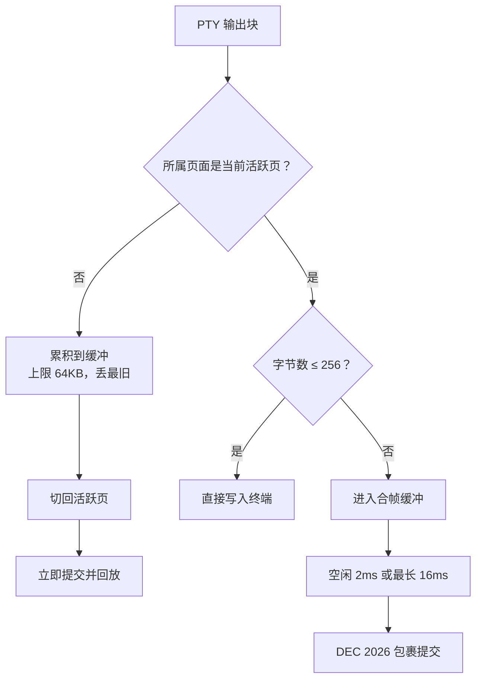
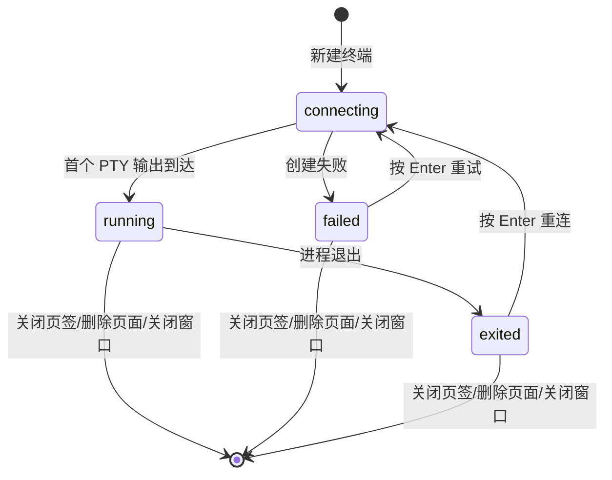

# 终端面板

> 快照日期：2026-10-19
>
> 本文档描述 slTerminal 主区面板与工作区在当前版本中的实际行为，属于 as-is 现状功能规格。代码是行为的真值源；本文档为一次性快照，不承诺随代码演进同步更新。若文档与代码不一致，以代码为准。
>
> 读者：测试/QA、开发，以及需要了解主区用户可感知行为的成员。

## 1. 本篇定位与范围

本文覆盖终端面板的全部用户可见行为：入口与落点、Shell 选择与工作目录、渲染与加载、键盘输入与快捷键、输出与合帧、尺寸调整、页签标题与状态、超链接与剪贴板序列、进程退出与重连、字体大小、会话生命周期、状态保留与持久化、错误提示与已知限制。

不覆盖：

- PTY 后端、ConPTY 标志矩阵、启动序列处理、DA1/DSR 代答等实现细节。
- Shell 集成脚本的内部实现与 OSC 序列构造。
- 工作区标题栏、操作页面切换、页签分屏、布局持久化等主区通用行为（见 [01-workspace-shell.md](01-workspace-shell.md)）。
- 侧栏内部交互（见 [../sidebar/README.md](../sidebar/README.md)）；本文只写与终端相关的触发条件与可感知结果。
- 设置中心内部页面结构（见 [07-settings-center.md](07-settings-center.md)）。

## 2. 界面结构与入口

### 2.1 终端面板构成

- 终端面板由页签和内容区组成；内容区只有终端画面，没有工具栏、新建/重启/关闭按钮或状态栏。
- 普通新建的页签标题显示终端编号 `terminal-N`（每页独立从 0 开始）；历史会话恢复的页签初始使用会话标题（无标题时为会话 ID 前 8 位）。标题可被用户自定义标题或运行中的 CLI 会话标题覆盖。
- 页签可显示以下运行期标记：
  - CLI 品牌图标：终端内识别到运行中的编码 CLI 会话时显示，会话结束后消失。
  - 状态圆点：工作=绿、注意=黄、完成=灰、错误=红；无状态时不显示。
- 内容区占满面板；终端画面使用固定等宽字体栈、竖线闪烁光标，保留 5000 行回滚缓冲。

### 2.2 新建终端的入口

| 入口 | 位置 | 目标页面 | 落点页组 | 工作目录 |
|---|---|---|---|---|
| 水印区「新建终端」 | 空白页组中央 | 当前活跃页面 | 水印所在空白组；无组上下文时按聚焦组 → 主组 → 页内首组回退 | 项目根 |
| 组头「+」 | 每个页组的页签栏右侧，悬停提示「新建终端」 | 页组所属页面 | 按钮所在页组 | 项目根 |
| 页签右键「新建终端」 | 任意终端/面板页签右键菜单 | 被右键面板所属页面 | 右键瞬间面板所在页组 | 项目根 |
| 文件树「在终端中打开」 | 文件浏览器 / Agent 全局文件右键菜单 | 当前活跃页面 | 当前聚焦分屏区；回退页内主组/首个页组 | 文件所在目录；文件夹入口当前取其父目录 |
| 历史会话恢复 | 导航树历史行双击或右键「分支恢复」 | 会话工作目录所属项目的第一个页面（无项目/页面则新建） | 该页当前聚焦分屏区；回退页内主组/首个页组 | 历史会话记录的工作目录 |

- 空白页组无水印以外的面板时，水印区显示「打开终端或编辑器开始工作」与「新建终端」按钮。
- 新建终端后，终端输入区自动获得键盘焦点；布局恢复不抢焦点。
- 所有入口每次点击都新建独立终端页签，不做去重。
- Commit 视图没有「在终端中打开」入口；其条目按 Git 状态打开编辑器、Diff 或 GitShow 面板。

### 2.3 终端页签右键菜单

- 终端页签右键菜单包含：
  - 「新建终端」。
  - 「重命名」：仅终端页签显示；CLI 会话运行中时置灰不可用。
  - 「关闭」「关闭其他」「关闭全部」：关闭类为危险项；「关闭其他/关闭全部」只作用于当前页组内的面板。
- 关闭终端页签的其他路径：悬停页签出现的「×」、`Ctrl+W`、鼠标中键、右键菜单「关闭」。这些路径共用同一关闭守卫；终端页签本身没有额外的关闭确认。
- 重命名弹窗标题为「重命名终端」，预填当前标题并全选；Enter 确认，Esc、点击遮罩或「取消」取消；空或纯空白提交时显示行内错误「名称不能为空」并保持弹窗。

**验收判据**

- 空白页组显示水印与「新建终端」按钮；点击后出现新终端页签并自动获得键盘焦点。
- 组头「+」创建的新终端落在该组；页签右键「新建终端」也落在右键时所在组。
- 终端页签右键菜单含「新建终端」「重命名」与「关闭」「关闭其他」「关闭全部」；CLI 会话运行中「重命名」不可点击。
- 文件树「在终端中打开」每次新增一个终端页签，工作目录符合上表。

## 3. 功能点分节

### 3.1 Shell 选择与工作目录

**行为**

- 未指定 Shell 时，按以下顺序探测并使用第一个可用的 Shell：
  1. PowerShell 7（`pwsh.exe`）。
  2. Windows PowerShell 5.1（`powershell.exe`）。
  3. `cmd.exe`。
- PowerShell 会话启动时加载用户的 PowerShell profile（不跳过 profile），因此 profile 中的环境初始化（如 conda 初始化）正常生效；同时注入 shell 集成脚本，用于命令边界、标题与状态识别。
- `cmd.exe` 会话没有 shell 集成能力。
- 工作目录规则：创建时显式指定的目录优先；未指定时使用所属项目的根目录。
- 显式指定工作目录的入口：文件树「在终端中打开」、历史会话恢复。新建终端（水印、组头 +、页签右键）恒使用项目根，不继承当前终端的目录。
- 终端工作目录只能位于项目根或已登记的 Agent 全局目录内；启动时由应用校验。

**交互规则**

- 新终端先等待容器尺寸就绪，再按真实字符尺寸创建会话；容器尺寸在 500ms 内始终不可用时，以 80×24 创建。
- 终端初始尺寸与网格由容器实际尺寸决定，不固定为 80×24（超时兜底除外）。

**边界条件**

- Shell 探测链固定，设置中心没有 Shell 选择入口。
- 探测只按可执行文件是否存在选择；选中的 Shell 启动失败时直接进入创建失败流程，不会自动回退到下一个 Shell。
- 工作目录越出允许范围、目录不存在或启动参数非法时，会话创建失败，进入 3.8 的失败重连流程。
- 项目根不可用且入口未显式指定目录时，子进程继承应用自身的工作目录（防御形态）。
- 应用同时最多维护 32 个 PTY 会话；达到上限后新建终端失败。

**验收判据**

- 装有 PowerShell 7 的机器上新终端运行 `pwsh`；仅有 Windows PowerShell 时运行 `powershell`；两者都不可用时运行 `cmd`。
- 在 PowerShell 终端中，用户 profile 里定义的函数或初始化命令可直接使用（profile 未被跳过加载）。
- 水印/组头/页签右键新建的终端起始目录为项目根；文件树入口为入口指定目录。
- 工作目录越界时终端内出现重连提示，并出现「终端启动失败」错误提示。

### 3.2 渲染与 WebGL 降级

**行为**

- 终端画面由 xterm.js 渲染；配色取自当前激活的暗色配色方案，界面仅支持暗色模式。
- 渲染器优先使用 WebGL2：
  - WebGL2 可用时加载 WebGL 渲染器，GPU 加速绘制。
  - WebGL2 不可用时退回 DOM 渲染器，终端功能不变，滚动与重绘性能下降。
- 检测不排除软件渲染；落入 SwiftShader 软件渲染时，首次成功加载后弹出一次警告提示「当前终端使用软件渲染(SwiftShader),滚动性能可能下降」，整个应用运行期只提示一次。
- WebGL 上下文丢失时自动重建，延迟依次为 1s、2s、4s、8s、16s；最多重建 5 次。第 6 次丢失后放弃 WebGL，退回 DOM 渲染器。该过程不弹提示，仅记录日志。
- WebGL 可用时，每个终端面板各自持有一个 WebGL 上下文；切换页面或页签不会创建/销毁上下文。

**交互规则**

- 切回已隐藏的页面时，终端按当前容器尺寸重新适配并继续渲染，内容不丢失。
- 页面或页签切换不重建终端实例；只有关闭面板或删除页面才销毁。

**边界条件**

- 同时打开大量终端面板时可能触及浏览器 WebGL 上下文数量上限；后续面板会退避重试并最终使用 DOM 渲染，应用不崩溃、不弹提示。
- WebGL 不可用或耗尽时没有可见的“已降级”标记，只能从渲染性能或日志判断。

**验收判据**

- 具备 WebGL2 的环境下终端滚动流畅；禁用 WebGL 后终端仍可正常输入输出。
- 从 GPU 卸载/驱动恢复触发上下文丢失后，终端自动恢复显示或退回 DOM，不白屏。
- 软件渲染环境首次打开终端时出现一次 SwiftShader 警告；再次新建终端不重复提示。

### 3.3 键盘输入与快捷键

**行为**

- 终端获得焦点后，键盘输入直接发送到 PTY；可打印字符、控制键、方向键、功能键均由终端编码后写入。
- 默认快捷键：

| 快捷键 | 作用 |
|---|---|
| `Ctrl+Shift+C` | 复制当前选区到系统剪贴板；无选区时不复制，但按键仍被消费 |
| `Ctrl+Shift+V` | 读取系统剪贴板并粘贴到终端 |
| `Ctrl+Enter` | 向 PTY 写入 LF（0x0a，等价 `Ctrl+J`），供 Ink 系 TUI 插入换行而不提交；接收方语义由前台程序决定 |
| `Ctrl+C` | 本地中断提示：页签当前为“工作”时改为“注意”，随后 `\x03` 照常发送到 PTY（SIGINT 语义不变） |
| `Ctrl+W` | 关闭当前活跃页签；终端聚焦时同样生效 |
| `Ctrl+滚轮` / `Cmd+滚轮` | 调整终端字体大小（见 3.9） |

- `Ctrl+C` 的本地提示只改变状态圆点，不显示文字提示；重复触发是幂等的。
- 终端快捷键可在设置中心重绑定，但以下保留键不可被用户覆盖绑定：`Ctrl+C`、`Ctrl+V`、`Ctrl+X`、`Ctrl+Z`、`Ctrl+A`。
- 输入法合成期间不触发快捷键；合成文本正常进入终端。中文等 IME 输入依赖真实 WebView2 的合成事件。
- 终端允许子进程通过 Kitty 键盘协议（`CSI>1u`）启用差异化按键编码；应用不主动启用，仅在子进程请求后生效。
- 点击终端内容区或切换到该页签时，键盘焦点进入终端输入区。

**交互规则**

- 快捷键命令只作用于当前聚焦的终端；没有聚焦终端时命令透传。
- `Ctrl+W` 在没有活跃面板时透传为 `\x17`，由前台程序处理。
- 复制/粘贴失败不弹提示，只记录日志；连续输入发送失败 3 次时弹出「终端输入发送失败: <原因>」错误提示，成功一次后计数清零。
- 输入法合成中按 Enter 属于合成确认，不触发终端快捷键。
- 不带 `Ctrl/Cmd` 的滚轮默认用于滚动回滚缓冲；前台程序启用鼠标跟踪时滚轮事件交由程序处理；全屏 TUI 的滚轮行为还受设置中心「终端输入模式」开关影响。

**边界条件**

- PTY 会话尚未注册完成时的键入会被静默丢弃（通常只出现在加载遮罩期）。
- 保留键只限制用户覆盖；`Ctrl+C` 的本地中断命令由代码默认绑定，用户不能把其他命令绑到这些保留键。
- `Ctrl+Enter` 写入的是 LF 而非回车；需要提交命令时应使用 Enter。

**验收判据**

- 在终端输入文本并回车，Shell 收到并回显。
- 选中文本后 `Ctrl+Shift+C`，系统剪贴板内容为选中文本；无选区时按 `Ctrl+Shift+C` 不改变剪贴板。
- `Ctrl+Shift+V` 将剪贴板文本输入终端。
- `Ctrl+C` 后终端程序收到中断，页签从工作态转为注意态；重复按 `Ctrl+C` 不产生额外状态变化。
- 中文输入法合成文字可正常输入，合成期间快捷键不触发。
- 在设置中心尝试把命令绑定到 `Ctrl+C`/`Ctrl+V`/`Ctrl+X`/`Ctrl+Z`/`Ctrl+A` 会被拒绝或回退默认键。

### 3.4 输出与合帧

**行为**

- PTY 输出按字节数分流：
  - 不超过 256 字节且面板可见：立即写入终端，低延迟回显。
  - 超过 256 字节：进入合帧缓冲。
- 合帧缓冲同时维护空闲定时器与最长等待定时器：
  - 空闲 2ms 无新数据即提交一帧。
  - 持续有数据时最多 16ms 强制提交一次，防止饥饿。
- 合帧提交使用 DEC 2026 同步更新包裹，同一帧内的网格变更原子呈现，避免 Ink 系 TUI 高频刷屏撕裂。
- 输出按 UTF-8 解码；中文等多字节字符按字节阈值判断，不会被字符数低估而绕过合帧。
- 所属操作页面不是当前活跃页面时，终端进入降频状态：
  - 所有输出只累积、不渲染，包括不超过 256 字节的小块。
  - 待处理缓冲上限 64KB；超出时按块丢弃最旧数据，保留最新数据。
  - 切回该页面时立即提交并回放当前缓冲内容。
- 运行中的 PTY 输出持续到达，不受页签是否在前台影响；页面隐藏不暂停进程。
- 降频门控以所属操作页面是否为当前活跃页为准，不按页签是否聚焦：同一活跃页面内非当前页签的终端仍正常渲染。

**交互规则**

- 同一空闲窗口内到达的多块大数据合并为一次提交，只产生一对同步更新包裹。
- 输出缓冲在尺寸变化前会被丢弃，避免旧尺寸内容渲染到新网格。

**边界条件**

- 非活跃页面累积超过 64KB 时，旧输出不可恢复；切回后只能看到最近保留部分。
- 64KB 上限按原始字节计算，包含控制序列。
- 输出合帧只影响渲染节奏，不改变字节内容与顺序。

**验收判据**

- 小段输出（如单字符回显）立即出现。
- 大段高频输出（如全屏 TUI 刷新）无可见撕裂，最终内容完整。
- 切到另一页面再切回，终端内容保留；隐藏期间输出超过 64KB 时只保留最新部分。
- 中文输出不出现乱码或错位。

### 3.5 尺寸调整

**行为**

- 初始创建时按容器真实尺寸计算行列数；尺寸不可用时以 80×24 兜底。
- 运行时监听容器尺寸：
  - 只有行数变化（高度变化）：立即适配并通知 PTY 新尺寸。
  - 列数变化（宽度变化）：等待 100ms 合并连续变化后适配并通知 PTY。
  - 行列均无变化：不执行任何操作。
- 每次适配都先更新终端网格，再向 PTY 发送尺寸变化信号。
- 普通屏幕与交替屏幕（全屏 TUI）使用同一适配路径，均执行网格更新，避免 SIGWINCH 后新尺寸输出绘制到旧网格。
- 字体大小变化也会立即触发一次适配与 PTY 尺寸通知，不受列变化 debounce 影响。

**交互规则**

- 拖动窗口边缘、调整侧栏宽度、页内分屏比例、切换页面导致容器尺寸变化时，均按上述规则适配。
- 尺寸变化前会丢弃尚未提交的旧尺寸输出，防止错位与撕裂。

**边界条件**

- 终端网格计算在渲染器未就绪时可能得到非法数值；此类结果被丢弃，不发送给 PTY。
- 容器尺寸为 0（页面隐藏）时不适配；页面重新可见后由尺寸观察自然触发。
- 适配失败不影响输入输出，仅记录日志。

**验收判据**

- 仅拖动窗口高度时终端行数立即变化；仅拖动宽度时约 100ms 后列数变化一次。
- 快速连续拖动宽度只产生一次最终适配。
- 全屏 TUI（如 claude）在改变尺寸后重新绘制完整、无错位。
- 字号变化后终端网格与 PTY 尺寸同步更新。

### 3.6 页签标题、状态与重命名

**行为**

- 普通新建的初始标题为 `terminal-N`，按操作页面独立编号，从 0 开始；关闭页签不重排已有编号；应用重启恢复布局时按恢复顺序重新计算无自定义标题的终端编号。
- 历史会话恢复的终端初始标题为历史会话标题；无标题时取会话 ID 前 8 位。该标题是运行期标题，不写入自定义标题；应用重启后若无自定义标题，仍按恢复顺序重算为 `terminal-N`。
- PowerShell 会话通过命令边界序列识别命令：
  - 命令开始时，若命令行首 token 命中已注册的编码 CLI 命令或用户别名，页签标题切换为该 CLI 的固定标题，状态圆点置为“注意”，并显示 CLI 品牌图标。
  - 命令结束时，标题恢复为该终端的原始标题（普通新建为 `terminal-N`；历史恢复为会话标题或会话 ID 前 8 位）；有自定义标题时恢复自定义标题。状态圆点与品牌图标清除。
- 普通命令（未命中已注册 CLI）不改变标题与状态。
- 运行中的 CLI 会话由 agent 事件驱动四态：
  - 工作（绿）：提交提示词、工具调用等执行活动。
  - 注意（黄）：会话开始、权限请求、需要用户处理。
  - 完成（灰）：本轮回复结束。
  - 错误（红）：工具执行失败或停止失败。
  - 未知 CLI 或无对应能力的事件不改变状态。
- 运行中会话标题会随会话记录刷新：按自定义标题、AI 标题、摘要、首个提示词的顺序取值，读不到时使用会话 ID 前 8 位；刷新最多每 5 秒一次。
- 用户可通过页签右键「重命名」设置自定义标题；CLI 会话运行中该项禁用。自定义标题随布局持久化，并在命令结束、页面切换与应用重启后保留。
- 会话结束（hook 的 SessionEnd/Exit）只清除状态圆点与品牌图标，不恢复标题；真正的命令结束或进程退出才恢复标题。该设计避免 `/resume` 会话切换时把标题误回退为终端编号。

**交互规则**

- 页签状态圆点与品牌图标同时出现在页签和侧栏导航树的活跃会话行；标题变化实时同步到侧栏行。
- 本地 `Ctrl+C` 中断只把“工作”转为“注意”，不产生文字提示；若当前不是工作态则不改变状态。
- 自定义标题存在时，CLI 命令结束后恢复自定义标题而不是原始标题。

**边界条件**

- `cmd.exe` 会话没有命令边界，不会自动切换标题或显示四态；会话开始/结束的 hook 事件仍可按 CLI 能力更新状态。
- 只有命令首 token 精确命中已注册命令或别名才识别；大小写不匹配、带路径前缀的命令不命中。
- 未知 CLI 的 agent 事件被忽略，不建行、不置图标、不报错。

**验收判据**

- 新建终端标题为 `terminal-0`、`terminal-1`……，关闭中间页签后编号不重排。
- 在 PowerShell 终端运行 `claude`，页签标题变为该 CLI 标题并出现品牌图标与状态点；命令退出后恢复自定义标题、终端编号或历史会话标题。
- CLI 处于工作、注意、完成、错误状态时圆点颜色依次为绿/黄/灰/红。
- CLI 会话运行中右键「重命名」不可点击；结束后可重命名，且重启应用后自定义标题保留。
- 重启应用后，未自定义标题的终端重新显示为 `terminal-N`，不残留运行中的状态点或品牌图标。

### 3.7 OSC 8 超链接与 OSC 52 剪贴板

**行为**

- OSC 8 超链接：点击终端中由程序声明为 OSC 8 的链接，交给系统默认浏览器/默认处理程序打开。只有 OSC 8 声明的链接可点击；普通 URL 文本不会自动识别为链接。悬停与离开回调未实现。
- OSC 52 剪贴板写入：
  - 仅接受系统剪贴板选择器（空选择器或 `c`）；忽略 `p`（primary）与 `q`（secondary）。
  - 仅支持写入，不响应读取请求。
  - 单条负载超过 1MB 时忽略，不写入。
  - 负载按 UTF-8 解码后写入系统剪贴板，中文内容正确。
  - 所属页面不是当前活跃页面时忽略；非活跃终端的后台程序不能静默改写剪贴板。
  - 非法 base64 或格式错误时静默忽略。
  - 成功处理后该序列被消费，不显示在终端画面中。

**交互规则**

- 打开链接不阻塞终端输入输出；打开失败只记录日志，不弹提示。
- OSC 52 写入与 `Ctrl+Shift+C` 共用同一系统剪贴板写入通道。

**边界条件**

- OSC 52 读取请求（`?`）永远不响应，终端程序无法通过该序列读取系统剪贴板。
- 超过 1MB 的剪贴板写入会被整体丢弃，不会截断写入部分内容。

**验收判据**

- 点击 OSC 8 链接后系统默认浏览器打开对应 URL；点击普通 URL 文本无反应。
- 运行 `claude` 的复制命令后系统剪贴板内容更新，终端画面不出现该控制序列。
- 非活跃页面中的终端收到 OSC 52 时不改写剪贴板。
- 超过 1MB 的 OSC 52 负载不改变剪贴板。

### 3.8 进程退出、启动失败与重连

**行为**

- 终端内进程退出时，终端画面追加：
  - `进程已退出 (退出码: N)`；退出码不可用时显示 `?`。
  - `按 Enter 重新连接...`。
- 按 Enter 后使用最近一次已知的行列数重新创建 PTY 会话；重连后是新的 Shell 进程，原进程状态与内存不保留。
- 会话创建失败时：
  - 终端画面追加 `[重新连接] 按 Enter 重试...`。
  - 弹出错误提示「终端启动失败: <原因>」。
  - 按 Enter 使用同尺寸重试；失败原因未消除（如工作目录越界、会话数达上限）时会再次失败并重复提示。
- 终端输入发送连续失败 3 次时弹出「终端输入发送失败: <原因>」；失败不足 3 次或中间成功一次时不弹提示。

**交互规则**

- 重连不自动发生，必须由用户按 Enter 触发。
- 进程退出时若检测到 CLI 命令正在运行，先清除页签状态并恢复标题，再显示退出提示。
- 重连监听是一次性的：按 Enter 后移除，新的失败或退出会重新注册。

**边界条件**

- 重连使用最近一次记录的尺寸，不重新测量容器；重连后首次尺寸变化会再次适配。
- PTY 进程退出后原会话不可恢复；历史会话需通过导航树恢复功能重新启动 CLI 会话。
- 应用关闭时的清理失败只记录日志，不阻止窗口关闭。

**验收判据**

- 在终端执行 `exit` 后出现退出码提示与「按 Enter 重新连接...」；按 Enter 出现新的 Shell 提示符。
- 使用不存在或越界的工作目录创建终端时，出现「终端启动失败」提示与终端内重试提示；按 Enter 再次尝试。
- 退出码为 0 与非 0 时提示中的数字与真实退出码一致；不可用时显示 `?`。

### 3.9 字体大小

**行为**

- 在终端内容区按住 `Ctrl`（或 Mac `Cmd`）滚动鼠标滚轮，每次上滚放大 1、下滚缩小 1。
- 字号范围 8–32，默认 14；超出范围时停在边界。
- 终端字号为全局共享：所有终端面板使用同一字号，调整任一终端会同步到其他终端。
- 字号变化后立即重新适配终端网格并通知 PTY 新尺寸。
- 字号变更约 2 秒后写入应用设置；应用启动时读取并恢复。
- 编辑器字号是独立配置，不受终端字号影响（见 [03-editor.md](03-editor.md)）。
- 设置中心没有终端字号配置项，唯一调整入口是 `Ctrl/Cmd+滚轮`。

**交互规则**

- 滚轮事件被消费，不触发页面缩放或终端回滚。
- 连续滚动会连续调整字号；持久化只保存最后一次值。
- 应用读取到损坏的配置时回退默认字号并提示「配置已损坏，已回退默认值」；保存失败时提示「设置保存失败，重启后将丢失」。

**边界条件**

- 字号达到 8 或 32 后继续滚动不再变化。
- 字号变更不影响已运行进程，只改变显示与 PTY 尺寸。

**验收判据**

- 在任一终端按 `Ctrl+滚轮`，字号按 1 递增/递减并限制在 8–32；其他终端字号同步变化。
- 重启应用后字号恢复为最后保存值。
- 编辑器字号不随终端字号变化。

### 3.10 会话生命周期

**行为**

- 一个终端面板对应一个 PTY 会话；会话元数据仅在应用运行期内存中维护，终端面板只订阅。
- 切换页签或操作页面：终端面板不卸载、终端实例不重建、PTY 进程继续运行；画面与回滚内容保留。
- 关闭终端页签：销毁终端实例并终止对应 PTY 会话，回滚内容丢失。
- 删除操作页面：先移除该页全部页组，页内所有终端面板随之卸载并终止 PTY；随后清理页面标题状态与页面记录。该过程没有页面级确认，也不做面板级未保存确认。
- 删除项目：移除其全部页面与终端（项目删除有确认）。
- 关闭窗口：
  - 先并发终止所有已知 PTY 会话，最长等待 3 秒。
  - 再执行一次后端残留会话兜底清理，同样有 3 秒上限。
  - 随后冲刷布局与项目数据并保存当前活跃页面（保存阶段同样有 3 秒上限），最后销毁窗口。
  - 任一清理失败只记录日志，不阻止关闭；子进程由系统作业对象兜底终止。
- 应用重启：恢复布局中的终端面板，并为每个终端新建 PTY 会话；原 Shell 进程、输出与回滚内容不恢复，工作目录取布局中保存的目录（缺失时回退项目根）。

**交互规则**

- 隐藏页面的终端继续运行并累积输出；见 3.4 的降频与 64KB 上限。
- 终端页签关闭后不可撤销，重新打开会得到新的 `terminal-N` 编号。
- 会话数上限为 32；达到上限时新建终端失败。

**边界条件**

- 页面切换只改变可见性，不触发终端实例销毁；窗口关闭与页面删除才会终止进程。
- 应用异常崩溃时正常清理链不会执行，由系统作业对象负责终止子进程树。
- 页面删除不提供终端内容确认，运行中的命令与未复制的输出会直接丢失。

**验收判据**

- 在页面 A 的终端写入内容，切到页面 B 再切回，内容与进程仍在。
- 关闭终端页签后对应进程终止，重新创建的终端为新编号与新 Shell。
- 删除含终端的页面后，该页终端进程消失；若删除的是活跃页面，主区切到该项目剩余页面或进入无活跃页面状态。
- 关闭窗口后所有 PTY 子进程终止，重开应用时布局恢复但终端为新会话。

## 4. 跨区行为

| 触发条件 | 可感知结果 |
|---|---|
| 文件浏览器/Agent 全局文件右键「在终端中打开」 | 当前活跃页面新增终端页签；文件入口工作目录为其所在目录，文件夹入口当前为其父目录；无活跃页面时静默不创建。侧栏细节见 [03-explorer.md](../sidebar/03-explorer.md) 与 [05-agent-files.md](../sidebar/05-agent-files.md) |
| 导航树历史会话普通双击 | 必要时新建项目/页面并切页，创建终端；终端就绪后自动输入该 CLI 的恢复命令并回车。见 [02-nav-tree.md](../sidebar/02-nav-tree.md) |
| 导航树历史会话右键「分支恢复」（该 CLI 支持时） | 同上，恢复命令追加分支参数，原会话不受影响 |
| 导航树运行中会话行双击 | 弹出「会话运行中」弹窗；选择「切换到该会话操作页面」后切到对应页面并聚焦该终端页签 |
| 点击导航树活跃会话行 | 切到会话所在页面并聚焦对应终端页签 |
| 终端页签标题/状态变化 | 导航树活跃会话行的标题与状态圆点实时同步 |
| 设置中心「终端输入模式」开关 | 只影响之后新建的终端会话；已打开终端需重开生效。见 [07-settings-center.md](07-settings-center.md) |
| 关闭应用窗口 | 终止全部终端会话后保存布局并退出；终端输出不保留 |

历史会话恢复的终端侧可感知结果：

- 恢复前会确保存在与工作目录匹配的项目与页面，并切换到目标页；归属、复用与新建规则见 [02-nav-tree.md](../sidebar/02-nav-tree.md)。
- 新终端页签标题取历史会话标题；无标题时取会话 ID 前 8 位。
- 注入命令在终端就绪后出现并自动执行：
  - PowerShell 系终端等待首个提示符，最多约 10 秒；超时仍尝试注入。
  - `cmd` 终端固定等待约 0.5 秒后注入。
  - 普通恢复注入 `claude --resume <会话 ID>` 并回车；分支恢复追加 `--fork-session`（以 claude 为例；其他 CLI 由各自能力实现）。
- 任一步骤失败时弹出系统通知「恢复会话失败」，正文含会话 ID 前 8 位与失败原因；不影响其他已打开页面与终端。

## 5. 状态保留与持久化

### 5.1 状态保留矩阵

| 状态 | 组内切签 | 切换操作页面 | 关闭后重开 | 应用重启 |
|---|---|---|---|---|
| PTY 进程 | 保留 | 保留 | 新进程 | 新进程 |
| 终端画面与回滚内容 | 保留 | 保留（隐藏期间按 64KB 上限累积） | 丢失 | 丢失 |
| 工作目录 | 保留 | 保留 | 新终端按项目根或入口指定 | 布局保存的目录；缺失时项目根 |
| 自定义页签标题 | 保留 | 保留 | 新终端无自定义标题 | 随布局恢复 |
| 未自定义的标题 | 保留 | 保留 | 新 `terminal-N` | 按恢复顺序重算为 `terminal-N`（历史会话标题不保留） |
| 状态圆点与 CLI 品牌图标 | 保留并实时更新 | 保留并实时更新 | 无状态 | 不恢复，直至再次识别到 CLI 会话 |
| 运行中 CLI 会话元数据（会话 ID、上下文用量来源等） | 保留 | 保留 | 无 | 不持久化 |
| 终端字号 | 全局共享 | 全局共享 | 不变 | 恢复 |
| 回滚缓冲（最多 5000 行） | 保留 | 保留 | 丢失 | 丢失 |

> 终端的「关闭后重开」指关闭面板后重新创建终端，不复用原会话与内容。

### 5.2 持久化对象

- 自定义页签标题随操作页面布局持久化；重命名后立即保存布局。
- 终端字号写入应用设置，变更约 2 秒后落盘；启动时读取。关闭窗口时，尚未触发的字号自动保存会被取消，最近一次字号变更可能未写入，重启后恢复旧值。
- 终端面板的创建参数（工作目录等）随布局持久化，重启恢复时用于新建会话。
- 运行期会话元数据、四态、CLI 品牌图标、滚动内容均不持久化。
- 布局中残留的瞬态状态（如运行中标题、状态圆点、品牌图标）在启动恢复时被重算或清除，不会显示为仍在运行的会话。

## 6. 空态、加载、错误

### 空态

- 操作页面没有任何面板时，主区显示水印区「打开终端或编辑器开始工作」与「新建终端」按钮。
- 终端面板本身没有空态：会话创建中显示加载遮罩，创建失败显示重连提示。
- 终端程序主动清屏后画面为空，属于终端内容而非应用空态。

### 加载

- 终端面板挂载后显示居中遮罩「正在连接...」，覆盖终端内容区。
- 首个非空 PTY 输出到达时立即隐藏遮罩，不等固定时长。
- 首帧始终不到达（创建失败、进程立即退出等）时，遮罩在 1500ms 后强制隐藏，避免永远遮挡终端区。

### 错误

| 场景 | 可感知结果 |
|---|---|
| 会话创建失败 | 终端内 `[重新连接] 按 Enter 重试...`；错误提示「终端启动失败: <原因>」 |
| 进程退出 | 终端内 `进程已退出 (退出码: N/?)` 与 `按 Enter 重新连接...` |
| 终端输入连续失败 3 次 | 错误提示「终端输入发送失败: <原因>」 |
| WebGL2 不可用 | 静默退回 DOM 渲染器，无提示 |
| WebGL 上下文丢失且重试耗尽 | 静默退回 DOM 渲染器，无提示 |
| SwiftShader 软件渲染 | 首次出现一次警告提示「当前终端使用软件渲染(SwiftShader),滚动性能可能下降」 |
| Windows 10 捆绑控制台加载失败 | 启动时警告提示「终端已回退到系统控制台,鼠标滚轮转发不可用」（仅该场景） |
| 字号保存失败 | 警告提示「设置保存失败，重启后将丢失」 |
| 设置文件损坏 | 警告提示「配置已损坏，已回退默认值」 |
| 历史会话恢复失败 | 系统通知「恢复会话失败」，正文含会话 ID 前 8 位与失败原因 |
| 打开 OSC 8 链接失败 | 无用户提示，仅记录日志 |

## 7. 图表

### 7.1 输出路径

### 7.2 终端会话状态

## 8. 验收判据汇总

| 触发 | 结果 | 验收判据 |
|---|---|---|
| 水印/组头 +/页签右键新建终端 | 新终端会话 | 新页签获得焦点并出现提示符；标题为 `terminal-N` |
| 文件树/Agent 全局文件「在终端中打开」 | 新终端，指定工作目录 | 终端起始目录符合入口（文件为所在目录，文件夹当前为父目录） |
| 新建终端 | 自动选择 Shell | PowerShell 7 优先，其次 Windows PowerShell，最后 `cmd`；用户 profile 在 PowerShell 中生效 |
| 输入普通文本/回车 | 直通 PTY | Shell 收到输入并回显 |
| `Ctrl+C` | 中断且本地状态提示 | 程序收到中断；工作态页签转为注意态 |
| `Ctrl+Shift+C` / `Ctrl+Shift+V` | 复制/粘贴 | 系统剪贴板内容与选区/粘贴文本一致 |
| 大段输出 | 合帧渲染 | 无撕裂，内容完整；小段输出立即显示 |
| 切到其他页面再切回 | 终端保活 | 内容与进程保留；隐藏期间超过 64KB 的旧输出可丢失 |
| 改变窗口宽高 | 尺寸适配 | 行变化立即、列变化约 100ms 后生效一次 |
| PowerShell 中运行已注册 CLI | 标题/状态/图标变化 | 标题变为 CLI 标题，状态点与品牌图标出现；退出后恢复 |
| 进程退出 | 重连提示 | 显示退出码与「按 Enter 重新连接...」；按 Enter 得到新 Shell |
| 会话创建失败 | 错误提示 | 「终端启动失败」提示与终端内重试提示同时出现 |
| OSC 8 链接点击 | 系统打开 | 默认浏览器打开链接 |
| OSC 52 写入 | 系统剪贴板更新 | 剪贴板内容正确，序列不显示；非活跃页面忽略 |
| `Ctrl/Cmd+滚轮` | 调整字号 | 字号在 8–32 变化，所有终端同步，重启恢复 |
| 关闭终端页签/删除页面/关闭窗口 | 清理会话 | 对应 PTY 进程终止；窗口关闭的清理与保存阶段各自最长等待 3 秒 |

## 9. 边界与非目标

**边界**

- 仅支持 Windows 10/11、单窗口、暗色模式；不描述多窗口与亮色主题。单实例现状见 [01-workspace-shell.md](01-workspace-shell.md) 的已知限制。
- 一个终端面板只承载一个 PTY 会话；分屏由工作区页组提供，不是终端面板内部能力。
- 终端面板内没有工具栏；新建、重命名、关闭均通过页签、组头、右键菜单或侧栏入口完成。
- 默认 Shell 探测链固定，不提供界面配置。
- 新建终端默认工作目录为项目根；只有显式入口可指定其他目录。
- 终端工作目录受路径沙箱限制，不能指向项目根与 Agent 全局目录之外。
- 回滚缓冲固定 5000 行；输出回放缓冲上限 64KB。
- 字号全局共享、范围 8–32；字体家族固定，不提供界面配置。
- 同时最多 32 个 PTY 会话。
- 普通 URL 文本不是可点击链接；只有 OSC 8 声明的链接可打开。
- 不描述 PTY/ConPTY 后端、Shell 集成脚本内部、DA1/DSR 处理与输入模式位矩阵实现。

**非目标**

- 不描述终端多路复用、面板内页签、终端搜索、终端内分屏、会话录制或自动重连策略。
- 不描述 Shell 配置、配置文件、启动参数自定义能力。
- 不描述主题、颜色、字体与图标视觉规范。
- 不包含改进建议、缺陷修复方案、优先级与排期。

## 10. 已知限制

- 【行为设计】终端面板内没有新建、重启或关闭按钮；运行中的 Shell 不能原地重启，只能关闭页签后重新创建，或在进程退出/创建失败后按 Enter 重连。
- 【行为设计】默认 Shell 探测链固定，当前版本不提供设置覆盖入口。
- 【无障碍/平台】`cmd.exe` 没有 Shell 集成：命令边界、命令标题与四态识别不可用；历史会话恢复只能固定等待约 0.5 秒后注入。
- 【行为设计】非活跃页面的终端只累积输出，超过 64KB 时丢弃最旧数据；切回后可能缺少前段输出。
- 【无障碍/平台】WebGL 可用时每个终端面板各持有一个上下文；同时打开较多终端时可能触及浏览器上下文上限，后续终端退回 DOM 渲染且没有用户提示。
- 【无障碍/平台】WebGL 上下文丢失最多重建 5 次，之后退回 DOM 渲染；降级过程无提示。
- 【无障碍/平台】SwiftShader 软件渲染的警告只在应用运行期内出现一次；后续终端不再提示，性能可能持续下降。
- 【无障碍/平台】中文输入法合成路径依赖真实 WebView2 环境，自动化测试不覆盖，需要实机验证。
- 【疑似缺陷】删除操作页面没有确认提示，会直接终止页内所有终端并丢失未复制的输出；删除项目则有确认提示，两者不一致。
- 【行为设计】应用同时最多维护 32 个 PTY 会话；达到上限后新终端创建失败。
- 【行为设计】新建终端的工作目录恒为项目根，不继承当前聚焦终端的目录；只有文件树入口与历史会话恢复可指定其他目录。
- 【行为设计】CLI 会话运行中禁止重命名页签，必须等待会话结束后才能改名。
- 【行为设计】运行中会话的状态、品牌图标与上下文元数据不跨应用重启保留；重启后的终端在再次识别到 CLI 会话前不显示状态。
- 【无障碍/平台】Windows 10（build < 21376）捆绑控制台加载失败时会回退系统控制台，鼠标滚轮转发不可用，仅在启动时提示一次。
- 【疑似缺陷】字号变更沿用应用设置自动保存策略，关闭窗口前约 2 秒内尚未落盘的变更可能丢失（见 [01-workspace-shell.md](01-workspace-shell.md) 已知限制）。

## 11. 相关文档

- [README.md](README.md)：主区面板与工作区文档总览
- [01-workspace-shell.md](01-workspace-shell.md)：工作区壳、操作页面、页签、分屏与布局持久化
- [03-editor.md](03-editor.md)：编辑器面板（文件打开、保存、字号）
- [07-settings-center.md](07-settings-center.md)：设置中心与「终端输入模式」配置页
- [../sidebar/README.md](../sidebar/README.md)：侧栏系统总览
- [../sidebar/02-nav-tree.md](../sidebar/02-nav-tree.md)：导航树、活跃会话行与历史会话恢复
- [../sidebar/03-explorer.md](../sidebar/03-explorer.md)：文件浏览器与「在终端中打开」
- [../sidebar/05-agent-files.md](../sidebar/05-agent-files.md)：Agent 全局文件与「在终端中打开」

