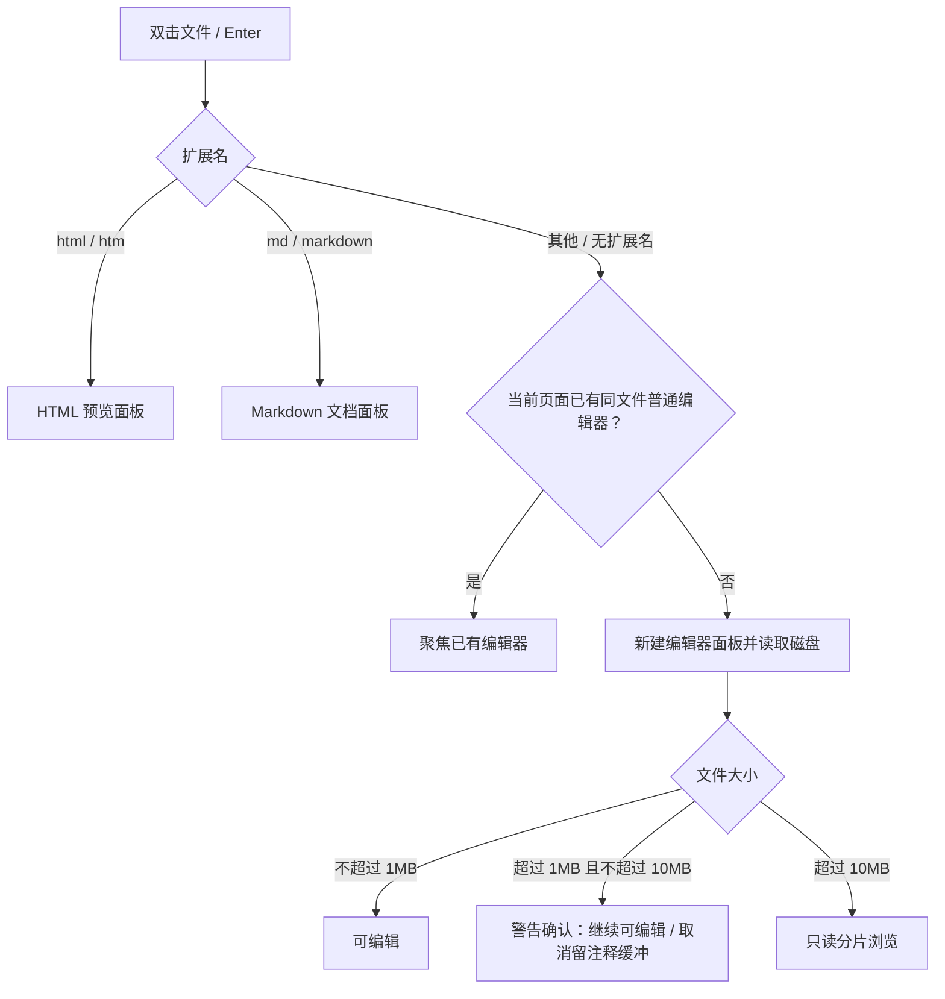
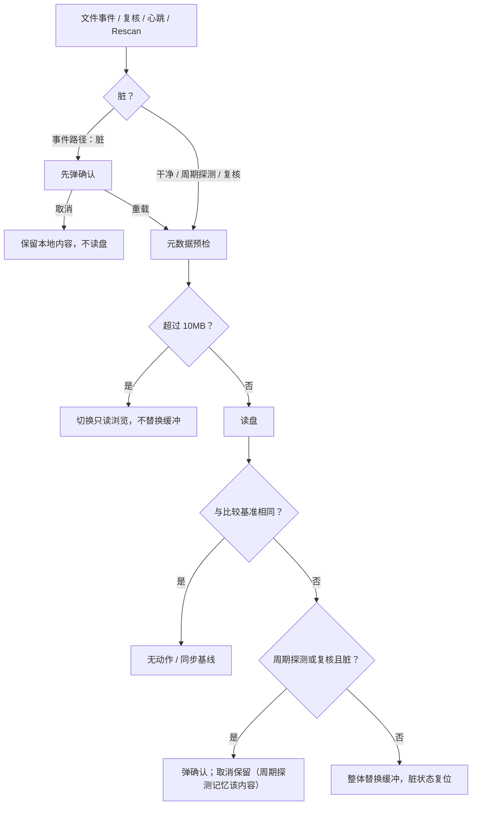
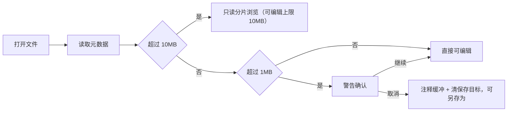

# 编辑器面板

> 快照日期：2026-10-19
>
> 本文档描述 slTerminal 主区面板与工作区在当前版本中的实际行为，属于 as-is 现状功能规格。代码是行为的真值源；本文档为一次性快照，不承诺随代码演进同步更新。若文档与代码不一致，以代码为准。
>
> 读者：测试/QA、开发，以及需要了解主区用户可感知行为的成员。

## 1. 本篇定位与范围

本文描述编辑器面板的全部用户可感知行为：界面结构、打开入口、编辑与搜索、字体与自动换行、保存与标题、Git 变更标记、外部修改同步、大文件警告与只读分片浏览、焦点、状态保留及空态/加载/错误。

覆盖：

- 编辑器面板本身，以及从侧栏文件浏览器、Commit 视图、Markdown 文档预览链接进入编辑器面板的触发条件与结果。
- 保存链路及其跨区结果：写盘、Git 变更标记刷新、页签标题更新、侧栏刷新。
- 外部修改同步：文件事件、打开后复核、周期探测与 Rescan 等通道。
- 1MB 警告、10MB 可编辑上限与超过 10MB 后的只读分片浏览。
- 面板级状态保留与持久化边界。

不覆盖：

- Diff 面板与 GitShow 面板的内部行为；它们复用编辑器的语言、主题与大文件阈值，但各自规格见 [04-diff.md](04-diff.md) 与 [05-gitshow.md](05-gitshow.md)。
- HTML 预览面板、Markdown 文档面板（`.html`、`.htm`、`.md`、`.markdown` 的默认打开目标），见 [06-document-preview.md](06-document-preview.md)。
- 工作区的页签、分屏、页签关闭守卫、布局持久化与焦点框架，见 [01-workspace-shell.md](01-workspace-shell.md)。
- 侧栏文件浏览器的树交互与 Commit 视图的列表交互，见 [../sidebar/03-explorer.md](../sidebar/03-explorer.md) 与 [../sidebar/04-commit.md](../sidebar/04-commit.md)。
- 设置中心内部页面；仅引用其快捷键重绑对编辑器命令的影响，见 [07-settings-center.md](07-settings-center.md)。
- 终端面板、PTY、主题配色定义与实现架构。

## 2. 界面结构与入口

### 2.1 面板结构

**行为**

- 编辑器面板是主区中的一个面板实例，内容区占满面板，没有面板内标题栏、工具栏、状态栏、保存按钮或行号列状态提示。
- 面板外观只包含：
  - 编辑区：等宽字体文本、行号栏、当前行高亮、行号旁的 Git 变更标记栏、按需出现的竖向/横向滚动条。
  - 搜索面板：默认隐藏，`Ctrl+F` 时出现在编辑区顶部。
  - 只读大文件形态：编辑区被顶部信息条与只读滚动区替代，见 3.12。
- 面板的页签标题由工作区管理，显示文件名或相对路径；编辑区内不再重复显示文件名。
- 编辑器不提供小地图、折叠按钮、语言选择器、编码选择器或换行状态指示。
- 打开文件后，内容未读完前编辑区为空白暗色区域，没有加载动画、骨架屏或「加载中」文字。

**验收判据**

- 打开一个文件后，面板内容区只有编辑区与行号；不存在保存按钮、工具栏或状态栏。
- `Ctrl+F` 前看不到搜索面板；触发后搜索面板出现在编辑区顶部。
- 文件内容加载期间只看到空白编辑区，没有加载文案。

### 2.2 打开入口

**行为**

编辑器面板按以下入口打开或复用：

| 入口 | 触发方式 | 打开结果 |
|---|---|---|
| 侧栏文件浏览器 | 双击文件行；或选中文件后按 `Enter` | 经统一文件打开链路，按扩展名分派面板类型；未命中专用查看器时打开编辑器 |
| Commit 视图 | 双击「Changes」中的 added 文件，或「Unversioned Files」中的 untracked 文件 | 打开编辑器，页签标题追加 `(git add)` 或 `(git not add)` |
| Markdown 文档预览 | 点击文档中的相对本地链接（目标不是 HTML/Markdown 时） | 走同一打开链路，打开编辑器 |
| 布局恢复 | 应用启动或布局恢复 | 按布局中保存的文件路径重新打开编辑器并读取磁盘 |

- 扩展名分派规则：
  - `.html`、`.htm`：打开 HTML 预览面板，不打开编辑器。
  - `.md`、`.markdown`：打开 Markdown 文档面板，不打开编辑器。
  - 其余扩展名、无扩展名文件、以点开头的隐藏文件：回退打开编辑器。
- 去重规则：
  - 从文件浏览器或 Markdown 文档预览再次打开同一文件时，若当前操作页面已有该文件的普通编辑器，则聚焦已有面板，不重复创建。
  - 从 Commit 视图打开时，按「文件路径 + 页签后缀」去重；同一文件可同时存在普通编辑器与带 Git 后缀的编辑器，两者不互相复用。
- 打开入口失败时：
  - 当前没有活跃操作页面或主区宿主未就绪：静默不打开，无提示。
  - 当前操作页面没有任何面板组：显示警告提示 `当前页面无面板——请先新建终端`，不打开。
- 编辑器面板不提供面板内的「新建文件」或「打开文件」入口；未携带路径的空白编辑器不会由正常界面入口产生。

**交互规则**

- 双击与 `Enter` 的树交互细节见侧栏文件浏览器规格；本篇只描述打开结果。
- 页签标题的计算与冲突处理见 3.8。

**边界条件**

- 从 Commit 视图打开 added/untracked 文件时，即使同一文件已作为普通编辑器打开，也会新建一个带 Git 后缀的编辑器。
- 侧栏中重命名一个已打开的文件，不会改变已打开编辑器的路径或页签标题；编辑器仍指向旧路径（见第 10 节）。
- 布局恢复只恢复文件路径，不恢复编辑内容；恢复时按当前磁盘内容重新读取。

**验收判据**

- 双击 `.txt` 文件出现编辑器面板，页签标题为文件名。
- 双击 `.md` 文件出现 Markdown 文档面板而不是编辑器。
- 同一文件再次双击，已有编辑器被聚焦，不新增第二个普通编辑器。
- Commit 中双击 added 文件，标题以 `(git add)` 结尾；再次双击聚焦同一带后缀面板。
- 页面没有面板组时打开文件，出现 `当前页面无面板——请先新建终端`，且不创建编辑器。

## 3. 功能点分节

### 3.1 编辑与语言高亮

**行为**

- 编辑器打开后可直接键入、删除、选中、复制、粘贴；文本按 UTF-8 文本读写。
- 语言高亮在打开时按文件扩展名选择：

| 扩展名 | 高亮语言 |
|---|---|
| `.js`、`.ts`、`.tsx`、`.jsx`、`.mjs`、`.cjs` | JavaScript |
| `.py`、`.pyw` | Python |
| `.rs` | Rust |
| `.json`、`.jsonc` | JSON |
| `.html`、`.htm` | HTML |
| `.css`、`.scss`、`.less` | CSS |
| `.md`、`.markdown` | Markdown |
| `.xml`、`.svg` | XML |
| 其他或无扩展名 | JavaScript |

- TypeScript 文件按 JavaScript 语法高亮，不启用 TypeScript 类型语法解析。
- 同一面板内文件路径发生变化时，语言高亮就地热切换，不重建编辑缓冲、不丢失文档内容、光标与撤销历史。
- 基础编辑能力包括：行号栏、当前行高亮、括号匹配、自动补全、撤销与重做。
- 文件内容修改后进入「脏」状态（内部标记，不显示在页签或编辑区）。

**交互规则**

- 标准编辑按键由编辑区自己处理；应用级只注册保存与自动换行命令（见 3.7、3.4）。
- `Ctrl+Z` 撤销、`Ctrl+Y` 或 `Ctrl+Shift+Z` 重做由编辑区处理。

**边界条件**

- 仅支持 UTF-8 文本。非 UTF-8 文本或多数二进制文件读取失败，编辑区显示读取失败占位文本（见 6.3）。
- 正常界面路径下，面板的路径参数不会变化；「另存为」只改变会话内的保存目标与页签标题，不改变面板路径参数，因此不会触发语言热切换。
- 1MB–10MB 的可编辑文件整份载入内存；不支持超大文件的局部编辑。

**验收判据**

- 打开 `.py` 文件出现 Python 语法着色，打开 `.rs` 文件出现 Rust 语法着色，打开无扩展名文件按 JavaScript 着色。
- 编辑内容后不出现页签脏标记或保存状态文字。
- 保存后继续编辑，撤销与重做仍作用于当前缓冲。

### 3.2 搜索与跳转

**行为**

- `Ctrl+F` 打开编辑区顶部的搜索面板，提供查找与替换输入，以及大小写敏感、正则、整词匹配选项。
- 搜索面板打开后高亮当前匹配；选中文本后，编辑区内其他相同文本也会被高亮。
- 默认搜索/跳转键位：
  - `F3` 或 `Ctrl+G`：下一个匹配。
  - `Shift+F3` 或 `Ctrl+Shift+G`：上一个匹配。
  - `Ctrl+Alt+G`：跳转到指定行。
  - `Esc`：关闭搜索面板。
- 搜索位置、搜索词与面板开关状态只存在于当前面板实例内。

**交互规则**

- 搜索键位由编辑区内部处理，不出现在应用快捷键配置页，不可重绑。
- `Ctrl+F` 是编辑器保留键，用户快捷键覆盖不能占用它。

**边界条件**

- 搜索只在编辑区获得焦点时生效；焦点在侧栏或其他面板时不触发。
- 只读大文件形态没有搜索功能（见 3.12）。
- 搜索面板的打开/关闭不改变文档内容，也不会使文件变脏。

**验收判据**

- 编辑区聚焦时按 `Ctrl+F` 出现搜索面板；按 `Esc` 关闭。
- 搜索一个存在的词后按 `F3` 或 `Ctrl+G` 跳到下一个匹配，`Shift+F3` 返回上一个。
- 只读大文件形态下按 `Ctrl+F` 不出现搜索面板。

### 3.3 Tab 缩进

**行为**

- 编辑区内按 `Tab` 插入缩进；选中多行时对选中行整体缩进。
- `Shift+Tab` 反向缩进。
- 缩进操作不移动键盘焦点、不离开编辑区。

**交互规则**

- `Tab`/`Shift+Tab` 是编辑器保留键，应用快捷键设置不能占用。

**边界条件**

- 只读大文件形态不提供缩进编辑。

**验收判据**

- 在行首按 `Tab`，文本缩进且焦点仍在编辑区。
- 选中多行按 `Tab`，选中行整体右移；按 `Shift+Tab` 整体左移。

### 3.4 自动换行

**行为**

- 默认为关闭：长行不换行，编辑区出现横向滚动。
- `Alt+Z` 在开启与关闭之间切换；切换只改变显示，不修改文档内容、不使文件变脏。
- 自动换行状态是每个编辑器面板实例独立的，不随文件、不随主题或字体变化。
- 自动换行状态不持久化：面板关闭后重新打开、应用重启后都回到关闭。

**交互规则**

- `Alt+Z` 是应用快捷键配置页中的可重绑命令（默认 `Alt+Z`），用户可改绑或解绑。
- 命令只作用于当前聚焦的编辑器；没有聚焦编辑器时不生效。

**边界条件**

- 同一组内切走页签导致编辑实例被卸载时，换行状态随之丢失；切换操作页面只隐藏页组、不卸载面板，换行状态保留（见第 5 节）。
- 只读大文件形态没有自动换行开关，长行横向滚动。

**验收判据**

- 打开一个长行文件，默认不换行且可横向滚动；按 `Alt+Z` 后换行显示，再按一次恢复。
- 同一页面多个编辑器之间，一个开启换行不影响另一个。
- 关闭并重新打开同一文件，换行恢复为关闭。

### 3.5 字号

**行为**

- 编辑器字号为全局编辑器字号，所有编辑器面板共享同一值。
- 默认 14px，可调范围 8–32px。
- 在编辑区内按住 `Ctrl`（Mac 上 `Cmd`）滚动滚轮：上滚放大 1px，下滚缩小 1px；到达 8 或 32 后不再变化。
- 字号变化只重配显示，不重建编辑缓冲，不丢失文档内容、光标与撤销历史。
- 字号变更后约 2 秒写入应用配置；重启后恢复保存值。加载时越界值被收回 8–32，非法值回退 14。
- 终端字号与编辑器字号相互独立。

**交互规则**

- `Ctrl+滚轮` 只在指针位于编辑区时生效；非修饰键滚轮保持正常滚动。
- 设置中心内没有字号输入入口；唯一调节方式是该手势。
- 保存失败时显示警告提示 `设置保存失败，重启后将丢失`。

**边界条件**

- 只读大文件形态的滚动区不受该手势影响，固定 14px 字号与 20px 行高。
- 组内切签导致卸载后重新挂载时，使用全局当前字号。

**验收判据**

- 在编辑区 `Ctrl+上滚`，字号加 1 且文本不重建；连续调节停在 32。
- 再打开一个编辑器，字号与已有编辑器一致。
- 调大字号后重启应用，字号仍为保存值。

### 3.6 主题

**行为**

- 编辑器的背景、正文、语法高亮与变更标记颜色取自当前激活配色方案。
- 配色方案在应用启动时从配置读取；当前版本设置中心没有配色方案切换页面，界面内没有运行期切换入口。
- 方案注册表在运行期发生切换时，已挂载的编辑器会在原实例上热重配配色：语法色、背景色与正文色即时变化，不重建缓冲、不丢失文档状态。
- 只读大文件形态的文本颜色同样跟随方案正文色；行高与字号不变。
- 应用仅提供暗色方案。

**交互规则**

- 方案切换不是用户可操作的界面路径；修改配色方案配置后需重启应用生效。
- 主题切换不改变文档内容、不使文件变脏、不触发保存。

**边界条件**

- 未挂载的编辑器在下次打开时直接使用当时激活方案的配色。
- 方案切换不影响 Git 变更标记的形状与位置，只改变其颜色来源。

**验收判据**

- 启动后编辑器配色与当前激活方案一致。
- 运行期触发方案切换（非界面路径）时，已打开编辑器的配色即时变化且文档内容不变。
- 设置中心内不存在配色方案选择页面。

### 3.7 保存

**行为**

- 默认 `Ctrl+S` 保存当前聚焦编辑器；命令默认键可在设置中心快捷键页重绑或解绑。
- 有文件路径时：直接把整个缓冲内容写入该路径，无确认弹窗。
- 无文件路径时（取消 1MB 大文件打开后的缓冲，或空白缓冲）：弹出系统「另存为」对话框：
  - 默认文件名 `Untitled.txt`。
  - 筛选器为「所有文件」。
  - 取消对话框：不写盘、不改变缓冲。
  - 选择路径后：写入该路径，并在本次面板存活期间把后续保存目标改为该路径。
- 写盘保持原文件行尾风格：原文件使用 CRLF 时写入 CRLF，原文件使用 LF 时保持 LF；新文件在 Windows 上默认 CRLF。
- 保存成功后：
  - 无成功提示文案。
  - 重新计算该文件的 Git 变更标记（见 3.9）。
  - 通知侧栏文件浏览器刷新保存路径所在的目录层与 Git 着色（约 300ms 合并窗口）。
  - 若保存路径与打开路径不同（首次保存或另存为），通知工作区按新路径重算页签标题。
- 保存失败时：
  - 显示错误提示 `保存失败: <错误信息>`。
  - 编辑内容与脏状态保持，不清空缓冲。
  - 不刷新 Git 标记，不广播保存事件。
- 编辑器没有自动保存：内容只有在显式保存后才写入磁盘。

**交互规则**

- `Ctrl+S` 由应用级快捷键处理并在编辑区聚焦时消费；焦点不在任何编辑器时不派发保存。
- 多个编辑器同时打开时，命令只作用于最后获得焦点的编辑器。
- 只读大文件形态没有编辑实例，不提供保存；`Ctrl+S` 不会保存该大文件。

**边界条件**

- 保存路径必须位于当前项目根目录或已放行的 Agent 全局目录内；另存为到其他路径时写盘被拒绝并显示上述错误提示。
- 文件读取失败时路径仍被保留，此时保存会以「读取失败」占位文本覆盖原文件（见 6.3 与第 10 节警示）。
- 过滤器中「所有文件」允许选择任意扩展名；另存为不改变面板的语言高亮（见 3.1）。
- 保存成功但 Git 标记刷新失败时，仅内部记录错误，界面无提示，标记可能保持旧状态。

**验收判据**

- 有路径时按 `Ctrl+S`，磁盘文件内容变为当前缓冲内容，无确认弹窗。
- 无路径时按 `Ctrl+S`，出现另存为对话框；取消后磁盘无变化；选择路径后该路径被写入。
- 写入失败时出现 `保存失败: …`，编辑区内容不丢失。
- 保存后侧栏对应目录层与文件颜色更新；首次保存/另存为后页签标题按新文件名更新。

### 3.8 页签标题

**行为**

- 编辑器页签标题默认为文件名。
- 同一操作页面内出现同名文件时，相关页签标题改为相对于项目根的路径；文件不在项目根下时使用规范化绝对路径。
- 从 Commit 视图打开时，在标题末尾追加后缀：added 为 `(git add)`，untracked 为 `(git not add)`，后缀与标题之间无空格。
- 首次保存或另存为后，按新路径重算该页面所有编辑器标题；同名冲突可能使其他页签同时切换为相对路径。
- 关闭一个同名冲突面板后，剩余面板标题重新计算，可能恢复为文件名。
- 布局保存忽略页签标题文本；恢复时按面板保存的文件路径重新计算标题。

**交互规则**

- 标题更新不弹提示；用户只看到页签文字变化。
- 标题只反映路径，不反映未保存状态或只读状态。

**边界条件**

- 同一文件以普通编辑器与 Commit 后缀编辑器各开一个时，两者都参与同名统计，标题可能变为相对路径加后缀。
- 另存为只更新标题与标题管理状态，不更新布局中保存的文件路径；应用重启后仍按原路径恢复（见第 5 节与第 10 节）。
- 侧栏重命名已打开文件不会触发标题更新。

**验收判据**

- 打开 `a/main.ts` 显示 `main.ts`；再打开 `b/main.ts` 后两者显示为 `a/main.ts`、`b/main.ts`；关闭一个后另一个恢复为 `main.ts`。
- 从 Commit 打开 added 文件，标题形如 `a.ts(git add)`。
- 另存为 `new-name.py` 后页签立即显示 `new-name.py`。

### 3.9 Git 变更标记

**行为**

- 编辑器行号旁有固定 9px 宽的 Git 变更标记栏；无标记时也保留宽度，避免文本左右移动。
- 标记类型：
  - 新增行：绿色竖条。
  - 修改行：蓝色竖条。
  - 删除：灰色向上三角，显示在工作区中相邻的行上（被删除的行本身已不存在）。
- 标记按文件与 HEAD 的差异块计算：
  - 纯新增块：新增的每一行显示新增标记。
  - 纯删除块：在删除位置对应的相邻行显示删除标记。
  - 修改块：新旧行数取较小值逐行显示修改标记；新文件行数更多时，多出的行显示新增标记；旧文件行数更多时，在块末显示删除标记。
- 文件打开后异步计算并显示标记；保存成功后重新计算：有差异则更新，无差异则清除全部标记。
- 标记在编辑过程中随文本变更自动平移，但不会重新计算；大量编辑后可能与真实差异不一致，直到下一次打开或保存。
- 非 Git 仓库、无法取得父目录、Git 读取失败时不显示标记，也不弹错误提示。

**交互规则**

- 标记栏不可点击，不提供悬停提示或操作菜单。
- 标记颜色来自当前配色方案。

**边界条件**

- 文件路径没有父目录（如仅文件名）时跳过 Git 查询，不显示标记。
- 文件在 Git 仓库之外时不显示标记。
- 保存后 Git 查询失败时保留旧标记，界面无提示。

**验收判据**

- 打开一个相对 HEAD 有新增/修改/删除的文件，行号旁出现对应绿条/蓝条/灰三角。
- 保存使文件与 HEAD 一致后，标记全部消失。
- 在非 Git 仓库目录打开文件，不出现标记且无错误提示。

### 3.10 外部修改同步

编辑器在打开期间通过以下通道感知磁盘变化：

| 通道 | 触发 | 说明 |
|---|---|---|
| 文件事件 | 文件系统监听器推送 Modify 或 Create | 经约 300ms 去抖合并；原子替换写（临时文件加重命名）会以 Create 到达，按内容替换处理；Remove、Access 及其他类型忽略 |
| 打开后复核 | 文件打开后约 1.5 秒一次 | 补偿监听器注册空窗与去抖窗口内被吞掉的事件；只复核一次 |
| 周期探测 | 后端约每 10 秒广播一次心跳 | 对已打开文件读盘复核，覆盖事件丢失 |
| Rescan | 监听队列溢出或超批量合并后 | 忽略路径匹配，对已打开文件做一次周期探测式复核 |

**行为**

- 文件事件路径：
  - 事件路径与当前打开文件不一致：忽略。
  - 保存成功后，该路径的下一条匹配事件被视为自身写入回声并忽略；抑制条目一次性消费。
  - 文件为脏：先弹确认弹窗，再决定是否读盘。弹窗标题 `外部修改`，正文 `文件 "<路径>" 已被外部修改。当前编辑器有未保存的修改。确认将重载并丢弃本地修改，取消将保留当前内容。`，确认按钮 `重载`，取消按钮 `取消`（`Esc` 或点击遮罩也取消）。
    - 确认：继续读盘；内容与缓冲不同时整体替换并复位脏状态，相同则不替换。
    - 取消：不读盘，缓冲与脏状态保持。
  - 文件为干净：读盘后与当前缓冲比较；内容相同则不做任何替换（仅时间戳变化等不打扰），内容不同则整体替换缓冲。
- 打开后复核路径：
  - 读取磁盘内容并与「打开时读到的内容」比较；相同则不动作，即使此时用户已在编辑（打字本身不算外部修改）。
  - 磁盘内容不同：文件脏时弹上述确认，干净时直接重载。
  - 读盘失败只内部记录，不弹提示。
- 周期探测与 Rescan 路径：
  - 读取磁盘内容并与「滚动磁盘基线」比较；基线在打开、保存成功、重载成功时更新。
  - 磁盘内容与基线相同：无动作，即使文件为脏也不打扰。
  - 磁盘内容与基线不同：干净则直接重载；脏则弹上述确认。
  - 用户取消后，记住这份磁盘内容；同一内容再次探测到时不再弹窗；磁盘内容再次变化时重新弹窗。切换文件或面板重建会清除该记忆。
  - 读盘失败只内部记录，不弹提示。
- 任何重载路径在读取磁盘前检查文件大小：
  - 超过 10MB：不读入编辑缓冲，切换到只读大文件形态（见 3.12），不弹错误提示。
  - 不超过 10MB：读取并替换缓冲；读取后再复核一次大小（防止检查与读取之间文件增长）。
- 发生内容替换的重载成功后：脏状态复位，用于周期探测的基线更新，取消记忆清除。
- 重载失败时：
  - 文件事件路径显示错误提示 `外部修改重载失败: <错误信息>`，保留当前缓冲。
  - 打开后复核与周期探测路径静默保留当前缓冲，不弹提示。
- 外部删除文件（Remove 事件）不触发重载、不提示；编辑器保留现有内容，之后保存会重新创建该文件。

**交互规则**

- 确认弹窗是模态的，同一时刻只显示一个；取消不会丢弃本地修改。
- 文件事件路径的脏确认发生在读盘与内容比较之前，因此即使事件只是元数据变化、内容未变，脏文件也会看到确认弹窗。
- 周期探测与 Rescan 的拒绝记忆只针对「同一份磁盘内容」；内容变化后仍会再次询问。
- 编辑器面板因组内切走页签或关闭而被卸载后，不再接收这些通道；重新挂载时按磁盘重新读取。切换操作页面只隐藏页组、不卸载面板，监听与缓冲保持。

**边界条件**

- 内部编辑标记在文本修改时置位；保存成功后不会复位，因此保存后若发生外部修改，仍会按「有未保存的修改」弹出确认，即使本地内容已全部落盘（见第 10 节）。
- 读盘与缓冲替换之间存在毫秒级窗口；窗口内磁盘再次变化时以本次读到的内容为准，随后的事件或心跳会再次校正。
- 自身写盘事件丢失时，保存回声抑制条目会驻留，可能吞掉同路径下一次真实外部修改；由约 10 秒周期探测兜底（见第 10 节）。
- 文件事件、周期探测与打开后复核都依赖文件监听器与心跳；极端情况下外部变化最多可能延迟到一个心跳周期才被感知。
- 重载路径不重复 1MB 警告：1MB–10MB 的文件在外部修改后直接重载，只有超过 10MB 才切换只读形态。

**验收判据**

- 在应用外修改一个干净文件，编辑器内容自动更新，无弹窗。
- 在应用外修改一个脏文件，出现 `外部修改` 确认；确认后缓冲被替换，取消后本地内容保留且不读盘。
- 周期探测在用户取消后，对同一磁盘内容不再弹窗；磁盘再次变化后重新弹窗。
- 保存文件后，自身写盘不触发外部修改确认。
- 外部修改使文件超过 10MB 时，编辑器切换到只读浏览形态，且无错误提示。
- 外部修改重载失败时，文件事件路径出现 `外部修改重载失败: …`，缓冲内容不变。

### 3.11 大文件警告（超过 1MB）

**行为**

- 打开文件前先读取文件元数据（真实字节数）；超过 1,000,000 字节时，在读取内容前弹出确认弹窗：
  - 标题 `打开大文件`。
  - 正文 `文件较大（约X.XMB），打开可能影响性能。`，大小按真实字节数换算并保留一位小数。
  - 确认按钮 `继续`，取消按钮 `取消`。
- 确认继续：读取文件并按普通可编辑文件打开。
- 取消（含 `Esc`、点击遮罩）：不读取文件，编辑区以一行注释缓冲替代：
  - 内容为 `// [slTerminal] 用户取消打开大文件（约X.XMB）。`
  - 编辑器内部的保存目标被清空（面板参数仍保留原路径），之后 `Ctrl+S` 弹出另存为对话框，可把该缓冲另存到新路径。
- 恰好 1,000,000 字节不触发警告。
- 该警告只出现在打开文件时；外部修改重载不做 1MB 警告（见 3.10）。

**交互规则**

- 警告弹窗没有「不再提示」选项，每次打开超过 1MB 的文件都会出现。
- 取消后的缓冲是可编辑的普通编辑器内容，不自动变脏。
- 取消后页签标题仍是原文件名，直到另存为成功。

**边界条件**

- 文件元数据读取失败（文件不存在、无权限等）时不弹警告，直接进入读取失败占位（见 6.3）。
- 取消后原大文件内容没有被读取；用户不会在编辑区看到原文件内容。
- 确认继续后，文件仍可能因读取过程中增长而在读后复核阶段切换到只读形态。

**验收判据**

- 打开 1.5MB 文件出现 `打开大文件` 弹窗，正文含 `约1.5MB`。
- 点「继续」后文件内容可编辑。
- 点「取消」后编辑区显示以 `// [slTerminal] 用户取消打开大文件` 开头的注释，按 `Ctrl+S` 出现另存为对话框。
- 打开恰好 1,000,000 字节的文件不弹警告。

### 3.12 只读大文件浏览（超过 10MB）

**行为**

- 打开文件前先读取元数据；超过 10,000,000 字节时不再读入编辑缓冲，也不创建可编辑实例，面板在同一页签内切换为只读分片浏览形态：
  - 顶部信息条：`只读浏览（<大小>），可编辑上限 10MB`。编辑器入口没有来源标签前缀。
  - 下方为只读滚动区，显示文件文本。
- 大小展示规则：
  - 小于 10MB：一位小数 MB，如 `2.5MB`。
  - 10MB 到 1000MB：整数 MB，如 `12MB`。
  - 1000MB 及以上：一位小数 GB，如 `1.2GB`。
  - 元数据读取失败：显示 `只读浏览（…），可编辑上限 10MB`。
- 只读浏览形态：
  - 固定行高虚拟化：只渲染可见行窗口，并在窗口上下各预渲染 20 行作为滚动缓冲。
  - 无编辑、无保存目标；`Ctrl+S` 不保存该文件。
  - 无行号、无语法高亮、无搜索、无自动换行；长行横向滚动。
  - 固定 20px 行高、14px 字号，不随全局编辑器字号变化。
  - 文本颜色为当前配色方案的正文色；主题热切换时文字颜色即时更新。
- 分片读取与缓存：
  - 按 256KB 块按需读取，块内文本按 UTF-8 字符边界切分，多字节字符不会被截断。
  - 块文本使用全局 LRU 缓存，最多 32 块（约 8MB），超出后淘汰最久未使用的块。
  - 行索引随滚动按需向后扩展；尚未索引的区域不显示具体行，滚动条总高度随已索引行数增长。
  - 行文本跨块时按字节区间拼接；CRLF 行尾在展示时剥除 `\r`。
- 恰好 10,000,000 字节的文件仍可编辑（会先出现 1MB 警告）。
- 读取过程中若在元数据检查与读取之间文件增长，读取后复核超过 10MB 时同样切换到只读形态，不替换任何编辑缓冲。

**交互规则**

- 只读浏览形态不抢占键盘焦点；激活该页签不会把焦点放入查看器。
- 查看器信息条固定可见，不随内容滚动；信息条文字不可选中。
- 没有「切换回编辑形态」的按钮；形态由文件大小决定。

**边界条件**

- 只读形态在同一面板内持续；文件之后缩小到 10MB 以下也不会自动切回编辑形态，只有关闭面板重新打开或路径变化时才重新判定。
- 文件读取失败时信息条显示 `部分内容读取失败`，已成功读取的部分继续显示；失败块不再重试，索引停止向后扩展。
- 元数据读取失败时信息条大小为 `…`，且外部修改复核基线未建立，后续外部变化不会被自动检测（需关闭重开）。
- 只读形态的页签标题仍是文件名，不显示只读标记。

**验收判据**

- 打开 12MB 文件，页签内出现信息条 `只读浏览（12MB），可编辑上限 10MB`，无可编辑光标。
- 滚动到文件底部可看到末尾内容；长行可横向滚动，文本不换行。
- 按 `Ctrl+S` 不会写盘。
- 打开恰好 10,000,000 字节的文件仍为可编辑编辑器（先出现 1MB 警告）。
- 读取失败的块导致信息条出现 `部分内容读取失败`。

### 3.13 只读浏览的外部修改

**行为**

- 文件事件（Modify/Create 命中当前路径）、Rescan、约 10 秒周期心跳都会触发一次复核：
  - 重新读取文件元数据。
  - 修改时间或大小与基线不同：使该文件的全部缓存块失效、行索引复位重扫，并更新信息条大小。没有确认弹窗（只读形态没有本地修改需要保护）。
  - 修改时间与大小都相同：读取首、中、末三段各 4KB 文本作为指纹，与基线指纹比较；不同则同样使缓存失效并重扫，相同则不做任何动作。
- 复核与重扫是静默的：不弹确认、不弹错误提示。
- 首次挂载时建立元数据与指纹基线；若首个块在基线建立前已被扫描，会保守地失效并重扫一次。

**交互规则**

- 只读形态不保存任何本地修改，所以外部变化总是直接生效。
- 文件事件路径匹配与编辑器一致：按规范化路径逐条比较；Rescan 忽略路径匹配，直接复核。
- 文件元数据读取失败（如文件已删除）时静默忽略，查看器保留最后一次成功读取的内容，信息条大小保持不变。

**边界条件**

- 抽样盲区：三段 4KB 采样窗之外的原位改写，若修改时间与大小都未变化，无法检出。
- 事件丢失残余窗口：与编辑器相同，依赖文件事件加约 10 秒心跳；心跳未到达前可能显示旧内容。
- 文件被删除（Remove 事件）不触发失效；后续复核的元数据读取失败被静默忽略，查看器继续显示旧内容。
- 文件在只读形态期间重新出现并发生变化时，下一次事件或心跳可使其重扫。

**验收判据**

- 在应用外追加内容使文件大小变化，查看器内容与大小在一次事件或心跳后更新。
- 同大小、同修改时间的原位改写若落在首/中/末 4KB 内，查看器更新；落在三段之外则不更新。
- 删除文件后查看器不崩溃、不弹窗，保留旧内容。

### 3.14 焦点

**行为**

- 通过文件浏览器、Commit 视图或 Markdown 文档预览链接打开编辑器时，面板挂载并激活后，键盘焦点进入编辑区，可直接键入。
- 点击页签激活一个已打开的编辑器，键盘焦点进入编辑区。
- 点击编辑区文本位置，焦点进入编辑区并定位光标。
- 只读大文件形态不抢焦点：打开或激活这类面板时，焦点不进入查看器。
- 编辑器快捷键（保存、自动换行）只在焦点位于编辑区内时生效；焦点移到其他面板后不生效。

**交互规则**

- 焦点进入编辑区的时机可能比面板出现晚一帧；打开后立刻键入的极短窗口内按键可能不被编辑区接收。
- 多个编辑器之间切换时，快捷键作用于最后获得焦点的编辑器。
- 切换操作页面只隐藏页组，不主动迁移键盘焦点；组内切换页签并激活编辑器时，焦点进入该编辑区。

**边界条件**

- 编辑区不可用（只读大文件形态）时，激活面板不会把焦点放入任何编辑控件。
- 焦点在搜索面板输入框内时仍属于编辑区子树，保存快捷键仍作用于该编辑器。

**验收判据**

- 从文件浏览器双击打开文件后直接键入，字符进入编辑区。
- 点击另一个编辑器页签后直接键入，字符进入该编辑器而非之前的编辑器。
- 打开大于 10MB 的文件后，焦点不被查看器夺走。

## 4. 跨区行为

| 触发条件 | 可感知结果 |
|---|---|
| 文件浏览器双击文件（非 HTML/Markdown） | 打开或聚焦编辑器面板；页签标题为文件名/相对路径 |
| 文件浏览器双击 HTML/Markdown 文件 | 打开对应的预览/文档面板，不打开编辑器 |
| Commit 视图双击 added/untracked 文件 | 打开编辑器，页签标题带 `(git add)` 或 `(git not add)` 后缀 |
| Markdown 文档预览中点击指向普通文件的相对本地链接 | 打开或聚焦编辑器面板 |
| 从任一入口重复打开同一文件 | 聚焦已有普通编辑器，不重复创建 |
| 编辑器保存成功 | 磁盘内容更新；Git 变更标记刷新；侧栏文件浏览器刷新保存路径所在目录层与 Git 着色；另存为时页签标题更新 |
| 编辑器保存失败 | 出现错误提示 `保存失败: …`；侧栏与标题不变 |
| 磁盘文件被外部修改 | 编辑器按 3.10 自动重载或弹确认；不受侧栏视图是否打开影响 |
| 同一组内切走编辑器页签 | 编辑器实例卸载；未保存修改与撤销历史丢失；切回时按磁盘重新读取 |
| 切换到其他操作页面 | 页组隐藏但不卸载面板；编辑内容、未保存修改与自动换行状态保留 |
| 打开编辑器/切换到编辑器页签 | 键盘焦点进入编辑区（只读大文件形态除外） |
| 修改编辑器字号 | 所有已挂载编辑器字号同步变化；约 2 秒后写入应用配置 |
| 侧栏重命名已打开文件 | 编辑器仍指向旧路径，页签标题不变；后续保存会写回旧路径 |
| 关闭编辑器页签 | 直接关闭，不检查未保存修改；仅设置中心面板有未保存确认 |
| 删除包含编辑器的操作页面 | 页面内面板连同未保存内容直接销毁，不弹确认 |
| 应用重启 | 按布局路径重新打开编辑器并读取当前磁盘内容；未保存内容不恢复 |

## 5. 状态保留与持久化

### 5.1 保留范围

| 状态 | 同组切走页签 | 切换操作页面 | 关闭后重开 | 应用重启后 |
|---|---|---|---|---|
| 打开的文件路径 | 保留（面板参数不变） | 保留 | 保留（布局参数） | 保留（按路径重读磁盘） |
| 编辑内容、光标、选区、滚动位置、撤销历史 | 不保留（卸载，按磁盘重读） | 保留（页组仅隐藏） | 不保留（按磁盘重读） | 不保留（按磁盘重读） |
| 未保存修改与脏标记 | 丢失（卸载） | 保留 | 丢失 | 丢失 |
| 自动换行状态 | 丢失（实例重建为关闭） | 保留 | 重置为关闭 | 重置为关闭 |
| 搜索面板与搜索词 | 丢失（卸载） | 保留 | 不保留 | 不保留 |
| 面板焦点 | 不保留 | 不主动迁移 | 不保留 | 不保留 |
| 编辑器字号 | 保留（全局） | 保留（全局） | 保留 | 保留（约 2 秒持久化） |
| 主题配色 | 保留（全局） | 保留（全局） | 保留 | 保留（启动读取配置） |
| Git 变更标记 | 重新计算（重挂载） | 保留 | 重新计算 | 重新计算 |
| 只读大文件形态 | 重新判定（重挂载） | 保留 | 重新判定 | 重新判定 |

说明：

- 编辑器不属于恒挂载面板：同一组内切走页签时编辑实例被卸载，未保存修改与撤销历史丢失，切回时按磁盘重新读取；切换操作页面只隐藏页组、不卸载面板，编辑内容与未保存修改保留（见 [01-workspace-shell.md](01-workspace-shell.md)）。
- 布局只保存面板参数中的文件路径，不保存编辑内容、脏状态、换行状态、光标或搜索状态。
- 文件路径保存的是面板创建时的路径。另存为只更新页签标题与会话内保存目标，不写回布局参数；重启后仍按原路径恢复（见第 10 节）。
- 编辑器字号写入应用配置文件，变更后约 2 秒合并保存；保存失败时提示 `设置保存失败，重启后将丢失`。
- 自动换行不持久化，组内切签、关闭或重启后均为关闭；切换操作页面保留。
- 配色方案在启动时读取，运行期无界面切换入口。

### 5.2 加载与清洗

- 字号加载时限制在 8–32；越界值收回边界，非法值回退 14。
- 配置文件损坏时沿用应用统一策略（提示 `配置已损坏，已回退默认值`）；字号段缺失或非法时使用默认值 14。
- 布局恢复时忽略保存的页签标题，按保存的文件路径重新计算标题。
- 恢复时若文件已不存在或不可读，编辑区显示读取失败占位（见 6.3），面板与路径仍保留。

**验收判据**

- 编辑文件但不保存，组内切到其他页签再切回，内容恢复为磁盘内容（未保存修改丢失）。
- 编辑文件但不保存，切换到其他操作页面再切回，编辑内容与未保存修改保留。
- 保存后关闭应用并重启，编辑器按布局路径重新打开且显示当前磁盘内容。
- 开启自动换行后重启，编辑器恢复为不换行。
- 调大字号后重启，字号保持。

## 6. 空态、加载、错误

### 6.1 空态

- 无文件路径的编辑器显示空白可编辑区域，没有占位文字、标题或提示。
- 正常界面入口不会产生无路径编辑器；取消 1MB 大文件打开后会出现带注释文本的无路径缓冲，页签标题仍为原文件名。
- 只读大文件形态在文本尚未读入时显示信息条与空白滚动区。
- 编辑器不显示「未打开文件」的引导页或欢迎页。

### 6.2 加载

- 文件读取期间编辑区为空白暗色区域，无加载指示。
- 文件读取完成后内容与行号一次性出现；Git 变更标记随后异步出现。
- 只读大文件形态先出现信息条（大小可能先显示 `…`），文本随滚动按需加载；尚无内容的行显示为空。
- 组内切走页签或关闭面板导致卸载后，再次打开/切回时按磁盘重新读取，期间同样没有加载指示；切换操作页面不卸载面板，不重新读取。

### 6.3 错误

| 场景 | 用户可见结果 |
|---|---|
| 打开文件读取失败（不存在、无权限、非 UTF-8、后端读取上限等） | 编辑区缓冲为 `// 读取失败: <错误信息>`；路径保留，可继续编辑。注意：此时保存会把该占位文本写回原路径，可能覆盖原文件 |
| 打开文件元数据读取失败 | 不弹 1MB/10MB 判断，直接进入读取失败占位 |
| 保存失败 | 错误提示 `保存失败: <错误信息>`；内容保留 |
| 外部修改重载失败（文件事件路径） | 错误提示 `外部修改重载失败: <错误信息>`；保留当前内容 |
| 外部修改读盘失败（打开后复核/周期探测/Rescan） | 无提示，仅内部记录 |
| Git 变更标记计算失败 | 无提示；标记保持旧状态或不显示 |
| 只读浏览块读取失败 | 信息条显示 `部分内容读取失败`；已读部分保留，停止向后扩展 |
| 只读浏览元数据读取失败 | 信息条大小显示 `…`；外部修改复核基线不可用 |
| 字号持久化失败 | 警告提示 `设置保存失败，重启后将丢失` |
| 打开时页面无面板组 | 警告提示 `当前页面无面板——请先新建终端` |

## 7. 图表

### 7.1 打开入口分派

### 7.2 外部修改判定

### 7.3 文件大小门控

## 8. 验收判据汇总

| 场景 | 关键判据 |
|---|---|
| 从文件浏览器打开普通文件 | 出现编辑器面板，标题为文件名，内容与磁盘一致 |
| 重复打开同一文件 | 聚焦已有普通编辑器，不新增面板 |
| 从 Commit 打开 added/untracked | 编辑器标题带 `(git add)` / `(git not add)`，与普通编辑器互不复用 |
| 编辑并保存 | 磁盘内容更新，无成功提示，Git 标记刷新，侧栏目录层刷新 |
| 无路径保存 | 出现另存为对话框，默认 `Untitled.txt`；取消不写盘 |
| 保存失败 | `保存失败: …`，缓冲不丢 |
| 外部修改（干净） | 自动重载，无弹窗 |
| 外部修改（脏） | 确认弹窗；确认重载、取消保留；周期探测对同一内容不重复弹 |
| 1MB 警告 | 超过 1,000,000 字节弹 `打开大文件`；取消后注释缓冲且可另存为 |
| 超过 10MB | 只读浏览信息条 `只读浏览（…），可编辑上限 10MB`；不可编辑、不可保存 |
| 只读浏览外部修改 | 大小或指纹变化后静默重扫；无确认弹窗 |
| 自动换行 | `Alt+Z` 切换；默认关；每实例独立；重启后关 |
| 字号 | `Ctrl+滚轮` 在 8–32 间步进 1；全局共享；重启保留 |
| 标题冲突 | 同名文件显示相对路径；关闭冲突项后恢复文件名 |
| 布局恢复 | 按保存路径重读磁盘内容；未保存修改不恢复 |
| 只读浏览焦点 | 打开/激活只读大文件面板不抢键盘焦点 |

## 9. 边界与非目标

**边界**

- 仅支持 UTF-8 文本文件；非 UTF-8 文本与二进制文件读取失败并显示占位。
- 可编辑上限为 10,000,000 字节；超过后只读浏览。1MB 以上、10MB 以内可编辑但会警告。
- 文件读取与保存受当前项目根路径沙箱约束；Agent 全局目录是已登记的额外放行域。
- 编辑器不提供自动保存、页签脏标记、关闭前未保存确认、版本历史或差异预览。
- Git 变更标记只表达工作区与 HEAD 的差异，不涉及暂存区操作，不可点击。
- 自动换行状态不持久化；字号全局持久化；主题来自启动时读取的配色方案。
- 应用为单窗口、Windows 原生、仅暗色模式；不支持多窗口共享同一编辑器实例。

**非目标**

- 不描述 Diff/GitShow 面板的双栏、滚动同步、占位对齐与保存。
- 不描述 HTML/Markdown 预览面板的渲染、缩放与链接处理。
- 不描述工作区页签拖拽、分屏、布局持久化、关闭守卫与全局快捷键框架。
- 不描述侧栏文件浏览器与 Commit 视图的内部交互。
- 不描述配色方案的定义、颜色值与新增方案流程。
- 不包含改进建议、缺陷修复方案、优先级或排期。

## 10. 已知限制

- 【行为设计】没有页签脏标记：编辑后页签与标题不显示未保存状态。
- 【疑似缺陷】关闭编辑器页签、删除包含编辑器的操作页面或关闭窗口时，不检查未保存修改，直接丢弃；未保存确认仅存在于设置中心面板。
- 【行为设计】没有自动保存；内容只有显式保存后才落盘。
- 【行为设计】编辑器不属于恒挂载面板：同一组内切走页签时编辑实例被卸载，未保存修改与撤销历史丢失，切回时按磁盘重读；切换操作页面只隐藏页组、不卸载面板，内容保留。
- 【行为设计】侧栏重命名一个已打开的文件不会同步编辑器路径与页签标题，编辑器继续指向旧路径；此后保存会写回旧路径。
- 【行为设计】1MB–10MB 的可编辑文件整份载入内存，编辑不做虚拟化。
- 【行为设计】超过 10MB 的文件只读浏览：不可编辑、无搜索、无行号、无语法高亮；固定 20px 行高与 14px 字号。
- 【无障碍/平台】只读浏览的固定字号与行高无法调节，低视力用户不能放大文本。
- 【行为设计】只读浏览形态在同一面板内持续：文件之后缩小到 10MB 以下仍保持只读，直到关闭面板重开或路径变化；形态由打开时的文件大小决定，不在运行期自动切回。
- 【行为设计】只读浏览的外部修改检测采用首/中/末各 4KB 三段指纹；三段采样窗之外的原位改写且修改时间、大小均未变化时无法检出。
- 【行为设计】外部修改事件存在丢失残余窗口：极端情况下变化最多延迟到下一次约 10 秒的心跳探测；打开瞬间的监听空窗由约 1.5 秒的一次性复核补偿。
- 【行为设计】保存回声抑制的代价：自身写盘事件丢失时，抑制条目会驻留并可能吞掉同路径下一次真实外部修改，由约 10 秒心跳探测兜底。
- 【行为设计】外部修改读盘与缓冲替换之间存在毫秒级理论窗口；窗口内再次变化时以本次读到的内容为准，后续事件或心跳再校正。
- 【行为设计】Git 变更标记在编辑过程中只随文本位置平移，不重新计算；大量编辑后可能过时，直到下次打开或保存。
- 【疑似缺陷】保存成功后内部脏标记未复位：保存后若发生外部修改，即使本地已无未保存内容，仍会弹出「当前编辑器有未保存的修改」确认。
- 【疑似缺陷】首次保存/另存为不写回布局中的文件路径：重启后编辑器仍按原路径恢复；取消 1MB 警告后另存到新路径的缓冲，重启会重新打开原大文件。
- 【疑似缺陷】读取失败时占位缓冲保留原路径：此时保存会把 `// 读取失败: …` 占位文本写回原路径，可能覆盖原文件。
- 【无障碍/平台】WebView2/Chromium 存在陈旧光栅缺陷：连续跨帧输入后个别字形可能不绘制（文本、几何与颜色均正确，选中该行可恢复）。应用已用整行强制重绘规避，但引擎修复前规避手段不能移除。

## 11. 相关文档

- [README.md](README.md)：主区面板与工作区文档总览
- [01-workspace-shell.md](01-workspace-shell.md)：页签、面板生命周期、布局持久化、焦点框架、关闭守卫
- [02-terminal.md](02-terminal.md)：终端面板
- [04-diff.md](04-diff.md)：Diff 面板（复用编辑器能力与大文件只读形态）
- [05-gitshow.md](05-gitshow.md)：GitShow 面板（复用编辑器能力与大文件只读形态）
- [06-document-preview.md](06-document-preview.md)：HTML/Markdown 文档面板
- [07-settings-center.md](07-settings-center.md)：快捷键重绑等设置
- [../sidebar/03-explorer.md](../sidebar/03-explorer.md)：文件浏览器（打开入口）
- [../sidebar/04-commit.md](../sidebar/04-commit.md)：Commit 视图（打开入口与状态分派）
