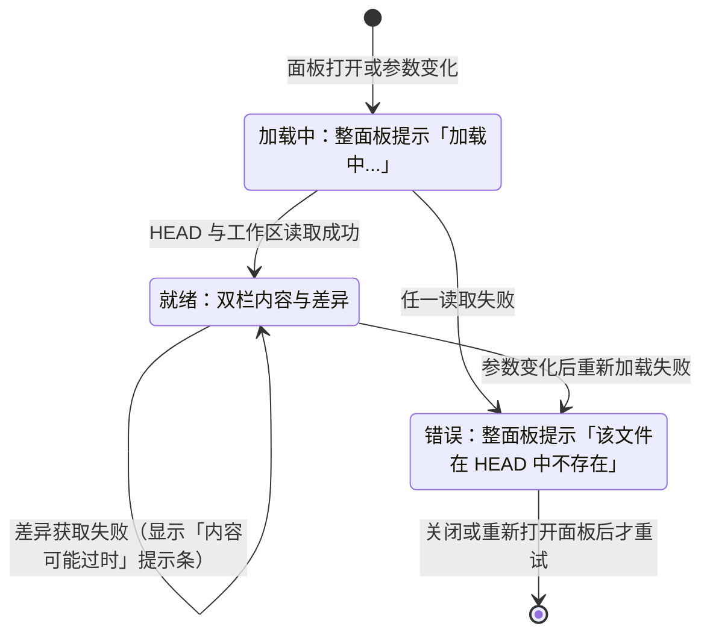
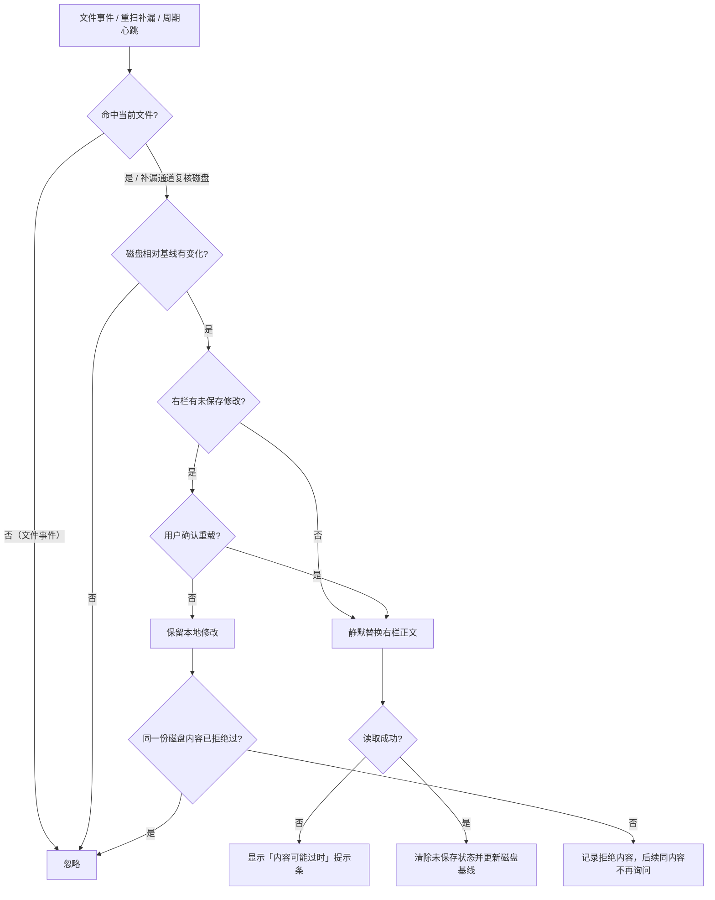

# Diff 面板：HEAD 与工作区双栏对比

> 快照日期：2026-10-19
>
> 本文档描述 slTerminal 主区面板与工作区在当前版本中的实际行为，属于 as-is 现状功能规格。代码是行为的真值源；本文档为一次性快照，不承诺随代码演进同步更新。若文档与代码不一致，以代码为准。
>
> 读者：测试/QA、开发，以及需要了解主区用户可感知行为的成员。

## 1. 本篇定位与范围

本文描述 Diff 面板的现状行为：打开入口、双栏布局、占位对齐、垂直滚动同步、右栏保存、左栏 HEAD 刷新、右栏外部修改处理、字号与自动换行、大文件降级、加载与错误状态、焦点与状态保留。

覆盖：

- 从 Commit 视图双击 modified / renamed / conflict 条目打开 Diff 面板。
- 左栏 HEAD 只读内容与右栏工作区可编辑内容的双栏对比。
- 两侧行标记、占位对齐、垂直滚动同步。
- 右栏保存及其后的差异刷新与跨区通知。
- 外部修改检测通道（文件事件、重扫补漏、周期心跳）。
- 大文件（>10MB）只读分片浏览与 1MB–10MB 警告前缀。
- 面板焦点、快捷键上下文与状态保留。

不覆盖：

- 编辑器面板的通用能力（普通打开、另存为、语言高亮、搜索等）见 [03-editor.md](03-editor.md)。
- 只读 HEAD 查看面板（Commit 视图 deleted 条目）见 [05-gitshow.md](05-gitshow.md)。
- 页面、面板页签、布局持久化与面板生命周期见 [01-workspace-shell.md](01-workspace-shell.md)。
- Commit 视图内部列表、折叠与右键操作见 [../sidebar/04-commit.md](../sidebar/04-commit.md)。
- Git 状态计算、文件监听与差异计算的后端实现。

## 2. 界面结构与入口

### 2.1 入口

**行为**

- 唯一入口：在 Commit 视图中双击 modified、renamed 或 conflict 状态的条目。
- 面板页签标题为「文件名(git diff)」，例如 `a.ts(git diff)`。
- 同一文件、同一后缀已有面板时，只聚焦该面板，不重复创建。
- renamed 条目使用旧路径读取 HEAD 侧内容；工作区侧内容与差异计算使用重命名后的当前路径。
- 面板的文件参数随布局持久化；应用重启后按原参数恢复并重新加载内容。

**交互规则**

- 双击为唯一打开手势；没有菜单命令、快捷键或拖拽打开入口。
- 同一文件若已由其他入口以不同后缀打开（如普通编辑器），视为不同面板，互不复用。

**边界条件**

- 无活跃操作页面、主区宿主不可用或找不到可落组的面板组时，双击无任何反馈。
- 未知 git 状态不会被分派到本面板。
- 布局恢复时若原文件已被删除，面板仍会打开，但进入统一错误态（见 §3.1）。

**验收判据**

- 双击 modified / renamed / conflict 条目，出现标题包含 `(git diff)` 的面板，左右两栏同时存在。
- 重复双击同一文件，不新增第二个 `(git diff)` 面板页签，只聚焦已有面板页签。
- renamed 条目的左栏显示旧路径在 HEAD 中的内容。
- 重启应用后，布局中的 Diff 面板重新出现并重新加载。

### 2.2 界面结构

**行为**

- 面板主体横向均分为左右两栏，各占 50% 宽度；两栏之间为 1px 竖向分隔线。
- 左栏标题语义为 HEAD：只读内容，带行号、搜索能力与 HEAD 侧行标记栏。
- 右栏标题语义为工作区：可编辑内容，带行号、搜索能力与工作区侧行标记栏。
- 两栏各自横向滚动，长行不会改变 50/50 的宽度分配。
- 面板顶部有一个可选的提示条槽位，仅在「内容可能过时——git diff 获取失败」出现时显示；出现时两栏整体下移，不压缩栏内内容。
- 任一侧内容超限时，该侧改为只读分片浏览视图（含来源标签与信息条），另一侧不受影响（见 §3.9）。
- 加载中与错误态不显示双栏，只显示整面板的居中文字。

**交互规则**

- 左右栏互相独立获得焦点；点击或键盘聚焦任一侧都可使用编辑器快捷键。
- 两栏的行标记栏固定占位：没有标记时也保留宽度，避免标记出现时正文横向跳动。

**边界条件**

- 面板宽度很窄时，两栏仍各占一半；每栏内部出现横向滚动条。
- 竖向分隔线不提供拖动调整宽度；两栏宽度不可单独缩放。
- 提示条只在就绪态显示；加载中与错误态下不显示。

**验收判据**

- 就绪后左右两栏等宽，中间有 1px 分隔线。
- 在任一侧输入超长行，另一栏宽度不变，长行侧出现横向滚动。
- 出现「内容可能过时」提示条时，两栏仍保持等宽并位于提示条下方。

## 3. 功能点分节

### 3.1 打开、加载与就绪

**行为**

- 面板打开后先进入加载中：整面板居中显示「加载中...」。
- 同时读取 HEAD 侧内容与工作区侧内容；两者都成功后才进入就绪并挂载编辑容器。
- 就绪后异步获取差异：内容先显示，行标记与占位随后出现。
- 初始读取任一步骤失败（HEAD 不存在、工作区文件不可读、路径越界等）一律进入错误态，整面板居中显示「该文件在 HEAD 中不存在」。
- 初始差异获取失败不阻断内容显示：两侧正文正常显示，顶部出现提示条「内容可能过时——git diff 获取失败」，此时不显示行标记与占位（差异视为空）。
- 差异获取成功后提示条消失。

**交互规则**

- 加载中与错误态没有取消、重试或刷新按钮。
- 错误态是终态：后续文件事件不会自动恢复，只有关闭后重新打开（或布局恢复重建）才会重新尝试加载。
- 若面板的文件参数在挂载期间发生变化，会重新进入加载中。

**边界条件**

- 「该文件在 HEAD 中不存在」是统一文案，不区分 HEAD 缺失、工作区读取失败、权限不足或文件过大等具体原因。
- 工作区文件在加载时被删除、或在加载瞬间不可读，同样显示该文案，而不是仅右栏空白。
- 差异获取失败后，下一次成功获取（保存后的刷新）或重新加载面板会清除提示条；除此之外不会自动清除。
- 提示条不区分失败来源：保存后的差异刷新失败与外部修改重载读取失败也复用同一文案。

**验收判据**

- 打开后先出现「加载中...」，随后出现左右两栏。
- HEAD 侧读取失败时只显示「该文件在 HEAD 中不存在」，不出现双栏与提示条。
- 工作区读取失败时同样显示「该文件在 HEAD 中不存在」。
- 差异获取失败时双栏正文可见，顶部出现「内容可能过时——git diff 获取失败」。
- 错误态下没有任何重试控件；关闭并重新打开后才重新加载。

### 3.2 左右栏内容与行标记

**行为**

- 左栏展示 HEAD 中该文件的内容，只读：可聚焦、可选择、可复制、可搜索，但不能编辑。
- 右栏展示工作区磁盘内容，可编辑；`Tab` 在右栏插入缩进。
- 两侧行标记栏按差异块显示：
  - 新增行：绿色竖条。
  - 修改行：蓝色竖条。
  - 删除行：灰色三角标记；工作区侧因该行已不存在，三角显示在相邻位置。
- 左栏按 HEAD 侧行号映射标记，右栏按工作区侧行号映射标记。
- 保存或重新获取差异后，两侧行标记一并刷新；差异为空时两侧标记清空。

**交互规则**

- 两侧均支持编辑器内的搜索（`Ctrl+F`）。
- 左栏只读不改变其可聚焦性；`Ctrl+S`、`Alt+Z` 在左栏聚焦时同样派发到本面板。
- 右栏编辑不会实时更新行标记；标记在保存后的差异刷新时才重算。

**边界条件**

- 左右栏各自横向滚动；行标记栏横向停靠，不随正文横向滚出视野，也不影响另一栏。
- 差异为空（文件与 HEAD 相同）时不显示任何标记，也没有「无差异」提示。
- 工作区侧文件超限改为只读浏览时，该侧没有编辑器行标记栏。

**验收判据**

- 打开一个含新增与删除的文件，左栏删除行出现灰色三角，右栏新增行出现绿色竖条。
- 在左栏按 `Ctrl+F` 能打开搜索框；在左栏尝试键入不会修改内容。
- 右栏编辑后未保存时，行标记保持原样；保存后标记按新差异更新。
- 文件与 HEAD 完全一致时，两侧无任何行标记。

### 3.3 占位对齐

**行为**

- 差异块导致两侧行数不一致时，在行数较少的一侧插入空白占位行，使对应内容在视觉上对齐。
- 占位规则：

| 差异块形态 | 占位所在侧 | 占位位置 | 占位行数 |
|---|---|---|---|
| 纯新增（HEAD 侧无对应行） | 左栏 | 新增内容在工作区出现的位置之前 | 等于新增行数 |
| 纯删除（工作区侧无对应行） | 右栏 | 删除内容在 HEAD 出现的位置之前 | 等于删除行数 |
| 修改，HEAD 行数更多 | 右栏 | 修改块最后一行之后 | 两侧行数差值 |
| 修改，工作区行数更多 | 左栏 | 修改块最后一行之后 | 两侧行数差值 |
| 修改，两侧行数相等 | 无 | — | 0 |

- 多个差异块落在同一插入点时，占位行数累加。
- 占位行是块级空白：无文本、不可选中、不响应鼠标事件。
- 占位行高度按当前字号估算（字号 × 1.5，四舍五入），而非实测行高。
- 占位在右栏编辑器挂载后短暂延迟应用；保存后的差异刷新会重新计算并应用。

**交互规则**

- 占位不参与行号；不改变文档内容，也不参与保存。
- 滚动同步基于滚动位置而非逻辑行号；占位的目的正是让两侧内容在相同滚动位置对齐。

**边界条件**

- 差异为空时清除两侧全部占位。
- 字号变化会即时改变正文行高，但已存在的占位行高度不会立即重算；要等下一次占位刷新（保存后或面板重新加载）才按新字号重建。期间可能出现对齐偏差。
- 任一侧超限改为只读浏览时，该侧不渲染占位；工作区侧超限时右栏编辑器不存在，占位刷新不再触发，左栏也不会出现占位。
- 1MB–10MB 警告前缀会改变编辑器实际行号，而占位仍按原始文件行号计算，因此在该区间占位可能与正文错位。
- 占位行高的估算依赖编辑器布局引擎；没有像素级自动化验证，像素级对齐由人工实测兜底。

**验收判据**

- 仅新增若干行时，左栏在对应位置出现等量空白占位，两侧后续内容视觉对齐。
- 仅删除若干行时，右栏在对应位置出现等量空白占位。
- 修改块两侧行数不等时，行数少的一侧出现差值数量的占位。
- 保存后差异变为空，两侧占位全部消失。
- 占位行不能被点击、选中或复制。

### 3.4 垂直滚动同步

**行为**

- 两侧编辑容器都就绪后，垂直滚动互相同步：任一侧纵向滚动，另一侧跟随到相同滚动位置。
- 同步仅限垂直方向；横向滚动各自独立。
- 同步过程中有防回环处理，不会出现两侧互相推动的抖动。
- 面板重新加载或切换文件后，滚动同步重新建立。

**交互规则**

- 使用鼠标滚轮、拖动滚动条、键盘滚动均触发同步。

**边界条件**

- 任一侧超限改为只读浏览时，该侧没有编辑容器，双栏滚动同步不生效；另一侧滚动不会带动只读浏览视图。
- 双侧都超限时，两侧都是只读浏览视图，各自独立滚动。

**验收判据**

- 左栏向下滚动，右栏跟随到相同滚动位置；反向亦然。
- 左栏横向滚动时，右栏横向位置不变。
- 一侧改为大文件只读浏览后，滚动另一侧不会带动该视图。

### 3.5 保存

**行为**

- 焦点位于左栏或右栏时，`Ctrl+S` 均保存右栏内容。
- 保存写入右栏编辑器的完整文档内容到工作区文件。
- 保存成功后：
  - 清除未保存状态。
  - 重新获取差异。
  - 刷新左右两栏的行标记；差异为空时清空标记。
  - 重新计算并应用占位。
  - 广播文件已保存事件，通知其他区域刷新。
- 保存成功不弹提示。
- 保存失败时弹出错误提示：`保存失败: <错误消息>`；不写盘、不刷新差异、不广播保存事件，右栏仍保持未保存状态。
- 保存后的差异刷新失败时，顶部出现「内容可能过时——git diff 获取失败」提示条；旧的行标记与占位保留，文件已保存事件仍然广播。

**交互规则**

- 保存作用于整个右栏文档，不区分选区或差异块。
- 保存不移动光标、不重置滚动位置、不重建编辑器。
- 右栏超限改为只读浏览时没有编辑容器，`Ctrl+S` 无动作且无提示。

**边界条件**

- 右栏内容处于 1MB–10MB 警告区间时，提示前缀属于右栏文档内容，会被一并写盘（见 §3.9）。
- 保存过程中若外部程序同时改写文件，以本次写入内容为准；随后文件事件可能再次触发外部修改流程。
- 连续保存时每次都会重新获取差异并广播事件。

**验收判据**

- 在右栏修改后按 `Ctrl+S`，磁盘内容等于右栏完整文档内容。
- 保存后行标记与占位按新差异更新，顶部无成功提示。
- 保存失败时出现 `保存失败: ...` 错误提示，磁盘内容不变，右栏仍为未保存状态。
- 保存后文件浏览器与 Commit 视图能够感知文件变化（见 §4）。

### 3.6 左栏 HEAD 刷新

**行为**

- 以下任一情况会重新获取 HEAD 侧内容：
  - 收到监听范围内的文件事件，且任一变更路径包含 `.git/` 目录段。
  - 收到重扫补漏信号（监听队列溢出或批量事件合并后产生）。
  - 收到约 10 秒一次的周期心跳。
- 重新获取使用打开时的 HEAD 查询路径（renamed 为旧路径）。
- 获取成功后与左栏当前内容比较：内容一致则不更新；不一致则整体替换左栏正文。
- HEAD 中已不存在该文件时，保持当前左栏内容不变。
- 刷新过程无加载提示。

**交互规则**

- `.git/` 事件不区分具体文件（索引、引用、对象等均可触发）。
- 周期心跳与重扫补漏不要求路径匹配当前文件。
- 左栏刷新不重置右栏内容、不改变右栏未保存状态。

**边界条件**

- 左栏处于 1MB–10MB 警告区间时，当前缓冲包含提示前缀，内容判等不会命中，因此每次触发都会整体替换左栏正文（包括光标与选择可能被重置）。
- 左栏超限改为只读浏览时没有编辑器内容可比较，重新获取 HEAD 不会更新该视图。
- 差异不会因左栏刷新而自动重新获取；行标记与占位保持刷新前状态，直到保存或面板重新加载。

**验收判据**

- 在仓库中执行会改动 HEAD 的操作（如提交）后，左栏内容自动更新为新 HEAD 内容。
- 仅修改普通工作区文件（事件路径不含 `.git/`）不会单独触发左栏刷新。
- HEAD 内容未变化时反复触发心跳，左栏正文不重建。
- HEAD 文件被删除后，左栏保持原内容，不显示错误。

### 3.7 右栏外部修改

**行为**

外部修改通过以下通道检测：

1. **文件事件**：收到与当前工作区文件路径匹配的修改或创建事件。
2. **重扫补漏**：监听队列溢出或批量事件合并后发出的重扫信号，忽略路径匹配。
3. **周期心跳**：约 10 秒一次，与重扫补漏共用同一复核逻辑。

文件事件通道：

- 自己保存产生的文件事件会被按路径忽略一次，不会触发外部修改流程。
- 路径不匹配、删除、访问等事件不触发重载。
- 右栏无未保存修改：静默读取磁盘并整体替换右栏正文。
- 右栏有未保存修改：弹出确认框，标题「外部修改」，正文说明文件已被外部修改且重载将丢弃本地修改，确认按钮「重载」。
  - 选择取消：保留本地修改，不读取磁盘。
  - 选择重载：读取磁盘并整体替换右栏正文，清除未保存状态。
- 读取失败：顶部出现「内容可能过时——git diff 获取失败」提示条。

重扫补漏与周期心跳通道：

- 读取磁盘内容并与上次加载、保存或重载时的磁盘内容比较。
- 磁盘内容未变化：不做任何事，不弹窗、不提示。
- 磁盘内容变化且右栏干净：静默替换正文。
- 磁盘内容变化且右栏有未保存修改：弹出与文件事件相同的确认框。
  - 取消后记住该份磁盘内容；同一内容再次被探测到时不再重复弹窗。
  - 探测到不同的新内容时重新弹窗。
  - 确认重载后清除该记忆。
- 读取失败：静默忽略，不提示。
- 右栏超限（无编辑器）时，本通道不处理；改由只读浏览视图自行检测并静默重载。

**交互规则**

- 重载总是整体替换右栏正文，不尝试合并。
- 「未保存修改」只要右栏发生过文档变更即为真，即使撤销回原始内容也仍视为有未保存修改。
- 文件事件通道下取消后不会记住该份磁盘内容，下一次同类事件仍会再次询问。
- 重载成功后清除未保存状态并更新所记录的磁盘内容。

**边界条件**

- 外部修改重载只替换正文，不重新获取差异；行标记与占位保持重载前状态，直到保存或面板重新加载。
- 事件通道的保存回声抑制条目按路径一次性消费；无关路径的保存不会误消费本文件的抑制条目。
- 心跳与重扫通道记住的「已拒绝磁盘内容」会在切换文件、重新加载、保存成功或重载成功时清空。
- 只读浏览视图的外部修改判定基于文件大小、修改时间与首/中/尾三段抽样指纹；命中变化时静默失效并重扫。

**验收判据**

- 右栏干净时外部修改文件，正文自动更新；不出现确认框。
- 右栏有未保存修改时外部修改文件，出现「外部修改」确认框；取消后本地修改保留，确认后正文变为磁盘内容。
- 周期心跳在磁盘未变化时不弹窗、不替换正文。
- 取消一次周期探测后，同一磁盘内容不再反复弹窗。
- 外部程序写入后右栏自动更新，无需手动操作。

### 3.8 字号与自动换行

**行为**

- 在左栏或右栏按住 `Ctrl`（macOS 风格下也接受 `Cmd`）滚动鼠标滚轮，按滚轮方向逐级调整编辑器字号；每级 1px。
- 字号范围为 8–32px，默认 14px；越界方向不再变化。
- 字号是全局编辑器设置：在任一侧调整后，两侧同时生效，并持久化到应用设置，重启后保留。
- 字号变化只重配置编辑器字体，不重建编辑器，不丢失内容、光标或滚动位置。
- `Alt+Z` 切换自动换行，左右两栏同时生效；默认关闭。
- 自动换行为面板实例状态，不持久化；面板重开后恢复关闭。
- 左右两栏都注册编辑器快捷键上下文：焦点在任一侧时，`Ctrl+S` 与 `Alt+Z` 都作用于本面板。

**交互规则**

- 非修饰键滚轮保持正常滚动，不调整字号。
- 自动换行开启后，长行在各自栏内折行；再次按 `Alt+Z` 恢复横向滚动。
- 大文件只读浏览侧不支持字号缩放，也不响应自动换行。

**边界条件**

- 左右栏的超限侧固定使用 14px 字号、20px 行高，不随全局编辑器字号变化。
- 字号变化不立即重算已有占位行高度（见 §3.3）。
- 两侧都超限时，没有任何编辑容器注册快捷键上下文，`Ctrl+S` 与 `Alt+Z` 在本面板内不生效。

**验收判据**

- 在任一侧 `Ctrl+滚轮`，两侧字号同步增减；到 8px 或 32px 后不再变化。
- 重启应用后字号保持上次设置。
- 在任一侧按 `Alt+Z`，两侧同时开启或关闭自动换行；重开面板后为关闭。
- 焦点在左栏时按 `Ctrl+S` 仍保存右栏内容。

### 3.9 大文件处理

**行为**

编辑器面板的通用大文件防线见 [03-editor.md](03-editor.md)；本面板的差异行为如下。

- 阈值按侧独立判定，判定依据为文本长度（字符数）：
  - 大于 1,000,000 且不超过 10,000,000：该侧正文前插入大文件警告前缀。
  - 大于 10,000,000：该侧改为只读分片浏览视图。
- 警告前缀：
  - 左栏（HEAD）：两行注释加一个空行——`// [slTerminal] 大文件（约N.NMB），只读查看。`、`// 语法高亮和搜索可能影响性能。`，随后空行。
  - 右栏（工作区）：一行注释加一个空行——`// [slTerminal] 大文件（约N.NMB），编辑可能影响性能。`，随后空行。
  - 大小按文本长度除以 1,000,000 保留一位小数。
  - 前缀计入编辑器行号，左栏相对原始文件偏移 3 行，右栏偏移 2 行。
- 只读分片浏览视图：
  - 顶部信息条显示来源标签（`HEAD` 或 `工作区`）与「只读浏览（大小），可编辑上限 10MB」。
  - 文件大小取磁盘真实字节数；取不到时显示 `…`。
  - 内容按需分片读取并虚拟化显示，可滚动浏览，固定 14px 字号、20px 行高。
  - 不提供编辑、保存、搜索、字号缩放与自动换行。
  - 文件被外部修改时自动失效缓存并静默重扫；读取部分失败时信息条显示「部分内容读取失败」。
- 两侧独立：一侧超限不影响另一侧仍使用编辑器；两侧都超限时两栏都是只读浏览视图。

**交互规则**

- 超限判定在加载内容后立即进行，警告前缀在首次显示前已插入。
- 只读浏览视图自持滚动，不参与双栏垂直滚动同步。
- 只读浏览视图不抢键盘焦点（见 §3.10）。

**边界条件**

- HEAD 侧只读浏览的内容源是磁盘上的当前工作区文件，而不是 HEAD 历史内容；文件内容与 HEAD 不一致（尤其是 renamed）时为近似展示。
- 工作区侧初始加载使用全量读取，受约 10 MiB 的全量读取上限约束：文件字节数超过该上限时读取被拒绝，面板进入统一错误态，而不是只读分片浏览。因此工作区侧只读浏览实际只在「字符数超过 10,000,000、但字节数未超过全量读取上限」的区间出现。
- 1MB–10MB 警告前缀属于编辑器文档内容：右栏保存时会被写入磁盘；左栏内容判等也因前缀而不命中。
- 警告前缀使编辑器行号整体偏移，而行标记与占位仍按原始文件行号计算，因此在该区间可能与正文错位。
- 只读浏览视图的内容大小信息条与 10MB 判定口径不同：前者是真实字节数，后者是文本长度。

**验收判据**

- 右栏文件字符数超过 10,000,000 且可被全量读取时，右栏显示只读浏览视图，信息条含「工作区」「只读浏览」，左栏正常编辑器不受影响。
- HEAD 内容超过 10,000,000 字符时，左栏显示只读浏览视图，信息条含 `HEAD`，右栏正常编辑器不受影响。
- 两侧都超限时，两栏均为只读浏览视图，没有编辑器。
- 字符数在 1,000,000–10,000,000 之间的侧，正文以对应警告前缀开头。
- 只读浏览视图可滚动，不出现编辑光标，不提供保存。
- 只读浏览视图读取失败时显示「部分内容读取失败」。

### 3.10 面板激活与焦点

**行为**

- 编辑容器只在就绪后挂载；加载中与错误态没有可聚焦的编辑器。
- 面板被激活（新建打开、点击面板页签、程序化聚焦）且右栏为可编辑形态时，键盘焦点进入右栏编辑器。
- 右栏超限改为只读浏览时，面板激活不抢占焦点；左栏是否超限不影响该规则。
- 新建打开时（来自 Commit 双击）同样经激活路径聚焦右栏。

**交互规则**

- 聚焦右栏后，编辑器快捷键上下文生效；点击左栏则上下文切换到左栏，但仍派发到本面板。
- 应用重启后的布局恢复不主动抢焦点。

**边界条件**

- 面板尚未就绪时不聚焦；就绪后若面板仍处于激活状态，补一次聚焦。
- 双侧都超限时没有焦点落点，面板激活不改动键盘焦点。

**验收判据**

- 从 Commit 双击打开后，光标位于右栏编辑器内，可直接输入。
- 右栏为只读浏览视图时，打开面板后焦点不进入该视图。
- 点击左栏后按 `Alt+Z`，两栏自动换行状态同时切换。

## 4. 跨区行为

| 触发条件 | 可感知结果 |
|---|---|
| Commit 视图双击 modified / renamed / conflict 条目 | 主区新增或聚焦 `文件名(git diff)` 面板；已存在同文件同后缀则只聚焦 |
| 在 Diff 面板保存成功 | 广播文件已保存事件；文件浏览器在约 300ms 去抖后刷新受影响目录并更新 git 着色；Commit 视图经自身文件事件监听约 200ms 后刷新列表 |
| 外部程序修改当前文件 | 右栏按 §3.7 更新；左栏仅在被判定为 HEAD 变化时刷新 |
| 在仓库中产生 `.git/` 变化 | 左栏重新获取 HEAD；差异本身不会自动重取 |
| 同一页组内切换面板页签 | 面板卸载重建；切回时重新读取 HEAD 与工作区，右栏未保存修改、滚动位置与自动换行状态丢失 |
| 切换操作页面 | 页组整体隐藏，面板不卸载；右栏未保存修改、两侧正文、滚动位置与自动换行状态保留，切回后不重新读盘 |
| 关闭面板页签后重新打开 | 新建面板并重新加载；未保存修改丢失 |
| 应用重启 | 面板按持久化布局恢复，重新加载内容；未保存修改不恢复 |
| 关闭面板页签或关闭窗口 | 不询问未保存修改，直接丢弃右栏修改 |

## 5. 状态保留与持久化

| 状态对象 | 组内切签 | 切换操作页面 | 关闭后重开 | 应用重启后 |
|---|---|---|---|---|
| 面板存在与文件参数（当前文件、旧路径、仓库根） | 保留 | 保留 | 重新创建（重新打开文件） | 按布局恢复 |
| 右栏未保存修改 | 不保留 | 保留 | 不保留 | 不保留 |
| 两侧正文、行标记、占位 | 重新加载 | 保留 | 重新加载 | 重新加载 |
| 未保存状态与所记录的磁盘内容 | 不保留 | 保留 | 不保留 | 不保留 |
| 滚动位置 | 不保留 | 保留 | 不保留 | 不保留 |
| 自动换行状态 | 不保留 | 保留 | 不保留 | 不保留 |
| 字号设置 | 保留（全局设置） | 保留 | 保留 | 保留 |
| 「内容可能过时」提示条状态 | 不保留 | 保留 | 不保留 | 不保留 |
| 面板焦点 | 不保留 | 不保留 | 不保留 | 不保留 |

- 面板自身不写入任何持久化状态；仅文件参数随布局持久化，由工作区层负责。
- 字号是全局编辑器设置，写入应用设置文件；它不是本面板的私有状态。
- 关闭面板页签、关闭窗口、组内切签与切换操作页面都不会确认未保存修改；其中关闭面板页签、关闭窗口与组内切签会丢失右栏修改，切换操作页面不会。

## 6. 空态、加载、错误

### 空态

- 两侧内容相同、差异为空时：两栏照常显示内容，无行标记、无占位，也没有「无差异」文字提示。
- 面板没有独立的空白状态；内容为空文件时，编辑器显示空文档。

### 加载

- 初始加载：整面板居中显示「加载中...」，不显示双栏、行标记或提示条。
- 内容就绪后先显示正文；差异异步返回后行标记与占位出现，期间无额外加载指示。

### 错误

- 初始加载任一步骤失败：整面板居中显示「该文件在 HEAD 中不存在」，不显示双栏与提示条，无重试入口。
- 初始差异获取失败：双栏正常显示，顶部出现「内容可能过时——git diff 获取失败」，无行标记与占位。
- 保存后的差异刷新失败：保留旧行标记与占位，顶部出现同一提示条。
- 外部修改重载读取失败：顶部出现同一提示条。
- 保存失败：错误提示 `保存失败: <错误消息>`。
- 只读浏览视图读取失败：信息条显示「部分内容读取失败」。

## 7. 图表

### 7.1 面板加载状态

### 7.2 右栏外部修改判定

## 8. 验收判据汇总

| 触发 | 结果 | 验收判据 |
|---|---|---|
| Commit 双击 modified / renamed / conflict | 打开或聚焦 Diff 面板 | 面板页签标题含 `(git diff)`，左右栏出现；重复双击不新建 |
| 打开面板 | 先加载后双栏 | 先见「加载中...」，再见双栏正文 |
| 初始读取失败 | 统一错误态 | 只见「该文件在 HEAD 中不存在」，无双栏、无重试 |
| 差异获取失败 | 内容可读但无标记 | 双栏正文可见，顶部提示「内容可能过时——git diff 获取失败」 |
| 仅新增或仅删除 | 占位对齐 | 行数少的一侧出现等量空白占位 |
| 滚动一侧 | 垂直同步 | 另一侧跟随相同纵向位置；横向不跟随 |
| 右栏修改后 `Ctrl+S` | 保存并刷新 | 磁盘内容等于右栏全文；行标记与占位更新；无成功提示 |
| 保存失败 | 错误提示 | 出现 `保存失败: ...`，磁盘不变，仍为未保存状态 |
| 右栏干净时外部修改 | 静默重载 | 正文自动更新，无确认框 |
| 右栏有未保存修改时外部修改 | 确认后重载 | 出现「外部修改」确认框；取消保留本地修改，确认后载入磁盘内容 |
| 心跳探测到磁盘未变 | 零打扰 | 不弹窗、不替换正文 |
| 任一侧超过 10,000,000 字符 | 该侧只读浏览 | 信息条含来源标签与「只读浏览」，该侧无编辑器 |
| 1,000,000–10,000,000 字符 | 警告前缀 | 该侧正文以对应大文件提示前缀开头 |
| 面板激活 | 聚焦右栏 | 右栏为编辑器时可直接输入；右栏为大文件视图时不抢焦 |
| 组内切签 | 不保留编辑状态 | 面板卸载重建；未保存修改、滚动位置与自动换行丢失 |
| 切换操作页面 | 保留编辑状态 | 右栏未保存修改、正文与滚动位置保留；切回不重新读盘 |
| 关闭面板页签后重开或应用重启 | 不保留编辑状态 | 重新加载磁盘内容；未保存修改丢失 |

## 9. 边界与非目标

**边界**

- 只做 HEAD ↔ 工作区的双栏对比；固定左右两栏等宽，不可调整宽度、不可交换左右、不可折叠单侧。
- 只读左栏与可编辑右栏的角色固定；不能把工作区内容放到左栏。
- 差异以行级差异块呈现；不提供字符级、单词级或语义级差异高亮。
- 行标记不提供点击、悬停详情、跳转或逐块导航。
- 保存只写右栏整份文档；不提供另存为、部分保存或暂存操作。
- 外部修改只支持整份重载；不提供三方合并或冲突解决。
- 大文件改为只读分片浏览后不可编辑、不可保存。
- 面板不持久化自身状态；组内切签、关闭后重开或应用重启后重新加载，切换操作页面不重新加载。
- 仅暗色模式、Windows 原生、单窗口；不描述多窗口、多实例、跨平台或触摸交互。

**非目标**

- 不提供暂存区对比、任意提交间对比、分支间对比。
- 不提供差异块级暂存、回滚、提交、推送或冲突解决。
- 不提供并排/行内差异形态切换、空白字符差异开关或换行符差异开关。
- 不描述 Git 差异计算、文件监听、路径沙箱的后端实现。
- 不描述编辑器通用能力与文档预览行为。

## 10. 已知限制

- 【行为设计】仅支持 HEAD ↔ 工作区对比；不支持暂存区（索引）对比，也不支持任意两次提交之间的对比。
- 【行为设计】不提供差异块级暂存或回滚，也没有任何 git 写操作；回滚需转到 Commit 视图执行。
- 【行为设计】初始加载的任意失败都显示同一文案「该文件在 HEAD 中不存在」，不区分 HEAD 缺失、工作区不可读、权限不足等原因；错误态没有重试入口，只能关闭后重开。
- 【行为设计】HEAD 侧超过 10MB 的只读浏览读取磁盘当前工作区文件，而非 HEAD 内容；文件与 HEAD 不一致（尤其重命名场景）时为近似展示。
- 【行为设计】10MB 阈值按文本长度（字符数）近似判定，而非磁盘真实字节数；多字节字符文件会被偏早判定为大文件。
- 【行为设计】1MB–10MB 的警告前缀计入 HEAD 内容判等，导致该区间每次 `.git/` 事件、重扫补漏或周期心跳都会整体替换左栏正文（代码注释登记为可接受）。
- 【行为设计】本面板不是常驻渲染面板：同一页组内切换面板页签会卸载重建并重新读盘，右栏未保存修改丢失；切换操作页面只隐藏页组，面板不卸载，修改保留。
- 【行为设计】关闭面板页签、关闭窗口与组内切签均不确认右栏未保存修改；关闭守卫只覆盖设置中心面板。
- 【行为设计】大文件只读浏览侧不参与双栏滚动同步与占位对齐，固定 14px 字号与 20px 行高，不支持字号缩放、自动换行、搜索与保存。
- 【行为设计】占位行高度按「字号 × 1.5」估算，且字号变化后不会立即重算；像素级对齐依赖编辑器布局引擎，无自动化像素级验证。
- 【疑似缺陷】1MB–10MB 警告前缀属于右栏文档内容，`Ctrl+S` 会把前缀一并写入磁盘；之后再次加载并保存会继续叠加前缀。
- 【疑似缺陷】工作区文件字节数超过全量读取上限（约 10 MiB）时，初始读取失败并显示「该文件在 HEAD 中不存在」；工作区侧只读分片浏览只在字符数超过 10,000,000 且未超全量读取上限的区间可达。
- 【疑似缺陷】1MB–10MB 警告前缀计入编辑器行号（左栏相对原始文件偏移 3 行、右栏偏移 2 行），而行标记与占位按原始文件行号放置，导致标记与占位同正文错位。
- 【疑似缺陷】外部修改重载只替换正文，不重新获取差异；行标记与占位保持重载前状态，直到保存或面板重新加载。
- 【疑似缺陷】面板没有可见的未保存指示；组内切签或关闭会丢弃右栏修改，但界面既无脏标记也无关闭确认。
- 【无障碍/平台】左右栏之间没有键盘焦点切换快捷键，焦点切换需要鼠标点击；右栏 `Tab` 用于缩进；大文件只读浏览视图不进入编辑器焦点流程。

## 11. 相关文档

- [README.md](README.md)：主区面板与工作区规格总览与阅读顺序
- [01-workspace-shell.md](01-workspace-shell.md)：页面、面板页签、布局持久化与面板生命周期
- [03-editor.md](03-editor.md)：编辑器面板通用能力（保存、搜索、字号、自动换行、大文件）
- [05-gitshow.md](05-gitshow.md)：只读 HEAD 查看面板
- [../sidebar/04-commit.md](../sidebar/04-commit.md)：Commit 视图与双击状态分派
- [../../CONTEXT.md](../../CONTEXT.md)：领域术语表
