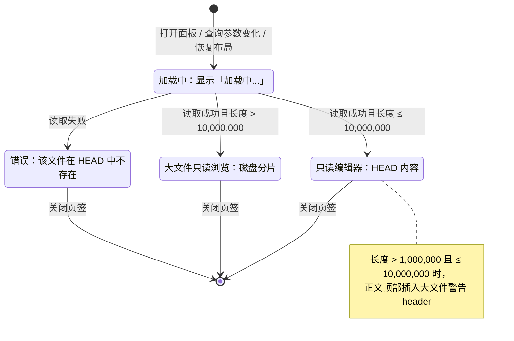

# GitShow 面板（HEAD 只读查看）

> 快照日期：2026-10-19
>
> 本文档描述 slTerminal 主区面板与工作区在当前版本中的实际行为，属于 as-is 现状功能规格。代码是行为的真值源；本文档为一次性快照，不承诺随代码演进同步更新。若文档与代码不一致，以代码为准。
>
> 读者：测试/QA、开发，以及需要了解主区用户可感知行为的成员。

## 1. 本篇定位与范围

本篇描述 GitShow 面板（主区中的只读 HEAD 文件查看面板）的入口、内容读取与加载/内容/错误状态、只读编辑能力、大文件处理、焦点、快照语义、状态保留与持久化、空态/加载/错误及已知限制。

覆盖：

- 从 Commit 侧栏视图打开 GitShow 面板的触发条件与用户可感知结果。
- 文件在 HEAD 提交中的内容读取、展示与失败处理。
- 只读编辑器的可聚焦、搜索、自动换行、字号调整与主题行为。
- 1MB 警告 header 与 10MB 大文件只读分片浏览形态。
- 面板焦点、快照语义、布局持久化与恢复。
- 已知限制登记。

不覆盖：

- Commit 侧栏视图内部的列表、刷新、回滚与状态计算，见 [../sidebar/04-commit.md](../sidebar/04-commit.md)。
- Diff 面板的双栏对比、占位对齐与保存行为，见 [04-diff.md](04-diff.md)。
- 编辑器面板的磁盘文件编辑、保存、外部修改、git gutter 与大文件防线的完整细节，见 [03-editor.md](03-editor.md)。
- 布局、面板页签、焦点与主题框架的通用行为，见 [01-workspace-shell.md](01-workspace-shell.md)。
- 大文件只读浏览组件的虚拟化实现细节；本篇只描述该形态下用户可感知的行为。

## 2. 界面结构与入口

### 2.1 界面构成

**行为**

- GitShow 面板是主区中的一个普通面板，占用一个面板页签，内容区占满页签下方空间。
- 面板页签标题为文件名直接拼接后缀 `(git delete)`，中间无空格，例如 `a.ts(git delete)`。
- 同一操作页面内出现同名文件时，面板页签标题改用相对项目根的路径再拼接后缀；同名冲突出现或消失时标题自动重算。
- 面板页签图标按文件扩展名显示文件类型图标。
- 面板自身没有工具栏、刷新按钮或状态栏。
- 常规形态下，内容区是一个只读代码编辑器：显示行号、按文件扩展名启用语法高亮，未知扩展名按纯文本显示。
- 大文件形态下，内容区改为顶部信息条加分片加载的只读滚动区域。

**交互规则**

- 面板内所有文本操作均围绕只读展示，不提供保存、另存为或格式转换入口。
- 面板尺寸与位置由主区布局管理，拖拽分屏、调整大小等行为遵循 [01-workspace-shell.md](01-workspace-shell.md)。

**边界条件**

- 面板页签标题中的后缀固定为英文 `(git delete)`，不随界面语言变化。
- 语法高亮与页签图标按面板当前文件路径的扩展名判定；若面板携带旧路径，仅内容查询使用旧路径，高亮与图标仍按当前文件路径判定。

**验收判据**

- 打开后面板页签标题符合 `文件名(git delete)`；同名文件并存时使用相对路径区分。
- 内容区没有刷新按钮或保存按钮。
- 常规形态正文可见行号与语法高亮；未知扩展名不显示语法着色。

### 2.2 入口

**行为**

| 触发条件 | 结果 |
|---|---|
| 在 Commit 侧栏视图的 Changes 列表中双击 `deleted` 状态的文件行 | 在当前活跃操作页面的聚焦组中打开 GitShow 面板，并读取该文件在 HEAD 提交中的内容 |

- GitShow 面板当前唯一入口是 Commit 视图中的已删除文件。其他 git 状态分别打开编辑器或 Diff 面板，不经过本面板，映射见 [../sidebar/04-commit.md](../sidebar/04-commit.md)。
- 打开前按「当前活跃操作页面 + 文件路径 + `(git delete)` 后缀」去重：命中已有面板时只聚焦该面板，不新建，也不重新读取内容。
- 普通编辑器面板、Diff 面板或其他后缀的面板不视为重复；同一文件可以同时存在多个不同类型或不同后缀的面板。
- 新面板落在当前活跃操作页面的聚焦组中；布局位置遵循 [01-workspace-shell.md](01-workspace-shell.md)。
- 查询 HEAD 时，面板若携带旧路径则优先使用旧路径，否则使用文件路径；仓库根路径取打开时所属项目的根路径。当前唯一入口不携带旧路径，因此实际按文件路径查询。

**交互规则**

- 双击即打开，无确认步骤。
- 去重聚焦是静默动作，不刷新面板内容、不显示提示。
- 打开失败（没有活跃操作页面、无法解析项目根路径、主区宿主不可用等）时不创建面板、不显示提示。

**边界条件**

- 去重范围仅限当前活跃操作页面；其他操作页面中打开的同文件面板不会被聚焦。
- 面板创建失败时静默结束，不产生页签。

**验收判据**

- 双击 `deleted` 文件行后出现标题为 `文件名(git delete)` 的面板。
- 在同一页面再次双击同一文件，不新增页签，仅聚焦已有 GitShow 面板。
- 同一文件已用普通编辑器打开时，双击 `deleted` 行仍会打开独立的 GitShow 页签。
- 没有活跃操作页面时双击不出现面板，也没有错误提示。

## 3. 功能点分节

### 3.1 HEAD 内容读取与展示

**行为**

- 面板挂载时、或查询参数（仓库根路径、文件路径、旧路径）变化时，立即进入加载态并读取目标文件在 HEAD 提交中的文本内容。
- 读取成功后进入内容态，使用只读代码编辑器展示完整文本；文本来自 HEAD 提交对象，不是工作区磁盘文件。
- 读取失败后进入错误态，任何失败原因都显示统一错误文案。
- 同一时刻只采纳最后一次请求的结果：旧请求晚到不会覆盖新参数对应的内容。

**交互规则**

- 正文可纵向滚动；长行默认不自动换行，可横向滚动查看。
- 文本可选择、复制；光标可在正文中移动。
- 内容区不提供重试、刷新或重新加载入口。

**边界条件**

- 空文件读取成功时进入内容态，正文为空白编辑器，不显示「文件为空」提示。
- 非 UTF-8 内容按文本方式解码，无法解码的字节以替换字符显示。
- HEAD 内容与工作区磁盘内容无关；工作区中的未提交修改不会出现在常规形态中。

**验收判据**

- 打开一个已删除文件，正文显示该文件在 HEAD 提交中的完整内容。
- 打开一个 HEAD 中不存在的路径，显示统一错误文案。
- 连续打开不同文件时，最终只显示最后一个文件的内容，不出现旧文件内容残留。
- 正文可选择并复制；键入、粘贴、删除不会改变文本。

### 3.2 只读编辑能力

**行为**

- 面板只读：不可编辑、不可保存、无脏状态；关闭页签不弹保存确认。
- 编辑器仍可获得键盘焦点：点击正文或面板被激活后，可直接使用编辑器快捷键与搜索。
- `Ctrl+F` 打开顶部搜索框，匹配项在正文中高亮；`Ctrl+G` 与 `Shift+Ctrl+G` 在匹配项之间前后跳转。
- `Alt+Z` 切换自动换行；仅当该只读编辑器持有焦点时生效。默认关闭，每个面板实例独立，不持久化。
- `Ctrl+滚轮` 在正文区域滚动时调整编辑器字号：每次滚轮向上或向下改变 1px，范围 8–32px。该字号是全局编辑器字号，与编辑器面板共享，所有编辑器同时变化，并在约 2 秒后持久化。
- 主题跟随当前配色方案；配色方案切换时编辑器主题热切换，编辑器实例不重建。
- 在该面板聚焦时，`Ctrl+S` 被消费但不产生任何效果：不写盘、不提示、不显示保存状态。

**交互规则**

- 搜索框位于正文顶部；关闭搜索框后恢复正文显示。
- 自动换行切换只重配当前编辑器视图，不重置光标与滚动位置。
- 字号调整仅在常规内容形态且指针位于正文区域时可用。
- 只读不阻止选择、复制、搜索与光标移动；所有会修改文本的操作均无效果。

**边界条件**

- 自动换行状态只在当前面板实例存活期内有效；面板重建后恢复为关闭。
- 加载态、错误态与大文件形态没有正文编辑器，搜索、自动换行与字号快捷键均不生效。

**验收判据**

- 点击正文后出现光标，可选中并复制；键入、粘贴、删除均不改变文本。
- `Ctrl+F` 出现搜索框并能定位匹配项；`Alt+Z` 在换行与不换行之间切换。
- `Ctrl+滚轮` 改变字号，且其他编辑器面板的字号同步变化；字号保持在 8–32px 内。
- 配色方案切换后正文配色即时变化，滚动位置与文本不重置。
- `Ctrl+S` 不产生任何可见反馈，磁盘文件不变。

### 3.3 大文件处理

大文件阈值与只读分片浏览的通用行为见 [03-editor.md](03-editor.md)；本节只描述 GitShow 面板的差异。

**行为**

- 面板按 HEAD 文本长度（以字符数近似字节数）处理：
  - 长度 ≤ 1,000,000：常规只读编辑器，无额外提示。
  - 1,000,000 < 长度 ≤ 10,000,000：常规只读编辑器，并在正文顶部插入大文件警告 header，原文完整保留。
  - 长度 > 10,000,000：不创建编辑器，切换为大文件只读分片浏览。
- 警告 header 由注释行、空行与行首警告图标组成，模板为：

  ```text
  // [slTerminal] 大文件（约X.XMB），只读查看。
  // 语法高亮和搜索可能影响性能。
  ```

  其中 `X.X` 为按 0.1MB 取整的近似大小；警告图标位于第一行行首，不响应指针或键盘事件。
- 大文件只读分片浏览由顶部信息条与滚动内容区组成：
  - 信息条左侧显示来源标识 `git show`，随后显示 `只读浏览（文件大小），可编辑上限 10MB`。
  - 文件大小取工作区磁盘文件的真实字节数，以人类可读单位显示；无法取得时显示 `…`。
  - 任一分片读取失败时，信息条追加红色 `部分内容读取失败`，悬停可查看具体错误；已读取的内容继续显示。
- 内容按固定行高虚拟化渲染，随滚动按需读取后续分片。

**交互规则**

- 大文件形态可纵向滚动；长行可横向滚动。
- 工作区磁盘文件发生修改时，查看器静默失效并重新读取（依据文件系统事件与约 10 秒心跳比对）；这是面板内唯一会随外部变化更新内容的形态。
- 大文件形态不提供搜索、自动换行与字号调整；正文固定 14px 字号、20px 行高。
- 大文件形态不自动获得键盘焦点。

**边界条件**

- 大文件形态的内容源是工作区磁盘文件，不是 HEAD 提交内容；两者不一致时，展示的是磁盘内容。
- 文件已从磁盘删除时（`deleted` 条目的常见情况）：大小显示 `…`，并出现 `部分内容读取失败`，正文可能为空白。
- 10MB 与 1MB 判定使用字符数近似，多字节字符会低估实际字节数；警告 header 中的大小同样是近似值。
- 行索引尚未覆盖的区域会随滚动逐步出现，没有整页加载提示。
- 长度恰好为 1,000,000 时不插入警告 header；长度恰好为 10,000,000 时仍使用常规编辑器并插入警告 header。

**验收判据**

- 1MB 以上、10MB 以内的内容：正文首部出现警告 header，原文完整保留。
- 超过 10MB：不出现代码编辑器，出现信息条与只读分片浏览；信息条包含 `git show`、`只读浏览` 与 `可编辑上限 10MB`。
- 磁盘文件缺失时出现 `部分内容读取失败`，面板不崩溃。
- 大文件形态下 `Ctrl+F`、`Alt+Z`、`Ctrl+滚轮` 均不生效。

### 3.4 焦点与激活

**行为**

- 新建该面板、点击其页签、或因去重而聚焦已有面板时，若常规形态内容已就绪，键盘焦点自动进入只读编辑器。
- 加载态、错误态、大文件形态均不抢焦点：面板打开后键盘焦点保持原处。
- 应用启动或布局恢复时，不因恢复面板而抢占键盘焦点。
- 点击正文区域可随时将焦点移入编辑器。

**交互规则**

- 焦点进入编辑器后，`Ctrl+F`、`Alt+Z` 等编辑上下文快捷键直接作用于该面板。
- 未聚焦时，编辑上下文快捷键作用于其他持焦点的编辑器；没有聚焦编辑器时不产生效果。

**边界条件**

- 内容读取失败后不会重试聚焦。
- 大文件形态没有可自动聚焦的编辑器，用户需自行滚动浏览。

**验收判据**

- 双击 `deleted` 文件打开面板，内容出现后无需再次点击即可使用 `Ctrl+F`。
- 打开超大文件进入大文件形态时，键盘焦点不被该面板夺走。
- 重启应用恢复布局后，没有 GitShow 面板抢占焦点。

### 3.5 快照与刷新语义

**行为**

- 常规形态的内容是一次性 HEAD 快照：面板挂载时读取一次，之后不订阅文件系统事件、不监听仓库变化、不提供刷新按钮。
- 外部修改工作区文件、执行提交、回滚、切换分支或让 `.git` 目录发生变化，均不会更新已打开的面板。
- 去重聚焦已有面板不会重新读取内容，即使 HEAD 已变化。
- 面板卸载后重建或应用重启时，会重新读取当时的 HEAD 内容。

**交互规则**

- 查看最新 HEAD 内容的方式是关闭页签后重新打开，或让面板重建。
- 面板内没有手动刷新、自动刷新或定时刷新机制。

**边界条件**

- 大文件形态是快照语义的明确例外：其内容来自工作区磁盘文件，并随磁盘变化静默重读，见 3.3。
- 面板保持挂载期间，即使目标文件被提交、回滚或删除，常规形态正文也保持不变。

**验收判据**

- 打开面板后修改工作区文件，常规形态正文文本不变。
- 在外部回滚或提交后，已打开面板仍显示打开时的内容。
- 关闭后重新打开同一文件，显示最新 HEAD 内容。
- 超过 10MB 的形态下修改磁盘文件，查看器内容随磁盘变化更新。

## 4. 跨区行为

| 触发条件 | 可感知结果 |
|---|---|
| 在 Commit 视图双击 `deleted` 文件行 | 主区打开或聚焦 GitShow 面板；面板进入加载态后显示 HEAD 内容或错误 |
| 同一页面已有同文件 `(git delete)` 面板时再次双击 | 仅聚焦已有面板；不新建、不重新读取 |
| 工作区或 `.git` 发生变化 | Commit 侧栏列表按自身机制刷新；已打开 GitShow 面板的常规形态内容不变 |
| 在侧栏或其他工具中回滚、删除或提交目标文件 | 已打开 GitShow 面板不刷新；大文件形态按磁盘变化自行重读 |
| 切换到其他操作页面 | 面板随所属页组隐藏但保持挂载；内容、滚动位置与编辑状态保留 |
| 切回该操作页面 | 面板重新显示，内容不重新读取 |
| 关闭 GitShow 页签 | 无保存确认；面板实例销毁，内容与界面状态丢弃 |
| 关闭后重新双击同一文件 | 新建面板并重新读取 HEAD 内容 |
| 应用重启 | 按布局恢复面板；重新读取 HEAD 内容，不抢焦点 |
| 更改全局编辑器字号 | GitShow 与其他编辑器面板的正文同步变化，字号持久化 |
| 切换配色方案 | 正文主题热切换，编辑器不重建 |

## 5. 状态保留与持久化

### 5.1 随布局持久化

- 面板类型、面板标识、文件路径、仓库根路径、可选的旧路径，以及页签位置、所属分组和面板尺寸，随操作页面布局保存。
- 面板页签标题不采用布局中的保存值，恢复时按文件路径与 `(git delete)` 后缀重新计算。

### 5.2 不持久化

- HEAD 文本内容、滚动位置、搜索框状态与关键词、自动换行开关、键盘焦点、大文件查看器的分片缓存均不写入布局，应用重启或面板重建后丢失。
- 字号不属于面板状态，属于全局编辑器设置，独立持久化。

### 5.3 状态保留矩阵

| 状态对象 | 组内切签 | 切换操作页面 | 关闭后重开 | 应用重启 |
|---|---|---|---|---|
| HEAD 文本 | 丢弃并重新读取 | 保留 | 丢弃并重新读取 | 丢弃并重新读取 |
| 滚动位置 | 重置 | 保留 | 重置 | 重置 |
| 搜索框与关键词 | 重置 | 保留 | 重置 | 重置 |
| 自动换行开关 | 恢复为关闭 | 保留 | 恢复为关闭 | 恢复为关闭 |
| 大文件查看器缓存 | 丢弃并重新读取 | 保留 | 丢弃并重新读取 | 丢弃并重新读取 |
| 字体大小 | 保留（全局设置） | 保留（全局设置） | 保留（全局设置） | 保留（恢复保存值） |
| 文件路径、仓库根路径 | 保留 | 保留 | 保留 | 保留（随布局恢复） |

> 该面板不参与常驻挂载：同一组内切到其他页签时面板会被卸载，因此组内切签再切回或拖拽重排会导致面板重建。切换到其他操作页面时页组仅隐藏，面板不被卸载；关闭后重开与应用重启则分别经新建面板与布局恢复重新读取 HEAD。

### 5.4 恢复流程

- 启动或恢复布局时，按保存的参数恢复 GitShow 面板。
- 面板先显示加载态，再读取当前 HEAD：成功则显示最新内容，文件已不在 HEAD 中则显示统一错误文案。
- 恢复过程不抢占键盘焦点。

## 6. 空态、加载、错误

### 6.1 加载

- 内容区居中显示 `加载中...`，使用灰暗色文字，背景为面板背景。
- 不显示骨架屏、进度条、取消按钮或重试入口。
- 加载期间面板页签仍可切换、关闭或拖拽。
- 查询参数变化时重新进入加载态，旧请求结果被丢弃。

### 6.2 空态

- HEAD 内容为空文件时进入内容态，显示空白只读编辑器（可见行号），没有「文件为空」之类的占位文案。
- 面板没有独立的「未打开文件」空态；面板始终由入口携带文件路径创建。

### 6.3 错误

- 内容区居中显示 `该文件在 HEAD 中不存在`，使用错误色文字，背景为面板背景。
- 所有读取失败均显示同一文案：无提交记录、文件不在 HEAD、非 git 仓库、路径校验失败、读取异常等不做区分。
- 不显示错误详情、错误码、重试按钮或刷新入口。
- 错误态持续到面板重建或查询参数变化。

### 6.4 大文件提示

- 1MB–10MB：正文顶部插入警告 header，提示大文件、只读查看以及语法高亮和搜索可能影响性能；警告 header 是正文的一部分，可被选中、复制，并使正文行号整体后移。
- 超过 10MB：信息条显示来源标识与 `只读浏览（文件大小），可编辑上限 10MB`；大小未知时显示 `…`。
- 分片读取失败：信息条显示红色 `部分内容读取失败`，悬停可查看错误详情；已有内容继续显示。
- 大文件形态没有整页加载提示，内容按需分片出现。

## 7. 图表



## 8. 验收判据汇总

| 触发 | 结果 | 验收判据 |
|---|---|---|
| Commit 视图双击 `deleted` 文件行 | 打开 GitShow 面板 | 面板页签标题为 `文件名(git delete)`；内容区先显示 `加载中...`，随后显示 HEAD 内容或错误 |
| 再次双击同文件 | 去重聚焦 | 不新增页签，不重新读取内容 |
| HEAD 中不存在该文件 | 错误态 | 居中显示 `该文件在 HEAD 中不存在`，无重试入口 |
| 点击正文 | 编辑器获得焦点 | 可直接使用 `Ctrl+F`、`Alt+Z`；键入与粘贴不改变文本 |
| `Ctrl+滚轮` | 调整全局编辑器字号 | 字号在 8–32px 内变化，其他编辑器同步，约 2 秒后持久化 |
| 1MB–10MB 内容 | 警告 header + 常规编辑器 | 正文首部出现警告 header，原文完整 |
| 超过 10MB | 大文件只读分片浏览 | 出现 `git show`、`只读浏览`、`可编辑上限 10MB`；不出现代码编辑器 |
| 大文件磁盘文件缺失 | 读取兜底 | 信息条出现 `部分内容读取失败`，面板不崩溃 |
| 打开后外部修改文件或 HEAD | 常规形态快照不变 | 常规形态正文不变；大文件形态按磁盘变化重读 |
| 组内切到其他页签再切回 | 面板重建 | 重新读取 HEAD；滚动与搜索状态重置 |
| 切换操作页面再切回 | 面板保持挂载 | 内容、滚动与搜索状态保留，不重新读取 |
| 应用重启 | 布局恢复 | 面板重新读取 HEAD；不抢占键盘焦点 |

## 9. 边界与非目标

**边界**

- 面板只展示文件在 HEAD 提交中的版本，不支持查看历史提交、其他分支、暂存区、索引或工作区版本（大文件形态的磁盘来源除外）。
- 面板不提供差异对比、blame、提交信息、文件历史或跳转其他提交的能力。
- 面板不可编辑、不可保存，不产生脏状态，关闭时无保存确认。
- 常规形态不随文件系统或 `.git` 变化刷新，没有刷新按钮。
- 大文件形态不支持搜索、自动换行与字号调整，正文固定字号与行高。
- 仅有 `deleted` 状态的文件会进入本面板；其他状态分派到编辑器或 Diff 面板。
- 本篇只覆盖 Windows 原生、单窗口、暗色模式场景；不描述多窗口、多实例或亮色主题。
- 超大文件只提供只读分片浏览，不提供全文搜索或整体复制保证。

**非目标**

- 不描述 Commit 侧栏视图内部实现与列表行为。
- 不描述编辑器面板、Diff 面板与文档预览面板的内部行为。
- 不描述布局、面板页签、焦点框架的实现细节。
- 不包含改进建议、缺陷修复方案、优先级或排期。
- 不描述尚未实现的历史版本浏览、diff 切换或保存能力。

## 10. 已知限制

- 【行为设计】常规形态为一次性 HEAD 快照：打开后不随工作区文件、提交、回滚、分支切换或 `.git` 变化刷新，也没有刷新按钮；去重聚焦已有面板同样不刷新。要看到新内容必须关闭重开或让面板重建。
- 【行为设计】所有读取失败统一显示 `该文件在 HEAD 中不存在`，包括无提交记录、非 git 仓库、路径校验失败、读取异常等原因；界面不提供原因区分或重试入口。
- 【行为设计】1MB 与 10MB 阈值、以及警告 header 中的大小，均按 HEAD 文本的字符数量近似字节数，多字节字符会低估实际体积；大文件查看器信息条使用磁盘文件真实字节，不同来源的数值可能不一致。
- 【行为设计】大文件只读浏览形态不支持搜索、自动换行与字号调整，正文固定 14px 字号、20px 行高，且不自动聚焦。
- 【行为设计】面板不参与常驻挂载：组内切签再切回、拖拽重排或应用重启会重建面板，HEAD 文本、滚动位置、搜索状态与自动换行状态丢失并重新读取；这是避免大文件编辑器常驻内存的既定取舍。
- 【行为设计】只读面板不提供保存能力；在该面板聚焦时，`Ctrl+S` 被消费但没有任何反馈（不写盘、不提示、不标脏）。
- 【疑似缺陷】没有活跃操作页面、无法解析项目根路径或主区宿主不可用时，双击 `deleted` 行完全静默，用户得不到任何引导；面板创建失败时同样无提示。
- 【疑似缺陷】超过 10MB 时，面板先以 HEAD 内容判定超限，随后却改读工作区磁盘文件而非 HEAD。本面板的主要入口是「已删除」文件，磁盘通常已无该文件，结果是 HEAD 中的大文件无法查看，只能看到空白与 `部分内容读取失败`。
- 【无障碍/平台】大文件形态没有可聚焦的编辑器：键盘用户无法使用 `Ctrl+F`、`Alt+Z` 与字号快捷键，只能依赖鼠标滚轮、滚动条或平台提供的滚动操作浏览内容。

## 11. 相关文档

- [README.md](README.md)：主区面板与工作区规格总览。
- [01-workspace-shell.md](01-workspace-shell.md)：工作区宿主、面板页签、页内分屏、焦点、布局持久化与主题。
- [03-editor.md](03-editor.md)：编辑器面板、只读编辑器通用能力、大文件防线与只读分片浏览、字号与自动换行。
- [04-diff.md](04-diff.md)：Diff 面板的双栏对比与 HEAD 侧只读展示。
- [../sidebar/04-commit.md](../sidebar/04-commit.md)：Commit 视图与状态分派入口。
