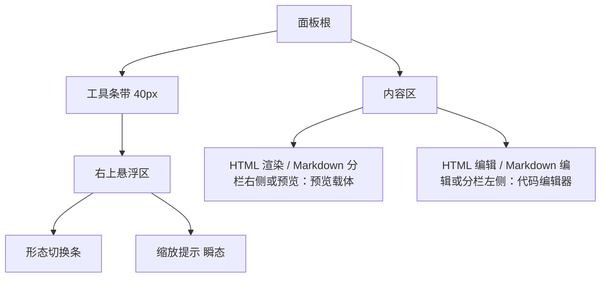
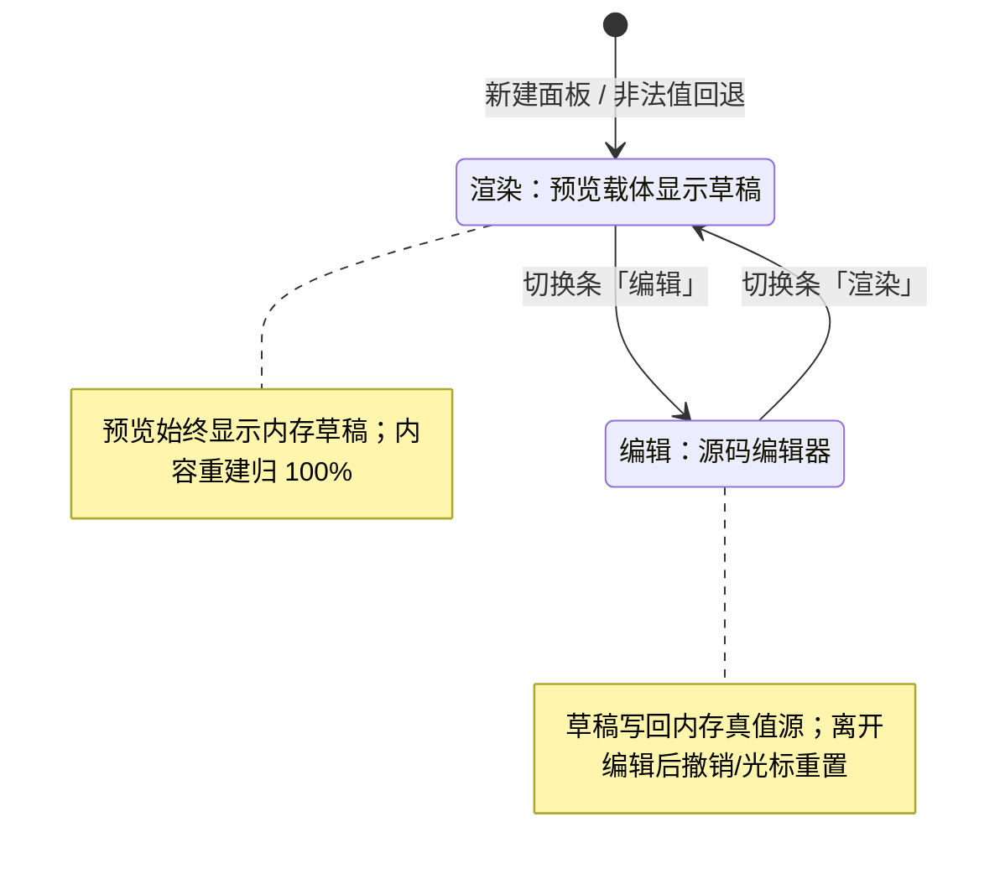
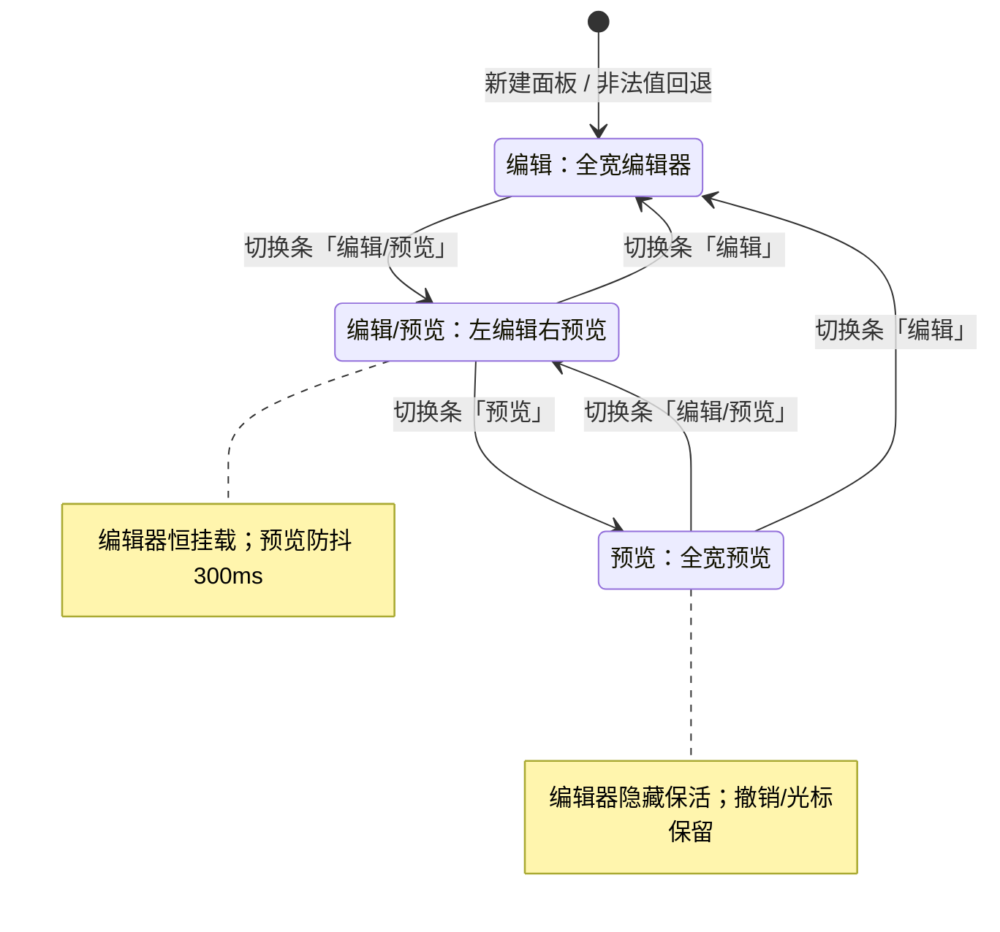

# 文档预览面板：HTML 二态与 Markdown 三态

> 快照日期：2026-10-19
>
> 本文档描述 slTerminal 主区面板与工作区在当前版本中的实际行为，属于 as-is 现状功能规格。代码是行为的真值源；本文档为一次性快照，不承诺随代码演进同步更新。若文档与代码不一致，以代码为准。
>
> 读者：测试/QA、开发，以及需要了解主区用户可感知行为的成员。

## 1. 本篇定位与范围

覆盖：

- 文档预览面板家族共享的预览渲染载体、消息桥、键盘转发与右上悬浮区。
- HTML 预览面板的二态行为：渲染、源码编辑、草稿模型、外部修改同步。
- Markdown 预览面板的三态行为：编辑、分栏、预览，以及渲染管线、本地资源、链接分派、滚动恢复。
- HTML 与 Markdown 面板共有的缩放交互、缩放提示、空态/加载/错误与安全边界。

不覆盖：

- 页签、分屏、面板拖拽、布局持久化、全局快捷键注册机制等主区框架行为，见 [01-workspace-shell.md](01-workspace-shell.md)。
- 编辑器通用能力（语言扩展、保存链路、外部修改确认、git gutter、大文件只读浏览、字号快捷键细则），见 [03-editor.md](03-editor.md)。
- 侧栏文件浏览器的打开入口与交互细节，见 [../sidebar/03-explorer.md](../sidebar/03-explorer.md)。
- 设置中心、主题方案定义与侧栏内部功能。

## 2. 界面结构与入口

面板出现在主区面板页签中，面板页签标题为文件名（同名冲突时使用相对路径，规则见 [01-workspace-shell.md](01-workspace-shell.md)）。

**入口**

- 文件浏览器中打开 `.html`、`.htm` 文件 → HTML 预览面板。
- 文件浏览器中打开 `.md`、`.markdown` 文件 → Markdown 预览面板。
- Markdown 预览中的本地链接被点击时，按同一文件打开链路在应用内打开目标文件（见 3.9）。
- 同一页面内重复打开同一文件不新建面板，而是聚焦已有面板。

**面板结构**

- 就绪后面板根自上而下为工具条带与内容区：
  - 顶部工具条带：高 40px，就绪后恒显示；右端承载形态切换条与缩放提示（缩放提示仅预览形态可见且为瞬态）。
  - 内容区：HTML 面板在渲染形态下由预览载体直接填满，在编辑形态下显示代码编辑器；Markdown 面板在编辑形态下显示全宽编辑器，在分栏/预览形态下显示左右分栏或全宽预览。
- 加载中与加载失败时不显示工具条带与切换条，只显示居中的状态文本。
- HTML 面板默认进入渲染形态；Markdown 面板默认进入编辑形态。

## 3. 功能点分节

### 3.1 共享预览层：渲染载体与键盘转发

**行为**

- 预览内容渲染在主窗口内部的跨源沙箱预览载体中，内容文档与主窗隔离；预览区域由该载体直接填满（HTML 渲染形态为整个内容区，Markdown 分栏形态为右侧预览区），不存在独立的操作系统预览窗口。
- 主窗口移动、缩放或跨屏时，预览随主窗同步跟随，无独立窗口式的延迟或位置同步。
- 预览内容与面板之间只通过受校验的消息通道交互：预览内的缩放变化、滚动位置、链接点击、按键描述上报面板；面板可向预览下发复位与恢复命令。只接受来源匹配、携带本面板本次挂载随机校验值、且属于白名单类型的消息，其余静默丢弃。
- 预览文档可以获得键盘焦点。焦点不在表单元素上时，按键描述转发给应用全局命令；焦点在输入框、多行输入框、下拉框或可编辑区域时，按键不转发。
- 预览沙箱禁止同源访问，预览内容无法访问主窗 DOM、应用接口或导航主窗；沙箱脚本仍在预览域内执行（见 3.11）。

**交互规则**

- 预览聚焦时，应用级命令仅有全局命令可用；当前全局命令只有「关闭页签」，默认 `Ctrl+W`。
- 表单焦点下全局快捷键不生效；表单键入、文本选择以及浏览器原生复制/粘贴正常。
- 按键转发不拦截预览文档自身的按键处理，也不改变文档默认行为。

**边界条件**

- 消息通道不提供命令重放通道：预览内容不能借键盘通道触发编辑器级、终端级或资源管理器级命令。
- 预览域不可读取主窗内容；内容断言与交互只能经由消息通道完成。

**验收判据**

- 拖动或缩放主窗时，预览内容跟随主窗移动，不出现独立窗口滞后。
- 点击预览后按 `Ctrl+W` 关闭当前面板页签；点击预览内输入框后按 `Ctrl+W` 不关闭面板页签，且输入框可正常输入。
- 预览内容中的脚本无法读写主窗页面，也无法调用应用功能。

### 3.2 形态切换条

**行为**

- 形态切换条常驻于面板右上悬浮区，单选高亮当前查看形态。
- HTML 面板的形态选项为 `渲染`、`编辑`。
- Markdown 面板的形态选项为 `编辑`、`编辑/预览`、`预览`。
- 点击非当前形态立即切换；点击当前形态无动作。
- 切换结果随面板参数持久化，重启后恢复上次形态。

**交互规则**

- 切换条默认半透明，鼠标悬停时变为不透明；这是视觉反馈，不改变可点击性。
- 切换形态不重新读取磁盘；页面内文档真值源保持不变。
- 加载中与加载失败状态下没有切换条，形态交互需等待文件读取完成。

**边界条件**

- 保存的形态值非法或缺失时，HTML 面板回退 `渲染`，Markdown 面板回退 `编辑`。
- 切换条与缩放提示同排，缩放提示隐藏时切换条位置不变。

**验收判据**

- 打开 HTML 面板显示 `渲染` 高亮；切到 `编辑` 后编辑器出现、预览载体消失；重启后仍为 `编辑`。
- 打开 Markdown 面板显示 `编辑` 高亮；切到 `编辑/预览` 后左右分栏出现；重启后仍为分栏。
- 保存的形态值非法时，分别回退到渲染或编辑。

### 3.3 缩放与缩放提示

**行为**

- 在预览内容上使用 `Ctrl+滚轮`（macOS 为 `⌘+滚轮`）缩放预览：上滚放大、下滚缩小，每累计约 100px 滚轮增量步进一档，每档乘以或除以 1.1。
- 缩放范围限制在 25%–400%；到达边界后继续滚动不再变化。
- 无修饰键滚轮保持预览文档正常滚动。
- 每次实际缩放变化时，右上悬浮区显示缩放提示：取整百分比与「重置」按钮；提示在最后一次变化后 3 秒自动消失，期间再次变化会续期。
- 点击「重置」立即把预览恢复 100%，并立即隐藏提示。
- 缩放发生变化后又回到 100% 时，提示仍显示 `100%` 并按 3 秒规则消失；重置与内容重建的归 100% 则静默隐藏提示。

**交互规则**

- 相同的缩放值重复上报不显示提示，也不为已隐藏的提示续期。
- 重置命令只在预览存在时可用；编辑形态没有缩放提示。

**边界条件**

- 缩放状态仅存活于当前预览文档/预览载体：仅会话级，不写入磁盘，不跨应用重启保留。
- HTML 面板：预览内容重建后缩放归 100%，提示静默隐藏；离开渲染形态（预览载体卸载）后再进入，缩放从 100% 开始。
- Markdown 面板：预览内容因草稿重渲染而重建时，自动恢复重建前的缩放，提示短暂显示恢复后的百分比；从分栏/预览切到 `编辑` 会卸载预览载体，此后再进入分栏/预览，缩放从 100% 开始。

**验收判据**

- 在预览上 `Ctrl+滚轮` 上滚两档，提示显示 `121%`；继续上滚至 400% 后不再增大。
- 提示出现后 3 秒内无操作自动消失；期间再次缩放会重新计时。
- 点击「重置」后提示立即消失，继续上滚一档从 100% 起算，显示 `110%`。
- HTML 预览发生外部刷新后缩放回到 100%。
- Markdown 预览因输入触发重建后，缩放比例保持。

### 3.4 HTML 面板：渲染形态

**行为**

- 渲染形态直接渲染磁盘文件内容；文件中的内联脚本、事件属性与普通 HTML 一样在预览域真实执行。
- 面板向预览文档注入缩放、键盘转发与页内锚点处理逻辑。
- 页内 `#` 锚点链接被拦截并在文档内平滑滚动到目标元素，地址栏不变化；再次点击同一锚点取消高亮状态；点击空 `#` 回到顶部。
- 外部修改由文件监听触发重新读盘并刷新预览；原子替换写（临时文件改名覆盖）同样生效。
- 若存在未保存草稿，外部修改到达时先弹出「外部修改」确认：确认「重载」则丢弃本地修改并刷新，取消则保留当前草稿。
- 预览内容重建后缩放归 100%、滚动位置回到顶部。

**交互规则**

- 渲染形态没有编辑入口，文档内容只在形态切换或外部重载时变化，不做输入防抖刷新。
- 外部修改刷新复用一条不可见的编辑通道（无可见编辑器）完成读盘与回写；没有独立的「刷新」按钮。
- 文件监听只处理修改与新建（原子替换）事件；外部删除不会清空或刷新预览，预览保持旧内容。

**边界条件**

- 空文件渲染为空白文档，不显示额外占位文案。
- 预览按原样渲染文件内容，不做本地资源内联；以相对路径引用的图片等资源不会从源文件目录加载。
- 预览载体建立到首次内容推送之间没有独立加载文案，内容区显示宿主背景色。

**验收判据**

- 打开含 `<h1>` 的 HTML 文件，渲染形态显示该标题；文件中内联脚本执行产生的界面变化可见。
- 点击页内 `#` 链接滚动到对应元素，地址栏不出现 `#` 片段。
- 在外部以原子替换写修改文件后，预览显示新内容；若本地有未保存修改，先出现「外部修改」确认。
- 外部删除文件后，预览不自动清空。

### 3.5 HTML 面板：编辑形态

**行为**

- 编辑形态显示全宽代码编辑器，HTML 语法高亮。
- 输入内容即时写回面板内存中的文档真值源；渲染形态预览的永远是该内存草稿，而不是磁盘内容。
- `Ctrl+S` 保存到原文件；保存失败弹出 `保存失败: {message}` 提示。
- `Ctrl+滚轮` 调整编辑字号：与编辑器面板共享字号，范围 8–32，默认 14，变更后约 2 秒写入设置。
- 编辑 → 渲染 → 编辑切换不丢草稿，返回编辑形态不重新读盘。
- 编辑形态下的外部修改会重载编辑器内容；存在未保存修改时同样先确认。

**交互规则**

- 离开编辑形态会卸载编辑器实例：草稿保留，但撤销历史、光标位置与编辑器滚动位置重置（再次进入编辑时重建编辑器）。
- 关闭面板页签或重启应用后重新打开，文件从磁盘重新读取，未保存草稿不保留。

**边界条件**

- 形态切换不会造成内容分叉：渲染形态与编辑形态始终使用同一份面板内存文档。
- 文档预览面板不执行编辑器的大文件只读引导与 1MB 警告，文件内容直接全文读入（见已知限制）。

**验收判据**

- 在编辑形态输入新内容后切回渲染，预览显示输入后的草稿；再切回编辑，内容仍在且未重新读盘。
- 编辑后按 `Ctrl+S`，磁盘文件更新；保存失败时出现 `保存失败: …` 提示。
- 关闭面板页签后重新打开，显示磁盘内容而非未保存草稿。
- 在编辑形态 `Ctrl+滚轮`，字号在 8–32 间变化，重启后保持。

### 3.6 Markdown 面板：编辑与分栏形态

**行为**

- 编辑形态为全宽 Markdown 代码编辑器；Markdown 语法高亮。
- `编辑/预览` 形态左右分栏：左侧编辑器、右侧预览。
- 分栏默认比例 50%/50%；拖动中间分隔线可调整。拖拽过程实时改变布局，拖拽结束才保存比例。
- 分栏两侧最小宽度：编辑侧 160px，预览侧 120px。
- 编辑器输入即时写回面板内存文档真值源；`Ctrl+S` 保存、`Ctrl+滚轮` 字号语义与 HTML 编辑形态一致。
- 编辑器的实例在编辑 / 分栏 / 预览之间始终保持挂载：预览形态下隐藏但不卸载。

**交互规则**

- 撤销历史、光标位置在编辑 / 分栏 / 预览之间切换时保留。
- 从编辑切到分栏或预览时，若存在尚未渲染的修改，立即先渲染一次，不等防抖。
- 形态切换与分栏切换不重新读盘。
- 预览形态下隐藏的编辑器仍持续接收外部修改重载与草稿同步。

**边界条件**

- 保存的分栏比例非法（结构或数值无效）时回退 50%/50%。
- 保存的形态非法或缺失时回退编辑形态。
- 拖拽中的比例不落盘；关闭面板时未拖拽结束的变化不会保存。

**验收判据**

- 编辑形态输入文字后切到预览，预览包含新文字；切回编辑，撤销可回退到输入前状态。
- 分栏默认左右各半；拖到约 70/30 后重启应用，恢复该比例。
- 分栏左缘拖到最小宽度时编辑侧不小于 160px，预览侧不小于 120px。
- 从预览切回编辑不重新读盘，光标位置仍在原处。

### 3.7 Markdown 面板：预览渲染

**行为**

- 预览渲染源始终是面板内存草稿，永不直接读取磁盘。
- 在分栏或预览形态下输入，停止输入约 300ms 后重新渲染；在编辑形态下输入只标记为待渲染，不启动计时。
- 首次进入分栏/预览时立即渲染；之后每次切换形态若存在待渲染修改也立即渲染。
- 首次渲染完成前，预览区域显示居中 `渲染中...`；首次渲染完成后，后续重渲染期间继续显示上一版内容，不闪回占位。
- 异步渲染的过期产物被丢弃：输入持续变化时，较早发起但较晚完成的渲染不会覆盖新内容。
- 渲染支持：GFM 表格、删除线、任务列表、自动链接；围栏代码块语法高亮；`$...$` 行内公式与 `$$...$$` 块级公式（KaTeX，公式错误不中断整篇渲染）；`mermaid` 围栏图在应用侧渲染为 SVG（暗色主题），失败时显示 `mermaid 渲染失败` 占位卡并附原始代码；原始 HTML 直通。
- 预览排版使用当前暗色配色方案生成，随配色方案切换在下次渲染时生效。

**交互规则**

- 代码高亮只覆盖内置语言集合（JavaScript、TypeScript、JSON、HTML/XML、CSS、Bash、Python、Rust、Go、Java、C、C++、SQL、YAML、Diff、Markdown）；`shell`/`console`/`sh`/`zsh`、`js`/`node`/`jsx`、`ts`/`tsx`、`python3` 等别名归一到上述语言；未知语言按纯文本显示。
- 外部修改重载后，草稿更新并触发预览刷新；未保存草稿下的外部修改同样先弹出「外部修改」确认。
- 预览内容重建（防抖重渲染或外部重载）后，缩放与滚动位置按重建前状态恢复（见 3.3、3.10）。

**边界条件**

- 空文档渲染为空白预览，不显示额外文案。
- 渲染管线内部错误不向用户抛出；图片与图表失败各自降级，不阻塞整篇。
- 编辑形态没有预览载体，不产生渲染计时；切回分栏/预览时补渲染。

**验收判据**

- 默认进入编辑形态并输入 `# 标题`，切到预览后显示一级标题。
- 在预览形态输入后约 300ms，预览更新；连续输入时只在停止后渲染一次。
- 首次进入预览先看到 `渲染中...`，随后被渲染内容替换。
- 含表格、代码块、公式、Mermaid 图的文档均能显示对应结构；Mermaid 语法错误显示失败占位卡。
- 外部修改 Markdown 文件后，预览更新为新内容。

### 3.8 Markdown 本地资源

**行为**

- 预览中的 ``、`<source>` 引用（包括 Markdown 图片语法生成的标签与原始 HTML 标签）会收集本地引用。
- 相对路径以 Markdown 文件所在目录为基准绝对化；Windows 盘符绝对路径直接使用；`..` 会被归一化，是否越界由后端沙箱最终判定。
- 仅项目根目录内的文件可读取；单个资源上限 10MB。
- 扩展名白名单：png、jpg、jpeg、gif、webp、avif、bmp、ico；白名单外（包括 svg）不收集。
- 读取成功的资源以 data: URL 内联到预览文档；读取失败（不存在、项目根外、超限）或白名单外时保留原始引用，表现为图片缺口，不弹出错误。
- 资源读取结果按绝对路径缓存，最多 50 项。

**交互规则**

- 资源读取在渲染管线内并行进行；单个资源失败不阻塞整篇文档。
- 缓存命中时不重复读盘。
- 原始 HTML 中的相对图片与 Markdown 图片语法同等处理。

**边界条件**

- 本地 svg 不在白名单内，不会内联；引用显示为缺口。
- 项目根外的相对路径即使前端绝对化成功，也会被后端拒绝并回退为缺口。
- data:、http(s) 等非本地引用不进入资源内联流程。

**验收判据**

- Markdown 引用同目录 `pixel.png`，预览中图片正常显示，且渲染产物包含 `data:image/png;base64,`。
- 引用本地 `.svg` 或项目根外图片时显示缺口，无错误提示。
- 同一图片在连续重渲染中不重复读取（缓存命中）。

### 3.9 Markdown 链接分派

**行为**

- 预览中的非 `#` 链接被拦截并上报面板，由面板分类处理：
  - `http`、`https`、`mailto`、`tel` → 使用系统默认浏览器打开。
  - 相对路径与 Windows 盘符绝对路径 → 走应用内文件打开链路（与文件浏览器打开同一分发），命中文档类型时打开对应预览面板，否则回退编辑器面板。
  - `#` 锚点 → 忽略（Markdown 渲染不生成标题锚点）。
  - `data:`、`blob:`、`javascript:`、`file:` 等其余协议 → 忽略。
- 应用内打开复用了去重聚焦：目标文件已在当前页打开时聚焦原面板，不新建。

**交互规则**

- 链接分类与打开在面板侧完成，预览文档内不做打开决策。
- 应用内打开链路的守卫失败（无活跃页或无面板 API）与面板创建异常静默返回；当前页面没有可承载面板的组时提示 `当前页面无面板——请先新建终端`。打开链路本身不校验文件是否存在，目标不可读时由打开后的面板显示自身的加载失败信息。
- `#` 锚点点击不滚动、不跳转。

**边界条件**

- 盘符绝对路径的判定先于协议判定，避免 `C:` 被当作协议。
- 相对路径以 Markdown 文件所在目录为基准；无目录上下文时仅接受盘符绝对路径。

**验收判据**

- 点击 `https://` 链接后系统浏览器打开该地址。
- 点击 `./next.md` 在当前页面打开（或聚焦）对应 Markdown 面板。
- 点击 `#section` 无任何跳转。
- 点击 `javascript:` 与 `data:` 链接无任何反应。

### 3.10 滚动位置上报与恢复

**行为**

- Markdown 预览会节流上报滚动比例（滚动距离 / 可滚动总距离，取值 0–1），约 120ms 合并一次；不可滚动时不报；相同比例不重复上报。
- 预览内容重建完成并加载后，按上次比例恢复滚动位置；恢复有约 60ms 延迟以等待布局收敛。
- 恢复为比例近似：重建后文档高度变化时，位置可能发生跳变，尤其是编辑点位于当前视口上方时。
- HTML 预览不上报也不恢复滚动位置；内容重建后回到顶部。

**交互规则**

- 滚动恢复只在下一次内容重建时发生，正常滚动不触发任何可见反馈。
- 比例恢复不改变缩放状态。

**边界条件**

- 滚动状态仅会话级，不写入磁盘，不跨应用重启保留。
- 从分栏/预览切到编辑会卸载预览载体，再返回时滚动位置从顶部开始。

**验收判据**

- 在长 Markdown 预览中滚动到中部，触发一次草稿重渲染后，位置仍大致在中部。
- 文档长度显著变化后恢复位置可能与原位置不同，但仍在文档范围内。
- HTML 预览外部刷新后回到顶部。

### 3.11 安全边界（用户可感知）

**行为**

- HTML 文件中的原始 HTML、内联 `<script>` 与事件属性在预览域真实执行。
- Markdown 与 HTML 使用同一信任模型：Markdown 中的原始 HTML 不做消毒，内联脚本与事件属性同样执行。
- 预览宿主页自身的脚本真实执行。
- 预览域的内容安全策略只允许内联脚本/样式以及 data: 图片与字体；外部网络子资源（脚本、样式、图片、字体等）不会加载。
- 预览沙箱无同源权限，预览内容无法读取主窗、调用应用接口、写入应用数据或导航主窗。
- 预览内容对应用的影响只限白名单消息：缩放上报、滚动上报、链接点击、按键描述；未知类型、来源不符或校验值不符的消息一律丢弃。
- 表单焦点下不转发按键，避免全局快捷键吞掉表单输入。

**交互规则**

- 预览内容可自行实现页面内交互与脚本逻辑；这些逻辑不能越过沙箱边界。
- 键盘转发仅解析应用全局命令；当前全局命令集只有「关闭页签」。

**边界条件**

- 预览域不是可信第三方内容隔离环境：本地文档被视作可信文件，与编辑器打开本地文件同级。
- 预览域禁止外部网络子资源，意味着依赖 CDN 脚本、远程图片或远程字体的 HTML 页面无法完整呈现。

**验收判据**

- HTML 与 Markdown 中的内联脚本均执行并产生可见效果。
- 预览脚本无法读取主窗 DOM、无法调用应用命令。
- 预览页面引用远程图片/脚本时不加载。
- 预览内输入框获得焦点时，应用全局快捷键不触发。

## 4. 跨区行为

| 触发条件 | 可感知结果 |
|---|---|
| 文件浏览器打开 `.html`/`.htm` | 在活跃页面打开 HTML 预览面板，默认渲染形态；同一文件已打开时聚焦原面板 |
| 文件浏览器打开 `.md`/`.markdown` | 在活跃页面打开 Markdown 预览面板，默认编辑形态；同一文件已打开时聚焦原面板 |
| 预览聚焦时按 `Ctrl+W` | 关闭当前活跃面板页签 |
| 预览内表单获得焦点时按 `Ctrl+W` | 不关闭面板页签，输入行为正常 |
| Markdown 预览点击外部链接 | 系统默认浏览器打开 |
| Markdown 预览点击本地链接 | 应用内打开目标文件；目标为 `.md`/`.html` 时进入对应预览面板，否则回退编辑器 |
| 主窗移动/缩放 | 预览像素级跟随，无独立窗口延迟 |
| 同组切签 | 面板保持挂载（恒挂载面板类型），内容与状态保留；预览载体若因布局重排重建，Markdown 恢复缩放与滚动，HTML 缩放归 100% |
| 切换操作页面 | 页组隐藏但不卸载面板，不主动重读；返回时状态保留，预览载体重建时按上一条处理 |
| 关闭面板 | 预览载体随面板卸载立即从主窗移除 |

## 5. 状态保留与持久化

### 5.1 保留矩阵

| 状态对象 | 同组切签 | 切换操作页面 | 关闭后重开 | 应用重启 |
|---|---|---|---|---|
| 查看形态（渲染/编辑，编辑/分栏/预览） | 保留 | 保留 | 不保留（新面板默认形态） | 保留 |
| Markdown 分栏比例 | 保留 | 保留 | 不保留（新面板默认比例） | 保留 |
| 面板内存草稿 | 保留 | 保留 | 不保留 | 不保留 |
| Markdown 编辑器撤销历史/光标 | 保留 | 保留 | 不保留 | 不保留 |
| HTML 编辑器撤销历史/光标 | 保留（未离开编辑形态）；离开编辑形态即丢失 | 保留（未离开编辑形态）；离开编辑形态即丢失 | 不保留 | 不保留 |
| 缩放与滚动位置 | 保留（会话内） | 保留（会话内） | 不保留 | 不保留 |
| 缩放提示显隐 | 瞬态（3 秒自动消失） | 瞬态 | 不保留 | 不保留 |

> 预览面板属于恒挂载面板类型，同组切签与切换操作页面均不卸载面板。若预览载体因布局重排重建，HTML 预览缩放归 100%、滚动回顶部；Markdown 预览恢复缩放与滚动比例（见 3.3、3.10）。

### 5.2 持久化

- 查看形态与分栏比例写入面板参数，随操作页面布局一并保存；应用重启后恢复。关闭面板后重新打开属于新建面板，不恢复上次形态与分栏比例。
- 分栏比例只在拖拽结束时保存；拖拽过程中的中间值不保存。
- 未保存草稿、缩放比例、滚动位置、缩放提示均不持久化。
- 编辑字号为应用级共享设置：修改后约 2 秒写入设置文件，重启后恢复。

### 5.3 加载与回退

- 保存的查看形态非法时，HTML 回退渲染、Markdown 回退编辑。
- 保存的分栏比例非法时回退 50%/50%。
- 面板重新打开或应用重启后，文件内容一律从磁盘重新读取。

## 6. 空态、加载、错误

### 空态

- 空文件：按空文档渲染，不显示「无内容」占位。
- Markdown 预览首次渲染完成前显示 `渲染中...`；渲染完成后为空文档时不显示额外文案。
- 加载中与加载失败时不显示工具条带、切换条与缩放提示。

### 加载

- 文件读取期间显示居中 `加载中...`。
- HTML 渲染形态在预览载体建立到内容推送之间无独立文案，内容区显示宿主背景色。
- Markdown 后续重渲染期间保留上一版预览内容，不闪回 `渲染中...`。

### 错误

- 未指定文件路径：`加载失败: 未指定文件路径`。
- 文件读取失败：`加载失败: {message}`，错误文本居中显示。
- 保存失败：`保存失败: {message}`。
- 外部修改重载失败：事件路径弹出 `外部修改重载失败: {message}`；静默心跳复核失败不提示。
- 本地资源读取失败、白名单外资源、项目根外资源：静默显示图片缺口，不弹错误。
- Mermaid 渲染失败：预览中显示 `mermaid 渲染失败` 占位卡并附原始代码，不阻塞整篇。
- Markdown 渲染管线内部异常：仅记录日志，不向用户抛错；可降级部分自行降级。

## 7. 图表

### 7.1 HTML 面板二态

### 7.2 Markdown 面板三态

## 8. 验收判据汇总

| 触发 | 结果 | 验收判据 |
|---|---|---|
| 打开 `.html` 文件 | 默认渲染形态 | 预览显示文件内容；切换条 `渲染` 高亮 |
| HTML 切到编辑并输入 | 草稿写入内存 | 切回渲染显示输入后的草稿；未重新读盘 |
| HTML 外部修改 | 预览刷新 | 预览显示磁盘新内容；有未保存草稿时先确认 |
| 打开 `.md` 文件 | 默认编辑形态 | 全宽编辑器出现；切换条 `编辑` 高亮 |
| Markdown 切到分栏 | 左右分栏出现 | 左侧编辑器、右侧预览；默认各半 |
| 分栏拖拽后重启 | 比例恢复 | 恢复上次拖拽结束时的比例 |
| Markdown 输入后预览 | 300ms 防抖 | 停止输入约 300ms 后预览更新 |
| 预览内 `Ctrl+滚轮` | 缩放并显示提示 | 每档 1.1 倍，提示显示取整百分比，3 秒消失 |
| 点击「重置」 | 归 100% | 提示立即隐藏；后续缩放从 100% 起算 |
| Markdown 相对图片 | data: 内联 | 图片显示；本地 svg/项目根外图片显示缺口 |
| Markdown 链接点击 | 分类分派 | 外部链接进系统浏览器；本地链接应用内打开；`#` 忽略 |
| 预览聚焦按 `Ctrl+W` | 关闭面板页签 | 当前活跃面板页签关闭 |
| 预览内表单聚焦按 `Ctrl+W` | 不关闭 | 面板页签保留，输入正常 |
| 关闭并重开面板 | 磁盘重读 | 未保存草稿丢失；显示磁盘内容 |

各功能节的验收判据同时有效，本节仅汇总关键路径。

## 9. 边界与非目标

**边界**

- 覆盖 HTML 与 Markdown 文档扩展名（`.html`、`.htm`、`.md`、`.markdown`）；其他类型不进入本家族预览。
- 预览渲染于主窗内跨源沙箱载体，不提供独立窗口、画中画或浮出面板区域的能力。
- 单窗口、仅暗色模式、Windows 桌面场景；不描述多窗口或多实例。
- HTML 渲染不做本地资源内联；Markdown 本地资源只读项目根内、单文件不超过 10MB。
- 缩放范围 25%–400%，步进约 1.1 倍；缩放与滚动仅会话级。
- 预览域不加载外部网络子资源（脚本、样式、图片、字体等）。
- 应用级预览快捷键只有全局命令集（当前仅关闭页签）。

**非目标**

- 不描述页签、分屏、布局持久化、面板注册与生命周期（见 [01-workspace-shell.md](01-workspace-shell.md)）。
- 不描述编辑器通用能力与保存链路的完整细节（见 [03-editor.md](03-editor.md)）。
- 不描述侧栏内部视图行为（见 [../sidebar/README.md](../sidebar/README.md)）。
- 不描述设置中心、主题配色定义、终端行为。
- 不包含改进建议、缺陷修复方案、优先级或排期。
- 不描述尚未实现的预览类型（如 PDF、图片查看）。

## 10. 已知限制

- 【行为设计】未保存草稿只存在于面板内存：关闭面板页签或退出应用即丢失，关闭前没有确认；应用仅对设置中心面板执行未保存确认。
- 【行为设计】HTML 渲染形态没有独立刷新入口；外部修改刷新依赖一条不可见的编辑通道（文件监听 + 约 10 秒心跳复核）。该通道未收到信号时，预览保持旧内容。
- 【行为设计】HTML 渲染形态不内联本地资源；相对路径引用的图片等资源无法从源文件目录加载，显示为缺口且无提示。
- 【行为设计】本地 svg 因安全原因排除在内联白名单外；Markdown 中引用本地 `.svg` 显示为缺口。
- 【行为设计】图片资源读取失败、白名单外、项目根外或超出单资源 10MB 上限时均静默降级为缺口，不向用户提示具体原因。
- 【行为设计】缩放与滚动位置仅会话级，不持久化；HTML 预览内容重建后缩放归 100%、滚动回顶部。
- 【行为设计】Markdown 滚动恢复为比例近似，重建后文档高度变化时位置可能跳变。
- 【行为设计】Markdown 从分栏/预览切到编辑会卸载预览载体，缩放与滚动状态随之丢失；再次进入时从初始状态开始。
- 【行为设计】HTML 编辑形态离开后撤销历史与光标位置重置（草稿内容保留）。
- 【行为设计】文档预览面板不执行编辑器的大文件只读引导与 1MB 警告，文件内容直接全文读入；大文件下渲染/编辑性能无上限保护。
- 【疑似缺陷】外部删除文件后，预览不刷新并继续显示已删除文件的内容，没有失效提示；用户可能误以为文件仍然存在。
- 【行为设计】HTML 预览只拦截页内 `#` 锚点；非锚点链接不经过面板的链接分派，点击行为由预览文档自身决定（Markdown 则统一分派）。HTML 按原文档语义运行，Markdown 才使用统一链接分派。
- 【无障碍/平台】预览内表单获得焦点时按键不转发，全局快捷键（含默认 `Ctrl+W`）不生效；预览域可用的应用级命令只有全局命令。
- 【无障碍/平台】物理滚轮/触控板手势、Mermaid 图表与公式的视觉质量、大文档渲染性能依赖真实 WebView2 环境，自动化测试不覆盖，需人工验收。

## 11. 相关文档

- [README.md](README.md)：主区面板与工作区文档总览
- [01-workspace-shell.md](01-workspace-shell.md)：工作区、页签、分屏、布局持久化与全局快捷键
- [03-editor.md](03-editor.md)：编辑器面板、保存、外部修改处理、大文件只读浏览、字号语义
- [04-diff.md](04-diff.md)：Diff 面板
- [05-gitshow.md](05-gitshow.md)：GitShow 只读面板
- [../sidebar/03-explorer.md](../sidebar/03-explorer.md)：文件浏览器的打开入口与文件树交互
- [../sidebar/README.md](../sidebar/README.md)：侧栏系统总览
- [../../CONTEXT.md](../../CONTEXT.md)：领域术语表
