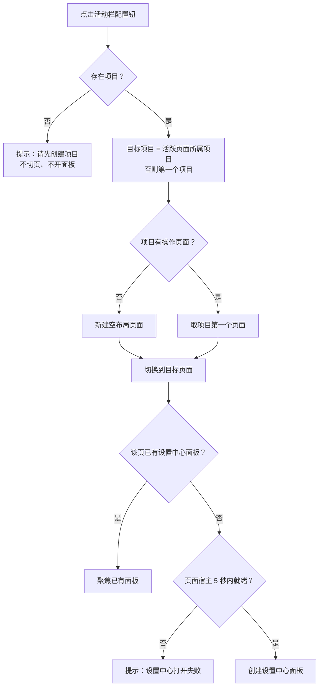
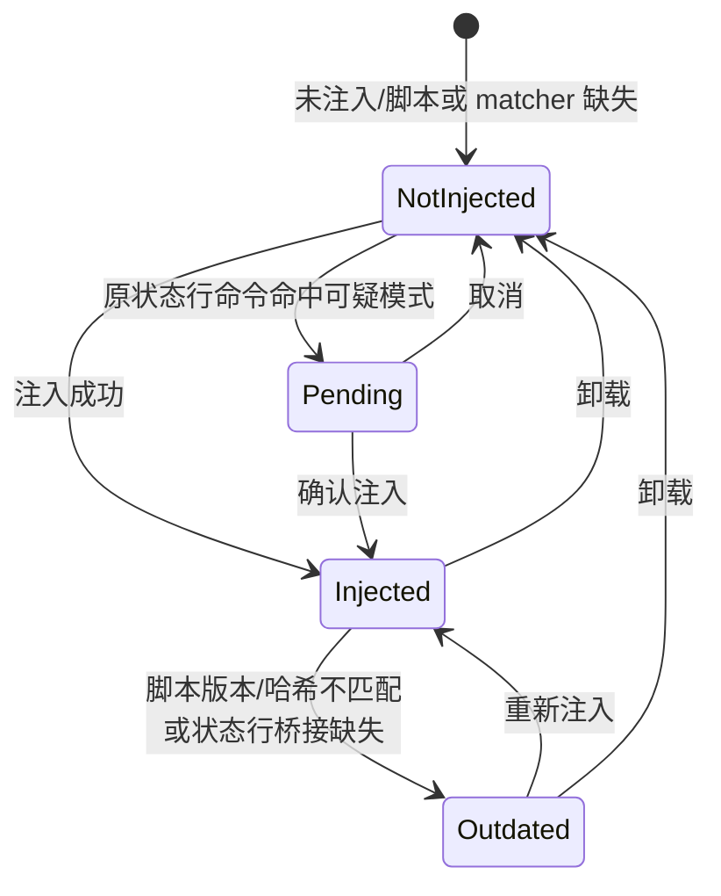

# 设置中心：统一配置入口与配置页

> 快照日期：2026-10-19
>
> 本文档描述 slTerminal 主区面板与工作区在当前版本中的实际行为，属于 as-is 现状功能规格。代码是行为的真值源；本文档为一次性快照，不承诺随代码演进同步更新。若文档与代码不一致，以代码为准。
>
> 读者：测试/QA、开发，以及需要了解主区用户可感知行为的成员。

## 1. 本篇定位与范围

本文覆盖设置中心面板的用户可感知行为：

- 活动栏「配置」钮打开设置中心的入口编排、目标项目与目标页面选择、同页单例与打开失败提示。
- 设置中心壳：左导航、全局组与 Agent 组的组序、Agent 按 CLI 分节、配置页注册与排序、选中页回退、页内参数通道、dirty 圆点与切页/关闭守卫、切项目自动关闭、损坏警示条、面板激活焦点。
- 全局配置页：快捷键、后台定时任务、终端输入模式。
- Agent 组配置页：基础配置页（侧栏展示内容与 CLI 别名）、Hooks 配置页（三层配置、双模式编辑、注入/卸载）。
- 应用设置文件的持久化、浅合并、原子写、备份与损坏恢复，以及配置保存失败和关闭时的落盘边界。

不覆盖：

- 编码 CLI profile 的后端实现、hooks 注入脚本与信号通道的内部机制。
- 侧栏视图内部行为（配置钮的位置与交互见 [../sidebar/01-framework.md](../sidebar/01-framework.md)）。
- 主区页签、分屏、页面切换的通用语义（见 [01-workspace-shell.md](01-workspace-shell.md)）。
- 终端 PTY 与 ConPTY 的内部实现；终端输入模式的用户可见效果只写到「新建终端生效」为止。
- 主题、字体、侧栏布局等没有设置中心入口的配置域的内部实现。

本文为 as-is 现状功能规格，只记录已实现行为、边界与已知限制。

## 2. 界面结构与入口

### 2.1 入口与前置

**行为**

- 设置中心唯一用户入口是活动栏底部的「配置」钮；它不是侧栏视图，不参与侧栏按钮的拖拽、排序与持久化。
- 点击后按以下顺序解析打开目标：
  - 当前没有任何项目：显示警告提示 `请先创建项目`，不切换页面，不打开面板。
  - 目标项目：优先选择当前活跃页面所属的项目；若活跃页面不属于任何项目（或没有活跃页面），选择项目列表中的第一个项目。
  - 目标页面：目标项目已有操作页面时，选择该项目的第一个页面；没有操作页面时，新建一个空布局页面并切换过去。
  - 先切换到目标页面，再打开或聚焦设置中心面板。
- 设置中心面板固定挂在目标页面内；因此上述切页行为会同时改变主区当前显示的页面。
- 同一页面最多一个设置中心面板。目标页已有设置中心面板时，只聚焦已有面板，不新建。
- 重复点击「配置」钮不会创建额外的设置中心面板。

**交互规则**

- 「配置」钮单击即生效，没有二次确认。
- 「配置」钮只有默认态与悬停态，没有「设置中心已打开」的持续激活态。

**边界条件**

- 没有项目时不会隐式创建项目，只提示。
- 目标页面不一定是当前活跃页面：即使同一项目内正停留在其他页面，入口仍会切到该项目的第一个页面。
- 正常入口不指定初始配置页；打开编排支持携带一个可选的初始配置页标识（供深链场景使用），携带时面板创建后直接选中该页。

**验收判据**

- 无项目时点击配置钮，出现 `请先创建项目`；页面不切换，设置中心面板不出现。
- 有项目时点击配置钮，主区切到目标项目的第一个页面，并显示设置中心面板；目标项目无页面时先产生一个新的空页面。
- 在同一页面再次点击配置钮，面板数量不增加，已有面板获得焦点。
- 正常入口打开时，选中页遵循回退规则（全局组第一页），不保留上一次关闭前的选中页。

### 2.2 设置中心壳布局

**行为**

- 设置中心面板的页签标题固定为 `设置`。
- 面板内部由左导航与右侧配置页槽位组成：
  - 左导航：固定宽 180px，不可拖拽调整；内容超出时纵向滚动。
  - 右侧配置页槽位：占据剩余宽度，渲染当前选中的配置页。
- 左导航按固定组序排列：先「全局」组，后「Agent」组。
- 「全局」组下依次是：快捷键、后台定时任务、终端输入模式。
- 「Agent」组按编码 CLI 分节：
  - 每个分节显示 CLI 的品牌 logo（14×14）与显示名称；分节标题是不可点击的分组标题，不是配置页入口。
  - 分节下缩进显示该 CLI 的配置页：基础配置恒有；Hooks 配置仅在该 CLI 声明了配置编辑器能力时出现。
  - 当前内置注册的 CLI 为 Claude Code，分节显示名称即 `Claude Code`。
  - 没有任何 agent 配置页时，Agent 组整组不渲染。
- 导航项是按钮：选中项使用选中底色；配置页上报未保存修改时，导航项右侧显示 7px 中性色圆点。
- 设置中心面板属于恒挂载面板：同一分屏组内切换到其他面板页签、或切换到同项目的其他操作页面，设置中心面板都不卸载，未保存修改与页内状态保留。
- 在设置中心内部切换配置页会重新挂载配置页组件；离开某配置页再回来，该页的页内临时状态不保留。
- 关闭设置中心面板或应用重启才真正销毁面板及其未保存修改。

**交互规则**

- 点击当前已选中的导航项不产生任何变化，也不重复写入面板参数。
- 点击其他导航项立即切换；若当前页有未保存修改，先进入确认流程（见 3.1）。
- 左导航本身没有搜索、折叠、导入/导出或全局恢复默认入口。

**边界条件**

- 注册表没有任何配置页时，右侧显示居中空态 `暂无配置页`，左导航不渲染任何组。
- 有 Agent 页但没有全局页时，选中页回退结果为「无」，右侧显示空态；正常内置注册不存在该状态。
- 页内临时状态（快捷键录制态、后台任务输入草稿、Agent 基础页输入草稿、Hooks 页未保存编辑与层级/模式选择）都在配置页重新挂载时丢失。

**验收判据**

- 左侧导航宽度恒为 180px，组序为「全局」在上、「Agent」在下。
- Agent 分节标题显示 logo 与 `Claude Code`，点击标题不切换配置页；其下子页缩进显示。
- 切换到另一个配置页再切回，页内临时输入或编辑状态已重置。
- 注册表为空时显示 `暂无配置页`。

### 2.3 配置页注册与顺序

**行为**

- 配置页集合由全局配置页与已注册 CLI profile 生成的 Agent 页组成；Agent 页随 profile 注册出现。
- 配置页以注册项形式进入设置中心，注册项包含标题、分组、所属 CLI（Agent 组）与可选排序值。
- 同一标识重复注册时后注册者覆盖前注册者，不产生重复条目。
- 排序规则：带排序值的页按数值升序排在前面；没有排序值的页按注册顺序稳定排在后面。
- 当前顺序：
  - 全局组：快捷键 → 后台定时任务 → 终端输入模式。
  - Agent 组：按 CLI 注册顺序分节；每个 CLI 内先注册「基础配置」，再注册「Hooks 配置」（若可用），两者均无排序值，按注册顺序展示。

**交互规则**

- 运行期不提供新增、删除、重命名或重排配置页的用户入口。
- 配置页集合在面板挂载前已固定；面板生命周期内不因外部变化重排。

**边界条件**

- 新增 CLI 后，其 Agent 分节与页面随注册出现；已打开的面板不会自动刷新导航，需要重新打开或重新挂载设置中心面板后才看到新分节。

**验收判据**

- 新打开设置中心时，全局组第一页为「快捷键」。
- Agent 组下 Claude Code 分节依次显示「基础配置」「Hooks 配置」。
- 同一配置页标识重复注册后只显示一条。

### 2.4 选中页规则

**行为**

- 面板创建时读取保存的选中页标识：
  - 该标识对应已注册配置页时，直接选中该页。
  - 标识缺失、失效或未注册时，回退到全局组第一页。
  - 全局组没有任何页时，选中页为空，右侧显示空态。
- 外部更新面板参数中的选中页标识时，若目标页已注册，选中态同步切换。
- 用户切换配置页后，选中页标识随面板参数写入所在页面的布局数据。

**交互规则**

- 选中页变化不改变面板的打开状态或所在页面。
- 关闭设置中心面板后，面板从布局中移除；重新打开时不恢复上次选中页，回到回退规则。

**边界条件**

- 保存的选中页属于 Agent 组且仍然注册时，直接恢复该 Agent 页，不回退到全局组。
- 指向已删除或未注册页的标识被忽略，不弹提示。

**验收判据**

- 以失效选中页标识打开面板，显示全局组第一页。
- 在面板内切到「后台定时任务」，同一页面内切走再切回，选中页仍为「后台定时任务」。
- 关闭设置中心面板后重新打开，选中页回到「快捷键」。

## 3. 功能点分节

### 3.1 设置中心壳：导航、页内参数与 dirty 守卫

**行为**

- 左导航项点击后切换右侧配置页；选中页标识与页内参数都随所在页面的布局持久化。
- 页内参数按配置页分槽保存。配置页读取自己槽位中的参数；写回时与既有键合并，不覆盖其他键。
- 配置页通过统一通道上报「是否有未保存修改」；壳在导航项上显示 dirty 圆点，并把同一状态登记到跨面板共享的关闭守卫数据源。
- 壳根容器可被程序化聚焦，但不进入 Tab 顺序；面板被激活（新打开或页签被选中）时，键盘焦点落到壳根容器。
- 面板挂载时读取应用设置文件；若加载结果为「损坏后恢复」，顶部显示警示条 `设置文件已损坏，已从备份/默认值恢复`。警示条右侧有 `×`，可关闭；关闭后本次面板生命周期内不再显示，且不阻塞任何配置操作。

**交互规则**

- 当前页 dirty 时点击其他配置页：
  - 弹出确认框，标题 `未保存的修改`，正文 `当前配置页有未保存的修改，切换将丢弃这些修改。`
  - 确认：清除当前页 dirty 与圆点，切换到目标页。
  - 取消：保持当前页、dirty 与圆点不变，不写入面板参数。
- 当前页不 dirty 时直接切换，不弹确认。
- 共享的 dirty 登记只在「确认丢弃」动作点清除；面板隐藏不会清除登记，关闭面板时由关闭确认流程清除。
- 面板被激活时，焦点落在壳根容器；随后按 Tab 进入左导航按钮序列。

**边界条件**

- 页内参数通道当前内置配置页均未使用；该通道仅提供透传、合并与随布局保存能力。
- 确认弹窗关闭后的短暂回归不会再次弹窗（防止焦点回归造成循环确认）。
- 警示条只反映本次面板挂载时的加载结果；关闭面板后重新打开会重新检查。
- 壳根容器自身没有可见输入框，聚焦壳根后直接键入不会改动任何配置。

**验收判据**

- 当前页产生未保存修改后，导航项出现圆点；点击其他页弹确认框，取消后圆点与页面保持不变。
- 确认丢弃后切到目标页，原页圆点消失。
- 面板新打开时焦点位于面板根容器，Tab 可依次到达导航按钮。
- 设置文件损坏并恢复时，顶部出现可关闭的警示条，配置页仍可正常操作。

### 3.2 打开、关闭与切项目

**行为**

- 设置中心面板以页面为归属；同一页面最多一个实例。
- 关闭设置中心面板的路径包括页签关闭按钮、`Ctrl+W`、鼠标中键关闭、页签右键菜单「关闭」。
- 批量关闭（关闭其他、关闭全部）会把待关闭列表中的设置中心面板作为一个整体处理。
- 切项目时，设置中心面板自订阅活跃页面所属项目：
  - 面板所属项目与活跃项目不同且面板不 dirty：自动关闭。
  - 面板所属项目与活跃项目不同且面板 dirty：弹确认框；确认后关闭并清除 dirty，取消则保留面板。
  - 活跃页面为空（启动瞬态、删除末页）时不动作。
  - 面板挂载时若已处于「活跃页面属于其他项目」的布局恢复场景，直接静默关闭，不弹确认。

**交互规则**

- 单个关闭：设置中心面板 dirty 时弹确认框，标题 `未保存的修改`，正文 `当前配置页有未保存的修改，关闭将丢弃这些修改。`；确认才关闭，取消保留面板与修改。
- 批量关闭：先收集 dirty 的设置中心面板；若有，弹一次确认框，正文列出待关闭面板的页签标题；确认后统一关闭，取消则全部不关。无 dirty 面板时不确认，直接关闭。
- 切项目自动关闭的确认框正文与单个关闭相同；取消后不关闭，面板暂时留在非活跃项目。
- 面板被自动关闭后不显示额外提示。
- dirty 关闭守卫只适用于设置中心面板；其他面板关闭不做未保存确认。

**边界条件**

- 删除操作页面会直接移除页内组并结束其中的终端，不走面板级 dirty 守卫；整页销毁即用户放弃页上内容，页内设置中心面板与未保存修改一并消失。
- 取消切项目自动关闭后，面板仍留在旧项目；此时若在新项目再次点击配置钮，会为新项目打开设置中心面板。旧面板在切回旧项目前不可见，旧项目面板与新项目面板可短暂并存。
- 目标页面没有任何可承载面板的区域时，打开失败并提示 `设置中心打开失败:页面尚未就绪,请重试`。
- 目标页面的面板宿主在 5 秒内未就绪时，打开失败并提示 `设置中心打开失败:操作页面尚未就绪,请重试`。

**验收判据**

- dirty 面板点 `×` 弹确认框；取消后面板仍在，再次确认后关闭。
- 关闭其他/关闭全部时，多个 dirty 设置中心面板只弹一次确认，正文列出全部标题。
- 切到另一项目时设置中心面板自动关闭；dirty 时取消则面板保留。
- 删除包含设置中心面板的页面时不弹 dirty 确认，面板随页面消失。
- 页面宿主未就绪时出现对应失败提示，应用不崩溃。

### 3.3 快捷键页

**行为**

- 页面按分组展示全部可重绑命令，分组顺序固定：全局 → 终端 → 编辑器 → 文件浏览器。
- 命令目录：

| 分组 | 命令 | 默认键 | 备注 |
|---|---|---|---|
| 全局 | 关闭当前页签 | Ctrl+KeyW | |
| 终端 | 复制选区 | Ctrl+Shift+KeyC | |
| 终端 | 粘贴 | Ctrl+Shift+KeyV | |
| 终端 | 插入换行（不提交） | Ctrl+Enter | |
| 终端 | 中断(本地状态提示) | Ctrl+KeyC | 终端上下文中的 Ctrl+C 仍透传为中断信号；终端与全局上下文的命令不能绑定到 Ctrl+C |
| 编辑器 | 保存文件 | Ctrl+KeyS | |
| 编辑器 | 切换自动换行 | Alt+KeyZ | |
| 文件浏览器 | 删除文件 | Delete | |
| 文件浏览器 | 打开文件 | Enter | |
| 文件浏览器 | 重命名文件 | F2 | |

- 键位显示采用物理键名格式：修饰键固定按 Ctrl、Shift、Alt、Meta 的顺序，末段为物理键名，例如 `Ctrl+KeyW`、`Ctrl+Shift+KeyC`、`Alt+KeyZ`、`F2`。
- 每行显示当前生效键：
  - 无用户覆盖：显示默认键，普通颜色，不显示复位按钮与默认键小字。
  - 有用户覆盖：生效键用强调色显示，并显示 `↺` 复位按钮与默认键小字；复位按钮提示 `恢复默认键`。
  - 用户解绑：显示 `未绑定`，不显示生效键。
- 行内没有单独的「编辑」按钮；点击整行进入录制态，行内显示提示 `按下新键位…Esc 取消`。

**交互规则**

- 录制期间：
  - 应用全局快捷键被暂停消费，录制按键不会触发对应命令；录制结束、取消或页面卸载后恢复。
  - 按 `Esc` 取消录制，不写入任何绑定。
  - 按 `Backspace` 或 `Delete` 解绑该命令；行变为 `未绑定`。
  - 只按修饰键（Ctrl、Shift、Alt、Meta）被忽略，保持录制等待下一键。
  - 输入法组合态（`isComposing`）中的按键被忽略，不视为录制按键。
  - 命中保留键：行内显示红字 `保留键 <键名> 不可绑定`，不写入并保持录制，等待下一个按键。
  - 命中同一上下文内其他命令的生效键：允许写入，行内显示警告 `与「<命令名>」冲突，生效按优先级派发`；警告保持显示到下一次开始录制。
  - 合法按键：写入覆盖并退出录制。
- 点击 `↺` 清除该命令覆盖，回退默认键，且不会误进入录制。
- 解绑后行内不再显示 `↺`，因此没有直接恢复默认键的入口；需重新录制默认键或录制其他键。
- 覆盖层改动在 2 秒无后续操作后写入应用设置文件的快捷键段；保存失败时弹出 `设置保存失败，重启后将丢失`。

**边界条件**

- 保留键集合：
  - 终端上下文：`Ctrl+KeyC`、`Ctrl+KeyV`、`Ctrl+KeyX`、`Ctrl+KeyZ`、`Ctrl+KeyA`。
  - 编辑器上下文：`Ctrl+KeyF`、`Ctrl+KeyZ`、`Ctrl+KeyY`、`Ctrl+Shift+KeyZ`、`Tab`、`Shift+Tab`。
  - 全局上下文：上述保留键集合的并集。
- `terminal.interrupt` 的默认键是保留键 Ctrl+C，这是代码默认绑定，不属于用户可写覆盖；用户仍可将该命令改绑到其他非保留键。
- 同上下文键位冲突不在写入时拦截，运行期按命令优先级与焦点上下文决定实际生效者。
- 启动加载或运行期重建绑定表时，若用户覆盖绑定到保留键或格式非法，该覆盖被跳过并回退默认键，仅在控制台告警；命令仍可用，应用不会因坏配置崩溃。坏值仍保留在设置文件中，直到用户重新录制或复位。
- 页面重新挂载时录制态重置；覆盖层本身保存在全局状态中并跨配置页切换保留。

**验收判据**

- 点击「保存文件」行进入录制；按 Esc 退出且绑定不变。
- 录制「复制选区」时按 Ctrl+C，显示 `保留键 Ctrl+KeyC 不可绑定`，保持录制且不写入。
- 录制时按 Backspace，命令显示 `未绑定`。
- 录制一个与同分组其他命令相同的键，出现冲突警告但绑定写入成功。
- 有覆盖的行显示强调色生效键、默认键小字与 `↺`；点击 `↺` 后恢复默认键。
- 录制期间按 Ctrl+Shift+C 不会执行复制。
- 设置文件中存在绑定到保留键的非法覆盖时，该命令仍按默认键工作，应用不崩溃。

### 3.4 后台定时任务页

**行为**

- 页面向后端读取任务清单与当前生效配置，每个任务一行：
  - 标题与启用勾选框。
  - 频率输入框，标签为 `<任务标题>频率（秒）`。
  - 范围提示 `<最小值>–<最大值> 秒`。
- 当前任务与默认值：

| 任务 | 默认状态 | 默认频率 | 允许范围 |
|---|---|---|---|
| 套餐余量查询 | 启用 | 10 秒 | 10–3600 秒 |
| 会话历史刷新 | 启用 | 3 秒 | 2–300 秒 |

- 勾选或取消勾选立即提交，不做乐观更新；提交失败时界面保持提交前的值。
- 频率输入在失焦或按 Enter 时提交；提交前去除首尾空白。
- 提交成功后用后端返回的完整清单刷新所有行：
  - 会话历史刷新任务立即应用新配置到前端定时刷新。
  - 清单中存在套餐余量任务时，额外触发一次套餐余量刷新。
- 套餐余量任务由后端轮询：停用后停止后续执行，已有快照保留，导航树中的套餐余量区整块隐藏；重新启用后重新开始，并显示最后快照；频率修改在下一轮按新间隔执行。
- 会话历史刷新由前端定时刷新驱动：没有订阅方时只记录配置，不启动计时器；有订阅方后按配置启用并立即执行一轮。

**交互规则**

- 频率输入的合法值必须是整数，且落在该任务允许范围内。
- 非法输入（空串、非数字、小数、越界）在行下方显示红字范围提示（如 `10–3600 秒`），不提交、不弹提示，输入内容保留供修改。
- 后端拒绝提交时弹出警告提示 `设置失败：<错误信息>`；频率输入保留用户输入，不重置。
- 勾选切换失败同样弹出 `设置失败：<错误信息>`；勾选状态回到提交前的值。
- 提交成功不弹提示。

**边界条件**

- 页面加载期间行区为空，没有独立的加载文案或骨架屏。
- 任务清单读取失败时页面保持空行区，仅在控制台记录错误，不显示界面错误提示。
- 范围提示只写范围，不写默认值。
- 成功提交任何一种配置（勾选或频率）都会触发一次套餐余量刷新（清单包含该任务时）。

**验收判据**

- 打开页面看到任务行，默认均勾选，频率分别为 10 与 3，范围提示分别为 `10–3600 秒` 与 `2–300 秒`。
- 取消勾选「套餐余量查询」后立即提交；成功后勾选态更新，并触发一次套餐余量刷新。
- 会话历史刷新频率改为 15 并失焦，提交成功后输入框规范回显 `15`。
- 输入 `5` 给套餐余量任务并失焦，行内出现 `10–3600 秒`，不提交、不弹提示，输入保持 `5`。
- 后端拒绝时出现 `设置失败：...`，输入保持用户所填内容。

### 3.5 终端输入模式页

**行为**

- 页面提供以下开关，每个开关带状态位与说明：

| 开关 | 位 | 默认 | 说明 |
|---|---|---|---|
| 继承光标位置 | 0x1 | 开 | 子进程启动时继承终端光标状态 |
| Resize 兼容 | 0x2 | 开 | 创建时应用窗口尺寸，避免启动首帧错位 |
| Win32 输入模式 | 0x4 | 开 | 发送 Win32 键事件而非 VT 序列；系统 conhost 的旧 Win10 回退路径不生效 |
| Passthrough 直通模式 | 0x8 | 关 | 子进程输出原样透传，conhost 不做 VT 解析 |

- 页首说明：这些开关控制新建终端会话的输入模式位组合；已打开的终端需要重开后才生效；默认值与内置行为一致。
- Passthrough 开关旁有常驻警示：`警示：启用后将导致 claude 等全屏 TUI 鼠标滚轮失效，变更须实测验证 （真实 claude 全屏滚轮测试）后方可保留。`
- 切换开关立即更新内存状态；变更在 2 秒无后续操作后写入应用设置文件。
- 后端在新建终端时读取该配置并计算输入模式；已在运行的终端不受即时影响。

**交互规则**

- 勾选/取消勾选即生效，无确认、无 dirty 暂存。
- 保存失败时弹出警告提示 `设置保存失败，重启后将丢失`。

**边界条件**

- 配置段缺失或某字段类型非法时，该字段回退默认值；其余合法字段照常采用。
- 保存失败后内存值仍保留本次运行内生效，但重启后丢失。
- 旧 Win10 系统 conhost 回退路径下，Win32 输入模式开关不产生实际效果。

**验收判据**

- 默认打开页面时，「继承光标位置」「Resize 兼容」「Win32 输入模式」为开，「Passthrough 直通模式」为关。
- 切换任一开关后立即反映在界面上；等待约 2 秒后配置写入应用设置文件。
- 修改后已打开终端行为不变；新建终端按新配置启动。
- Passthrough 行始终显示完整警示文案。

### 3.6 Agent 基础配置页

**行为**

- 页面包含「侧栏展示内容」与「CLI 别名」配置节。
- 侧栏展示内容：
  - 展示模式单选：`全部` / `自定义`；默认 `全部`。
  - 选择 `自定义` 时展开自定义名单：
    - 名单项以 chip 展示，每项带 `×` 删除按钮；删除无确认，可重新添加。
    - 名单为空时显示 `名单为空——视图中不展示任何条目`。
    - 添加行包含输入框（占位 `输入文件/目录名`）与「添加」按钮；按 Enter 等价于点击「添加」。
    - 添加成功后清空输入与错误；编辑输入即清除错误。
  - 「显示运行时文件」开关：
    - 默认关闭。
    - 仅 `全部` 模式下可操作；`自定义` 模式下置灰禁用，但其值保留，切回 `全部` 后恢复。
    - `全部` 模式下若该 CLI 声明了运行时文件名单，开关下方显示 `运行时文件：<名单>`。
- 侧栏展示配置的生效范围是「Agent 全局文件」侧栏视图的根层：按名称匹配，大小写不敏感，仅根层完全同名；目录内部内容随根层是否展示而展示或隐藏。
  - `自定义` 模式：仅展示名单内的根层条目；运行时文件开关不参与判断。
  - `全部` 模式：展示全部根层条目；「显示运行时文件」关闭时排除运行时文件名单内的条目。
- CLI 别名：
  - 顶部只读展示该 CLI 的内置命令 chip，下方提示 `内置命令已占用命名空间，不可配置为别名`；内置命令不可删除。
  - 别名 chip 带 `×` 删除按钮；删除无确认，可重新添加。
  - 无别名时显示 `暂无别名`。
  - 添加行包含输入框（占位 `输入启动命令别名`）与「添加别名」按钮；按 Enter 等价于点击。
- 所有操作即时生效，无 dirty 暂存；变更在 2 秒无后续操作后写入应用设置文件。

**交互规则**

- 自定义名单校验（输入先去首尾空白）：
  - 空名称：`名称不能为空`。
  - 含 `/` 或 `\`：`名称不能包含路径分隔符`。
  - 与已有名单项大小写不敏感重名：`名称已存在`。
  - 失败时行内红字、输入保留；成功时加入名单并清空输入。
- CLI 别名校验（输入先去首尾空白）：
  - 空：`别名不能为空`。
  - 超过 32 个字符：`别名过长（最多 32 个字符）`。
  - 含空白：`别名不能包含空格`。
  - 含单引号、双引号或反引号：`别名不能包含引号或反引号`。
  - 以 `-` 开头：`别名不能以 - 开头`。
  - 与本 CLI 已有别名重复：`别名「<别名>」已存在`。
  - 撞本 CLI 内置命令：`「<别名>」是本 CLI 的内置命令`。
  - 撞其他 CLI 内置命令：`「<别名>」是「<CLI 显示名>」的内置命令`。
  - 撞其他 CLI 的别名：`「<别名>」已被「<CLI 显示名>」的别名使用`。
  - 失败时行内红字、输入保留；成功时加入别名并清空输入。
  - 别名的唯一性判定大小写敏感（`cc` 与 `CC` 视为不同别名），并覆盖全部 CLI 的命名空间与内置命令。
- 输入框失焦不提交、不清空草稿、不清除错误；使用真实鼠标点击「添加」按钮时，先发生的输入框失焦不会破坏随后的提交。
- 别名添加成功后在内存中即时生效：下一次命令行首 token 匹配即把该命令识别为对应 CLI，无需等待落盘。

**边界条件**

- 自定义名单只接受名称，不接受路径；不允许通过名单递归指定目录内部条目。
- 「显示运行时文件」的值在 `自定义` 模式下虽然禁用，但仍会被保存；切回 `全部` 后直接使用该值。
- 当前 CLI 未注册（防御场景）时，CLI 别名区显示 `未知 CLI` 占位；侧栏展示内容区仍按默认配置渲染。
- 页面重新挂载时，未提交的自定义名单输入、别名输入与行内错误全部丢失。

**验收判据**

- 默认模式为「全部」，「显示运行时文件」为关。
- 切到「自定义」后「显示运行时文件」置灰且值保留；切回「全部」后开关恢复可用且值不变。
- 添加名称 `agents` 成功；再添加 `AGENTS` 失败并显示 `名称已存在`。
- 添加含 `/` 或 `\` 的名称失败并显示 `名称不能包含路径分隔符`。
- 添加别名 `cc` 后立即在终端中执行 `cc ...` 能被识别为对应 CLI；再加 `CC` 可成功（大小写敏感）。
- 添加内置命令名或其他 CLI 已占用别名时显示对应冲突文案，且不写入。
- 输入框失焦后草稿与错误仍保留，点击「添加」按钮能正常提交。

### 3.7 Hooks 配置页

#### 3.7.1 三层配置与层级切换

**行为**

- 页面只对声明了配置编辑器能力的 CLI 出现；当前为 Claude Code。
- 页面编辑的是该 CLI 设置文件的「三层配置」：user、project、local。
- 页面顶部提供层级按钮：
  - `User`：用户级，文件 `~/.claude/settings.json`，全局生效，优先级最低。
  - `Project`：项目级，文件 `<项目根>/.claude/settings.json`，当前项目生效。
  - `Local`：本地级，文件 `<项目根>/.claude/settings.local.json`，当前项目生效，优先级最高。
- 工具栏固定显示优先级提示 `优先级：Local > Project > User`。
- 初始层级为 User。
- 没有活跃项目时，Project 与 Local 按钮禁用，仅 User 可用；若当前层级不是 User，会回退到 User 并重新读取。
- 切换层级时重新读取该层的 hooks 子树；读取期间编辑区被 `加载中...` 占位替代。
- 切换项目导致项目根变化时，重新读取当前层；无项目根时回退 User。

**交互规则**

- 当前层有未保存修改时切换层级：弹确认框，标题 `未保存的修改`，正文 `当前层有未保存的修改，切换层级将丢弃这些修改。`；确认后切换并重读，取消保持当前层与修改。
- 读取文件失败（JSON 损坏等）显示错误态 `配置文件损坏，请先修复`，不进入编辑界面。
- 文件不存在或没有 hooks 内容时按空配置处理，正常进入编辑界面。

**边界条件**

- 页面只读写目标文件中的 hooks 子树；文件中的其他字段（权限、环境变量、`$schema` 等）原样保留。
- 项目/本地层必须能解析当前活跃项目的根目录；无根目录时不可选。

**验收判据**

- 无活跃项目时只有 User 按钮可用；有活跃项目时各层均可用。
- 在 User 层编辑后不保存直接点 Project，弹出切换层级确认框；取消后仍停留在 User 且修改保留。
- 目标文件 JSON 损坏时显示 `配置文件损坏，请先修复`。

#### 3.7.2 双模式编辑

**行为**

- Hooks 页采用双模式面板形态：工具栏提供 `GUI` 与 `JSON` 模式按钮，默认 JSON。
- GUI 与 JSON 编辑同一份 hooks 配置，并实时同步：
  - GUI 编辑后切到 JSON，JSON 文本立即包含改动。
  - JSON 合法编辑后切到 GUI，事件树与详情立即反映改动。
- JSON 模式：
  - 左侧是 190px 宽的事件导航，按分组列出事件；点击事件名在右侧 JSON 中定位并选中该事件键。
  - 右侧为 JSON 编辑器，提供语法错误与 schema 违规的波浪线与悬停提示。
  - JSON 语法非法时保留最后一次合法快照，不更新配置模型；schema 违规时解析结果已进入配置模型，但 `GUI` 切换与保存被禁用。上述情况下工具栏都显示单行错误提示 `JSON 存在错误，无法切换 GUI：<首条诊断>`，完整诊断挂在悬停提示中。
- GUI 模式：
  - 左侧事件树展示已配置事件（按分组），右侧为详情区。
  - 添加事件：下拉列出目录中尚未配置的事件；添加后自动选中新事件。
  - 事件详情显示事件名、所属分组与 matcher 目标提示；支持 matcher 的事件显示 matcher 输入框（留空 = 全匹配），不支持 matcher 的事件显示 `全匹配（该事件不支持 matcher）` 并省略输入框。
  - matcher 组与 handler 均可增删；删除当前选中项后详情回退到合适的空态。
  - 添加 handler 时，类型下拉按事件支持的 handler 档位过滤。
- 事件目录（按分组）：

| 分组 | 事件 |
|---|---|
| 会话生命周期 | SessionStart、SessionEnd、Setup |
| 用户交互 | UserPromptSubmit、UserPromptExpansion |
| 工具调用 | PreToolUse、PermissionRequest、PermissionDenied、PostToolUse、PostToolUseFailure、PostToolBatch |
| 通知与消息 | Notification、MessageDisplay |
| 子代理与任务 | SubagentStart、SubagentStop、TaskCreated、TaskCompleted、TeammateIdle |
| 上下文管理 | PreCompact、PostCompact |
| 停止与错误 | Stop、StopFailure |
| 配置与文件变更 | ConfigChange、CwdChanged、FileChanged、InstructionsLoaded |
| 工作树 | WorktreeCreate、WorktreeRemove |
| 启发式交互 | Elicitation、ElicitationResult |

- handler 类型与字段：

| 类型 | 必填 | 可选 |
|---|---|---|
| command（命令） | 命令 | 参数、异步模式、异步重新唤醒、Shell 解释器 |
| http（HTTP 请求） | URL | 请求头、允许的环境变量 |
| mcp_tool（MCP 工具） | MCP Server、工具名 | 输入参数 |
| prompt（提示词） | 提示词 | 模型、阻塞时继续 |
| agent（子代理） | 提示词 | 模型 |

- 所有 handler 共享通用字段：条件过滤器（仅工具事件求值）、超时（秒）、状态消息。
- 事件按支持范围分档：A 档支持全部 handler 类型；B 档支持 command、http、mcp_tool；C 档仅支持 command、mcp_tool。类型下拉按档位过滤。
- slTerminal 托管条目：
  - handler 的命令文本包含 slTerminal 注入脚本标识时，GUI 中显示 `slTerminal 托管` 徽标。
  - 该 handler 的全部字段只读，删除按钮禁用。
  - 包含托管 handler 的 matcher 组与事件的删除按钮禁用。

**交互规则**

- 模式切换不丢失当前编辑内容；JSON 非法时不能切到 GUI。
- GUI 中删除事件、matcher 组或 handler 立即更新 JSON 侧内容；没有额外确认。
- GUI 中字段的必填缺失以红色标签与 `此字段为必填` 提示；JSON 数组/对象类字段（参数、请求头、输入参数）非法输入时保留草稿，不向上更新。
- 切换 handler 类型时保留通用字段与适用于新类型的字段，清除不适用字段。
- JSON 模式中未知事件、未知字段仍按 schema 结果判定；合法时保留原始内容，GUI 转换对未知字段做容错保留。

**边界条件**

- 内嵌 schema 接受的事件名集合比 GUI 目录多出 DirectoryAdded，并禁止未列出的额外事件。
- GUI 只展示目录中的事件；不在目录中的事件无法通过 GUI 添加，但可在 JSON 中手写（仍需通过 schema 校验）。
- 当前配置页重新挂载后模式重置为 JSON，未保存的编辑按 dirty 守卫处理。

**验收判据**

- 默认进入 JSON 模式；GUI 新增一个事件后切回 JSON，文本含该事件。
- JSON 中输入非法内容后，`GUI` 按钮禁用、保存按钮禁用，工具栏显示错误提示；修复为合法 JSON 后恢复。
- GUI 中 matcher 组、handler 的增删即时反映到 JSON。
- 含 slTerminal 注入脚本标识的 handler 显示托管徽标，字段不可编辑、删除按钮禁用；其所在组与事件的删除按钮禁用。
- 不支持 matcher 的事件不显示 matcher 输入框。

#### 3.7.3 保存

**行为**

- 保存按钮仅在「有未保存修改且 JSON 合法」时可用。
- 保存前依次校验：
  - 配置必须是 JSON 对象。
  - 必须通过内嵌 schema 校验（事件名、handler 结构、必填字段、额外属性限制）。
- 校验失败：弹出错误提示（`hooks 配置必须是 JSON 对象` 或 schema 诊断首条），不写盘，dirty 保留。
- 校验通过后：
  - User 层：弹出二次确认框，标题 `确认写入用户级 hooks 配置`，正文 `hooks 可执行任意命令`；确认才写盘，取消保持 dirty 与未保存状态。
  - Project 与 Local 层：不弹二次确认，直接写盘。
- 写盘采用读-改-写：只替换目标文件中的 hooks 子树，其他字段保留；父目录不存在时自动创建；写入采用临时文件替换，避免产生半截文件。
- 保存成功后：dirty 清除，工具栏显示重启提示 `hooks 改动需重启 claude 会话生效`；下一次编辑或重新加载后提示消失。
- 保存失败（写盘错误或后端校验拒绝）：dirty 保留、提示不显示；界面没有错误提示，仅控制台记录。

**交互规则**

- User 层确认框取消不写盘，不丢失当前编辑。
- 保存过程中没有进度条；按钮在保存完成前仍可再次点击（无进行中禁用）。
- Project/Local 层保存不确认，但同样受校验与 dirty 门控。

**边界条件**

- 后端写盘通道还会执行一层语义校验：事件名必须属于注入使用的事件集合，handler 类型必须为 command，命令必须为非空字符串。该层拒绝时零写盘。
- 该后端校验范围窄于 GUI 目录与内嵌 schema：GUI 可构造的 non-command handler、以及目录中不在注入事件集合内的事件，均可能通过前端校验但被后端拒绝。
- 后端拒绝或写盘失败不会在界面提示（见 10 已知限制）。

**验收判据**

- 无修改时保存按钮禁用；产生合法修改后可用。
- 输入非对象 JSON 或 schema 违规内容时保存被拒并出现错误提示，文件不变。
- User 层保存弹二次确认；取消不写盘且修改保留。
- Project/Local 层保存不弹确认，直接写盘。
- 保存成功显示 `hooks 改动需重启 claude 会话生效`，再次编辑后提示消失。
- 保存后目标文件的其他字段保持不变。

#### 3.7.4 注入与卸载

**行为**

- 工具栏显示注入状态，初始查询完成前为 `注入状态：--`；查询完成后显示 `注入状态：已注入`、`注入状态：未注入` 或 `注入状态：版本过旧`。
- 「待确认」态不以状态条文案呈现：注入命中可疑命令时，状态条保持进入前的值（通常为未注入），另以工具栏下方的内联确认条表达待确认态。
- 提供「注入 Hooks」与「卸载 Hooks」按钮；操作进行中两者均禁用。
- 注入：
  - 通常直接完成并显示已注入。
  - 若用户原有状态行命令命中可疑模式（下载器或 PowerShell 任意执行类命令），暂停注入：设置文件零写盘，工具栏下方出现内联确认条，显示 `检测到可疑 statusline 命令，注入已暂停：` 与命令原文，并提供「确认注入」「取消」。
  - 「确认注入」发起第二次注入并完成；「取消」清空待确认态，保持点击前的注入状态。
- 卸载：移除 slTerminal 注入的 handler（同组内的用户 handler 保留）、删除注入脚本目录与状态行备份文件、清空信号目录；若状态行仍是 slTerminal 桥接，则还原到注入前的备份，备份缺失时移除状态行配置。
- 注入或卸载完成后刷新注入状态，并自动重读 User 层配置；若当前在其他层，则切换到 User 层（切换的 dirty 守卫照常生效）。
- 注入状态查询失败时保持上一次显示值，仅在控制台记录。

**交互规则**

- 注入/卸载失败时在工具栏显示行内错误：
  - `注入失败，请检查 ~/.claude/settings.json`
  - `确认注入失败，请检查 ~/.claude/settings.json`
  - `卸载失败，请检查 ~/.claude/settings.json`
- 失败时不刷新注入状态、不重读配置，当前编辑内容保留。
- 待确认期间不写盘、不重读配置；取消或确认后待确认条消失。

**边界条件**

- 注入状态查询路径只会返回已注入、未注入或版本过旧；待确认只作为注入操作的返回结果出现。
- 「版本过旧」可能来自脚本内容与内置模板不一致（版本或哈希不匹配），也可能来自 hooks 配置存在但状态行桥接缺失。
- 卸载时若目标设置文件不是合法 JSON，操作失败且脚本目录、信号目录全部保留，避免产生「配置残留但脚本已删」的悬空状态；文件恢复为合法 JSON 前无法完成卸载。
- 注入会改写用户级设置文件并影响之后启动的 CLI 会话；已运行会话需要重启才按新配置执行。

**验收判据**

- 未注入时状态条显示 `注入状态：未注入`；点击注入后变为 `注入状态：已注入`，并自动重读 User 层配置（不显示保存成功提示）。
- 原有状态行命令含可疑下载/执行模式时，点击注入后出现待确认条与命令原文，设置文件不变，状态条保持点击前的值；点击取消后条消失。
- 点击确认注入后状态变为已注入。
- 点击卸载后状态刷新为未注入，注入脚本与信号目录被移除。
- 设置文件非法 JSON 时卸载失败并显示错误提示，目录保留。

#### 3.7.5 外部修改检测

**行为**

- 页面重新可见时（应用窗口从后台恢复、最小化恢复、Alt+Tab 切回等）触发轻量重读。
- 触发条件必须同时满足：文档可见、事件为可见变化、面板自身及其祖先没有 `display:none`。
- 面板内点击、窗口移动/缩放不触发重读。
- 若当前有未保存修改，重读前弹确认框，正文 `配置文件可能已被外部修改。重载将丢弃当前未保存的修改。`；确认才覆盖当前编辑，取消保持现状。
- 确认框打开期间及其关闭后的短暂窗口内，回归触发不会再次弹窗。

**交互规则**

- 重读不显示整页加载遮罩，保留旧内容直到新数据到达。
- 重读失败进入 `配置文件损坏，请先修复` 错误态。
- 切换层级与项目根变化同样触发重读，遵循相同的 dirty 守卫。

**边界条件**

- 面板位于非活跃操作页面（页面容器隐藏）时不重读。
- 应用失焦但文档仍可见时不触发（只有可见性变化才触发）。
- 外部修改检测只比较读取结果并覆盖编辑模型，不自动保存或合并。

**验收判据**

- 从后台切回且无未保存修改时，配置被重新读取。
- 有未保存修改时切回，出现重载确认框；取消后编辑内容保持不变。
- 面板处于隐藏页面时切回前台不重读。
- 确认框打开期间重复切回前台不会重复弹框。

## 4. 跨区行为

| 触发条件 | 可感知结果 |
|---|---|
| 点击活动栏底部「配置」钮 | 切到目标项目第一个页面并打开/聚焦该页设置中心面板；无项目时提示 `请先创建项目` |
| 同一分屏组内切换到其他面板页签 | 设置中心面板不卸载；未保存修改与页内状态保留，切回时继续编辑 |
| 设置中心面板所在页面切到同项目其他页面 | 面板随页面组隐藏但不卸载；切回原页面时选中页与面板状态保留 |
| 切换到其他项目 | 设置中心面板按 dirty 状态自动关闭或弹确认；取消时面板暂留旧项目 |
| 快捷键页写入/复位/解绑覆盖 | 立即影响运行期键位派发，无需保存完成；同上下文冲突按优先级派发 |
| 后台定时任务页勾选/改频率 | 套餐余量任务由后端即时采用；会话历史刷新任务立即启停或改频；成功提交触发一次套餐余量刷新 |
| 终端输入模式页切换开关 | 新建终端按新组合启动；已打开终端不变 |
| Agent 基础页修改侧栏展示内容 | 「Agent 全局文件」视图根层展示即时刷新（全部/自定义、运行时文件显隐） |
| Agent 基础页添加/删除 CLI 别名 | 下一次命令行首 token 匹配立即按新别名识别，无需等待落盘 |
| Hooks 页保存配置 | 写入对应层级的 CLI 设置文件；需重启 CLI 会话生效 |
| Hooks 页注入/卸载 | 改写用户级 CLI 设置与注入脚本/信号目录；已运行 CLI 会话需重启 |
| 配置保存失败（2 秒自动保存通道） | 弹出 `设置保存失败，重启后将丢失`；本次运行内内存值仍有效 |
| 应用设置文件损坏并在加载时恢复 | 启动阶段弹出 `配置已损坏，已回退默认值`；设置中心面板顶部另显示损坏警示条 |

## 5. 状态保留与持久化

### 5.1 状态保留矩阵

| 状态对象 | 组内切签后 | 切换操作页面后 | 关闭设置中心面板后重开 | 应用重启后 |
|---|---|---|---|---|
| 选中配置页 | 保留 | 保留 | 不保留（按回退规则） | 保留（面板仍在布局中时） |
| 页内参数槽 | 保留 | 保留 | 不保留 | 保留（面板仍在布局中时） |
| 未保存修改与 dirty 圆点 | 保留 | 保留 | 确认关闭后清除 | 不保留 |
| 快捷键录制态与行内提示 | 保留 | 保留 | 不保留 | 不保留 |
| 快捷键覆盖层 | 保留 | 保留 | 保留 | 保留 |
| 后台任务输入草稿与行内错误 | 保留 | 保留 | 不保留 | 不保留 |
| 后台任务生效配置 | 保留 | 保留 | 保留 | 保留 |
| 终端输入模式开关状态 | 保留 | 保留 | 保留 | 保留 |
| Agent 基础页输入草稿与行内错误 | 保留 | 保留 | 不保留 | 不保留 |
| Agent 展示配置与 CLI 别名 | 保留 | 保留 | 保留 | 保留 |
| Hooks 当前层级 | 保留 | 保留 | 不保留（重置 User） | 不保留 |
| Hooks 编辑模式 | 保留 | 保留 | 不保留（重置 JSON） | 不保留 |
| Hooks 未保存编辑 | 保留 | 保留 | 确认关闭后丢弃 | 不保留 |
| Hooks 已保存配置 | 保留（文件） | 保留 | 保留 | 保留 |

> 「组内切签」指同一分屏组内切换到其他面板页签；「切换操作页面」指同项目内切到其他操作页面。设置中心面板为恒挂载面板，上述操作都不卸载它，因此页内临时状态与未保存修改保留；关闭设置中心面板或应用重启才真正销毁面板。
>
> 在设置中心内部切换到其他配置页会重新挂载配置页组件，该页的页内临时状态（录制态、输入草稿、Hooks 层级/模式/未保存编辑）随该次切换丢失；有未保存修改时先经确认。

### 5.2 应用设置文件

**位置与形态**

- 应用设置文件为 exe 同级的 `settings.json`（便携分发语义）。
- 同一目录下有上一代备份 `settings.json.bak`。
- 文件为 JSON 对象；顶层键白名单如下：

| 顶层键 | 配置域 | 是否由设置中心提供 UI |
|---|---|---|
| fontSize | 终端/编辑器字体大小 | 否 |
| keybindings | 快捷键覆盖 | 是（快捷键页） |
| sideBar | 侧栏布局 | 否 |
| colorScheme | 配色方案 | 否（手改文件并重载窗口生效） |
| backgroundTasks | 后台定时任务 | 是（后台定时任务页） |
| cliAliases | CLI 别名 | 是（Agent 基础配置页） |
| conptyInputModes | 终端输入模式 | 是（终端输入模式页） |
| agentGlobalFiles | Agent 全局文件展示配置 | 是（Agent 基础配置页） |

- 快捷键、终端输入模式、Agent 全局文件展示配置、CLI 别名属于前端消费型配置：经通用设置保存通道写段，内容由前端自行校验与净化。后台定时任务属于后端消费型配置：写入经任务域专用命令完成校验、内存态更新与落盘，最终复用同一文件写通道。字体大小与侧栏布局同为前端消费型配置；配色方案只能手动编辑配置段。
- 写入任何白名单外的顶层键会被拒绝；非 JSON 对象输入同样被拒绝。
- 序列化后的文件大小上限为 1MB，超限拒绝写入。
- 保存采用「读取现有文件 → 顶层浅合并 → 临时文件写入 → 替换目标文件」。浅合并只按顶层键替换：写入某个配置段时，该段整体替换，段内未提交的子键不会保留；其他顶层段不受影响。
- 若现有文件读取失败或解析失败，保存中止且不改写磁盘，避免用不完整数据覆盖原文件；文件不存在时按首次写入处理。
- 保存过程在进程内串行化，避免并发读-改-写互相覆盖。
- 每次成功保存前，若目标文件已存在，先把旧文件复制为 `settings.json.bak`；备份失败只记录日志，不阻断保存。
- 后台定时任务段有独立的配置写入通道：提交时只合并对应任务子键，其他任务子键保留，最终仍走同一文件写入通道。

**加载与损坏恢复**

| 情况 | 加载结果 | 用户可感知 |
|---|---|---|
| 文件不存在 | 使用默认值 | 无提示 |
| 文件合法 | 使用文件内容 | 无提示 |
| 文件损坏且有可解析的备份 | 使用备份内容，并用备份回写主文件 | 启动时提示 `配置已损坏，已回退默认值`；设置中心面板顶部显示损坏警示条 |
| 文件损坏且无可用备份 | 使用默认值 | 同上 |
| 空文件 | 视为损坏 | 同上 |
| 读取失败（权限等） | 各配置域保持默认或内存现状 | 仅控制台告警 |

- 备份命中同样计为「损坏」，因为数据来自备份而非当前主文件。
- 单个配置段缺失、类型非法或字段非法时，按各配置域自己的规则回退默认值；其他合法段照常加载。
- 启动时各配置域独立加载并独立提示损坏；设置中心面板的警示条只反映面板挂载时的加载结果。

**保存失败与关闭**

- 快捷键、终端输入模式、Agent 展示配置、CLI 别名、字体大小、侧栏布局等 2 秒自动保存通道失败时，弹出警告提示 `设置保存失败，重启后将丢失`；当前运行内内存值仍有效。
- 后台定时任务页的提交失败使用 `设置失败：<错误信息>`，由页面直接提示。
- 关闭应用时，所有待执行的 2 秒自动保存定时器被取消而非立即冲刷；最近约 2 秒内的设置变更可能未写入磁盘。
- Hooks 配置不使用 2 秒自动保存；只有显式点击保存才写盘，因此未保存编辑在关闭面板或应用后丢失。

### 5.3 布局内持久化

- 选中配置页标识与页内参数属于设置中心面板自身的参数，随所在操作页面的布局数据持久化，不写入应用设置文件。
- 切换配置页、写页内参数都会立即更新面板参数并触发一次显式布局保存。
- 同一项目内切换操作页面不销毁设置中心面板，布局恢复时按保存的选中页标识恢复。
- 关闭设置中心面板会将其从布局中移除；重新打开是新建面板，因此不恢复上次选中页与页内参数。

### 5.4 Hooks 与注入的落盘

- Hooks 页读写的是编码 CLI 自己的配置文件，不写入应用设置文件：
  - User：`~/.claude/settings.json`
  - Project：`<项目根>/.claude/settings.json`
  - Local：`<项目根>/.claude/settings.local.json`
- 写入只替换 hooks 子树，其他字段保留；采用临时文件替换；不生成 `.bak`；没有进程内写锁。
- 注入会：
  - 在用户级设置文件中为注入覆盖的事件写入 slTerminal 的 matcher（每个事件一个 `matcher` 为空、`timeout` 为 5 秒、`type` 为 command 的 handler），并移除旧的 slTerminal matcher，保留用户其他 handler。
  - 把状态行配置改写为桥接命令；若存在原状态行配置，则将其备份到用户主目录下的 `~/.slterminal/statusline-backup.json`（无原配置时不产生备份）。
  - 把注入脚本写入 `~/.slterminal/hooks/`；信号文件目录为 `~/.slterminal/hooks-events/`。
- 卸载会移除用户级设置中的 slTerminal handler、还原或移除状态行配置、删除脚本目录、信号目录与状态行备份文件；目标文件损坏时整体失败且不删除任何内容。
- 注入/卸载只影响之后启动的 CLI 会话；已运行会话需重启。

## 6. 空态、加载、错误

### 6.1 空态

- 设置中心注册表为空：右侧居中显示 `暂无配置页`，左导航没有组标题。
- 后台定时任务页读取中或读取失败：行区为空，不显示占位文案。
- Agent 自定义名单为空：`名单为空——视图中不展示任何条目`。
- Agent 别名列表为空：`暂无别名`。
- Hooks 页当前 CLI 没有配置编辑器：居中显示 `该 CLI 未提供配置编辑器`。
- Hooks 事件树没有已配置事件：提示从上方下拉添加；选中事件没有 matcher 组时显示空态提示。
- 正常构建中快捷键页始终有可显示的命令；单条命令解绑后该行显示 `未绑定`。

### 6.2 加载

- 设置中心面板本身没有加载遮罩；壳同步渲染。
- 后台定时任务页挂载后异步读取任务清单，读取完成前为空行区。
- Hooks 页首次加载、切换层级、切换项目根时显示 `加载中...`；轻量重读（可见性恢复）保留旧内容。
- 注入状态查询是异步的，查询完成前显示 `注入状态：--`。
- 其他配置页的数据来自启动时已加载的全局状态，页面挂载时不显示加载态。

### 6.3 错误

| 场景 | 用户可见结果 |
|---|---|
| 无项目点击配置钮 | 警告提示 `请先创建项目` |
| 目标页面宿主 5 秒未就绪 | 警告提示 `设置中心打开失败:操作页面尚未就绪,请重试` |
| 目标页面无承载区域 | 警告提示 `设置中心打开失败:页面尚未就绪,请重试` |
| 设置文件损坏并恢复 | 启动警告 `配置已损坏，已回退默认值`；设置中心面板顶部警示条 `设置文件已损坏，已从备份/默认值恢复` |
| 2 秒自动保存失败 | 警告提示 `设置保存失败，重启后将丢失` |
| 后台任务提交失败 | 警告提示 `设置失败：<错误信息>` |
| 后台任务频率非法 | 行内红字范围提示，不提交、不弹提示 |
| Hooks 文件读取失败 | `配置文件损坏，请先修复` |
| Hooks 保存校验失败 | 错误提示（对象形态或首条 schema 诊断），不写盘 |
| Hooks 写盘失败或后端校验拒绝 | 无界面提示，仅控制台记录；dirty 保留 |
| Hooks 注入/卸载失败 | 行内错误：`注入失败，请检查 ~/.claude/settings.json`、`确认注入失败，请检查 ~/.claude/settings.json` 或 `卸载失败，请检查 ~/.claude/settings.json` |
| 快捷键录制命中保留键 | 行内红字 `保留键 <键名> 不可绑定` |
| 快捷键同上下文冲突 | 行内警告 `与「<命令名>」冲突，生效按优先级派发`，仍写入 |
| Agent 名单/别名校验失败 | 行内红字对应错误文案，输入保留 |
| 当前 CLI 未注册 | `未知 CLI` 防御占位 |

## 7. 图表

### 7.1 配置钮打开流程

### 7.2 Hooks 注入状态流转

> 注入状态查询只返回未注入、已注入、版本过旧；待确认是注入操作的暂停结果，以内联确认条呈现，不改变状态条文案。

## 8. 验收判据汇总

| 触发 | 结果 | 验收判据 |
|---|---|---|
| 无项目点击配置钮 | 不打开设置中心 | 出现 `请先创建项目`，页面不切换 |
| 有项目点击配置钮 | 切到目标项目第一个页面并打开面板 | 面板出现；同页再次点击不新增面板 |
| 页面宿主 5 秒未就绪 | 打开失败 | 出现 `设置中心打开失败:操作页面尚未就绪,请重试` |
| 导航切换 | 渲染目标配置页 | 选中项高亮；目标页内容出现 |
| 当前页 dirty 时切页 | 确认丢弃 | 取消保持原页与圆点；确认后切换且圆点消失 |
| 关闭 dirty 设置中心面板 | 确认关闭 | 取消保留面板；确认关闭并清除 dirty |
| 批量关闭含 dirty 设置中心面板 | 一次确认 | 正文列出全部待关闭标题；取消全部保留 |
| 切换项目 | 自动关闭 | 无 dirty 直关；dirty 时确认，取消保留面板 |
| 快捷键录制合法键 | 写入覆盖 | 生效键立即更新，显示复位按钮与默认键小字 |
| 快捷键录制保留键 | 拒绝写入 | 行内红字 `保留键 ... 不可绑定`，仍处于录制态 |
| 快捷键解绑 | 命令无绑定 | 行显示 `未绑定`，运行期不再派发 |
| 后台任务改频率合法值 | 落盘并生效 | 输入规范回显；套餐余量刷新触发 |
| 后台任务改频率非法值 | 不提交 | 行内范围红字；输入保留；无提示 |
| 终端输入模式切换 | 内存即时更新 | 新建终端按新配置；约 2 秒后落盘 |
| Agent 展示模式切自定义 | 根层按名单过滤 | 名单内条目显示，名单外隐藏 |
| Agent 添加重复名称（大小写不同） | 拒绝 | `名称已存在`，输入保留 |
| Agent 添加合法别名 | 即时生效 | 下一次命令行首 token 命中新别名 |
| Hooks JSON 非法 | 阻止切换与保存 | GUI 按钮与保存按钮禁用，显示错误提示 |
| Hooks User 层保存 | 二次确认 | 取消不写盘且 dirty 保留；确认后写盘并显示重启提示 |
| Hooks 注入命中可疑命令 | 暂停注入 | 待确认条显示命令原文；设置文件不变 |
| Hooks 卸载 | 清理注入 | 状态刷新为未注入；脚本与信号目录移除 |

各功能节的验收判据同时有效，本节仅汇总关键路径。

## 9. 边界与非目标

**边界**

- 设置中心是主区面板，不是模态框、独立窗口或侧栏视图；关闭面板即离开设置中心。
- 设置中心只有一个用户入口（活动栏底部配置钮），没有应用级键盘快捷键；`Ctrl+,` 未被采用。
- 左导航固定 180px，不可调整；只有全局组与 Agent 组，没有项目组。
- 配置页集合由注册决定，运行期不提供增删改排入口。
- 保存模型按配置域不同：即时提交、2 秒自动保存、显式保存等形态并存。
- Hooks 页只对声明配置编辑器能力的 CLI 出现；当前内置注册的 CLI 仅 Claude Code，Agent 组当前只含 Claude Code 分节。
- Hooks 的 Project/Local 层依赖活跃项目的根目录；无项目时不可用。
- 应用设置文件仅接受白名单内的顶层键，大小上限 1MB。
- 设置中心面板的损坏警示条不阻塞配置操作；损坏恢复不保证恢复未备份的最近修改。
- 注入/卸载只影响之后启动的 CLI 会话；已运行会话不热更新。

**非目标**

- 不描述 CLI profile 的注册与能力声明机制。
- 不描述 hooks 注入脚本、信号文件监听、状态行透传的内部协议。
- 不描述终端 PTY/ConPTY 的启动参数计算与 shell 探测。
- 不描述侧栏视图内部行为、主区页签与分屏的通用语义。
- 不描述主题、字体、侧栏布局等没有设置中心入口的配置域。
- 不包含改进建议、缺陷修复方案、优先级或排期。

## 10. 已知限制

- 【行为设计】设置中心没有全局搜索、导入/导出、全局恢复默认入口；快捷键仅支持逐条复位，没有「全部恢复默认」按钮。
- 【行为设计】保存模型不统一：快捷键、后台定时任务、终端输入模式、Agent 基础配置为即时生效型（其中多数经约 2 秒 debounce 落盘）；Hooks 页为显式保存型并产生 dirty。用户需要按页面区分操作习惯。
- 【行为设计】没有项目级设置分组；全局组承载应用级配置，Agent 组按 CLI 组织。Hooks 的 Project/Local 层虽然与项目相关，但不构成独立项目组。
- 【行为设计】配色方案没有设置中心 UI；只能手改 `settings.json` 的 `colorScheme` 段并重载窗口生效。
- 【行为设计】未知 CLI 的配置键在加载时整键丢弃：CLI 别名与 Agent 全局文件展示配置按已注册 CLI 过滤，未注册 CLI 的键不会被保留，下一次保存时从文件中消失。
- 【疑似缺陷】Hooks 前后端事件与 handler 白名单不一致：GUI 目录提供的事件与 handler 类型范围大于后端接受集合，内嵌 schema 的事件名集合又多出 GUI 目录未展示的事件；后端保存通道只接受注入所需的事件集合且只接受 command 类 handler。用户可在 GUI/JSON 中构造出通过前端校验、却被后端拒绝的配置。
- 【行为设计】Hooks 配置写入不生成 `.bak` 备份；误覆盖或并发覆盖后没有文件级回退手段（仅临时文件替换可避免半截文件）。
- 【疑似缺陷】Hooks 配置写入没有进程内互斥；与注入、外部编辑器或其他写入者并发时，读-改-写可能相互覆盖。
- 【疑似缺陷】Hooks 保存的写盘失败与后端校验拒绝在界面上没有提示，只有控制台日志；保存按钮仍可用、dirty 仍保留，用户无法判断保存是否成功。
- 【疑似缺陷】加载期的非法快捷键覆盖会静默回退到默认键（仅控制台告警），坏值仍保留在设置文件中；界面会把回退后的默认键当作生效键显示，用户难以发现覆盖已失效。
- 【疑似缺陷】关闭应用时待执行的约 2 秒自动保存被取消而非冲刷，最近约 2 秒内的设置变更可能未写入磁盘。
- 【疑似缺陷】删除操作页面不触发设置中心面板的 dirty 守卫；整页销毁语义下，页内设置中心面板与未保存修改一并消失。
- 【行为设计】切项目时若取消设置中心面板的自动关闭，面板会保留在旧项目；此时在新项目再次打开设置中心，旧项目面板与新项目面板可同时存在，直到旧面板被切回并关闭。
- 【无障碍/平台】设置中心只能经鼠标点击配置钮打开，没有键盘快捷键；左导航没有方向键移动与分组折叠，Agent 分节标题不可聚焦，只能按 Tab 顺序逐个到达导航按钮。

## 11. 相关文档

- [README.md](README.md)：主区面板与工作区文档总览
- [01-workspace-shell.md](01-workspace-shell.md)：操作页面、页签、面板生命周期与布局持久化
- [02-terminal.md](02-terminal.md)：终端面板行为与新建终端的用户可见效果
- [../sidebar/01-framework.md](../sidebar/01-framework.md)：活动栏底部配置钮的位置与交互
- [../sidebar/02-nav-tree.md](../sidebar/02-nav-tree.md)：套餐余量展示与会话历史刷新入口
- [../sidebar/05-agent-files.md](../sidebar/05-agent-files.md)：Agent 全局文件视图与展示过滤效果
