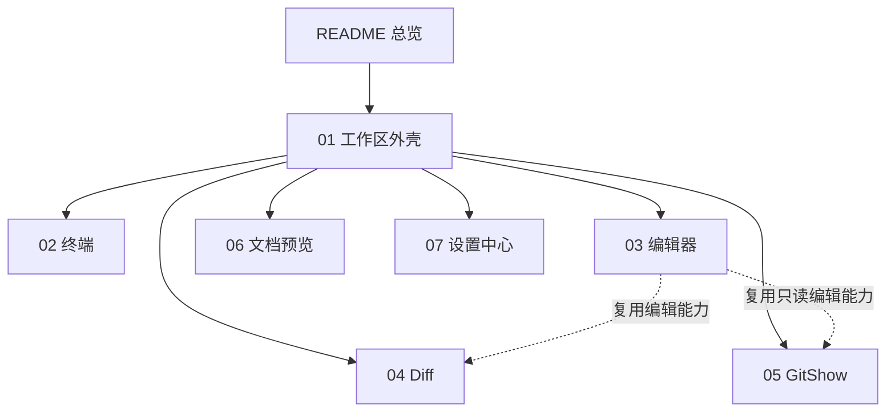

# slTerminal 主区面板与工作区功能规格（现状快照）

> 快照日期：2026-10-19
>
> 本文档描述 slTerminal 主区面板与工作区在当前版本中的实际行为，属于 as-is 现状功能规格。代码是行为的真值源；本文档为一次性快照，不承诺随代码演进同步更新。若文档与代码不一致，以代码为准。
>
> 读者：测试/QA、开发，以及需要了解主区用户可感知行为的成员。

## 1. 范围

覆盖：

- 主区 Dockview 宿主、操作页面、布局持久化、页签与面板生命周期。
- 主区已注册的全部面板类型：终端、编辑器、Diff、GitShow、HTML 预览、Markdown 预览、设置中心。
- 运行时外壳：自绘标题栏、主题、全局快捷键、启动与关闭流程、Toast / 确认框 / 系统通知。
- 侧栏与主区之间的跨区交互：只描述触发条件与用户可感知结果，侧栏内部行为见 [侧栏功能规格](../sidebar/README.md)。

不覆盖：

- 侧栏内部功能（活动栏、侧栏区、导航树、文件浏览器、Commit、Agent 全局文件）。
- 后端实现细节：PTY / ConPTY 内部、Git 计算、文件监听、预览协议与注入脚本实现。
- 视觉规范与设计稿：颜色 token 取值、字体、图标、截图、动效细节。
- 安装、更新、打包与分发。
- 缺陷修复方案、优先级、排期与未来规划。

## 2. 术语

领域术语以仓库根 [CONTEXT.md](../../CONTEXT.md) 为准。本篇只补充规格内常用说法：

- **主区**：活动栏与侧栏区右侧、承载 Dockview 面板宿主与操作页面的区域。
- **操作页面 / 页面**：项目内的独立工作页，拥有自己的布局；页面间显隐切换，终端跨页存活。
- **页组**：Dockview 中承载一个操作页面的组容器；页面切换即页组显隐。
- **面板 / 面板类型 / 面板实例**：见 CONTEXT.md；本规格用「面板类型」区分实现，用「面板实例」指具体页签。
- **恒挂载面板**：页签切走后仍保持挂载的面板类型；当前为终端、HTML 预览、Markdown 预览、设置中心。其余面板在同组切走页签时卸载。
- **查看形态**：文档面板的显示形态；Markdown 为 edit / split / preview 三态，HTML 为 render / edit 二态。
- **文档真值源**：文档面板以内存草稿优先、磁盘为初值的内容模型；形态切换保留草稿。
- **预览域**：承载 HTML / Markdown 渲染内容的跨源沙箱 iframe 域。
- **已知限制标签**：已知限制分为【行为设计】【疑似缺陷】【待产品确认】【无障碍/平台】四类；本快照的待裁决项已定稿，未再使用【待产品确认】。

## 3. 功能总览

### 3.1 入口与默认布局

- 应用的一个进程只有一个主窗口；主区由单一 Dockview 共享宿主承载全部操作页面。当前未在进程层强制单实例，第二个进程可以启动并共享同一持久化文件。
- 每个操作页面的主组至少有零个或多个面板；没有面板时显示 Watermark 空态与「新建终端」入口。
- 新建终端入口：Watermark、「组头 +」、页签右键菜单、侧栏文件树 / Agent 全局文件的「在终端中打开」、历史会话恢复。
- 文件面板入口：侧栏文件浏览器双击按扩展名分派；Commit 视图双击按 Git 状态分派。
- 设置中心入口：活动栏底部「配置」钮；须存在项目，且会切换到目标项目的页面后打开。
- 首次启动没有保存布局时，不自动创建终端；用户从 Watermark 或组头入口创建。

### 3.2 面板能力矩阵

| 面板类型 | 用途 | 主要打开入口 | 默认形态 | 同组切签保活 | 文件型 |
|---|---|---|---|---|---|
| 终端 | 运行 shell 与编码 CLI | Watermark、组头 +、页签右键、侧栏、历史恢复 | 终端画面 | 是 | 否 |
| 编辑器 | 编辑普通文件 | 文件浏览器双击、Commit added/untracked | 编辑区 | 否 | 是 |
| HTML 预览 | 渲染或编辑 HTML | 文件浏览器双击 `.html` / `.htm` | render | 是 | 是 |
| Markdown 预览 | 编辑 / 分栏 / 预览 Markdown | 文件浏览器双击 `.md` / `.markdown` | edit | 是 | 是 |
| GitShow | 只读查看 HEAD 内容 | Commit deleted 双击 | 只读内容 | 否 | 是 |
| Diff | HEAD 与工作区双栏对比 | Commit modified/renamed/conflict 双击 | 双栏对比 | 否 | 是 |
| 设置中心 | 全局与 Agent 配置 | 活动栏配置钮 | 快捷键页 | 是 | 否 |

### 3.3 状态保留矩阵

| 状态对象 | 同组切走页签 | 切换操作页面 | 关闭后重开 | 应用重启后 |
|---|---|---|---|---|
| 页面、页签与布局 | 保留 | 保留 | 其余布局保留；重新打开的面板按当前聚焦组落位 | 保留 |
| 终端进程与屏幕内容 | 保留 | 保留 | 不保留（新会话） | 不保留（新会话） |
| 终端自定义标题 | 保留 | 保留 | 不保留 | 保留 |
| 编辑器未保存内容与撤销历史 | 不保留（卸载） | 保留（页组仅隐藏） | 不保留 | 不保留 |
| Diff 右栏未保存内容 | 不保留（卸载） | 保留（页组仅隐藏） | 不保留 | 不保留 |
| GitShow 内容与滚动状态 | 不保留（卸载） | 保留（页组仅隐藏） | 不保留 | 不保留 |
| HTML / Markdown 未保存草稿 | 保留 | 保留 | 不保留 | 不保留 |
| HTML / Markdown 查看形态 | 保留 | 保留 | 不保留（新面板默认形态） | 保留 |
| Markdown 分栏比例 | 保留 | 保留 | 不保留（新面板默认比例） | 保留 |
| 设置中心当前页 | 保留 | 保留 | 不保留 | 保留（面板仍在布局中时） |
| 设置中心脏草稿 | 保留 | 同项目保留；跨项目关闭需确认 | 关闭前确认；确认后不保留 | 不保留 |
| 终端 / 编辑器字号 | 保留 | 保留 | 保留 | 保留 |
| 编辑器 / Diff / GitShow 自动换行状态 | 不保留 | 保留 | 不保留 | 不保留 |
| 面板焦点 | 不保留 | 不主动迁移 | 不保留 | 不保留 |
| 预览缩放与滚动位置 | 保留（会话内） | 保留（会话内） | 不保留 | 不保留 |

> 「切换操作页面」只隐藏页组，不卸载任何面板；「同组切走页签」才会卸载非恒挂载面板。具体例外与边界见各篇「状态保留与持久化」节。

### 3.4 快捷键矩阵

| 命令 | 默认键 | 作用 | 生效上下文 |
|---|---|---|---|
| 关闭页签 | `Ctrl+W` | 关闭当前页签并走关闭守卫 | 全局 |
| 终端复制 | `Ctrl+Shift+C` | 复制终端选区 | 终端聚焦 |
| 终端粘贴 | `Ctrl+Shift+V` | 粘贴到终端 | 终端聚焦 |
| 终端换行不提交 | `Ctrl+Enter` | 插入换行，不提交命令 | 终端聚焦 |
| 终端中断 | `Ctrl+C` | 本地提示中断并透传中断信号 | 终端聚焦（保留键，不可覆盖） |
| 编辑器保存 | `Ctrl+S` | 保存当前编辑器内容 | 编辑器 / Diff 右栏 / 文档编辑形态 |
| 自动换行 | `Alt+Z` | 切换编辑器自动换行 | 编辑器 / Diff / GitShow / 文档编辑形态 |
| 文件删除 | `Delete` | 删除文件树选中项 | 侧栏文件树 |
| 文件打开 | `Enter` | 打开或展开文件树选中项 | 侧栏文件树 |
| 文件重命名 | `F2` | 重命名文件树选中项 | 侧栏文件树 |

- 终端保留键还包括 `Ctrl+C/V/X/Z/A`；编辑器保留键包括 `Ctrl+F/Z/Y`、`Ctrl+Shift+Z`、`Tab`、`Shift+Tab`。
- 快捷键覆盖存于应用设置；同一上下文冲突时警告但允许保存，运行期按优先级派发。
- 侧栏文件树快捷键的完整语义见 [侧栏功能规格](../sidebar/03-explorer.md)。

## 4. 文档地图

## 5. 阅读路径

- 测试/QA：先读本篇的状态保留矩阵与快捷键矩阵，再按变更范围读对应面板篇的「验收判据」与「已知限制」。
- 开发：先读 [01-workspace-shell.md](01-workspace-shell.md) 理解页面、布局与面板生命周期，再读目标面板篇。
- 新成员：README → 01 工作区外壳 → 02 终端 → 03 编辑器 → 04 Diff → 05 GitShow → 06 文档预览 → 07 设置中心。

## 6. 全局边界与非目标

- 只描述单窗口、Windows 10/11、仅暗色的现状；不描述多窗口、多实例强制、触摸优先、亮色主题或跨平台行为。
- 不描述侧栏内部；跨区行为只写触发条件与结果。
- 不描述主区面板的后端实现、协议细节与安全机制的内部实现；只写用户可感知的安全边界。
- 不描述视觉规范与截图。
- 不描述安装、更新、打包、分发。
- 不提供缺陷修复方案、优先级或排期；已知问题只按标签登记。
- 主区当前没有应用级状态栏与原生菜单栏；这两项作为现状边界出现，不属于本规格的待实现能力。

## 7. 相关文档

- [侧栏功能规格](../sidebar/README.md)：活动栏、侧栏区与侧栏视图。
- [领域术语表](../../CONTEXT.md)：项目、操作页面、工作区、面板等术语。
