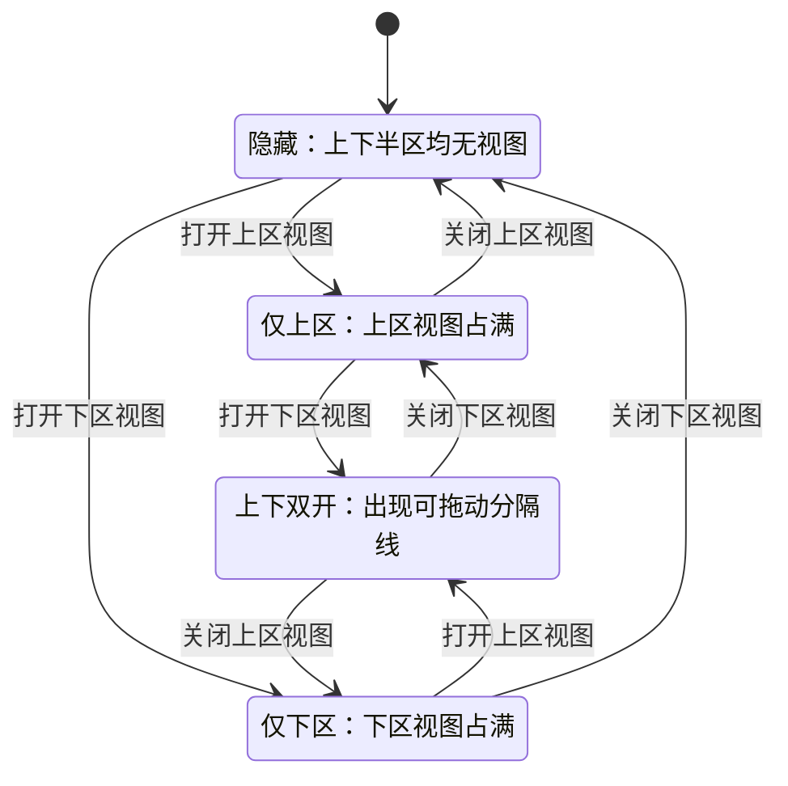
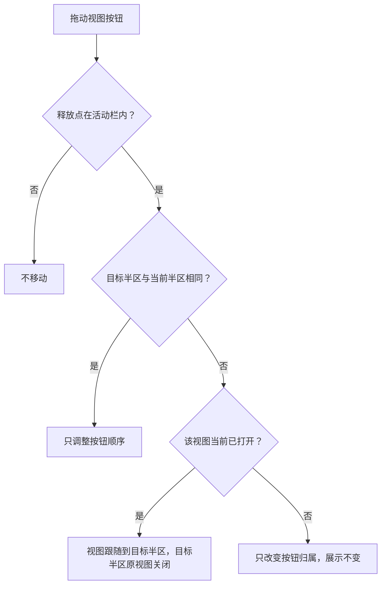

# 侧栏系统本体：活动栏与侧栏区

## 1. 本篇定位与范围

本文描述侧栏系统本体的现状行为：活动栏、侧栏区，以及二者与主区之间的空间关系；覆盖视图按钮的展示、开关、拖拽排序与换区、侧栏布局状态、分割线与宽度调节、视图生命周期、启动对齐与持久化。

本文不描述各视图内部的功能与界面细节：

- 导航树见 [02-nav-tree.md](02-nav-tree.md)
- 文件浏览器见 [03-explorer.md](03-explorer.md)
- Commit 见 [04-commit.md](04-commit.md)
- Agent 全局文件见 [05-agent-files.md](05-agent-files.md)

本文为 as-is 现状功能规格，只记录用户可感知的行为、交互、边界与已知缺陷。

## 2. 总体构成与界面结构

界面横向由三部分组成，自左向右：

- **活动栏**：固定宽 46px，常驻显示，不随侧栏区隐藏而消失；与侧栏区/主区之间有分隔线。
- **侧栏区**：位于活动栏与主区之间，宽 160–500px，默认 250px；可整体隐藏。
- **主区**：占据剩余宽度，最小宽度 200px。

活动栏自上而下分为：

- **上区**：视图按钮组，默认承载全部内置视图按钮。
- **中部弹性空白**：把上区与下区推开。
- **下区**：视图按钮组，默认无按钮。
- **底部配置钮**：固定贴底，与视图按钮视觉同规格，但独立的固定入口。

侧栏区上下分为两个半区，每个半区最多放一个视图。侧栏区本身没有标题栏或通用工具栏，视图内容占满所属半区，各视图自带内容区头部。

内置视图在活动栏中的默认顺序（自上而下）：导航树、文件浏览器、Commit、Agent 全局文件。

首次启动（无保存记录）时：上述按钮全部位于上区且按上述顺序排列；导航树处于打开状态；侧栏区可见，宽度 250px；上下分割比例为 50%（仅双开时有意义）。

**验收判据**

- 启动后活动栏宽度恒为 46px，侧栏区默认宽 250px，按钮顺序为导航树、文件浏览器、Commit、Agent 全局文件。
- 活动栏始终可见；侧栏区隐藏后主区接管其宽度。
- 每个半区同一时刻最多显示一个视图。

## 3. 功能点分节

### 3.1 活动栏视图按钮的展示状态

**行为**

- 每个视图按钮为 34×34px，图标 15px，按钮在 46px 栏内水平居中。
- 按钮使用系统原生悬停提示，提示文字为视图名称：`导航树`、`文件浏览器`、`Commit`、`Agent 全局文件`。
- 按钮的可感知状态包括：
  - 默认：透明底色，图标较暗。
  - 悬停（非激活）：出现悬停底色，图标变亮。
  - 激活：出现激活底色，图标使用强调色，按钮左侧显示 2px 宽竖条指示条；激活时悬停不改变底色。
- 同一视图按钮的激活态与它所在半区当前是否打开该视图一致。
- 视图按钮不显示禁用态、计数徽标或加载标记。

**交互规则**

- 鼠标移入非激活按钮显示悬停态；移出后恢复默认态。
- 鼠标移入激活按钮不产生额外悬停反馈。

**边界条件**

- 多个视图可同时处于激活态，但必须分属上、下两个半区；同一半区只能有一个激活按钮。

**验收判据**

- 悬停任一未打开视图按钮，按钮出现底色且图标变亮；移出后恢复。
- 打开某视图后，其按钮出现激活底色、强调色图标与左侧 2px 竖条；同区其他按钮恢复非激活。
- 双开时，上下半区各有一个按钮处于激活态。

### 3.2 点击开关视图

**行为**

- 点击某个视图按钮，对其所属半区执行开关：
  - 若该半区为空，或打开的是另一个视图：打开该视图。若原有一个其他视图，原视图被直接关闭并卸载，不弹确认。
  - 若该半区已经打开的就是该视图：关闭该半区，槽位清空。
- 上下半区相互独立：打开下区视图不会关闭上区视图，反之亦然。
- 当两个半区都关闭后，侧栏区整体隐藏。

**交互规则**

- 单击即生效，无过渡确认。
- 双击等同于连续两次单击，触发两次开关。

**边界条件**

- 双击已打开的视图：先关闭、再重新打开，最终仍为打开，但视图界面经历一次卸载与重新加载。
- 双击已关闭的视图：先打开、再关闭，最终仍为关闭。
- 同一半区替换视图时，旧视图界面被卸载；除文件浏览器与 Agent 全局文件会恢复展开状态外，搜索、滚动、折叠等内部状态不保留（见 3.9）。

**验收判据**

- 点击已关闭视图：侧栏区出现该视图；若同区原有视图，原视图内容立即消失。
- 点击已打开视图：该视图消失；若另一侧仍打开，则另一侧占满侧栏区；若两侧都无视图，侧栏区整体隐藏。
- 双击已关闭视图后，最终看不到侧栏区；双击已打开视图后，视图仍打开。

### 3.3 活动栏内拖拽排序与换区

**行为**

- 视图按钮可拖动；底部配置钮不可拖动，也不参与排序与换区。
- 拖动开始后，被拖按钮保持在原位、显示为半透明；不产生占位空洞。
- 拖动经过活动栏时，在预计插入位置显示 2px 高的水平插入指示线。
- 目标半区按活动栏整体垂直中点判定：指针在活动栏上半部即上区，下半部即下区，不以两个按钮组之间的实际空白为界。
- 目标半区内的插入位置按按钮判定：
  - 指针位于某按钮上半部：插入该按钮之前。
  - 指针位于某按钮下半部：插入该按钮之后。
  - 指针位于该半区按钮之外或半区为空：插入该半区末尾（空半区即唯一位置）。
- 松开鼠标时：
  - 同区内移动：只改变按钮顺序，不改变任何视图的打开状态。
  - 跨区移动且该视图当前打开：视图跟随到目标半区，源半区清空；目标半区原视图被关闭并替换。
  - 跨区移动且该视图未打开：只改变按钮归属，侧栏展示不变；目标半区原视图继续打开。
- 拖出活动栏后松开：不移动、不换区。
- 拖拽离开活动栏、松开或取消后，插入指示线与半透明效果消失。

**交互规则**

- 上区、下区都可作为落点；下区默认为空时同样可接收按钮。
- 拖拽只在活动栏范围内生效，外部区域不接收落点。
- 拖拽结束后是否还会额外触发一次按钮点击，取决于平台/浏览器行为，应用未做额外屏蔽。

**边界条件**

- 由于分区以活动栏整体中点为界，当窗口较矮或上区按钮较多、按钮组越过中点时，落在上区按钮下半部的指针也可能被判为下区落点。
- 跨区替换不弹确认，目标半区正在显示的视图会直接关闭。
- 拖拽改变的是按钮归属与顺序，不改变视图集合。

**验收判据**

- 同区拖动后，按钮顺序按插入位置变化，打开状态与侧栏布局不变。
- 将一个打开中的视图拖到另一区后，源半区变空，目标半区显示该视图，目标半区原有视图关闭。
- 将一个未打开的视图拖到另一区后，当前显示的视图不变，仅按钮位置变化。
- 拖出活动栏后松开，按钮位置与侧栏布局均不变化。
- 向空的下区/上区拖动并释放，按钮进入该区并可随后点击打开。

### 3.4 键盘可达性

**行为**

- 视图按钮与配置钮都是原生可聚焦按钮。
- 键盘焦点顺序：上区按钮（按当前顺序）→ 下区按钮（按当前顺序）→ 底部配置钮。
- 键盘聚焦时显示 1px 焦点环；鼠标点击不显示焦点环。
- `Enter` 与 `Space` 触发与点击相同的开关或打开设置行为。

**交互规则**

- 不提供应用级快捷键来显示/隐藏侧栏或切换视图。
- 不提供方向键在活动栏按钮之间移动焦点。
- 激活态只通过视觉呈现，不向辅助技术提供程序化的“已按下/已选中”状态。

**边界条件**

- 键盘只能到达并激活按钮，不能执行拖拽排序或换区。

**验收判据**

- 按 `Tab` 可依次聚焦活动栏中的全部按钮与配置钮，焦点环可见。
- 聚焦视图按钮后按 `Enter` 或 `Space`，视图开关结果与鼠标点击一致。
- 页面中不存在用于切换侧栏/视图的全局快捷键。

### 3.5 底部配置钮与设置中心

**行为**

- 配置钮固定在活动栏最底部，34×34px，图标 15px，提示文字为 `配置`。
- 配置钮只有默认态与悬停态（悬停出现底色、图标变亮），没有激活态，不显示左侧指示条。
- 配置钮不参与排序、拖拽、换区与持久化。
- 点击配置钮后，按以下顺序打开设置中心：
  - 当前没有任何项目：弹出警告提示 `请先创建项目`，不切换页面，不打开设置面板。
  - 存在项目：优先选择“当前活跃页面所属的项目”；若活跃页面不属于任何项目，则选择项目列表中的第一个项目。
  - 在该项目中：已有操作页面则切换到第一个页面（不一定是当前活跃页面）；没有操作页面则自动新建一个空页面并切换过去。
  - 切换完成后打开设置面板；若该页面已存在设置面板，则聚焦已有面板，不重复创建。
- 设置面板固定挂在目标页面内，因此上述切页行为会同时改变主区当前显示的页面。
- 打开失败时以警告提示告知：
  - 目标页面在 5 秒内未就绪：`设置中心打开失败:操作页面尚未就绪,请重试`
  - 目标页面没有可承载面板的区域：`设置中心打开失败:页面尚未就绪,请重试`

**交互规则**

- 连续点击配置钮不会创建多个设置面板，只会聚焦同一个。
- 配置钮在侧栏区隐藏时仍可点击。

**边界条件**

- 无项目时不会隐式创建项目，只提示。
- 配置钮的悬停反馈与视图按钮一致，但没有“当前已打开设置”的持续激活态。

**验收判据**

- 无项目时点击配置钮，出现 `请先创建项目`，页面不切换。
- 有项目时点击配置钮，切到目标项目第一个页面，并显示设置面板；再点一次不新增第二个设置面板。
- 目标页面无页面时，点击后产生一个新的空页面并进入设置面板。
- 页面无法就绪时出现对应警告提示，应用不崩溃。

### 3.6 侧栏区单槽位与布局状态

**行为**

- 上、下两个半区各只有一个槽位。
- 侧栏区布局由两个槽位是否打开推导，可感知状态如下：

| 布局状态 | 上区槽位 | 下区槽位 | 可感知结果 |
|---|---|---|---|
| 隐藏 | 空 | 空 | 侧栏区整体不显示，主区扩展 |
| 仅上区 | 有视图 | 空 | 该视图占满侧栏区高度 |
| 仅下区 | 空 | 有视图 | 该视图占满侧栏区高度 |
| 上下双开 | 有视图 | 有视图 | 上下分区显示，中间出现可拖动水平分隔线 |

- 没有独立的“折叠侧栏”按钮；只有关闭全部已打开视图才会使侧栏区隐藏。
- 隐藏不是独立保存的开关，而是由两个槽位都为空推导出的结果。

**交互规则**

- 只有两个半区都关闭时侧栏区才隐藏。
- 上下两个半区可同时打开各自的视图，互不影响；打开一侧不会改变另一侧。

**边界条件**

- 同一半区不能并排或堆叠显示多个视图。
- 侧栏区没有空面板占位：关闭最后一个视图后整个区域消失。

**验收判据**

- 仅打开上区视图时，该视图高度占满侧栏区；打开下区视图后，两视图上下分列并出现分隔线。
- 关闭双开中的一侧后，另一侧自动占满整个侧栏区。
- 关闭最后一个视图后，侧栏区不可见，主区扩展到活动栏右侧。

### 3.7 上下分割线与比例

**行为**

- 只有上下双开时出现水平分隔线，可上下拖动改变上下高度比例。
- 可保存并恢复的比例范围为 10%–90%，默认 50%。
- 双开时按当前比例分配上下高度；关闭一侧后，另一侧占满。
- 再次打开另一侧时，恢复此前保存的合法比例（50% 或 10%–90% 内的其他值）。
- 比例越界或缺失时，双开回退到 50%。
- 重启后读取持久化比例；若保存值恰好为 90%，会被视为异常并重置为 50%，其余 10%–90% 内的值正常恢复。

**交互规则**

- 拖动分隔线过程中实时改变上下高度，并更新保存值。
- 关闭一侧期间不显示分隔线，也不可调整比例。

**边界条件**

- 比例限制的是保存/恢复值；当前运行内拖到边界附近的实际像素高度还受两个半区各自最小可用高度约束。
- 恰好 90% 是唯一会被重启重置的合法边界值；89.9% 等邻近值会保留。

**验收判据**

- 双开时默认上下各约一半；拖动分隔线后上下高度随之变化。
- 关闭下区再重新打开，恢复上次的比例，而不是回到 50%。
- 重启后，10%–90% 内且不等于 90% 的比例被恢复；恰好 90% 的比例显示为 50%。

### 3.8 侧栏区宽度调节

**行为**

- 侧栏区默认宽 250px，可拖动其与主区之间的竖向分隔线调整宽度。
- 可调范围为 160–500px；超出范围时停在边界。
- 主区最小宽度 200px；窗口较窄时，侧栏可拖到的实际最大宽度会先受主区最小宽度限制。
- 侧栏区隐藏时，该竖向分隔线不可见，也无法调宽。
- 重新打开任一视图后，侧栏区按上次宽度显示。
- 宽度会持久化，重启后恢复；越界保存值在加载时被收回 160–500px，非法值回退 250px。

**交互规则**

- 宽度调整与上下分割线相互独立。
- 拖动宽度只改变侧栏区与主区的横向分配，不改变活动栏宽度。

**边界条件**

- 没有“恢复默认宽度”的可见入口。
- 侧栏区隐藏期间不能预先设置宽度。

**验收判据**

- 显示侧栏时横向拖动其右边界，宽度在 160–500px 内变化，主区不小于 200px。
- 隐藏侧栏后看不到宽度分隔线；重新打开视图后宽度与此前一致。
- 重启后宽度恢复为保存值。

### 3.9 视图切换、关闭与重开的生命周期

**行为**

- 同一半区切换视图时，旧视图界面立即关闭并被卸载；新视图重新挂载并自行加载数据。
- 关闭视图后再打开，视图重新加载，不保留上一轮的界面实例。
- 在本次应用运行期间，以下视图的展开状态会跨“关闭/重开”和“换区/切槽”保留：
  - 文件浏览器：保留目录展开状态；该状态与项目根路径绑定，项目根变化后旧展开状态作废并按新根重新加载。
  - Agent 全局文件：保留各 Agent 分区的展开状态及各文件树的目录展开状态。
- 以下视图在切换或重开后不保留内部状态：
  - 导航树：搜索词、项目/页面/历史节点展开状态、折叠状态均重置。
  - Commit：文件列表折叠状态等界面状态重置，并重新读取提交信息。
- 所有视图的内部状态都不跨应用重启保留；重启后只恢复按钮顺序、归属、打开状态、侧栏宽度与分割比例。

**交互规则**

- 视图状态只在内存中跨挂载保留，不写入持久化配置。
- 视图重新打开时可能出现自身的加载态（如文件树、提交列表的读取过程），框架层不提供统一的加载占位。

**边界条件**

- 文件浏览器与 Agent 全局文件的保留范围仅限本次运行；关闭应用后丢失。
- 文件浏览器切换项目根路径时，原有的展开路径不属于新根，会被整份作废。
- 跨区拖拽打开中的视图仍会卸载并重建，但文件浏览器/Agent 全局文件经内部状态保留机制恢复展开状态。

**验收判据**

- 打开文件浏览器并展开若干目录，切换到其他视图再切回，展开状态仍在；重启应用后展开状态消失。
- 打开 Agent 全局文件并展开 Agent 分区与目录，切换视图再切回，展开状态仍在；重启后消失。
- 在导航树中输入搜索词并展开节点，切换到其他视图再切回，搜索词与展开状态重置。
- 在 Commit 中折叠文件列表，切换视图再切回，折叠状态重置。

### 3.10 视图集合与启动对齐

**行为**

- 内置视图集合固定为导航树、文件浏览器、Commit、Agent 全局文件；用户界面不提供新增、删除、改名视图的入口。
- 启动读取保存的侧栏配置后：
  - 保留已保存的按钮顺序与上下区归属。
  - 已不存在的视图记录被静默丢弃，不提示。
  - 保存记录中缺失的当前可用视图，按内置顺序追加到上区末尾。
  - 若某个半区保存的打开视图已被丢弃，该半区置空；另一侧不受影响。
- 没有可用的保存记录时，使用首次启动默认值（全部按钮在上区，打开导航树）。
- 保存的打开状态本身会持久化，因此关闭全部视图后重启，侧栏仍保持隐藏，而不会回到默认打开导航树。

**交互规则**

- 启动对齐只发生在加载阶段，运行期间不会因为视图集合变化而重排按钮。
- 视图被丢弃时不会弹出任何提示。

**边界条件**

- 新增视图（随版本更新出现）只有在保存记录缺少它时才会被追加到上区末尾，不会插入到原有顺序中间。
- 被丢弃视图若原在两个半区都有记录，两个半区的打开状态都可能因此清空，侧栏区可能整体隐藏。

**验收判据**

- 保存“文件浏览器、导航树”的顺序后重启，按钮仍按该顺序显示。
- 保存记录包含已不存在的视图名时，该记录消失且无提示，其余按钮顺序不变。
- 保存记录缺少某个当前可用视图时，该视图按钮出现在上区末尾。
- 打开状态指向已不存在的视图时，对应半区为空；若两侧皆空，侧栏隐藏。

## 4. 跨区行为

| 触发条件 | 可感知结果 |
|---|---|
| 点击已关闭的视图按钮 | 对应半区打开该视图；若同区已有其他视图则被替换；侧栏区若原为隐藏则出现并按保存宽度显示 |
| 点击已打开视图按钮 | 对应半区关闭；若另一侧仍打开则其占满；若两侧皆空则侧栏区消失、主区扩展 |
| 双开上下区 | 出现水平分隔线；上下按当前比例分配高度 |
| 关闭双开中的一侧 | 分隔线消失；剩余视图占满侧栏区 |
| 拖动侧栏区与主区之间的竖向分隔线 | 侧栏区宽度在 160–500px 内变化，主区宽度反向变化且不小于 200px |
| 侧栏区隐藏 | 竖向宽度分隔线不可见、不可调整；活动栏保持显示；主区占据侧栏原空间 |
| 拖动打开中的视图跨区 | 视图跟随到目标区，源区清空，目标区原视图关闭；布局按剩余打开状态重新推导 |
| 拖动未打开视图跨区 | 当前显示不变，仅按钮归属与顺序变化 |
| 点击底部配置钮（有项目） | 切换到目标项目第一个页面（无页面则新建空页面），并打开/聚焦该页面的设置面板 |
| 点击底部配置钮（无项目） | 警告提示 `请先创建项目`，页面不切换 |
| 切换项目或操作页面 | 活动栏与侧栏区布局、宽度、打开状态保持不变；各视图内容随新的活跃项目/页面刷新 |
| 重启应用 | 按钮顺序、归属、打开状态、侧栏宽度、分割比例恢复；视图内部状态不恢复 |

## 5. 状态保留与持久化

### 5.1 保留范围

| 状态 | 本次运行内切换视图/换区 | 应用重启后 |
|---|---|---|
| 按钮顺序与上下区归属 | 保留 | 保留 |
| 各半区打开状态 | 保留 | 保留 |
| 侧栏区宽度 | 保留 | 保留 |
| 上下分割比例 | 保留 | 保留（恰好 90% 例外，重置为 50%） |
| 文件浏览器目录展开状态 | 保留 | 不保留 |
| Agent 全局文件展开状态 | 保留 | 不保留 |
| 导航树展开/搜索/折叠状态 | 不保留 | 不保留 |
| Commit 折叠等界面状态 | 不保留 | 不保留 |

### 5.2 保存

- 按钮顺序/归属、打开状态、侧栏宽度、分割比例发生变更后，约 2 秒自动写入持久化配置。
- 连续多次变更会合并，只保存最后一次的完整状态。
- 保存失败时弹出警告提示 `设置保存失败，重启后将丢失`。
- 关闭应用时，最近一次变更若尚未到达自动保存时刻，其待执行保存会被取消，可能未写入磁盘（见已知限制）。

### 5.3 加载与清洗

- 启动时读取保存的侧栏配置；读取异常时静默使用默认值，不弹提示。
- 配置文件整体损坏时，弹出警告提示 `配置已损坏，已回退默认值`；若仍能取得可用数据，则继续使用可用部分。
- 侧栏配置段缺失或结构非法时，相应部分静默回退默认值，其他合法字段照常恢复。
- 宽度加载时限制在 160–500px；非法数值回退 250px。
- 分割比例加载时限制在 10%–90%；非法数值回退 50%；恰好 90% 的保存值重置为 50%。
- 打开状态指向已不存在视图时，对应半区置空。
- 保存记录中缺失的可用视图追加到上区末尾。

## 6. 空态、加载、错误

### 空态

- 两个半区都无视图：侧栏区整体隐藏，不显示空面板、占位图或“无视图”提示；活动栏与配置钮保持可见。
- 某个半区为空时，该半区不显示，另一侧占满整个侧栏区。
- 下区默认无按钮：活动栏下区为空白区域，但仍可作为拖拽落点。
- 视图集合固定，不存在“一个按钮都没有”的正常用户状态；配置钮始终存在。

### 加载

- 框架层不提供侧栏区级别的加载遮罩、骨架屏或读取中提示。
- 打开或切回视图后，由各视图自身展示其数据加载状态；文件浏览器与 Agent 全局文件重开时会恢复展开状态并重新读取目录内容。
- 启动加载侧栏配置期间没有可见的加载提示；加载完成后按保存状态显示。

### 错误

- 侧栏配置保存失败：警告提示 `设置保存失败，重启后将丢失`。
- 配置文件整体损坏：警告提示 `配置已损坏，已回退默认值`。
- 侧栏配置读取异常或结构非法：静默回退默认值，不弹提示。
- 配置钮打开设置中心失败：警告提示 `设置中心打开失败:操作页面尚未就绪,请重试` 或 `设置中心打开失败:页面尚未就绪,请重试`。
- 无项目时点击配置钮：警告提示 `请先创建项目`。
- 各视图内部的数据读取/操作错误由视图自身呈现，不在本篇范围内。

## 7. 图表

### 7.1 侧栏布局状态

### 7.2 拖拽落点判定

## 8. 验收判据汇总

| 触发 | 结果 | 验收判据 |
|---|---|---|
| 点击未打开的视图按钮（半区为空或已有其他视图） | 该半区打开该视图；已有其他视图则被替换 | 原视图内容消失，新视图内容出现；按钮激活态随之切换 |
| 点击已打开的视图按钮 | 该半区关闭 | 若另一侧仍打开则其占满侧栏区；若两侧皆空则侧栏区整体隐藏 |
| 上区已打开，再打开下区视图 | 切换为上下双开 | 上下两个视图同时可见，中间出现水平分隔线 |
| 关闭双开中的一侧 | 另一侧占满 | 侧栏区只剩一个视图，分隔线消失 |
| 拖动已打开视图跨区 | 跟随并替换 | 源半区变空，目标半区显示该视图，目标半区原视图关闭 |
| 拖动未打开视图跨区 | 仅改变归属 | 当前显示的视图与布局不变，按钮出现在目标区 |
| 同区拖动 | 仅调整按钮顺序 | 按钮顺序按插入位置变化；打开状态与布局不变 |
| 启动读取保存记录 | 对齐视图集合与状态 | 顺序/归属/打开状态/宽度/比例恢复；已移除视图静默丢弃；缺失视图追加到上区末尾；指向已移除视图的半区置空 |

各功能节的验收判据同时有效，本节仅汇总跨功能的关键路径。

## 9. 边界与非目标

**边界**

- 活动栏固定 46px，不提供用户调整宽度、隐藏或停靠到其他位置的入口。
- 侧栏区只有上下两个半区、每半区一个槽位；不支持左右分栏、多标签页或同一半区并排多个视图。
- 侧栏区没有独立的“显示/隐藏”按钮或默认空面板；隐藏等价于两个槽位都为空。
- 侧栏区宽度范围 160–500px，主区最小 200px；上下比例可保存范围为 10%–90%。
- 视图按钮可拖拽，但仅在活动栏内生效；拖出活动栏不产生移动。
- 配置钮固定底部，不参与拖拽、排序、换区与持久化。
- 视图内部状态只在本次运行内按视图能力部分保留，不跨重启。
- 拖拽基于桌面指针操作；不支持触摸拖拽或键盘拖拽排序。

**非目标**

- 不描述导航树、文件浏览器、Commit、Agent 全局文件的具体功能与界面内容。
- 不描述主区的页面、页签、分屏与终端行为。
- 不描述设置中心内部的配置页与设置项。
- 不描述主题、颜色、字体与图标视觉设计。
- 不描述全局快捷键系统、命令行参数、多窗口或多实例行为。
- 不包含改进建议、缺陷修复方案、优先级或排期。

## 10. 已知限制

- 【行为设计】同一半区只有一个槽位，没有“上次打开”历史栈：关闭当前视图后，之前被替换的视图不会自动恢复，必须再次点击。
- 【行为设计】关闭全部视图后侧栏区整体隐藏，活动栏仍然保留；没有独立的侧栏显示/隐藏控件。
- 【行为设计】底部配置钮不参与拖拽、排序、换区与持久化，且没有持续激活态，无法从活动栏判断设置面板是否已打开。
- 【行为设计】内置视图集合固定，用户不能新增、删除或重命名视图。
- 【行为设计】导航树与 Commit 在切换视图或重开后丢失展开、搜索、折叠等内部状态。
- 【行为设计】文件浏览器与 Agent 全局文件的展开状态只在本次运行内保留，关闭应用后丢失。
- 【行为设计】双击视图按钮会执行两次开关：双击已打开视图最终仍打开但会重新加载；双击已关闭视图最终仍关闭。
- 【疑似缺陷】保存的上下分割比例恰好为 90% 时，重启会被重置为 50%；该值本身处于允许范围内，89.9% 等邻近值则正常保留。
- 【疑似缺陷】关闭应用时，最近约 2 秒内尚未触发的侧栏配置自动保存会被取消，可能丢失最后一次按钮顺序、打开状态、宽度或比例变更。
- 【无障碍/平台】不提供侧栏/视图的应用级快捷键，不支持方向键在按钮间移动焦点；按钮不向辅助技术暴露“已按下/已选中”状态，只能通过视觉判断激活态。
- 【无障碍/平台】拖拽仅支持桌面指针，不支持触摸拖拽，也没有键盘排序替代路径。
- 【行为设计】拖拽换区以活动栏整体垂直中点划分上下区，不以两个按钮组之间的实际空白为界；窗口较矮或上区较长时，落点可能超出用户直觉。
- 【行为设计】跨区拖拽打开中的视图会无确认地关闭目标半区原有视图。
- 【行为设计】侧栏区隐藏时不可调整宽度，且没有恢复默认宽度的可见入口；重新打开后沿用隐藏前宽度。
- 【行为设计】首次启动（无保存记录）默认打开导航树；而用户关闭全部视图后重启，侧栏会保持隐藏，两种启动结果不同。
- 【疑似缺陷】拖拽结束后可能额外触发一次按钮点击（由平台/浏览器决定，应用未屏蔽）；若触发，可能造成拖动后视图被意外开关。

## 11. 相关文档

- [README.md](README.md)：侧栏系统文档总览与阅读顺序
- [02-nav-tree.md](02-nav-tree.md)：导航树视图
- [03-explorer.md](03-explorer.md)：文件浏览器视图
- [04-commit.md](04-commit.md)：Commit 视图
- [05-agent-files.md](05-agent-files.md)：Agent 全局文件视图
