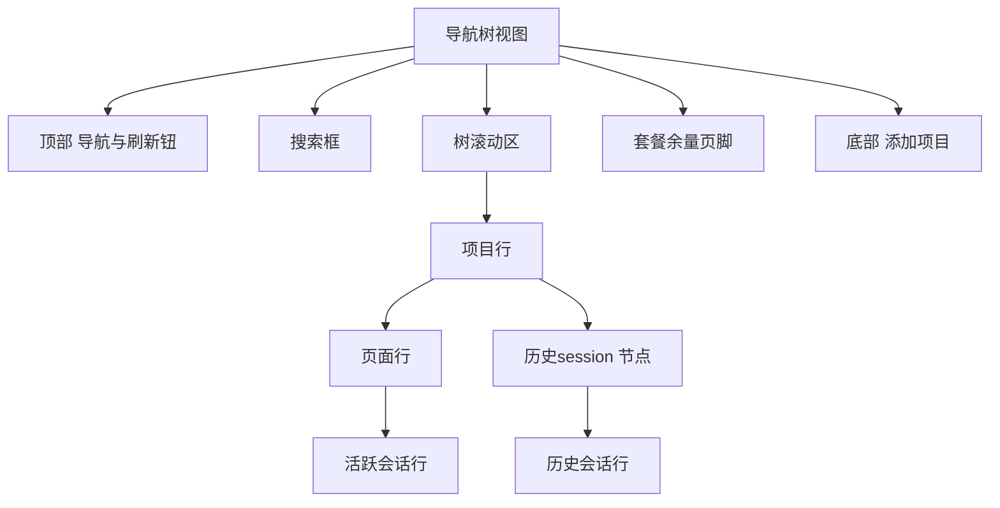
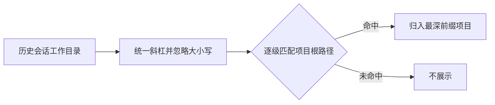

# 导航树视图（as-is 现状功能规格）

> 本文是 as-is 现状规格，只描述当前版本中用户可感知的界面、交互、功能、边界与已知缺陷，不包含未来需求、修复建议或改进方案。
> 适用范围：侧栏「导航树」视图本体。

## 1. 本篇定位与范围

本篇描述侧栏「导航树」视图的现状行为，覆盖：

- 入口、默认打开状态与界面分区。
- 项目、页面、活跃会话、历史会话的层级与归属。
- 项目与页面的添加、重命名、删除。
- 历史会话的展示、双击恢复、右键操作。
- 搜索、刷新与历史扫描、套餐余量页脚。
- 行度量、滚动、跨区联动、空态与错误表现。

不在本篇范围：

- 活动栏的拖拽换区、排序、侧栏宽度调整等框架行为。
- 主工作区的页面布局、终端渲染、终端面板内部行为。
- 历史扫描的后端实现、缓存策略与各 CLI 恢复命令的具体内容。
- 设置中心与后台任务配置页面的操作细节。
- 文件浏览器、Commit、Agent 全局文件等其他侧栏视图。
- 任何未来设计、重构方案或缺陷修复方案。

## 2. 界面结构与入口

### 2.1 入口与默认状态

- 默认配置下，「导航树」位于活动栏上区第一个按钮，按钮图标为树形/文件夹树样式，悬停提示为「导航树」。
- 无已保存的侧栏状态时，启动后默认打开导航树。
- 已保存的侧栏状态优先于默认值：若用户上次关闭了导航树，重启后保持关闭。
- 点击已打开的「导航树」按钮会关闭该视图；点击其他上区视图按钮会用该视图替换导航树。
- 上区同一时间只显示一个视图。

### 2.2 界面分区

界面自上而下固定为以下结构：

| 分区 | 内容 | 滚动行为 |
|------|------|----------|
| 顶部标题行 | 左侧「导航」，右侧刷新按钮（悬停提示「刷新」） | 固定，不随树滚动 |
| 搜索区 | 带放大镜图标的输入框，占位文案「搜索项目 / 页面 / 会话…」 | 固定，不随树滚动 |
| 树滚动区 | 项目 → 页面 → 活跃会话；项目下另有「历史session」折叠节点 | 纵向滚动；内容超宽时横向滚动 |
| 套餐余量页脚 | 仅在满足显示条件时出现，位于树滚动区与「添加项目」之间 | 固定，不随树滚动 |
| 底部操作区 | 全宽「添加项目」按钮，上方有分隔线 | 固定，不随树滚动 |
| 浮层 | 行右键菜单、运行中会话弹窗、删除确认弹窗 | 覆盖在界面之上 |

### 2.3 树的基本形态

- 项目行默认收起。
- 页面行默认收起；项目展开后才可见。
- 历史节点默认收起；项目展开且历史会话总数大于 0 时才可见。
- 活跃会话行挂在所属页面下，页面展开后才可见。
- 历史会话行挂在历史节点下，历史节点展开后才可见。
- 所有行均支持鼠标悬停高亮；当前活跃页面行和当前活跃页面上的最近活跃会话行带选中底色。

## 3. 功能点分节

### 3.1 层级与归属

**行为**

- 树的主层级为：项目 → 页面 → 活跃会话。
- 历史会话折叠节点直接挂在项目下，位于该项目所有页面行之后，与页面行同级缩进。
- 活跃会话只展示当前活跃项目中的运行中 CLI 会话。当前活跃项目 = 包含当前活跃页面的项目；纯 shell 终端不建行。
- 活跃会话按所属页面归组，并按其最近事件时间降序排列。
- 历史会话按会话工作目录与项目根路径做前缀匹配后归属到项目。

**交互规则**

- 切换当前活跃页面到另一个项目后，原项目的活跃会话行不再出现，新项目对应页面的活跃会话行出现。
- 历史归属匹配忽略大小写与正斜杠/反斜杠差异，并按路径段边界判断；嵌套项目存在时，会话归属到匹配最深前缀的项目。
- 会话工作目录等于项目根路径，或位于项目根路径之下，均可归属。
- 无法匹配任何项目根路径的历史会话不展示。
- 工作目录为空的会话不展示。
- 多个项目的根路径重复时，历史会话只归属树中先出现的那个项目；其他同根项目不显示这些历史会话。

**边界条件**

- 项目没有历史会话时不显示历史节点，也没有「暂无历史会话」占位。
- 项目展开后若既无页面也无历史，只显示空的项目展开区域。
- 历史节点即使项目未展开，后台仍可能已完成扫描；但节点在项目展开前不可见。

**验收判据**

- 从项目 A 切换到项目 B 的页面后，项目 A 的活跃会话行消失，项目 B 的活跃会话行出现。
- 根路径 `C:/root` 与 `C:/root/sub` 同时存在时，工作目录为 `C:/root/sub/x` 的会话只出现在 `C:/root/sub` 项目下。
- 工作目录为 `C:/elsewhere` 的会话不出现在任何项目下。
- 项目收起时看不到页面行和历史节点；展开后页面行在前、历史节点在后。

### 3.2 项目行

**行为**

- 项目行由展开箭头、文件夹图标、项目名称、可选「当前」标签、页面计数标签组成。
- 项目行默认收起。
- 点击项目行展开或收起其下的页面行与历史节点，箭头方向随展开状态变化。
- 当前活跃页面所属项目显示「当前」标签；没有活跃页面时，没有项目显示该标签。
- 页面计数标签显示该项目的页面总数，搜索时不变。
- 右键菜单包含「新建操作页面」与「删除项目」。
- 「新建操作页面」会立即在项目内创建一个空布局页面，默认名为「页面-」加时间派生数字；新页面不会自动切换过去。
- 「删除项目」先弹出确认弹窗，标题「确认删除」，正文 `确定删除项目 "项目名"？`；取消则不删除，确认后项目及其页面从树中移除。

**交互规则**

- 项目行整体点击只负责展开/收起，不切换主工作区页面。
- 右键菜单在鼠标位置弹出；点击菜单项后执行并关闭；点击菜单外关闭。
- 「删除项目」为危险项，使用危险色显示。
- 新建页面后，项目计数标签增加，新页面行出现在该项目展开区域内。
- 新添加的项目默认收起，且不会自动成为当前项目。

**边界条件**

- 项目不支持重命名，项目行右键菜单没有重命名入口。
- 同一文件夹可以被重复添加为多个项目；导航树不做根路径去重。
- 删除项目没有撤销。
- 搜索状态下，项目行仍可能因项目名称或子节点命中而显示。

**验收判据**

- 点击项目行后页面行显隐翻转，箭头方向同步变化。
- 当前项目显示「当前」，其他项目不显示；页面计数等于该项目页面总数。
- 右键「新建操作页面」后页面计数加一，并出现一个新页面行。
- 右键「删除项目」弹确认；取消后项目仍在，确认后项目行消失。

### 3.3 添加项目

**行为**

- 点击底部「添加项目」按钮，打开系统文件夹选择框，标题「选择项目文件夹」。
- 取消选择时，导航树无任何变化。
- 选择文件夹后，以文件夹名作为项目名，并创建一个默认空布局页面，页面名与项目名相同。
- 新项目加入树中并默认收起。

**交互规则**

- 添加项目不会自动切换当前活跃页面或当前项目。
- 新项目按加入顺序排在已有项目之后。
- 添加失败时界面无变化、无通知，仅记录日志。

**边界条件**

- 不校验文件夹是否已被其他项目使用。
- 没有加载态；系统文件夹选择框关闭前，导航树保持原状。
- 文件夹名提取失败时，可能回退使用完整路径作为名称。

**验收判据**

- 取消文件夹选择后项目行数量不变。
- 选择文件夹后出现同名项目行和同名首个页面；项目保持收起。
- 添加失败时没有新项目行，也没有可见错误提示。

### 3.4 页面行

**行为**

- 页面行由展开箭头、页面图标、页面名称组成；页面收起且存在活跃会话时，右侧额外显示最近一条活跃会话的标题。
- 当前活跃页面行带选中底色。
- 点击页面行：切换该页面的活跃会话展开状态，同时把主工作区切换到该页面。
- 点击页面行左侧箭头：只切换该页面的活跃会话展开状态，不切换主工作区页面。
- 右键菜单包含「重命名操作页面」与「删除操作页面」。
- 「重命名操作页面」进入行内编辑：输入框预填当前页面名并自动获得焦点。
- 重命名确认方式：按 Enter 或输入框失焦。
- 重命名取消方式：按 Esc、输入空白、或输入与当前名称相同。
- 重命名期间点击该行不会切换页面；点击输入框内部也不会切换页面。
- 「删除操作页面」立即执行，无确认弹窗。
- 删除页面会终止该页面上的终端；若删除的是当前活跃页面，主工作区切换到该项目剩余页面中的第一个；若没有剩余页面，则没有活跃页面。

**交互规则**

- 页面行点击与箭头点击互不替代：点击箭头不切页，点击行会同时切页和展开/收起会话。
- 页面收起时右侧显示的最近会话标题取该页面活跃会话列表的第一条（按最近事件排序）。
- 页面展开后不再显示右侧最近会话标题。
- 页面名称可直接重复；重命名只阻止“空白”和“与当前名称相同”，不校验与其他页面重名。
- 删除页面为危险项，使用危险色显示。
- 删除后页面计数标签减少一。

**边界条件**

- 页面行右键菜单没有「新建操作页面」；新建入口在项目行菜单。
- 删除页面无确认、无撤销。
- 搜索状态下，页面行是否可见取决于页面名或该页面下是否有活跃会话命中。
- 搜索状态下点击页面行仍会切换主工作区页面，即使展开状态被搜索命中链覆盖。

**验收判据**

- 点击页面行后主工作区切到该页面，且该页面会话区域显隐翻转。
- 点击箭头后会话区域显隐翻转，但当前活跃页面不变。
- 当前活跃页面行有选中底色，切换页面后选中底色跟随。
- 重命名按 Enter 或失焦后名称更新；按 Esc、输入空白或同名后名称不变。
- 删除页面后页面行立即消失，页面计数减一，且没有确认弹窗。

### 3.5 活跃会话行

**行为**

- 活跃会话行为单行结构：可选状态圆点、CLI 品牌图标、会话标题、右侧迷你用量条、用量百分比。
- 状态圆点仅在会话有状态时显示；没有状态时不显示圆点。
- CLI 品牌图标在导航树已识别该 CLI 时显示，尺寸 14×14；未识别时不显示图标，其余内容照常。
- 迷你用量条尺寸为 32×3 像素，填充宽度对应用量百分比。
- 用量百分比由 CLI 能力换算，通常取整并限制在 0–100；没有用量数据时显示 `--`，此时用量条呈占位态。
- 用量条按 50%、70%、90% 三个阈值分为四档颜色。
- 会话标题实时跟随其终端页签标题变化。
- 当前活跃页面上的最近一条活跃会话行带选中底色；同一页面只有这一条带选中底色。
- 点击活跃会话行：切换到该会话所在页面，并聚焦对应终端页签。
- 连续点击时以最后一次点击为准，前一次尚未完成的聚焦等待会被取消。

**交互规则**

- 活跃会话行按最近事件时间降序排列。
- 只有运行中 CLI 会话建行；纯 shell 终端不显示。
- 只有当前活跃项目内的会话显示。
- 点击会话行后若约 5 秒内找不到对应终端面板，则无聚焦、无提示、无反馈。

**边界条件**

- 会话状态缺失时没有状态圆点，但行仍显示。
- 用量数据缺失时百分比显示 `--`，用量条不显示实际比例。
- 无法解析会话所属页面时，点击行无反应。
- 行内标题过长时单行截断并显示省略号。

**验收判据**

- 有状态的行显示状态圆点，无状态的行不显示圆点。
- 有用量时显示对应百分比与按比例填充的 32×3 用量条；无用量时显示 `--`。
- 终端页签标题改变后，导航树中的会话行标题同步改变。
- 点击会话行后主工作区切到其所属页面，对应终端页签获得焦点。
- 当前活跃页面只有最近一条会话行带选中底色，且顺序按最近事件时间降序。

### 3.6 历史节点与历史行

**行为**

- 历史节点由展开箭头、时钟图标、固定文案「历史session」、计数标签组成。
- 历史节点默认收起；点击节点行展开或收起历史行。
- 计数标签显示该项目的全部历史会话数，搜索时不变。
- 历史节点仅在项目展开且该项目历史会话总数大于 0 时渲染。
- 历史行按会话文件修改时间降序排列。
- 历史行为单行结构：状态圆点、CLI 品牌图标、标题、右侧相对时间。
- 状态圆点始终显示：能匹配到运行中终端时显示实际状态；没有运行状态时显示完成状态圆点。
- 无标题（标题缺失）时显示会话 ID 前 8 位。
- 悬停历史行时，以原生悬停提示显示该会话的首条提示词预览；没有首条提示词时不显示该提示。
- 相对时间按六档显示：刚刚、N 分钟前、N 小时前、N 天前、MM-DD、YYYY-MM-DD；没有有效时间时显示 `-`。
- 相对时间每 60 秒自动重算一次，视图保持打开时会从“5 分钟前”自动变为“6 分钟前”。
- 单击历史行没有动作；双击触发恢复分派；右键打开历史菜单。

**交互规则**

- 点击历史节点行切换展开；点击历史行本身不会导致历史节点收起。
- 历史行悬停提示承载提示词预览，预览文本不再作为可见的第二行显示。
- 历史会话按项目归属分组；不属于任何项目的历史会话不显示。
- 历史节点位于页面行之后，始终是项目展开区域的最后一个子项。

**边界条件**

- 项目收起时历史节点完全不渲染，即使历史会话数据已经存在。
- 项目历史会话总数为 0 时不渲染历史节点，也没有空态占位。
- 搜索时只有历史行命中，历史节点才显示；仅项目名或页面名命中不会显示历史节点。
- 历史计数不随搜索过滤结果变化。
- 无法与运行中终端匹配的历史会话（包括旧数据和仅命令匹配的会话）一律显示完成状态圆点，即使其实际仍在运行。

**验收判据**

- 项目展开且历史数大于 0 时出现「历史session」节点；项目收起或历史数为 0 时节点不存在。
- 计数标签等于该项目全部历史会话数，输入搜索词后计数不变。
- 历史行显示状态圆点、CLI 图标、标题和相对时间；无标题时显示会话 ID 前 8 位。
- 悬停有首条提示词的历史行出现对应提示；没有首条提示词时不出现提示。
- 历史行顺序按修改时间从新到旧；相对时间在 60 秒后自动更新。

### 3.7 双击历史行与恢复

**行为**

双击历史行按会话状态分三种结果：

- 运行中：弹出「会话运行中」弹窗，正文「该会话已在运行中，恢复会与现有会话冲突。」。
- 目录已不存在（孤儿）或工作目录为空：无操作。
- 普通会话：恢复该历史会话。

「会话运行中」弹窗包含：

- 主操作按钮「切换到该会话操作页面」。
- 底部「取消」按钮。
- 按 Esc、点击遮罩空白处或点击「取消」均关闭弹窗。

选择「切换到该会话操作页面」后：

- 定位该会话的运行中终端及其所属页面。
- 切换到该页面并聚焦对应终端页签。
- 找不到运行中终端或所属页面时，弹出通知「未找到运行中的会话」，正文「该会话已结束或无法定位其终端页签」。

普通恢复的执行结果：

- 查找根路径与会话工作目录完全相等的项目；比较时忽略大小写与斜杠差异。
- 没有对应项目时，新建项目，项目名取工作目录最后一段，并在其中创建默认页面。
- 已有项目但没有页面时，为该项目建设一个默认空布局页面。
- 切换到目标项目的第一页（不是该会话曾经所在的页面）。
- 新建一个终端页签，页签标题取历史会话标题；无标题时取会话 ID 前 8 位。
- 终端就绪后自动注入该 CLI 的恢复命令并回车。
- 任一步骤失败时，弹出通知「恢复会话失败」，正文包含会话 ID 前 8 位与失败原因。

**交互规则**

- 普通双击恢复不进行分支恢复；分支恢复只在历史行右键菜单中提供。
- 运行中弹窗只提供“切换”和“取消”，不提供分支恢复。
- 恢复编排进行中再次双击其他历史行会被忽略，不会并发执行。
- 页面或终端就绪最多等待约 5 秒；PowerShell 系终端等待首个提示符最多约 10 秒，超时后仍尝试注入；CMD 固定等待约 0.5 秒后注入。
- 当前 CLI 不支持历史恢复时，普通双击恢复会失败并提示。

**边界条件**

- 恢复复用的项目必须与工作目录完全相等；工作目录位于既有项目根路径的子目录时，不会复用父项目，而是新建一个以该子目录为根的项目。
- 孤儿行与无工作目录行双击后没有任何反馈。
- 当前导航树只展示可归属到项目的历史会话；工作目录为空的会话不会出现在树中，因此“无工作目录 → 无操作”分支在当前视图中没有可达行。
- 恢复进行中再次双击会被静默忽略。
- 恢复失败不会中断其他已打开页面或终端。

**验收判据**

- 双击普通历史行后，必要时出现新项目或新页面，主工作区切到该项目第一页，并出现自动输入恢复命令的新终端页签。
- 双击运行中历史行后出现「会话运行中」弹窗；点击「切换到该会话操作页面」后对应终端页签获得焦点。
- 双击孤儿行后界面无变化、无通知。
- 恢复失败时出现标题为「恢复会话失败」的通知。

### 3.8 历史右键菜单

历史行右键菜单的可用性如下：

| 操作 | 普通行 | 孤儿行 | 运行中行 | 无工作目录行 |
|------|--------|--------|----------|--------------|
| 复制恢复命令 | 可用 | 可用 | 可用 | 可用 |
| 分支恢复 | 可用 | 禁用 | 可用 | 禁用 |
| 删除 | 可用 | 可用 | 禁用 | 可用 |

**行为**

- 「复制恢复命令」：把该 CLI 的恢复命令写入剪贴板。成功时无提示；CLI 不支持生成恢复命令时复制空字符串，同样无提示。
- 「分支恢复」：仅在当前 CLI 支持分支恢复时出现在菜单中；不支持时该菜单项完全不显示。
- 「分支恢复」会基于原会话创建一个新的分支会话，原会话保持不变，并按恢复流程打开新的终端页签。
- 「删除」：先弹出确认弹窗，标题「确认删除」，正文 `确定删除会话"标题"？此操作不可撤销。`；无标题时使用会话 ID 前 8 位。
- 删除确认后立即从导航树局部移除该行，计数标签同步减少，不重新扫描历史。
- 删除失败时行保留，仅记录日志，界面无提示。
- 运行中行的「删除」禁用，点击无动作，菜单不关闭。
- 孤儿行的「分支恢复」禁用，点击无动作，菜单不关闭。

**交互规则**

- 菜单在鼠标位置弹出，点击菜单项后执行并关闭，点击菜单外关闭。
- 禁用项灰显且不可点击。
- 「删除」为危险项，使用危险色显示。
- 菜单不支持 Esc 关闭，也不支持键盘导航。

**边界条件**

- 无工作目录行在当前导航树中不可见，因此矩阵中的“无工作目录行”列属于防御性规格，实际没有可达行。
- 复制成功、复制空字符串、复制失败均没有可见反馈。
- 删除只影响当前行，没有批量删除入口。

**验收判据**

- 普通行右键菜单包含「复制恢复命令」「分支恢复」「删除」；点击复制后剪贴板内容为恢复命令，且没有通知。
- 孤儿行的「分支恢复」灰显不可点；运行中行的「删除」灰显不可点。
- 当前 CLI 不支持分支恢复时，菜单中没有「分支恢复」项。
- 删除确认后历史行立即消失且计数减一；取消后行保留。
- 点击菜单外任意处菜单关闭。

### 3.9 搜索

**行为**

- 搜索框输入内容后立即过滤，无需提交。
- 匹配规则为不区分大小写的子串匹配；查询首尾空白会被忽略，仅输入空白等同于未搜索。
- 匹配范围：
  - 项目名称。
  - 页面名称。
  - 活跃会话标题。
  - 历史会话标题；无历史标题时匹配会话 ID 前 8 位。
- 子节点命中时，父节点即使自身未命中也会显示。
- 查询非空时，命中链自动展开，覆盖手动展开/收起状态：
  - 项目存在任一命中页面或命中历史行时自动展开。
  - 页面存在命中活跃会话时自动展开。
  - 历史节点存在命中历史行时自动展开。
- 搜索期间点击项目行、页面行箭头或历史节点的折叠箭头，不会收起已显示出来的命中链。
- 搜索期间历史节点只在存在命中历史行时显示。
- 搜索期间页面计数标签和历史计数标签仍显示未过滤的总数。
- 搜索无结果时显示空态文案「没有找到匹配的项目 / 页面 / 会话」。
- 完全没有项目时显示空态文案「暂无项目，点击下方「添加项目」开始」；该空态优先于搜索无结果空态。

**交互规则**

- 搜索只过滤展示，不改变当前活跃页面、当前项目或终端状态。
- 项目名称命中但页面名和历史标题都未命中时，项目行显示但不展开，子项全部隐藏；搜索期间也无法通过折叠箭头展开这些未命中的子项。
- 搜索期间点击页面行仍会切换主工作区页面。
- 搜索框没有清除按钮，需要手动选中文本删除；清空输入后恢复按手动展开状态展示。
- 搜索期间对折叠箭头的点击会改变手动展开状态，但视觉上被命中链覆盖；清空搜索后才体现。

**边界条件**

- 不搜索历史会话的首条提示词、工作目录、项目根路径、页面内容或文件名。
- 活跃会话只按标题匹配，不按会话 ID 匹配。
- 历史会话有标题时只按标题匹配，无标题时才使用会话 ID 前 8 位。
- 搜索状态不跨视图切换或重启保留。

**验收判据**

- 输入页面名子串后，仅命中的页面行显示，未命中的页面行隐藏。
- 输入大写/小写不同的查询词，匹配结果一致。
- 仅页面命中时父项目行仍显示；仅项目名命中时未命中的页面行不显示。
- 非空查询下命中链自动展开，无需手动点击。
- 搜索期间点击折叠箭头，已显示的命中链不收起。
- 搜索无结果时显示「没有找到匹配的项目 / 页面 / 会话」；无项目时显示「暂无项目，点击下方「添加项目」开始」。

### 3.10 刷新与历史扫描

**行为**

- 顶部刷新按钮只触发历史会话重新扫描，不刷新项目列表、页面布局、活跃会话数据或套餐余量。
- 后台历史扫描任务启用时，首次打开导航树会立即扫描一轮；之后在视图保持打开期间按后台配置的周期扫描。
- 扫描周期默认约 3 秒，可在后台任务配置中调整，允许范围约 2–300 秒。
- 重新扫描总是重新读取磁盘上的会话数据，新会话不必等待上次扫描结果过期。
- 展开或收起历史节点不会触发额外扫描。
- 刷新按钮没有加载态；扫描期间树保持原样。
- 刷新失败没有界面提示，旧数据继续显示。
- 扫描进行中再次点击刷新会被忽略，不会排队追加一轮。

**交互规则**

- 扫描完成后，历史计数与历史行按新数据更新。
- 多个 CLI 的历史来源中，单个来源失败时该来源保留旧数据，其余来源使用新数据；全部来源失败时不更新。
- 即使后台定时扫描被禁用，点击刷新仍会立即执行一轮扫描。
- 视图关闭后停止周期扫描；再次打开时先显示上次扫描快照，并立即发起新一轮扫描。
- 后台任务配置读取失败时，仍执行首轮扫描，但不启动周期扫描。

**边界条件**

- 首次扫描完成前，历史节点可能暂时不出现；没有加载指示。
- 刷新只重扫历史，不重扫项目、页面或终端。
- 刷新不会改变当前展开状态或搜索状态。
- 后台扫描禁用时，视图打开不会自动扫描，但手动刷新仍可用。

**验收判据**

- 点击刷新后，新产生的历史会话出现在对应项目的历史节点下，计数更新。
- 首次打开视图会触发一轮历史扫描；保持打开时按配置周期再次扫描。
- 展开/收起历史节点不会增加扫描次数。
- 刷新过程中没有加载动画或提示。
- 扫描失败时历史列表保持旧内容，没有错误通知。
- 关闭导航树后周期扫描停止；重新打开后立即再扫一轮。

### 3.11 套餐余量页脚

**行为**

- 页脚位于树滚动区与「添加项目」按钮之间，上方有分隔线。
- 显示条件：套餐余量后台任务处于启用状态，且至少有一个来源条目（即使该条目当前无有效数值、显示 `--`）。
- 每个来源显示为一行：14×14 的套餐/品牌图标加一行文案；图标加载失败时隐藏图标，只保留文案。
- 行文案按以下优先级显示：
  - 冻结状态：「已冻结」。
  - 有金额：货币符号加原始金额值；人民币显示 `¥`，美元显示 `$`，未知货币显示原货币代码。
  - 有双窗用量：`5h xx% · 7d xx%`，其中 xx 为已用百分比，不是剩余百分比。
  - 只有冻结为假且金额、双窗都缺失：`--`。
- 悬停提示按行类型显示：
  - 冻结行固定文案「月限额触顶，Kimi Code 已冻结」。
  - 无数据行固定文案「查询中 / 查询失败重试中」。
  - 双窗行显示 `5h 窗（重置时间）`、`7d 窗（重置时间）` 与「上次更新 HH:mm:ss」；缺失的重置时间段落省略。
  - 金额行只显示「上次更新 HH:mm:ss」。
- 重置时间格式：不足 1 小时显示「Xm 后重置」；不足 24 小时显示「Xh Ym 后重置」（分钟为 0 时显示「Xh 后重置」）；达到或超过 24 小时显示「M月d日 HH:mm 重置」；已过期显示「0m 后重置」。
- 上次更新时间为 0 或缺失时，省略该段。
- 页脚不显示标题，也不显示来源名称，只显示图标与文案。

**交互规则**

- 点击任意余量行会立即请求刷新所有来源。
- 刷新节流窗口为 5 秒：自上次实际发起刷新起 5 秒内的再次点击被忽略，且没有任何反馈。
- 刷新失败时保留旧值，不显示错误提示。
- 行悬停时有背景高亮。
- 后台任务被禁用时，整个页脚（含分隔线）立即隐藏。
- 禁用期间保留最后一次快照；重新启用后直接显示最后快照，不重新拉取。

**边界条件**

- 后台任务配置尚未加载或来源列表为空时，页脚不渲染，避免先显示后隐藏的闪烁。
- 后台任务配置读取失败时按启用处理。
- 初始拉取失败时页脚不显示，也没有提示。
- 页脚随导航树视图关闭而消失；导航树关闭期间不接收余量更新。
- 重新打开导航树时会重新拉取一次余量数据。

**验收判据**

- 后台任务启用且存在来源数据时，树与「添加项目」之间出现余量行；禁用或无数据时整块消失。
- 四种场景分别显示金额、`5h xx% · 7d xx%`、「已冻结」、`--`。
- 悬停冻结行显示「月限额触顶，Kimi Code 已冻结」；悬停无数据行显示「查询中 / 查询失败重试中」。
- 连续两次点击余量行，5 秒内只发起一次刷新。
- 刷新失败后行文案保持旧值，没有通知。
- 禁用后台任务后页脚立即消失，重新启用后恢复显示最后快照。

### 3.12 行度量、滚动与右键菜单通用行为

**行为**

- 项目行、页面行、历史节点行的高度为 28 像素。
- 活跃会话行、历史会话行的高度为 30 像素。
- 每深入一级，内容左缩进增加 15 像素，并显示一条 1 像素宽的层级引导线。
- 历史节点与页面行同级缩进；历史行再深一级。
- 树滚动区纵向滚动；内容宽度超过可视宽度时出现横向滚动条。
- 内容不超宽时，右侧的「当前」标签、页面计数标签对齐到可视区域右端。
- 内容超宽时，右侧标签随最宽内容一起滚出视口，不固定在可视区域右侧。
- 顶部标题、搜索框、套餐余量页脚与底部按钮均不随树内容滚动。
- 行悬停时显示悬停底色；选中行悬停时使用更强的选中底色。
- 右键菜单在鼠标指针位置出现，点击菜单项后执行并关闭；点击菜单外任意位置关闭。
- 禁用菜单项灰显，点击不执行动作，也不会关闭菜单。
- 危险菜单项使用危险色显示。

**交互规则**

- 树行本身不可通过 Tab 聚焦，也不支持方向键导航。
- 右键菜单不支持 Esc 关闭，也不支持键盘上下导航。
- 行的文本过长时单行截断并显示省略号。
- 滚动条是否出现由内容宽度自动决定，没有常驻横向滚动条。

**边界条件**

- 右侧标签在内容超宽时属于“随内容滚出”的次要信息，不保证始终可见。
- 行的点击区域整行有效；箭头有独立的点击行为（仅页面行）。
- 树行不是原生按钮，键盘用户只能通过搜索框、刷新按钮、添加项目按钮等可聚焦控件操作。

**验收判据**

- 项目/页面/历史节点行高 28 像素，会话行高 30 像素；每级缩进增加 15 像素。
- 内容超宽时出现横向滚动条，右侧标签随内容滚出；内容不超宽时右侧标签贴右且无横向滚动条。
- 纵向滚动树内容时，顶部标题、搜索框、页脚和底部按钮保持不动。
- 右键菜单在指针处出现，点击外部关闭；禁用项灰显且点击无动作。
- 悬停行出现高亮，移出后恢复。

## 4. 跨区行为

| 触发条件 | 可感知结果 |
|----------|------------|
| 点击活动栏「导航树」按钮（视图已打开） | 导航树关闭；套餐余量页脚一并隐藏；展开状态、搜索词、滚动位置丢失 |
| 点击活动栏其他视图按钮 | 导航树被同区视图替换并卸载；历史周期扫描停止 |
| 点击项目行 | 仅展开/收起项目，不切换主工作区页面 |
| 点击页面行 | 切换主工作区到该页面，同时切换该页面活跃会话的展开状态 |
| 点击页面行箭头 | 仅切换该页面活跃会话的展开状态，不切换主工作区页面 |
| 点击活跃会话行 | 主工作区切到该会话所属页面并聚焦对应终端页签；约 5 秒未就绪则无反馈 |
| 右键项目行 →「新建操作页面」 | 项目下新增页面行、页面计数加一；不自动切换页面 |
| 右键页面行 →「删除操作页面」 | 页面行消失、页面计数减一；页面上的终端被终止；删除活跃页面时主工作区切到剩余首个页面 |
| 右键项目行 →「删除项目」并确认 | 项目及其页面从树中移除；没有项目时显示无项目空态 |
| 双击普通历史行 | 必要时新建项目/页面，主工作区切到目标项目第一页，新建终端页签并自动注入恢复命令 |
| 双击运行中历史行 | 弹出「会话运行中」弹窗；选择切换后聚焦对应终端页签 |
| 历史右键「删除」并确认 | 该历史行立即从树中消失，历史计数减一，不重新扫描 |
| 点击顶部刷新按钮 | 触发历史重扫；历史计数和行内容可能更新；无加载态 |
| 点击余量行 | 立即刷新余量；5 秒节流；无加载态、无失败提示 |
| 在搜索框输入 | 树即时过滤并自动展开命中链；不改变活跃页面或终端状态 |
| 清空搜索框 | 恢复按手动展开状态展示；搜索期间对折叠箭头的点击结果在此时生效 |

## 5. 状态保留与持久化

- 侧栏视图的打开/关闭状态与按钮归属会持久化；无保存状态时默认打开导航树。
- 项目与页面数据（含项目名、根路径、页面名、页面布局）会自动保存并在重启后恢复；保存失败时可能丢失最近变更。
- 导航树自身的以下状态不持久化，切换到其他视图或重启后重置：
  - 项目展开/收起状态。
  - 页面活跃会话展开/收起状态。
  - 历史节点展开/收起状态。
  - 搜索词。
  - 树滚动位置。
  - 右键菜单、行内重命名、运行中会话弹窗等临时状态。
- 历史会话数据不属于导航树持久化内容：视图关闭后停止周期扫描，重新打开时先显示内存中的上次扫描快照，并立即发起新一轮扫描。
- 历史会话删除成功后，对应会话记录被删除；局部移除只影响当前界面，后续扫描不会重新出现已删除会话。
- 导航树不保存套餐余量数据的本地副本：打开时拉取一次并订阅后台更新；关闭后停止接收，重新打开时重新拉取。
- 通过历史恢复新建的项目、页面与终端页签属于工作区状态，按工作区持久化规则保存。

## 6. 空态、加载、错误

| 场景 | 表现 |
|------|------|
| 没有任何项目 | 树区显示「暂无项目，点击下方「添加项目」开始」 |
| 有项目但搜索无命中 | 树区显示「没有找到匹配的项目 / 页面 / 会话」 |
| 项目无历史会话 | 不显示历史节点，也没有占位文案 |
| 项目展开后无页面且无历史 | 展开区域为空，没有占位文案 |
| 首次历史扫描进行中 | 没有加载指示；历史节点在扫描结果落地且总数大于 0 后才出现 |
| 刷新历史进行中 | 没有加载指示；旧历史内容保持显示 |
| 历史扫描失败 | 旧数据保留；没有可见错误提示 |
| 添加项目失败 | 界面无变化；没有可见错误提示 |
| 复制恢复命令失败或 CLI 不支持 | 没有可见错误提示；剪贴板可能为空字符串 |
| 删除历史会话失败 | 行保留；没有可见错误提示 |
| 恢复历史会话失败 | 通知「恢复会话失败」，正文含会话 ID 前 8 位与原因 |
| 运行中会话切换失败 | 通知「未找到运行中的会话」，正文「该会话已结束或无法定位其终端页签」 |
| 孤儿行或无工作目录行双击 | 无动作、无提示 |
| 余量初始拉取失败 | 页脚不显示；没有错误提示 |
| 余量刷新失败 | 保留旧值；没有错误提示 |
| 余量后台任务配置读取失败 | 按启用处理，页脚可正常显示 |

## 7. mermaid 图表

## 8. 验收判据汇总

| 功能域 | 可观察判据 |
|--------|------------|
| 入口与默认状态 | 首次启动默认打开导航树；按钮悬停显示「导航树」；再次点击关闭 |
| 界面分区 | 自上而下依次可见「导航」标题、刷新按钮、搜索框、树、可选余量页脚、「添加项目」 |
| 层级与归属 | 项目 → 页面 → 活跃会话；历史节点在页面之后；无法归属工作目录的会话不出现 |
| 项目行 | 行点击翻转展开；当前项目有「当前」标签；页面计数等于页面总数 |
| 添加项目 | 取消无变化；选择后出现同名项目和同名默认页面；新项目收起 |
| 页面行 | 行点击切页并翻转会话；箭头只翻转会话；当前页面有选中底色 |
| 页面重命名 | 预填、Enter/失焦确认、Esc/空白/同名取消；重命名期间点击行不切页 |
| 页面删除 | 无确认立即删除；行消失、计数减一、页面终端终止 |
| 活跃会话行 | 圆点、图标、标题、32×3 用量条、百分比；无用量显示 `--` |
| 会话聚焦 | 点击后切页并聚焦终端页签；约 5 秒未就绪无反馈 |
| 历史节点 | 项目展开且总数大于 0 时出现；计数为项目总数且搜索时不变 |
| 历史行 | 圆点恒显示；无运行状态为完成状态圆点；无标题显示 ID 前 8 位；悬停显示提示词 |
| 相对时间 | 六档文案正确；每 60 秒自动更新 |
| 历史双击 | 普通恢复、运行中弹窗、孤儿无操作三种分支可区分 |
| 恢复结果 | 必要时建项目/页面；切到第一页；新终端页签自动注入恢复命令 |
| 历史右键菜单 | 复制、分支恢复、删除的可用性和禁用态符合矩阵 |
| 搜索 | 输入即过滤、大小写不敏感、子串匹配、父节点因子命中显示 |
| 搜索展开 | 非空查询自动展开命中链；搜索期间点击折叠箭头不收起命中链 |
| 搜索空态 | 无项目与无匹配分别显示两种指定文案 |
| 刷新与扫描 | 刷新只重扫历史；无加载态；展开/收起不触发扫描 |
| 套餐余量 | 四种文案场景正确；冻结/无数据提示正确；点击刷新 5 秒节流 |
| 余量显隐 | 后台任务禁用或无数据时整块隐藏；重新启用显示最后快照 |
| 行度量 | 项目/页面/历史节点行 28 像素，会话行 30 像素，每级缩进 15 像素 |
| 横向滚动 | 内容超宽出现横向滚动，右侧标签随内容滚出；不超宽时贴右 |
| 右键菜单 | 指针处弹出、外部点击关闭、禁用项灰显且点击无动作 |
| 持久化 | 侧栏开合与项目/页面数据跨重启保留；展开与搜索状态不保留 |

## 9. 边界与非目标

**边界**

- 导航树只负责侧栏内的展示与操作编排；主工作区页面切换、终端面板创建与聚焦由工作区完成。
- 历史扫描数据取决于各 CLI 提供的历史来源；不同 CLI 的恢复命令内容不在本篇定义。
- 历史归属只依据会话工作目录与项目根路径；项目名、页面名不参与归属判断。
- 活跃会话归属只依据当前活跃项目；切换项目后非当前项目的活跃会话不显示。
- 套餐余量页脚的数据由后台任务提供；导航树只负责展示、拉取与刷新触发。
- 所有删除类操作均不提供撤销。

**非目标**

- 不描述未来可能增加的批量操作、拖拽排序、项目重命名、搜索高亮等能力。
- 不描述活动栏按钮的拖拽换区、排序、侧栏宽度与上下分割比例。
- 不描述主工作区的分屏、页签右键菜单、终端交互。
- 不描述设置中心中的后台任务配置界面。
- 不描述其他侧栏视图的搜索、树结构与操作。

## 10. 已知限制

| 标签 | 现象 | 用户影响 |
|------|------|----------|
| 【行为设计】 | 项目/页面/历史节点的展开状态、搜索词、滚动位置不跨视图切换与重启保留 | 切到其他视图再回来或重启后，树恢复为全部收起、搜索为空 |
| 【行为设计】 | 历史只显示工作目录可归属到某个项目的历史会话 | 工作目录不匹配任何项目或为空的会话无法在导航树中查看和恢复 |
| 【疑似缺陷】 | 目录已不存在的孤儿历史行与普通行外观相同，双击无任何反馈 | 用户无法从外观判断该行不可恢复，双击后可能误以为无响应 |
| 【行为设计】 | 无法匹配运行中终端的历史会话（含旧数据、仅命令匹配的会话）一律显示完成状态圆点 | 实际仍在运行的会话可能被误读为已完成 |
| 【行为设计】 | 历史计数标签与页面计数标签不随搜索变化 | 搜索过滤后计数与可见行数不一致，可能造成困惑 |
| 【行为设计】 | 搜索不匹配首条提示词、工作目录、项目根路径、页面内容或文件名 | 用户按这些信息搜索时得不到结果 |
| 【行为设计】 | 搜索框没有清除按钮 | 清空搜索需要手动选中并删除文本 |
| 【行为设计】 | 删除操作页面无确认弹窗，且会终止该页面上的终端 | 误点右键删除会立即丢失页面及其终端，无法撤销 |
| 【疑似缺陷】 | 添加项目失败时界面无变化、无提示 | 用户不知道添加为何未生效 |
| 【疑似缺陷】 | 复制恢复命令成功、失败或复制空字符串均无提示 | 用户无法确认剪贴板内容是否可用 |
| 【疑似缺陷】 | 历史刷新失败时无可见提示 | 用户可能以为刷新成功或数据未变化 |
| 【行为设计】 | 顶部刷新只重扫历史，不刷新项目、页面、活跃会话或套餐余量 | 用户可能误以为所有数据都会刷新 |
| 【行为设计】 | 根路径重复的多个项目允许共存，但历史只归属其中第一个项目 | 另一个同根项目的历史计数为 0，看起来像没有历史会话 |
| 【疑似缺陷】 | 点击活跃会话行后约 5 秒内找不到终端面板时无聚焦、无提示 | 用户点击后可能看不到任何变化 |
| 【行为设计】 | 运行中历史行双击只提供“切换/取消”，不提供分支恢复 | 需要分支恢复时必须改用右键菜单 |
| 【无障碍/平台】 | 树行不可通过 Tab 聚焦，也不支持方向键导航 | 键盘用户无法遍历和激活项目、页面、会话行 |
| 【无障碍/平台】 | 右键菜单不支持 Esc 关闭与键盘导航 | 键盘用户无法操作右键菜单，只能使用鼠标 |
| 【行为设计】 | 套餐余量页脚只在导航树视图内显示，随导航树关闭而消失 | 使用其他侧栏视图时看不到余量信息 |
| 【行为设计】 | 余量无数据提示统一为「查询中 / 查询失败重试中」 | 用户无法区分正在查询与查询失败 |
| 【行为设计】 | 历史会话没有批量删除入口 | 清理多条历史会话只能逐条右键删除 |
| 【行为设计】 | 搜索时项目名命中但子项均未命中时，项目行显示但无法展开查看子项 | 用户只能看到项目行，看不到该项目下的页面或历史 |

## 11. 相关文档

- [侧栏文档索引](./README.md)
- [侧栏框架与活动栏](./01-framework.md)
- [文件浏览器](./03-explorer.md)
- [Commit 视图](./04-commit.md)
- [Agent 全局文件](./05-agent-files.md)
