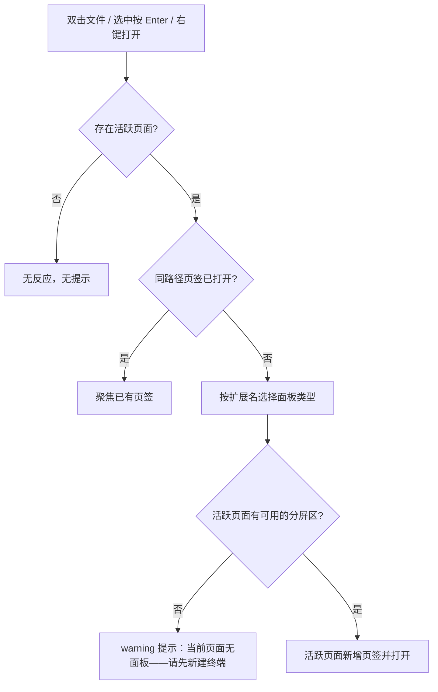
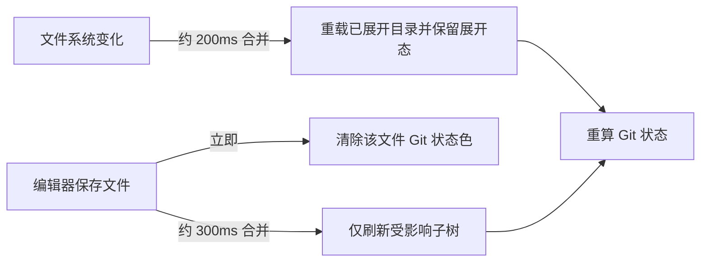

# 文件浏览器

## 1. 本篇定位与范围

- 本篇是「文件浏览器」侧栏视图的 as-is 功能规格，描述用户可感知的界面、交互、状态变化与边界。
- 同时作为共享文件树交互的基准篇：其他复用同一文件树形态的视图（如「Agent 全局文件」）默认继承本篇的选中、展开、右键菜单、CRUD、快捷键等交互；各视图的入口、过滤、打开守卫与空态差异归各自文档。
- 覆盖范围：入口与界面、加载与展开、行构成、选中与焦点、文件打开、右键菜单、复制相对路径、在终端中打开、新建、重命名、删除、Git 状态、自动刷新、快捷键、跨区结果、状态保留、空态/加载/错误。
- 不覆盖：主区各查看器/编辑器的内部能力、侧栏按钮归属与上下区布局规则、其他视图的专属过滤规则。

## 2. 界面结构与入口

- 入口位于侧栏活动栏上区第二个按钮（导航树之后），按钮名称「文件浏览器」。点击打开；再次点击关闭上区视图；打开其他上区视图会替换本视图。
- 视图顶部为固定标题栏，文案「文件浏览器」，高 28px，不可交互。
- 标题栏下方在操作失败时出现错误横幅：单行错误文本（超长省略）+ 关闭按钮（辅助名称「关闭错误提示」）。横幅可手动关闭，约 5 秒后自动消失；新错误会替换文案并重新计时。
- 树区域占据剩余高度，上下留 2px 内边距，可垂直滚动；内容超宽时出现横向滚动条。
- 树的根 = 当前活跃操作页面所属项目的根目录（不是页面工作目录）。
- 没有活跃项目/活跃页面（或活跃页面无法归属项目）时不显示文件树，显示居中空态：图标 + 「选择一个项目以浏览文件」。

## 3. 功能点分节

### 3.1 树加载与展开

**行为**

- 首次打开或切换项目根时，旧树立即清空，再从新根目录读取；旧项目的读取结果不会回填到新树。
- 根层条目首次加载时默认全部折叠。条目顺序为文件夹在前、文件在后，同类按名称不区分大小写排序；版本库元数据目录（`.git`）不显示。
- 根目录超大时分批到达：先显示首批条目，后续批次持续追加，期间不阻塞展开与选中操作；展开子目录时则在该层读取完成后一次性显示。
- 单击目录行即展开/收起。首次展开且尚无子项数据时，箭头位置显示「…」；加载完成后恢复为展开/收起箭头并显示子行。
- 已加载过子项的目录再次展开时直接显示既有子项，不出现「…」，后台会重新读取该层。
- 根目录条目为零时显示居中占位：图标 + 「空目录」。
- 树刷新（文件系统变化、CRUD、保存通知）后保留已展开目录及其展开状态；磁盘新增/删除的条目随之出现/消失。

**交互规则**

- 展开/收起的入口：单击目录行、对选中目录按 Enter、右键菜单「展开」/「折叠」。
- 目录展开时其子行按缩进层级显示；收起后子行隐藏，已加载的子项数据保留在内存中。
- 刷新保留展开状态对任意深度生效；刷新后原本折叠的目录仍折叠。

**边界条件**

- 根目录读取失败：不显示树，显示「文件树加载失败」+ 错误信息 + 「重试」按钮；点击重试重新读取，成功后退回树视图，失败则保持错误占位。
- 子目录读取失败：该目录仍显示为已展开，但没有任何子行，无错误提示（外观与真正空目录一致）。
- 根目录分批续载失败：保留已经显示的首批条目，不再追加，无任何提示。
- 根目录首次加载完成前存在短暂窗口：树区域先显示「空目录」，随后被实际内容替换。
- 根目录为空与根目录加载失败是两种不同状态：前者显示「空目录」，后者显示错误占位。
- 空子目录展开后没有任何子行，也不显示「空目录」文字；「空目录」占位只属于根层。
- 已展开目录被外部删除：刷新后该行及其子树直接消失。
- 子目录在刷新时读取失败：该目录保持展开但子行变为空，根层与根级错误占位不受影响。

**验收判据**

- 首次打开视图且存在活跃项目时，根层条目出现且全部为折叠状态；同一项目内重新打开视图时恢复此前的展开态。
- 单击目录行后子行出现；再次单击后子行隐藏。
- 首次展开未加载目录时箭头短暂显示「…」，完成后显示子行与方向箭头。
- 根目录为空时可见「空目录」。
- 根目录读取失败时可见「文件树加载失败」、具体错误文本与「重试」按钮；重试成功后树恢复。
- 根目录内容增删后，刷新结果反映到树中，且此前展开的目录仍保持展开。

### 3.2 行构成与视觉

**行为**

- 每行由缩进、折叠箭头（仅文件夹）、文件/文件夹图标、名称组成；行高固定 24px，每层缩进 16px。
- 文件夹行按展开状态显示向右/向下箭头；文件行在箭头位置留出等宽空白。
- 文件图标为 14px 图标，左缘带类型色块；文件夹为 14px 文件夹图标。
- 文件类型以左缘色块区分：不同扩展名族使用不同色块，未映射扩展名不显示色块；具体色值属于视觉规范，不在本篇范围。
- 名称完整显示，内容超宽时出现横向滚动条，不截断名称。
- 鼠标悬停行时显示悬停底色；选中行显示选中底色，且选中底色优先于悬停底色。

**交互规则**

- 文件夹图标与名称可按 Git 状态着色；文件图标与名称按 Git 状态着色，左缘类型色块保留类型颜色，两者叠加互不遮蔽。
- 无 Git 状态时图标与名称使用默认前景色。

**边界条件**

- Git 状态颜色只影响颜色，不改变行的布局、排序或图标形状。
- 长名称不会换行；横向滚动条只在内容确实超宽时出现。

**验收判据**

- 每行高度一致为 24px；层级越深缩进越大。
- 文件夹显示方向箭头，文件不显示箭头。
- 不同扩展名族显示不同颜色的左侧色块；未知类型无左侧色块。
- 文件名超宽时树区域出现横向滚动条，可滚动查看完整名称。
- 选中行与悬停行呈现不同底色，选中后悬停不覆盖选中底色。

### 3.3 选中与焦点

**行为**

- 单击任意行将其设为唯一选中项，同时把键盘焦点移到树容器；选中行显示选中底色。
- 单击另一行会移动选中；单击当前已选中行不会取消选中。
- 单击树内空白区域（列表下方/右侧空白、内容占位区）取消选中。
- 焦点离开树后选中态保留，但文件树快捷键不再响应。
- 切换项目根时清空选中与重命名状态；切换侧栏视图或将本视图拖到另一区后，选中与重命名状态同样清空。

**交互规则**

- 右键某行不会改变当前选中项；右键菜单中的操作作用于被右键的行。
- 选中与展开互不冲突：单击目录行会同时选中并切换展开状态。
- 选中项不随磁盘变化自动校正；行被删除或改名后，当前选中项可能仍指向旧路径。

**边界条件**

- 只支持单选，不支持 Ctrl/Shift 多选或范围选择。
- 不支持方向键在行间移动选中。
- 行本身不能通过 Tab 键获得焦点；键盘焦点只能经点击行后落到树容器。

**验收判据**

- 单击一行后该行出现选中底色，同时下一行的悬停不会影响它。
- 单击另一行后旧行选中底色消失、新行出现。
- 单击空白区域后所有行取消选中。
- 点击其他区域使焦点离开后，选中底色仍在；此时按 Delete/Enter/F2 不产生文件操作。
- 切换项目或切换侧栏视图后不再有任何行处于选中态。

### 3.4 打开文件

**行为**

- 双击文件行、选中文件后按 Enter、或右键菜单「打开」，都会在活跃操作页面打开该文件。
- 打开位置为活跃页面当前聚焦的分屏区；无聚焦分屏区时回退到主区/页内首个分屏区。
- 同一活跃页面内已有同路径的面板时，不新建面板，直接聚焦该已有页签。
- 面板类型按扩展名分派；分派结果与页签标题见第 4 节映射表。
- 打开后的页签标题默认为文件名；同页面存在同名文件时，标题改为相对项目根的路径以区分。
- 双击目录行会先后触发两次单击展开/收起，净效果通常回到双击前的展开状态；过程中可能出现一次展开与「…」加载。
- 选中目录后按 Enter 只切换展开/收起，不打开面板。

**交互规则**

- 双击文件行时也会触发单击选中，因此打开前面板所属行会处于选中态。
- 打开成功无额外提示；已有页签被聚焦时也不提示。
- 无活跃操作页面或无工作区宿主时，打开动作无反应且无提示（正常界面下此时树本身不显示）。
- 活跃页面存在但没有可用的分屏区时，不打开面板，并在右上角显示 warning 提示「当前页面无面板——请先新建终端」。
- 面板创建过程发生异常时，打开静默失败，无提示。

**边界条件**

- 文件名无扩展名、扩展名未知、或为 `.gitignore` 一类隐藏文件时，均回退到编辑器。
- 去重只针对同一路径；同一文件关闭后再双击会重新创建面板。
- 面板创建失败不会留下可被重复聚焦的页签记录，再次打开仍会尝试新建。

**验收判据**

- 双击 `.html`/`.htm` 文件后主区出现 HTML 预览页签；双击 `.md`/`.markdown` 文件后出现 Markdown 预览页签；双击其他文件后出现编辑器页签。
- 双击同一文件两次，第二次只聚焦已有页签，页签数量不增加。
- 选中文件按 Enter 与双击效果一致；选中目录按 Enter 不产生新页签。
- 无可用分屏区时出现指定 warning 提示，且不新增页签。

### 3.5 右键菜单

**行为**

- 右键文件行弹出文件菜单，菜单项依次为：复制相对路径、打开、在终端中打开、重命名、删除。
- 右键文件夹行弹出文件夹菜单，菜单项依次为：复制相对路径、展开/折叠（文案随当前状态在「展开」「折叠」间切换）、在终端中打开、新建文件、新建文件夹、重命名、删除。
- 右键根级空白区域弹出根级菜单，菜单项仅：新建文件、新建文件夹。
- 菜单在鼠标位置弹出，最小宽度 160px；每项高 28px，悬停时显示悬停底色。
- 「删除」为危险项，使用独立的危险色文字；其余项使用普通文字色。
- 点击任一菜单项执行操作并关闭菜单；在菜单外按下鼠标关闭菜单。

**交互规则**

- 右键行不会选中该行；所有菜单动作都作用于被右键的行。
- 根级菜单只在树内空白处出现；右键节点不会冒泡出根级菜单。
- 没有项目根时不存在树，也不会出现根级菜单。
- 菜单关闭只响应外部鼠标按下与菜单项点击，不响应 Esc。
- 菜单不支持键盘上下移动或 Enter 选择。

**边界条件**

- 菜单固定在鼠标坐标处，靠近窗口右/下边缘时可能超出可视区域，没有翻转或夹紧。
- 菜单项目前无分隔线，危险项仅靠文字颜色区分。

**验收判据**

- 右键文件行、文件夹行的菜单项与上文列表及顺序一致；文件夹菜单的「展开/折叠」文案与实际状态一致；右键根级空白只出现「新建文件」「新建文件夹」。
- 点击菜单外任意位置菜单消失；点击菜单项后菜单消失且动作生效。
- 按 Esc 菜单不关闭（当前行为）。
- 「删除」文字颜色与其他项不同。

### 3.6 复制相对路径

**行为**

- 文件与文件夹右键菜单的第一项为「复制相对路径」。
- 目标位于项目根内时，复制相对项目根、使用正斜杠 `/` 的路径（如 `src/a.ts`）。
- 目标位于项目根外，或当前视图没有项目根时，复制完整绝对路径。
- 复制成功没有任何界面提示；复制失败仅在控制台记录，界面无反馈。

**交互规则**

- 根级空白菜单不包含此项。
- 复制的是被右键行的路径，与当前选中项无关。

**边界条件**

- 路径比较与输出统一使用正斜杠。

**验收判据**

- 右键项目内深层文件「复制相对路径」，剪贴板内容为含子目录前缀的相对路径且以 `/` 分隔。
- 右键项目根外目标，剪贴板内容为完整绝对路径。
- 复制成功时界面无任何提示。

### 3.7 在终端中打开

**行为**

- 文件与文件夹右键菜单均含「在终端中打开」。
- 对文件：在文件所在目录创建并打开一个新终端页签。
- 对文件夹：使用该文件夹的父目录作为终端工作目录（当前行为）。
- 每次点击都新建一个终端页签，不做去重；页签标题沿用终端编号（`terminal-N`）。

**交互规则**

- 新终端打开在活跃页面当前聚焦的分屏区；无聚焦分屏区时按主区/页内首个分屏区回退。
- 无活跃操作页面时点击无反应、无提示。
- 活跃页面没有可用的分屏区时同样无反应、无提示。

**边界条件**

- 路径不含目录分隔符时，工作目录取路径自身。
- 终端工作目录不随文件后续移动而更新。

**验收判据**

- 右键文件「在终端中打开」后主区出现新终端页签，工作目录为该文件所在目录。
- 右键文件夹「在终端中打开」后工作目录为文件夹的父目录（当前行为）。
- 连续点击两次产生两个独立终端页签。

### 3.8 新建文件/新建文件夹

**行为**

- 入口：文件夹右键「新建文件」「新建文件夹」；根级空白右键同名项。
- 选择后，在目标文件夹行下方（根级则在根层）插入一行内联输入框并自动聚焦。
- 文件输入框占位文案「文件名」，文件夹输入框占位文案「文件夹名」。
- Enter 或输入框失焦创建；Esc 取消；名称为空白（仅空格）时不创建，直接退出输入态。
- 名称创建前会去除首尾空白。
- 新建文件写入空内容（0 字节）；新建文件夹创建目录。
- 创建成功后刷新文件树，输入框消失；新建项只有在目标文件夹展开时才立即可见。
- 创建失败时显示错误横幅「新建文件失败: …」或「新建文件夹失败: …」，输入态退出。

**交互规则**

- 目标文件夹无需处于展开状态，输入框仍会紧跟该文件夹行出现。
- 输入框存在期间，树中其它行的点击会先触发失焦提交（非空名称）或取消（空名称）。
- 输入名称不预校验路径分隔符；输入 `/` 或 `\` 会作为路径拼接的一部分，可能创建嵌套路径或导致创建失败。

**边界条件**

- 空白名称、纯空格名称不创建任何条目。
- 新建文件与已有文件同名时会以空内容覆盖原文件，没有额外确认。
- 新建文件夹与已有目录同名时通常无变化；与已有文件同名时创建失败，进入错误横幅。

**验收判据**

- 右键文件夹「新建文件」，输入名称后失焦，磁盘出现同名空文件且树刷新。
- 新建文件输入框按 Esc 后不创建任何条目，输入框消失。
- 输入纯空格后失焦不创建条目。
- 创建失败时可见「新建文件失败: …」或「新建文件夹失败: …」横幅。

### 3.9 重命名

**行为**

- 入口：行右键「重命名」，或选中行后按 F2。
- 进入重命名后，原行被内联输入框替换，输入框预填当前名称并自动聚焦。
- Enter 或失焦确认；Esc 取消。
- 名称去除首尾空白；空白名称或与原名相同（去空白后比较）视为取消，不发起任何磁盘操作。
- 成功后退回普通行并刷新文件树；失败显示错误横幅「重命名失败: …」，退出输入态。
- 重命名输入期间，Enter/Delete/F2 快捷键透传给输入框，不触发树级动作。

**交互规则**

- 同一时刻只有一个重命名输入框。
- 右键「重命名」作用于被右键的行；F2 重命名作用于当前选中行。
- 成功后选中状态不迁移：当前选中项仍指向旧路径，原行已不存在，选中底色消失。

**边界条件**

- 名称不预校验路径分隔符；名称中含 `/` 或 `\` 时按父目录拼接新路径，可能移动条目或失败。
- 同名提交被短路为取消，不会对磁盘发起同名重命名。
- 重命名失败后树不刷新，原行保持原名称。

**验收判据**

- 右键「重命名」后输入框出现并预填当前名称。
- 输入新名称后按 Enter，磁盘条目改名且树刷新。
- 不修改名称直接按 Enter，输入框消失且磁盘无变化。
- 按 Esc 后输入框消失且名称不变。
- 失败时可见「重命名失败: …」横幅。

### 3.10 删除

**行为**

- 入口：行右键「删除」，或选中行后按 Delete。
- 两种入口都会先弹出确认弹窗：
  - 标题「确认删除」
  - 文件消息：`确定删除 "X"？此操作不可撤销。`
  - 文件夹消息：`确定删除文件夹 "X"？此操作不可撤销。`
- 确认后永久删除，不进入回收站；文件夹连同其全部内容递归删除。
- 删除成功后刷新文件树；若删除的是当前选中项，清空选中。
- 删除失败显示错误横幅「删除失败: …」。
- 取消弹窗不产生任何磁盘变化。

**交互规则**

- 键盘 Delete 始终作用于当前选中项；右键删除作用于被右键的行。
- 右键删除非选中行时，当前选中项保持不变。
- 删除成功后，其他视图依赖文件系统变化通知随后刷新，不是瞬时同步。

**边界条件**

- 文件夹递归删除不可撤销。
- 删除已不存在或权限不足的目标时进入错误横幅。
- 删除过程中不提供进度显示。

**验收判据**

- 按 Delete 且确认后，目标从树与磁盘消失，选中态清空并出现刷新结果。
- 取消确认弹窗后目标仍在。
- 删除文件夹后其全部子项不再出现。
- 失败时可见「删除失败: …」横幅。

### 3.11 Git 状态

**行为**

- 树加载后按项目根的版本库状态为行着色，状态包括：修改、新增、未跟踪、删除、重命名、冲突、忽略。
- 文件名与图标按对应状态着色；文件夹图标/名称命中状态时同样着色。
- 文件左缘的类型色块不受 Git 状态影响，始终保留类型颜色。
- 忽略文件仍显示在树中，仅以较暗的忽略色区分。
- 刷新时重新计算 Git 状态；无状态或状态未知时回退默认前景色。
- 保存文件时，先立即清除该文件的 Git 状态色，经过约 300ms 合并窗口后再重新计算。
- 文件系统变化触发刷新时，历经约 200ms 合并窗口后重新读取目录并重算 Git 状态。

**交互规则**

- Git 状态只表达为颜色，不显示文字标记、徽标或状态列。
- 不提供暂存、提交、回滚、查看差异等版本库操作。
- 文件夹的展开/收起、选中与 CRUD 不改变 Git 状态。

**边界条件**

- 项目根不是 Git 仓库或状态读取失败时，树仍正常显示，只是全部使用默认颜色；无错误提示。
- 删除状态对应的文件通常已不在树中，因此删除色较少可见。
- Git 着色依赖项目根状态，不按子目录分别查询。

**验收判据**

- 修改/新增/未跟踪等状态的文件，其名称与图标出现对应状态颜色。
- 忽略文件仍出现在树中且颜色与普通文件不同。
- 保存文件后该文件颜色先短暂恢复默认，随后按最新状态重新着色。
- 非 Git 仓库中树正常显示且无状态颜色。

### 3.12 自动刷新

**行为**

- 项目根目录由应用持续监听；树只消费属于当前根目录下的变化。
- 文件系统变化到达后，约 200ms 合并窗口内的多次变化合并为一次刷新；刷新重读所有已展开目录，保留展开状态。
- 编辑器保存文件后，约 300ms 合并窗口内的多次保存合并为一次刷新，只重读「保存路径最近的已展开祖先目录」这一层，并原位合并，保留其余展开子树。
- 保存路径位于未展开目录内时，只刷新其父层（该目录保持折叠，不深挖未加载子树）。
- 保存路径不属于当前项目根时，树与 Git 着色都不刷新。
- 刷新期间没有加载指示；刷新完成后条目增减与 Git 颜色直接更新。

**交互规则**

- 外部新增文件会出现在对应目录；外部删除的文件/目录会消失；已展开目录的展开状态在刷新后保留。
- 已展开目录在磁盘上被删除时，整行与子树消失。
- 刷新时若某个已展开子目录读取失败，该目录的子行变为空且无提示。

**边界条件**

- 外部变化不是瞬时同步：依赖系统文件通知与合并窗口，另有系统监听延迟。
- 没有手动刷新按钮；根目录读取失败时的「重试」是唯一显式刷新入口。
- 未被文件通知捕获的变化不会自动出现，只能通过重新打开视图、切换项目、保存文件或 CRUD 刷新等路径更新。

**验收判据**

- 在外部新建文件后，树在短时间内自动出现该文件，且此前展开的目录仍展开。
- 在外部删除已展开目录后，该目录行与子树自动消失。
- 在应用内保存文件后，只有该文件所在目录层被刷新，其他已展开目录的展开态与内容保留。
- 保存项目外文件时，当前树不刷新。

### 3.13 快捷键

**行为**

- 文件树默认快捷键：

| 按键 | 动作 | 生效对象 |
|------|------|----------|
| Delete | 删除 | 当前选中项，先弹确认 |
| Enter | 打开 | 选中文件 → 打开面板；选中目录 → 展开/收起 |
| F2 | 重命名 | 当前选中项进入内联重命名 |

- 仅当键盘焦点位于文件树内时生效；单击任意行会把焦点移到树容器，之后快捷键可用。
- 无选中项时三个快捷键都没有可见效果。
- 重命名输入期间，快捷键透传给输入框（Enter 确认、Esc 取消、Delete 删除字符）。
- 三个命令可在设置中心重新绑定；本篇按默认键描述。

**交互规则**

- 「文件浏览器」与「Agent 全局文件」同时打开时，快捷键作用于最后获得焦点的树。
- 焦点离开树后快捷键不再作用于该树，但选中态保留。

**边界条件**

- 不支持方向键移动选中、Home/End 跳转、多选扩展、复制/剪切/粘贴文件。
- 仅提供上述三项文件操作快捷键，没有手动刷新、搜索或新建的键盘入口。
- 行不可 Tab 聚焦，键盘用户需要先点击行建立焦点。

**验收判据**

- 点击文件行后按 Delete，出现「确认删除」弹窗。
- 点击文件行后按 Enter，主区打开该文件页签；点击目录行后按 Enter，目录展开/收起。
- 点击文件行后按 F2，行变为预填名称的输入框。
- 焦点移出树后按上述键，不产生树操作。
- 重命名输入框内按 Enter 提交、按 Esc 取消，不触发树级打开/删除。
- 两个文件树视图同开时，按键只作用于最后获得焦点的那棵树。

## 4. 跨区行为

**触发条件 → 可感知结果**

| 触发 | 可感知结果 |
|------|-----------|
| 双击文件 / 选中文件按 Enter / 右键「打开」 | 活跃页面出现对应查看/编辑页签；同路径已打开时只聚焦已有页签 |
| 双击文件且活跃页面没有可用分屏区 | 右上角 warning 提示「当前页面无面板——请先新建终端」，不新增页签 |
| 双击文件但无活跃页面/宿主 | 无反应、无提示 |
| 右键「在终端中打开」（文件） | 主区新增终端页签，工作目录 = 文件所在目录 |
| 右键「在终端中打开」（文件夹） | 主区新增终端页签，工作目录 = 文件夹的父目录（当前行为） |
| 新建 / 重命名 / 删除成功 | 磁盘变化；当前树刷新；其他视图随后依靠文件系统变化通知刷新 |
| 右键「复制相对路径」 | 路径写入剪贴板；界面无提示 |
| 单击文件/文件夹行 | 该行选中，键盘焦点进入树容器 |

**打开结果映射表**

| 文件类型 / 扩展名 | 打开的面板类型 | 页签标题特征 |
|------------------|----------------|--------------|
| `.html`、`.htm` | HTML 预览 | 文件名；同页存在同名文件时为相对项目根路径 |
| `.md`、`.markdown` | Markdown 预览 | 文件名；同名冲突时同上 |
| 其他扩展名、无扩展名、隐藏文件（如 `.gitignore`） | 编辑器 | 文件名；同名冲突时同上 |

- 扩展名匹配不区分大小写；隐藏文件（点号紧邻文件名开头）不参与扩展名分派。
- 同名冲突判定基于当前页面已打开的文件；冲突时相关页签标题都会更新为相对路径。

## 5. 状态保留与持久化

| 状态 | 生命周期 | 恢复规则 |
|------|----------|----------|
| 选中项 | 当前打开期间 | 切换视图、拖到另一区、切换项目根后清空；应用重启后为空 |
| 重命名输入态 | 当前打开期间 | 切换视图、切换项目根后清空 |
| 已展开目录 | 应用运行期间，按项目根路径区分 | 同一项目内切换视图/拖到另一区后恢复；切换项目根后旧记录失效；应用重启后不保留（根层重新全折叠） |
| 滚动位置 | 当前打开期间 | 切换视图后不保留；一般刷新保留，树被清空重建时回到顶部 |
| 操作错误横幅 | 当前打开期间 | 关闭、5 秒超时、切换视图后消失 |
| 树内容与 Git 状态 | 每次打开时重新读取 | 不做持久化缓存；重新打开会短暂经过加载态 |
| 侧栏视图打开状态、按钮归属 | 侧栏布局持久化 | 应用重启后保留；由侧栏框架负责，不属于本视图 |

- 展开态恢复时会校验目录是否存在：磁盘上已删除的目录不会重新展开。
- 展开态恢复逐个目录进行，深层目录可能需要短暂时间才完全展开。
- 切换项目根时旧树同步清空，不显示上一项目的残留条目。

## 6. 空态、加载、错误

| 场景 | 用户可见表现 |
|------|--------------|
| 无活跃项目/页面 | 居中空态：图标 +「选择一个项目以浏览文件」 |
| 根目录首次加载中 | 短暂显示「空目录」，无加载动画/进度 |
| 根目录为空 | 居中空态：图标 +「空目录」 |
| 目录首次展开加载中 | 箭头位置显示「…」 |
| 根目录加载失败 | 「文件树加载失败」+ 错误信息 +「重试」按钮 |
| 子目录加载失败 | 目录保持展开、无子行、无错误提示 |
| 根目录续载失败 | 保留已显示的首批条目，无提示 |
| Git 状态读取失败 | 树正常显示，全部使用默认颜色，无提示 |
| 新建/重命名/删除失败 | 标题栏下方错误横幅，前缀分别为「新建文件失败: 」「新建文件夹失败: 」「重命名失败: 」「删除失败: 」 |
| 打开文件无可用分屏区 | 右上角 warning 提示「当前页面无面板——请先新建终端」 |
| 打开文件无活跃页面/宿主 | 无反应、无提示 |
| 面板创建异常 | 无反应、无提示 |
| 文件系统/保存刷新 | 无加载指示，内容直接替换 |

- 错误横幅显示在标题栏与树之间，出现时压缩树的可视高度；错误文本单行省略。
- 新错误立即替换旧错误并重置 5 秒计时；手动关闭立即消失。

## 7. mermaid 图表

打开文件：

刷新触发：

## 8. 验收判据汇总

- 无活跃项目/页面时显示「选择一个项目以浏览文件」，不显示文件树。
- 有活跃项目时根条目出现且默认全部折叠，顺序为文件夹在前、文件在后。
- 单击目录展开/收起；首次展开加载时箭头显示「…」；根目录为空显示「空目录」。
- 根目录加载失败显示「文件树加载失败」、错误信息与「重试」；重试成功后恢复树。
- 子目录读取失败不显示错误，表现为没有子行的展开目录；续载失败保留已显示部分且无提示。
- 单击行单选并高亮；点击其他行移动选中；点击空白取消；焦点离开后选中保留；切换视图/项目后清空。
- 双击/Enter 打开文件；重复打开只聚焦已有页签；扩展名映射与页签标题符合第 4 节。
- 选中目录按 Enter 只展开/收起；双击目录净效果通常回到双击前状态。
- 无可用分屏区时打开文件出现指定 warning；无活跃页面/宿主时静默。
- 三类右键菜单项与顺序正确；菜单外点击关闭；无 Esc 与键盘导航；危险项独立着色。
- 复制相对路径：项目内为正斜杠相对路径，项目外/无项目根为绝对路径；成功无提示。
- 在终端中打开每次新建终端；文件使用所在目录，文件夹使用父目录；无活跃页面时静默。
- 新建/重命名：Enter 或失焦提交、Esc 取消、空白与同名（重命名）取消；成功刷新，失败显示对应横幅。
- 删除：确认弹窗标题与消息文案正确；文件夹递归删除；成功后清空选中并刷新；失败显示横幅。
- Git 状态按修改/新增/未跟踪/删除/重命名/冲突/忽略着色；忽略文件仍显示；类型色块与状态色叠加。
- 文件系统变化约 200ms、保存约 300ms 后刷新；保存只影响相关子树；展开状态保留。
- Delete/Enter/F2 仅在树聚焦时生效；无选中无效果；重命名输入期间透传。
- 切换视图后同一项目的展开态恢复；选中、重命名与滚动位置不恢复。

## 9. 边界与非目标

- 文件树根固定为当前活跃项目根；不提供多根工作区、项目外路径浏览或跨项目同时浏览。
- 不提供文件搜索、名称过滤、快速跳转、内容预览、大纲或符号导航。
- 不提供多选与批量操作（批量删除、批量重命名、批量复制）。
- 不提供文件拖拽移动、复制/剪切/粘贴、导入/导出；新建与重命名是唯一的创建/改名入口。
- 不提供版本库写操作：无暂存、提交、回滚、分支、历史或差异查看；Git 仅用于状态着色。
- 不提供属性、权限、大小、修改时间、隐藏文件开关等文件管理功能。
- 不提供手动刷新按钮（根加载错误时的「重试」除外），不轮询磁盘。
- 右键菜单不支持 Esc 关闭、键盘导航或窗口边缘翻转。
- 不提供行级 Tab 聚焦、方向键导航、多选快捷键；仅 Delete/Enter/F2 三项文件快捷键。
- 删除为永久删除，不进入回收站。
- 其他复用同一文件树的视图可能在根路径、过滤、空态与打开守卫上有差异；这些差异不属于本篇。

## 10. 已知限制

| 现象 | 用户影响 | 标签 |
|------|----------|------|
| 仅支持单选，无批量操作 | 大目录整理需逐项操作 | 【行为设计】 |
| 选中与重命名状态随视图切换/项目根切换丢失 | 回来需重新定位文件；正在改的名字丢失 | 【行为设计】 |
| 展开态只在同一项目内跨视图切换保留，切换项目或重启后不保留 | 切回旧项目需重新展开目录 | 【行为设计】 |
| 双击目录会触发两次展开/折叠 | 净效果通常回到原状，但过程有展开/「…」闪烁 | 【行为设计】 |
| 文件夹「在终端中打开」使用父目录 | 终端起点比预期高一层 | 【行为设计】 |
| 无活跃页面时打开文件无反应、无提示 | 用户无法判断操作是否生效 | 【疑似缺陷】 |
| 重命名成功后选中仍指向旧路径 | 随后 Enter 会尝试打开旧路径；F2/Delete 也作用于旧路径 | 【疑似缺陷】 |
| 子目录读取失败显示为空目录 | 无法区分「真的为空」与「读取失败」 | 【疑似缺陷】 |
| 根目录续载失败无提示 | 超大目录只显示一部分，用户可能误以为已完整 | 【疑似缺陷】 |
| 根目录首次加载期间短暂显示「空目录」 | 会误以为项目为空 | 【疑似缺陷】 |
| 展开的空子目录不显示「空目录」文字 | 空目录提示仅根层有，层级间表现不一致 | 【行为设计】 |
| 无手动刷新按钮，依赖文件系统通知 | 通知丢失或监听异常时内容可能长期不更新 | 【行为设计】 |
| 右键菜单无 Esc 关闭、无键盘导航 | 键盘用户无法完整操作菜单 | 【无障碍/平台】 |
| 右键菜单靠近窗口边缘可能溢出 | 部分菜单项可能不可见/不可点击 | 【行为设计】 |
| 复制相对路径成功无提示、失败仅控制台 | 无法确认是否复制成功 | 【行为设计】 |
| 新建/重命名名称不校验路径分隔符 | 输入 `/` 或 `\` 可能创建嵌套路径或直接失败 | 【疑似缺陷】 |
| 新建文件与已有文件同名时直接覆盖为空文件 | 原文件内容被清空，且没有确认或提示 | 【疑似缺陷】 |
| 错误横幅约 5 秒自动消失 | 慢速阅读或辅助技术用户可能错过错误详情 | 【无障碍/平台】 |
| Git 状态仅以颜色表达 | 色觉差异用户难以区分状态；无文字图例 | 【无障碍/平台】 |
| 忽略文件仍显示 | 目录内容可能比预期多；仅靠较暗颜色区分 | 【行为设计】 |
| 无搜索、过滤、跳转、内容预览 | 大项目中定位文件只能逐层展开 | 【行为设计】 |
| 行不可 Tab 聚焦 | 纯键盘用户无法进入树；需先鼠标点击 | 【无障碍/平台】 |
| 仅三项文件快捷键，无方向键/多选/复制粘贴 | 键盘操作效率受限 | 【行为设计】 |
| 外部变化非瞬时同步 | 外部新建/删除后存在合并窗口与监听延迟 | 【行为设计】 |
| 面板创建异常时打开静默失败 | 用户无法得知打开失败的原因 | 【疑似缺陷】 |

## 11. 相关文档

- [侧栏总览](README.md)
- [侧栏框架与活动栏](01-framework.md)
- [Agent 全局文件](05-agent-files.md)
