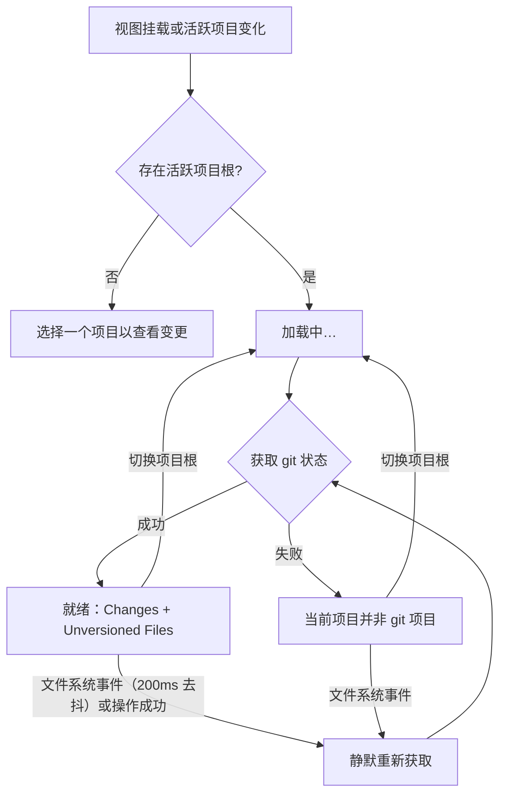

# Commit

## 1. 本篇定位与范围

Commit 是侧栏视图之一：只读展示当前活跃项目根路径下的 git 变更，按 Changes 与 Unversioned Files 两组呈现；双击条目按状态打开编辑器、git 查看或 diff 面板；右键可回滚或删除。本视图不提供暂存、提交、推送、分支等写操作。

状态数据来源于当前活跃操作页面所属项目的根路径，与该页面内文件浏览器正在浏览的子目录无关。

## 2. 界面结构与入口

- 活动栏默认上区第三个按钮，悬停名称为「Commit」。点击打开到侧栏槽位，再次点击关闭；同一槽位打开其他视图会替换本视图；按钮可拖拽换区或同区排序，之后位置以用户布局为准。
- 标题栏固定显示「COMMIT」。
- 就绪态为单一滚动区域，自上下堆叠两个可折叠分组：Changes 在上，Unversioned Files 在下。两个分组共用一个纵向滚动区和一个横向滚动区。
- 每行由三部分组成：按状态着色的文件名、父目录相对路径后缀（文件位于项目根层时不显示）、悬停时显示的完整相对路径。
- 根路径来源：当前活跃操作页面所属项目的根；无活跃页面（无项目）时没有根路径。

## 3. 功能点分节

### 3.1 四渲染态

**行为**

- 无根路径：显示「选择一个项目以查看变更」。
- 加载中：显示「加载中…」。
- 错误：显示「当前项目并非 git 项目」。
- 就绪：显示 Changes 与 Unversioned Files 两个列表。

四态互斥，任一时刻只显示其中一种。

**交互规则**

- 挂载且存在活跃项目时进入加载中；状态获取完成后进入就绪或错误。
- 切换活跃项目或操作页面导致根路径变化时，立即清空旧列表并进入加载中；上一项目的未完成结果会被丢弃，不会短暂显示旧数据。
- 错误态没有重试按钮；后续文件系统事件或切换项目会再次尝试获取，成功则恢复就绪。
- 自动刷新与右键操作后的刷新不经过加载中：旧列表保持到新结果返回，再原位更新。

**边界条件**

- 任何状态获取失败（非 git 仓库、权限不足、索引损坏等）都归为同一条错误文案。
- 根路径存在但仓库没有任何变更时进入就绪：两个列表均显示，展开后各显示「无变更文件」。

**验收判据**

- 无活跃项目时，视图内只出现「选择一个项目以查看变更」。
- 有活跃项目且请求未返回时，只出现「加载中…」，不出现列表。
- 请求失败时，只出现「当前项目并非 git 项目」，且没有重试控件。
- 请求成功时，Changes 与 Unversioned Files 两个分组标题同时出现。

### 3.2 列表内容、计数与排序

**行为**

- Changes 仅包含 added、modified、deleted、renamed、conflict 五种状态；Unversioned Files 仅包含 untracked。ignored 及其他状态不显示，也不计入任一标题。
- 分组标题固定为 `Changes (N)` 与 `Unversioned Files (N)`，N 为该组当前条目数；英文标题不随单复数变化。
- 组内按完整相对路径进行字母序升序排列；排序受系统区域设置影响（见 §10）。
- 文件行显示文件名与父目录后缀；父目录后缀是相对项目根的目录部分。

**交互规则**

- 点击分组标题折叠或展开该组；两组默认展开，可独立折叠。
- 折叠只影响显示，不改变计数与数据。
- 内容超宽时出现横向滚动条；不超宽时没有横向滚动条。两个分组共享同一滚动位置。

**边界条件**

- 展开且该组无条目时显示「无变更文件」；折叠时不显示空态。
- 文件名相同、目录不同时，行内文件名相同，靠父目录后缀区分；悬停可查看完整相对路径。
- 项目根层的文件不显示父目录后缀。

**验收判据**

- 五种状态之外的条目不出现，且不影响两组计数。
- 标题中的计数等于该组可见行数。
- 折叠后该组行消失、标题仍在；再次点击标题恢复行列表。
- 空组展开时出现「无变更文件」。
- 完整相对路径不同的条目按字母序排列。

### 3.3 自动刷新与手动刷新缺失

**行为**

- 文件系统事件发生后，约 200 毫秒内没有新事件时重新获取一次 git 状态；短时间内的连续事件合并为一次。
- 右键回滚或删除成功后立即触发一次刷新。
- 界面不提供手动刷新按钮。

**交互规则**

- 自动刷新与操作后刷新期间不切换到加载中，列表保持旧内容，结果返回后原位更新。
- 切换项目根时清空并进入加载中，不保留旧列表。

**边界条件**

- 文件系统事件是全局的：其他目录的变化也可能触发当前项目重新获取一次状态（结果通常不变）。
- 仅 git 索引发生变化、监听范围内没有对应文件事件时，列表可能保持旧内容，直到下一次文件事件或切换项目。
- 视图卸载时取消事件订阅，并清除尚未触发的去抖计时。

**验收判据**

- 200 毫秒内连续触发多次文件事件，只观察到一次状态重取。
- 事件发生后 200 毫秒内列表不变，超过后更新。
- 刷新过程中不出现「加载中…」。
- 界面上不存在刷新按钮。

### 3.4 双击打开文件

**行为（状态映射表）**

| git 状态 | 打开的面板 | 页签后缀 |
|---|---|---|
| added | 编辑器 | `(git add)` |
| untracked | 编辑器 | `(git not add)` |
| deleted | git 查看（只读 HEAD 内容） | `(git delete)` |
| modified | diff（HEAD 与工作区对比） | `(git diff)` |
| renamed | diff | `(git diff)` |
| conflict | diff | `(git diff)` |

- 页签标题为文件名后直接拼接后缀，例如 `a.ts(git diff)`。
- renamed 条目的 diff 使用重命名前的旧路径读取 HEAD 侧内容。

**交互规则**

- 双击文件行打开对应面板。
- 同一文件、同一后缀的面板已存在时，只聚焦该面板，不重复打开。
- 同一文件的不同后缀视为不同面板，可同时存在。
- 普通编辑器（无后缀）与 git 后缀面板互不复用。

**边界条件**

- 无活跃操作页面、主区宿主不可用，或找不到可落组的面板组时，无任何反馈。
- 未知状态无任何反馈；ignored 及其他不显示的状态通常也不会出现在列表中。
- 面板创建失败时静默，不产生页签。

**验收判据**

- 每种状态双击后，出现的面板类型与页签后缀符合上表。
- renamed 的 diff 能看到旧路径对应的 HEAD 内容。
- 重复双击同一文件、同一状态只保留一个页签并聚焦。
- 已打开 `(git diff)` 后从 added 打开同一文件，会出现独立的 `(git add)` 页签。

### 3.5 右键回滚与删除

**行为（状态映射表）**

| 状态 | 菜单项 | 确认文案 | 操作结果 |
|---|---|---|---|
| modified / deleted / renamed / conflict | 回滚 | 标题「确认回滚」；正文 `确定回滚"X" 到 HEAD 版本？此操作不可撤销。` | 将文件恢复到 HEAD 版本；renamed 按旧路径恢复，新路径文件保留在磁盘并转为未跟踪 |
| added | 删除 | 标题「确认删除」；正文 `确定删除"X"？此操作不可撤销。` | 先取消暂存，再删除磁盘文件 |
| untracked | 删除 | 标题「确认删除」；正文 `确定删除"X"？此操作不可撤销。` | 直接删除磁盘文件 |

- X 为文件名。
- 菜单项均以危险样式呈现（醒目错误色文字）。

**交互规则**

- 右键文件行弹出菜单，位置跟随指针。
- 点击菜单外任意位置关闭菜单。
- 点击菜单项执行操作并立即关闭菜单。
- 确认弹窗选择取消时不产生任何磁盘或索引变化，列表不刷新。
- 操作成功后刷新列表；操作失败不刷新。
- 菜单不支持 Esc 关闭，不支持键盘导航，菜单项不可通过 Tab 聚焦。

**边界条件**

- 回滚或删除失败只在控制台记录，界面没有 toast、横幅或错误文案，列表保持原状。
- added 删除时，若取消暂存失败，不会继续删除磁盘文件；若取消暂存成功但删除失败，文件会以未跟踪状态留在磁盘。
- renamed 回滚后，旧路径文件回到版本控制，新路径文件作为未跟踪文件出现在 Unversioned Files。
- ignored 或未知状态不弹出菜单。

**验收判据**

- 右键 modified/deleted/renamed/conflict 出现「回滚」；右键 added/untracked 出现「删除」；ignored 无菜单。
- 取消确认后，文件内容、git 状态与列表均不变。
- 回滚 modified 后该行按新状态从 Changes 消失或更新。
- 删除 untracked 后磁盘文件消失且该行消失。
- 操作失败时界面不出现错误提示，列表不变化。

## 4. 跨区行为

| 触发条件 | 可感知结果 |
|---|---|
| 切换活跃项目或操作页面 | 根路径变化，列表清空并显示「加载中…」，随后显示新项目状态；两个列表恢复默认展开 |
| 文件系统变化 | 约 200 毫秒去抖后列表原位更新，不显示加载态；文件浏览器、编辑器等其他视图按各自机制同步更新 |
| 双击文件行 | 主区新增或聚焦对应面板，映射见 §3.4 |
| 右键回滚或删除成功 | 磁盘与索引变化，本列表刷新；相关文件在其他视图中的内容或状态随后更新 |
| 切换侧栏视图或把按钮拖到另一侧栏区 | 本视图卸载；再次打开时重新加载，折叠状态、滚动位置与菜单不保留 |
| 无活跃项目 | 显示无根提示；已有列表被清空 |

## 5. 状态保留与持久化

- 本视图不持久化任何自身状态。
- 分组折叠状态仅在本次挂载期间有效；切换项目、切换侧栏视图或换区重建后恢复默认展开。
- 滚动位置、已打开的右键菜单不保留。本视图没有行选中模型。
- 列表数据不缓存：每次挂载、切换根路径、文件事件或操作成功后都重新获取。
- 活动栏按钮归属与视图开关由侧栏框架持久化，与本视图内部状态无关。

## 6. 空态、加载、错误

- 无根：居中提示「选择一个项目以查看变更」。
- 加载：居中提示「加载中…」，不显示旧数据与列表。
- 错误：居中提示「当前项目并非 git 项目」；没有重试按钮；错误期间不显示列表。
- 就绪但无变更：两个分组仍显示，展开时各显示「无变更文件」。
- 单组为空：仅该组显示「无变更文件」，另一组正常显示条目。
- 右键操作失败：没有界面提示（见 §10）。

## 7. mermaid 图表

## 8. 验收判据汇总

- 无活跃项目时只显示无根提示；再次打开项目后能自动进入加载中并最终显示列表。
- 非 git 项目显示统一错误文案，且没有重试入口。
- 两个列表的计数、分组归属与状态过滤符合 §3.2。
- 文件行显示状态着色文件名、父目录后缀；悬停显示完整相对路径。
- 文件系统事件后约 200 毫秒自动刷新，刷新期间无加载态闪烁。
- 切换项目后旧列表立即消失，不出现旧项目数据。
- 各状态双击后的面板类型与页签后缀符合映射表；重复打开同文件同后缀只聚焦。
- 回滚与删除的可用状态、确认文案、成功后的列表变化符合 §3.5。
- 取消确认无副作用；操作失败无界面提示。
- 折叠状态在视图重建后不保留；展开/折叠在本次挂载内独立生效。

## 9. 边界与非目标

- 只读视图：不提供提交、暂存/取消暂存、推送、拉取、分支、合并、冲突解决、历史浏览、stash 等操作。
- 不区分 staged 与 unstaged：Changes 展示工作区与索引合并后的状态。
- 不显示 ignored 文件，也不提供显示开关。
- 不提供列表内搜索、过滤、多选、批量操作、分页或虚拟化。
- 不解析子模块内部状态，只展示当前根路径返回的条目。
- 不替代完整 git 客户端；diff、查看、编辑能力由打开的面板决定。
- 不提供手动刷新入口，也不自动初始化 git 仓库。
- 不持久化折叠、滚动或选择状态。

## 10. 已知限制

- 【行为设计】只读，无提交、暂存、推送、分支等操作；用户需要写操作时必须离开本视图。
- 【行为设计】ignored 文件不显示且没有开关；用户无法在本视图中查看或处理被忽略的文件。
- 【行为设计】没有手动刷新按钮；用户只能等待文件事件或切换项目来强制更新。
- 【疑似缺陷】文件系统事件未按当前项目过滤，其他目录（包括后台会话）的变化也会触发重新获取；可能造成无谓刷新或列表闪动。
- 【行为设计】任何 git 状态获取失败都显示「当前项目并非 git 项目」；权限不足、索引损坏等场景会被误导为仓库类型问题。
- 【疑似缺陷】回滚或删除失败时仅控制台记录，界面无提示；用户可能误以为操作成功，文件状态实际未变。
- 【行为设计】折叠状态不持久化；切换视图或项目后重新展开，重复折叠操作需要再做一次。
- 【无障碍/平台】列表无键盘交互：行不可聚焦，不能通过 Tab、方向键、Enter 打开，也不能用键盘触发右键菜单。
- 【无障碍/平台】右键菜单仅鼠标可达：无 Esc 关闭、无键盘导航、菜单项不可聚焦，屏幕阅读器难以感知其结构。
- 【疑似缺陷】未知状态无任何反馈；若出现未映射状态，双击与右键都不会产生结果。
- 【疑似缺陷】无活跃页面或主区宿主不可用时，双击行完全静默；用户得不到「先创建项目」之类引导。
- 【疑似缺陷】排序依赖系统区域设置；中文、大小写与重音字符的顺序可能与其他 git 工具或用户预期不同。
- 【行为设计】大列表一次性渲染，无分页、虚拟化与批量操作；超大仓库下滚动和操作可能卡顿，也无法批量回滚或删除。
- 【行为设计】重命名条目回滚后，新路径文件残留为未跟踪；Unversioned Files 会新增该文件，用户需自行处理（与 git 命令行恢复语义一致）。
- 【无障碍/平台】列表行不是标准控件：无可聚焦语义、无列表/按钮角色，辅助技术无法识别行结构或操作。

## 11. 相关文档

- [侧栏总览](README.md)
- [侧栏框架](01-framework.md)
- [导航树](02-nav-tree.md)
- [文件浏览器](03-explorer.md)
