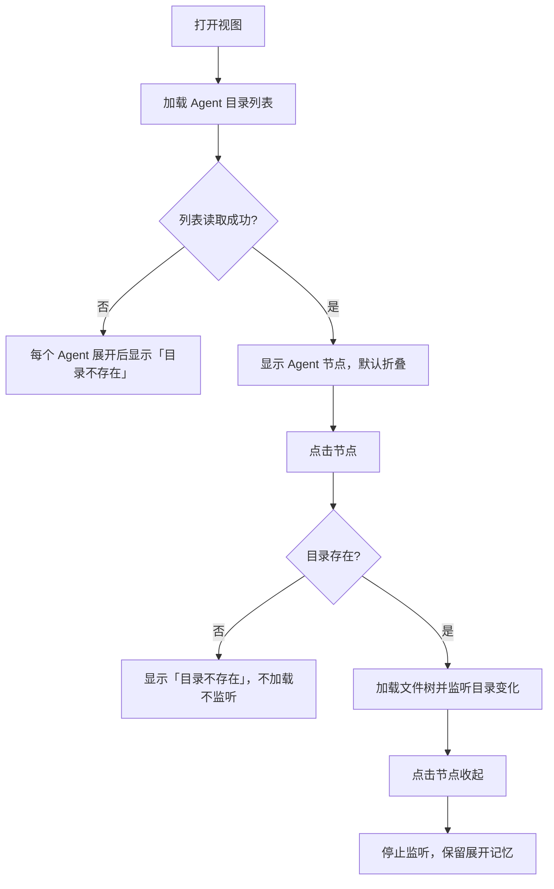

# Agent 全局文件

## 1. 本篇定位与范围

「Agent 全局文件」是侧栏视图之一：按 CLI 列出声明了全局配置目录能力的 Agent，展开后浏览该 Agent 的全局配置目录。树交互与文件浏览器一致，通用能力统一见 [文件浏览器](03-explorer.md)；本篇只写本视图的专属行为与差异。

当前仅 Claude Code 提供该能力，因此视图中通常只出现一个 Agent 节点。视图只负责浏览；过滤条件在设置中心配置，本视图不提供编辑入口。

## 2. 界面结构与入口

- 活动栏默认上区第四个按钮，悬停名称为「Agent 全局文件」。点击打开到侧栏槽位，再次点击关闭；同一槽位打开其他视图会替换本视图；按钮可拖拽换区或同区排序，之后位置以用户布局为准。
- 标题栏固定显示「Agent 全局文件」。
- 主体为单一纵向滚动区，自上而下排列 Agent 节点；展开的文件树缩进显示在对应节点下方。
- Agent 节点行由折叠箭头、CLI 品牌 logo（约 14 像素）和显示名组成，鼠标悬停时有背景高亮。
- 所有 Agent 默认折叠；节点按内置注册顺序排列；未声明全局文件能力的 CLI 不出现在列表中。

## 3. 功能点分节

### 3.1 Agent 节点列表

**行为**

- 只列出声明了全局文件能力的 CLI；当前为 Claude Code，显示名「Claude Code」。
- 每个节点显示折叠箭头、品牌 logo 与显示名。
- 全部节点默认折叠。

**交互规则**

- 点击节点行的任意位置展开或收起该 Agent。
- 节点本身没有右键菜单、没有排序入口、没有批量展开或批量操作。
- 点击节点不产生选中态。

**边界条件**

- 没有任何可用 Agent 时，主体显示「无可用 Agent」空态，不显示节点。
- 新增 CLI 必须由内置能力声明才会出现；用户不能手动添加节点。

**验收判据**

- 打开视图后看到 Claude Code 节点，且默认折叠。
- 点击节点后箭头方向变化并出现文件树；再次点击后文件树消失。
- 未声明能力的 CLI 不出现在列表中。
- 无可用 Agent 时只出现空态提示。

### 3.2 展开与目录探测

**行为**

- 每次打开视图时，探测一次所有 Agent 全局配置目录的绝对路径与是否存在。
- 展开 Agent 时：目录存在则加载该目录的文件树并开始监听目录变化；目录不存在则显示「目录不存在」，不加载文件树、不启动监听。
- 收起 Agent 或关闭视图时停止监听。
- 展开期间目录发生变化时，文件树自动刷新。

**交互规则**

- 目录存在性只在打开视图时检查一次；视图存活期间不会重新探测。
- 收起再展开同一 Agent 会重新加载文件树，但不重新探测目录是否存在。
- 关闭视图后重新打开会重新探测一次。

**边界条件**

- 目录在探测后被删除：再次展开仍按“存在”处理，文件树加载失败并显示加载失败占位（与文件浏览器一致）。
- 目录在探测后被创建：视图不会自动发现，需关闭并重新打开视图后才会显示文件树。
- 目录不存在时不启动监听，因此之后目录被创建也不会自动出现。

**验收判据**

- 目录存在时，展开后出现文件树与目录内容。
- 目录不存在时，展开后只出现「目录不存在」，且没有文件行。
- 收起后不再收到目录变化刷新；重新展开时重新加载。
- 关闭视图期间目录变化不会触发本视图刷新。

### 3.3 文件树浏览（与文件浏览器的差异）

**行为**

文件树的通用能力与文件浏览器一致：目录展开/收起、行选中、右键菜单、新建文件、新建文件夹、重命名、删除、git 状态着色、快捷键操作。通用交互规则见 [文件浏览器](03-explorer.md)。本视图的差异如下：

| 能力 | 差异 |
|---|---|
| 项目根 | 没有项目根；树根是 Agent 的全局配置目录 |
| 复制相对路径 | 没有项目根作基准，通常复制得到完整绝对路径 |
| 页签标题 | 使用文件名，而不是项目相对路径；不同目录的同名文件可能得到同名页签 |
| 无活跃页面双击 | 弹出提示「请先创建项目」 |
| 展开记忆 | 每个 Agent 的树独立记忆展开目录 |
| 在终端中打开 | 文件打开所在目录；文件夹打开父目录 |

**交互规则**

- 单击选中行，单击空白处取消选中；双击文件打开；快捷键与文件浏览器一致（需先通过鼠标点击让树获得焦点）。
- 右键菜单项与文件浏览器一致；文件菜单包含「复制相对路径」「打开」「在终端中打开」「重命名」「删除」，文件夹菜单额外包含「展开/折叠」「新建文件」「新建文件夹」。
- 新建、重命名、删除、确认弹窗与失败提示沿用文件浏览器的行为。

**边界条件**

- 全局配置目录本身不是 git 仓库时，树中没有 git 状态着色，也不显示错误。
- 选中项、重命名输入框与错误横幅不跨视图切换保留（见 §5）。
- 文件夹的「在终端中打开」定位到其父目录，而不是该文件夹自身。

**验收判据**

- 展开、选中、双击、新建、重命名、删除等操作与文件浏览器一致。
- 复制文件或文件夹的相对路径时，剪贴板得到绝对路径。
- 打开文件后页签标题通常为文件名。
- 无活跃页面时双击文件出现「请先创建项目」提示。
- 两个 Agent 的树各自保留自己的展开目录集合。

### 3.4 显示过滤

**行为**

- 过滤配置在设置中心：活动栏底部「配置」→ 设置中心 → Agent 组 → Claude Code → 基础配置 →「侧栏展示内容」。本视图内不显示配置入口。
- 模式分「全部」与「自定义」；「全部」为默认模式，并提供「显示运行时文件」开关。
- 「全部」模式：显示根层全部条目；「显示运行时文件」关闭时隐藏内置运行时产物（如会话、缓存、历史等），开启时一并显示。
- 「自定义」模式：只显示名单中的根层条目；「显示运行时文件」开关置灰且不生效，名单中即使包含运行时条目也会显示。
- 名称匹配不区分大小写，按根层条目的完整名称精确匹配；名单项不能包含路径分隔符，不支持通配符。
- 过滤只作用于根层：一旦根层目录被显示，其子目录内容不再按名单过滤。
- 名单外的根层目录整体不读取，不展开其内容。
- 设置变更后文件树立即刷新，已展开且仍存在的目录保持展开。

**交互规则**

- 本视图不显示当前模式、名单内容或过滤掉的数量；用户只能到设置中心确认当前条件。
- 过滤是纯展示行为，不移动、不删除磁盘文件。

**边界条件**

- 「自定义」名单为空时，根层没有任何条目，文件树显示「空目录」。
- 内置运行时文件清单固定，用户不可编辑或扩展。
- 根层过滤不会影响已显示目录的深层内容；深层同名条目不会被单独隐藏。

**验收判据**

- 默认「全部」模式下，运行时条目不可见；在设置中心打开「显示运行时文件」后，这些条目立即出现。
- 切到「自定义」并只添加某目录名后，根层只显示该目录，其余条目消失。
- 自定义名单匹配时大小写不同仍能命中。
- 名单中的名称为子目录内的条目名时，不会影响子目录内容。
- 设置变更后无需重新打开视图，文件树立即更新。

### 3.5 打开、终端与复制路径

**行为**

- 双击文件：有活跃操作页面且主区宿主可用时，在活跃页面打开对应面板；页签标题使用文件名。
- 同一路径的文件已打开时，聚焦已有面板，不重复打开。
- 无活跃页面或主区宿主不可用时，弹出警告提示「请先创建项目」，不打开面板。
- 右键「打开」与双击等效。
- 右键「在终端中打开」：文件打开其所在目录的终端；文件夹打开其父目录的终端。
- 右键「复制相对路径」：复制完整绝对路径。

**交互规则**

- 打开面板的落点、分屏与页签规则沿用文件浏览器的共享打开链路。
- 终端在当前活跃操作页面新建，不切换页面。
- 复制成功没有提示；复制失败只在控制台记录。

**边界条件**

- 有活跃页面但页面内没有可用的面板组时，提示「当前页面无面板——请先新建终端」，不打开面板。
- 无活跃页面或主区宿主不可用时，「在终端中打开」完全静默，没有任何提示。
- 不同目录下的同名文件可能得到同名页签（见 §10）。

**验收判据**

- 有活跃页面时双击文件，主区出现以文件名为标题的页签。
- 重复双击同一文件只聚焦已有页签。
- 无活跃页面时双击文件出现「请先创建项目」。
- 文件「在终端中打开」后终端工作目录为文件所在目录；文件夹「在终端中打开」后为父目录。
- 复制相对路径后剪贴板内容为绝对路径。

### 3.6 目录监听与自动刷新

**行为**

- Agent 展开且目录存在时开始监听该目录。
- 目录内发生文件系统变化后，约 200 毫秒内无新事件时刷新文件树，并同步刷新 git 状态着色。
- 刷新保留已展开目录的展开状态。

**交互规则**

- 收起 Agent 或关闭视图时停止监听。
- 被过滤掉的根层条目内部发生变化时，不触发刷新。
- 监听范围是该 Agent 的全局配置目录，不依赖项目文件浏览器的监听。

**边界条件**

- Agent 的全局配置目录被删除时，文件树按加载失败占位显示；目录存在性提示不会自动更新，直到重新打开视图。
- 高频变化会合并为一次刷新。
- 视图卸载时取消订阅并清除未触发的去抖计时。

**验收判据**

- 展开 Agent 后，在目录内新增文件，约 200 毫秒后文件树出现该文件。
- 在名单外目录内新增文件，不触发文件树刷新。
- 收起 Agent 后修改目录，重新展开时看到最新内容（重新加载）。
- 已展开的子目录在刷新后仍保持展开。

## 4. 跨区行为

| 触发条件 | 可感知结果 |
|---|---|
| 展开目录存在的 Agent | 加载文件树并开始监听；目录变化自动刷新 |
| 展开目录不存在的 Agent | 只显示「目录不存在」，不加载、不监听 |
| 收起 Agent 或关闭视图 | 停止监听；重新展开时重新加载文件树 |
| 设置中心修改过滤模式或名单 | 文件树立即刷新，仍存在的展开目录保持展开 |
| 展开目录内文件系统变化 | 约 200 毫秒去抖后文件树原位刷新 |
| 被过滤根层目录内的变化 | 不触发刷新 |
| 双击文件 | 主区新增或聚焦文件页签；无活跃页面/宿主时弹出「请先创建项目」 |
| 「在终端中打开」 | 在活跃页面新建终端：文件定位到所在目录，文件夹定位到父目录 |
| 切换侧栏视图或把按钮拖到另一侧栏区 | 视图重建；Agent 展开集与每棵树的展开目录恢复；选中项、重命名输入、错误横幅与滚动位置丢失 |
| 应用重启 | 所有 Agent 恢复默认折叠，每棵树的展开目录不保留 |
| 树内新建、重命名、删除 | 操作成功后文件树刷新；相关目录的监听继续生效 |

## 5. 状态保留与持久化

- Agent 展开集与每个 Agent 树的展开目录集合在本次应用运行期间保留：切换侧栏视图、跨上/下区拖拽导致视图重建后均可恢复。
- 上述展开状态不写入磁盘，应用重启后不保留。
- 选中项、重命名输入框、错误横幅与滚动位置不跨视图重建保留；错误横幅约 5 秒后自动消失，也可手动关闭。
- 过滤配置由设置中心持久化：修改后约 2 秒写入磁盘，应用重启后仍生效。本视图只消费配置，不显示也不保存配置。
- 目录是否存在只在视图打开时探测，探测结果不持久化。
- 侧栏视图是否打开、按钮所属区域由侧栏框架持久化，与本视图内部状态无关。

## 6. 空态、加载、错误

- 目录列表加载中：主体显示「加载中…」。
- 无可用 Agent：显示空盒图标与「无可用 Agent」。
- 目录不存在：展开该 Agent 后显示「目录不存在」。
- 目录列表读取失败：Agent 节点仍显示；展开任意 Agent 都显示「目录不存在」，不显示具体错误原因。
- 文件树加载失败：显示「文件树加载失败」、错误详情与「重试」按钮，与文件浏览器一致。
- 空目录：展开后显示「空目录」。
- 初始加载窗口：文件树条目返回前可能短暂显示「空目录」，随后被实际条目替换。
- 树内操作失败：显示内联错误横幅，约 5 秒后自动消失，也可手动关闭；与文件浏览器一致。

## 7. mermaid 图表

## 8. 验收判据汇总

- 打开视图后按内置注册顺序显示 Agent 节点，默认全部折叠；无能力 CLI 不出现。
- 目录存在时展开出现文件树；不存在时只出现「目录不存在」且无文件行。
- 展开期间目录内变化约 200 毫秒后自动反映在树中；收起后停止刷新。
- 树交互与文件浏览器一致；差异行为（绝对路径复制、文件名页签、无活跃页面提示、独立展开记忆）符合 §3.3。
- 默认全部模式下隐藏运行时条目；自定义模式只显示名单中的根层条目；修改设置后立即生效。
- 过滤只影响根层，子目录内容不受名单影响；名单外根目录整体不读取。
- 双击有活跃页面时打开文件页签；无活跃页面时提示「请先创建项目」。
- 文件夹「在终端中打开」定位到父目录；文件定位到所在目录。
- 视图切换/换区后展开集与每棵树展开目录恢复；应用重启后全部折叠。
- 空态、加载、目录不存在、列表读取失败、树加载失败与空目录提示符合 §6。

## 9. 边界与非目标

- 只浏览各 Agent 的全局配置目录，不浏览项目文件；项目文件浏览见 [文件浏览器](03-explorer.md)。
- 不负责 Agent 的安装、启动、状态监控、配置编辑或 Hooks 配置管理；这些能力在其他视图与设置中心提供。
- 不提供自定义路径：目录由内置能力声明决定，用户不能添加任意目录。
- 过滤是展示层行为，不会移动、删除或修改磁盘文件，也不会改变 git 状态。
- 不提供跨 Agent 搜索、对比、合并或批量操作。
- 不持久化展开状态；不提供手动刷新按钮。
- 「在终端中打开」不切换页面，也不创建新的操作页面。
- 设置中心里的过滤编辑界面不属于本视图范围。

## 10. 已知限制

- 【行为设计】仅显示内置声明全局文件能力的 Agent；当前只有 Claude Code，用户无法添加其他 Agent 或自定义目录。
- 【行为设计】Agent 节点默认全部折叠，没有批量展开、批量收起、排序或右键菜单。
- 【行为设计】目录存在性只在打开视图时探测一次；视图存活期间新建或删除目录不会被重新识别，需关闭并重新打开视图。
- 【行为设计】目录列表读取失败时，所有 Agent 都被显示为「目录不存在」，用户无法区分“目录确实不存在”和“列表读取失败”。
- 【行为设计】过滤条件只能在设置中心修改，本视图不显示当前模式、名单或过滤数量；用户可能无法在视图内判断某条目为何不显示。
- 【行为设计】自定义名单只支持根层完整名称，不支持通配符、路径或多级匹配；深层条目无法单独筛选。
- 【行为设计】运行时文件清单为内置常量，不可编辑；用户不能自行增删运行时条目。
- 【行为设计】自定义模式下名单即完整真值，运行时开关被禁用且不生效；曾经开启的开关值仍保留，切回全部模式后恢复作用。
- 【行为设计】文件夹的「在终端中打开」使用父目录，而不是该文件夹自身；用户需要再手动进入目标目录。
- 【疑似缺陷】无活跃页面或主区宿主不可用时，「在终端中打开」完全静默；用户得不到原因或引导。
- 【疑似缺陷】不同目录下的同名文件可能出现同名或难以区分的页签；没有项目相对路径作区分，用户难以判断页签来源。
- 【行为设计】多个 Agent 的树共享同一个纵向滚动区；展开多个长树时，后出现的 Agent 会把前面的内容推离视口，不能各自独立滚动。
- 【疑似缺陷】文件树首次加载期间可能短暂显示「空目录」；用户会误以为目录没有内容。
- 【无障碍/平台】Agent 节点与树行都不能通过 Tab 聚焦，也没有方向键导航；右键菜单不支持键盘、Esc 与焦点移动，屏幕阅读器无法识别树与菜单结构，键盘用户基本无法操作。
- 【行为设计】应用重启后不保留 Agent 展开集与每棵树的展开目录；每次启动都需要重新展开。

## 11. 相关文档

- [侧栏总览](README.md)
- [侧栏框架](01-framework.md)
- [文件浏览器](03-explorer.md)
- [Commit](04-commit.md)
