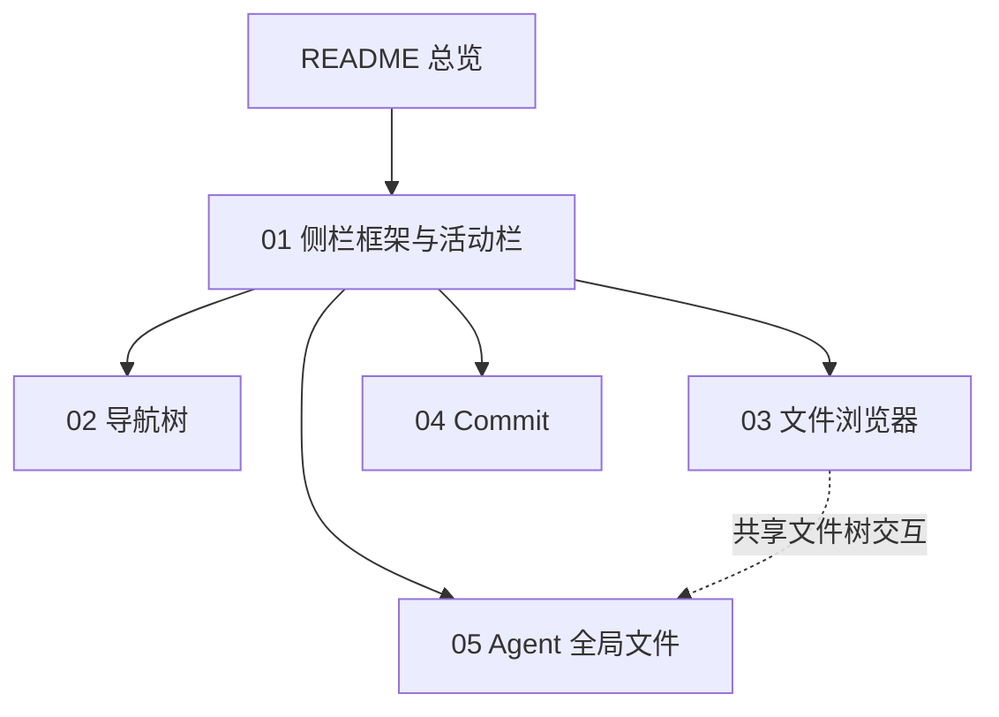

# slTerminal 侧栏功能规格（现状快照）

> 快照日期：2026-10-19
>
> 本文档描述 slTerminal 侧栏系统在当前版本中的实际行为，属于 as-is 现状功能规格。代码是行为的真值源；本文档为一次性快照，不承诺随代码演进同步更新。若文档与代码不一致，以代码为准。
>
> 读者：产品/设计、测试/QA、新成员，以及需要了解侧栏用户可感知行为的开发者。

## 1. 范围

覆盖：

- 活动栏，包括四个视图按钮与底部「配置」钮。
- 侧栏区，包括上下两区、单槽位规则、拖拽、宽度与上下分割比例。
- 四个侧栏视图：导航树、文件浏览器、Commit、Agent 全局文件。
- 视图触发的跨区行为：打开或聚焦主区面板、新建终端、恢复历史会话、通知、套餐余量刷新。只描述触发条件与用户可感知结果，不展开主区面板内部。

不覆盖：

- 主区面板内部（终端、编辑器、diff、文档预览、设置中心页面）。
- 通知系统、后台任务、历史扫描与 git 状态计算的后台实现。
- 主题、颜色、字体、图标视觉规范与代码架构。
- 已退役或当前不存在的侧栏视图、未来可能增加的能力。
- 缺陷修复方案、优先级与排期。

## 2. 术语

领域术语以仓库根目录的 [CONTEXT.md](../../CONTEXT.md) 为准。本篇只补充规格内常用说法：

- **侧栏系统**：活动栏、侧栏区及其交互规则的集合。
- **槽位**：侧栏区上区或下区当前展示一个侧栏视图的位置。每个半区同时只有一个槽位内容。
- **视图记忆**：本次应用运行期间，切换视图或换区后仍能恢复的界面状态，例如文件树展开的目录。视图记忆不代表跨应用重启保留。
- **当前项目 / 活跃页面**：当前活跃操作页面所属的项目；活跃页面是主区正在显示的操作页面。
- **活跃会话**：运行中的编码 CLI 会话在导航树中的行；纯 shell 终端不产生行。
- **历史会话**：编码 CLI 持久化到磁盘的会话记录，可在导航树中展开、恢复或删除。
- **孤儿会话 / 无 cwd 会话**：工作目录已不存在，或没有记录工作目录的历史会话。
- **套餐余量**：编码套餐的剩余可用量或时间窗用量，展示在导航树底部固定区。
- **跨区行为**：在侧栏内触发、结果发生在侧栏之外（主区、系统剪贴板、通知等）的行为。
- **已知限制标签**：各篇「已知限制」统一使用【行为设计】【疑似缺陷】【待产品确认】【无障碍/平台】四类标签。

## 3. 功能总览

### 3.1 入口与默认布局

- 活动栏位于应用最左侧，固定宽 46px，常驻显示，不随侧栏区隐藏而消失。
- 侧栏区位于活动栏与主区之间，默认宽 250px，可在 160–500px 范围内调整。
- 活动栏上区默认排列四个视图按钮：导航树、文件浏览器、Commit、Agent 全局文件；下区默认没有按钮。
- 首次启动默认打开导航树；之后启动恢复上次保存的打开状态。
- 活动栏底部固定「配置」钮，是设置中心唯一入口；它不是第五个侧栏视图，不参与拖拽、排序与持久化。
- 上下两区同时打开视图时，侧栏区上下分割，比例默认 50%，可在 10%–90% 范围内调整。
- 两个半区都没有打开的视图时，侧栏区整体隐藏，主区占满剩余宽度。

### 3.2 视图能力矩阵

| 视图 | 主要用途 | 数据范围 | 主要操作 | 切换视图后的状态 | 文件树快捷键 |
|------|----------|----------|----------|------------------|--------------|
| 导航树 | 项目/页面导航、活跃会话入口、历史会话恢复、套餐余量 | 项目与页面、活跃会话、历史会话 | 项目/页面 CRUD、搜索、刷新历史、恢复或删除历史会话 | 展开、搜索、滚动位置重置 | 无 |
| 文件浏览器 | 浏览当前活跃项目的文件树 | 当前活跃项目根目录 | 展开、选中、打开、新建、重命名、删除、在终端中打开、复制路径 | 展开目录保留到本次运行结束；选中与重命名重置 | Delete / Enter / F2 |
| Commit | 查看当前项目的 Git 变更概览 | 当前活跃项目的 Git 状态 | 折叠列表、双击打开、回滚、删除 | 列表折叠状态重置 | 无 |
| Agent 全局文件 | 浏览编码 CLI 的全局配置目录 | 内置声明全局文件能力的 Agent 配置目录 | 展开、选中、打开、新建、重命名、删除、在终端中打开、复制路径 | Agent 展开集与各树展开目录保留到本次运行结束 | Delete / Enter / F2 |
| 配置钮 | 打开设置中心 | 不适用 | 点击打开设置中心 | 不适用 | 无 |

### 3.3 状态保留矩阵

| 状态对象 | 切换视图后 | 换区/关闭后重开 | 应用重启后 |
|----------|------------|-----------------|------------|
| 视图开关、按钮顺序与上下归属 | 保留 | 保留 | 保留 |
| 侧栏区宽度、上下分割比例 | 保留 | 保留 | 保留 |
| 文件浏览器展开的目录 | 保留 | 保留 | 不保留 |
| 文件浏览器选中项、重命名输入 | 不保留 | 不保留 | 不保留 |
| Agent 节点展开集、各树展开的目录 | 保留 | 保留 | 不保留 |
| 导航树展开状态、搜索词 | 不保留 | 不保留 | 不保留 |
| Commit 列表折叠状态 | 不保留 | 不保留 | 不保留 |
| 各视图滚动位置 | 不保留 | 不保留 | 不保留 |

> 「切换视图」指同一半区从当前视图切换到另一个视图；「换区」指把按钮拖到另一个半区；「关闭后重开」指关闭半区后再次打开同一视图。文件浏览器与 Agent 全局文件的展开状态例外，见对应视图篇。

### 3.4 快捷键矩阵

| 场景 | 快捷键 | 作用 | 生效条件 |
|------|--------|------|----------|
| 文件浏览器 / Agent 全局文件 | Delete | 删除选中项 | 文件树获得焦点且存在选中项 |
| 文件浏览器 / Agent 全局文件 | Enter | 打开选中文件，或展开/收起选中目录 | 文件树获得焦点且存在选中项 |
| 文件浏览器 / Agent 全局文件 | F2 | 重命名选中项 | 文件树获得焦点且存在选中项 |
| 活动栏按钮 | Tab、Enter、Space | 聚焦并激活按钮 | 键盘焦点到达按钮 |
| 导航树 / Commit / 侧栏区 | 无应用级快捷键 | — | — |

> 两个文件树同时打开时，快捷键作用于最后获得焦点的那棵树。

## 4. 文档地图

## 5. 阅读路径

- 产品/设计：先读本篇与 [01-framework.md](01-framework.md)，再按需读四个视图篇。
- 测试/QA：先读本篇的状态保留矩阵与快捷键矩阵，再读各篇的「验收判据」与「已知限制」。
- 新成员：按 [01-framework.md](01-framework.md) → [03-explorer.md](03-explorer.md) → [05-agent-files.md](05-agent-files.md) → [02-nav-tree.md](02-nav-tree.md) → [04-commit.md](04-commit.md) 的顺序阅读。

## 6. 全局边界与非目标

- 本规格描述现状，不规定未来应该怎样；发现的行为差异以各篇「已知限制」记录，不在此提出改进方案。
- 侧栏系统只覆盖单窗口、暗色模式、Windows 桌面场景；不描述多窗口、多实例或触摸优先布局。
- 不描述主区面板内部、设置中心内部、通知系统内部与后台任务实现。
- 不描述主题、颜色、字体与图标视觉规范；图标资源仅作为资料收录。
- 不描述已退役的侧栏视图，也不描述尚未实现的规划功能。
- 侧栏行为以代码为准；本文档不承诺与后续版本同步。

## 7. 资产索引

侧栏使用的品牌位图、活动栏图标、树/列表图标与文件类型图标统一收录在 [assets/README.md](assets/README.md)，其中包含来源与使用位置说明。

- `assets/brand/`：CLI 品牌 logo、套餐来源 logo、应用图标。
- `assets/icons/`：活动栏与树/列表使用的线性图标以及文件类型图标。

## 8. 维护说明

本文档为一次性现状快照，不承诺后续维护。行为变更后如需准确规格，应重新从代码与测试梳理，而不是假定本文档仍然正确。
